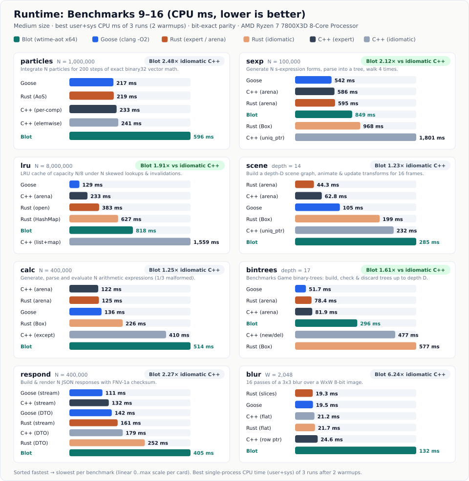
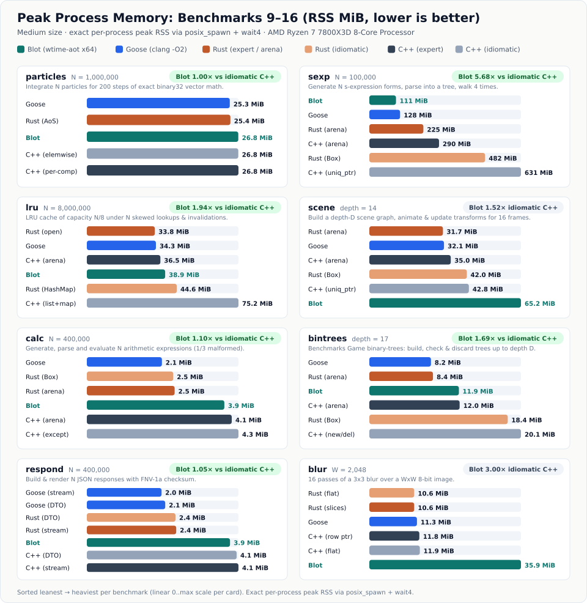
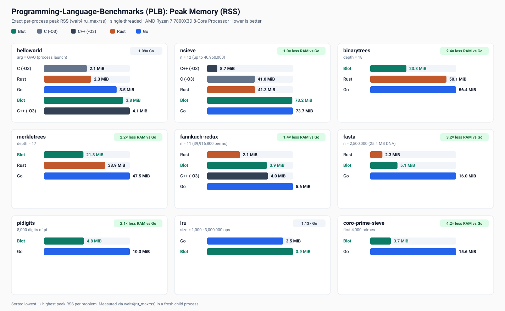

# Blot Benchmarks

Unified index of all recorded Blot benchmark suites, charts, and exact measurements on **AMD Ryzen 7 7800X3D (8C / 16T, Linux `x86_64`)**. Every cross-language workload verifies **bit-exact checksum parity** across implementations.

- [Suite 1: 16-Benchmark Cross-Language Suite (Blot vs Goose, Rust & C++)](#suite-1-16-benchmark-cross-language-suite-blot-vs-goose-rust--c)
- [Suite 2: Compute, Memory & Auto-SIMD Kernels (Blot vs Rust `-O3`, Default & `--wasm3`)](#suite-2-compute-memory--auto-simd-kernels-blot-vs-rust--o3-default---wasm3)
- [Suite 3: AoS Record SIMD, Multi-Core Isolated Guests & Persistent `#process`](#suite-3-aos-record-simd-multi-core-isolated-guests--persistent-process)
- [Suite 4: Ink ECS (Blot `#process`) vs Bevy ECS 0.20.1 (Native Rust)](#suite-4-ink-ecs-blot-process-vs-bevy-ecs-0201-native-rust)
- [Suite 5: Compiler Cold Build, Incremental Edit & Scaling](#suite-5-compiler-cold-build-incremental-edit--scaling)
- [Suite 6: `bddicken/languages` Suite (Blot vs Goose, C, C++ & Rust)](#suite-6-bddickenlanguages-suite-blot-vs-goose-c-c--rust)
- [Suite 7: Programming-Language-Benchmarks (PLB) Suite (Blot vs Go, Rust, C & C++)](#suite-7-programming-language-benchmarks-plb-suite-blot-vs-go-rust-c--c)
- [Regression & Boundary Suites](#regression--boundary-suites)

---

## Suite 1: 16-Benchmark Cross-Language Suite (Blot vs Goose, Rust & C++)

Full mirror of Goose's 16-benchmark main suite at **medium** size across **88 implementations** (**100% bit-exact stdout parity**): **Blot** (`blotc-goose` `b0596602` + `wtime-aot 0.1.7` `4aee74d` x64), **Goose** (`d5ae5bb` + `clang 23.1.5 -O2`), **C++20** (`clang++ 23.1.5 -O2`, idiomatic & expert), and **Rust** (`rustc 1.96.0-nightly -O -C codegen-units=1`, idiomatic & arena/expert).

- **Best of 3 runs** (2 discarded warmups) measuring single-process CPU time (`ru_utime + ru_stime`) and exact per-child peak RSS (`ru_maxrss`) via [`measure_proc.c`](benchmarks/goose-suite/measure_proc.c) (`posix_spawnp` + `wait4`).
- **Details & diagnosis:** [benchmarks/goose-suite/README.md](benchmarks/goose-suite/README.md) · **Raw JSON:** [`results.json`](benchmarks/evidence/measurements/2026-11-26-goose-suite/results.json)

### Geometric Means Across All 16 Benchmarks

- **Runtime (vs C++ expert = `1.00×`, lower is better):** Goose **`0.89×`**, C++ expert **`1.00×`**, Rust expert **`1.07×`**, Rust idiomatic **`1.89×`**, C++ idiomatic **`2.17×`**, Blot (`wtime-aot` x64) **`2.90×`** (`1.34×` idiomatic C++). Blot beats idiomatic C++ on **4/16** (`graph`, `sexp`, `lru`, `bintrees`) and idiomatic Rust on **5/16** (`strlist`, `interp`, `graph`, `sexp`, `bintrees`).
- **Peak Memory (exact per-process RSS vs C++ expert = `1.00×`, lower is better):** Goose **`0.72×`**, Rust expert **`0.86×`**, C++ expert **`1.00×`**, **Blot `1.10×`**, Rust idiomatic **`1.12×`**, C++ idiomatic **`1.30×`**. Blot beats idiomatic C++ on **12/16**, idiomatic Rust on **8/16**, and achieves **#1 lowest RSS of every language** on `words` (`91.2 MiB`) and `sexp` (`111.0 MiB`).
- **Cold Compile Time (geomean full build to native binary / `.so`):** **Blot `30.2 ms`** (`19.3 ms` `blotc-goose` + `10.6 ms` `wtime-aot`, `22.6–40.0 ms` range, **`6.0–33.5 KiB`** `.wasm`) — **`10.2×` faster than C++** (`308.9 ms`), **`5.4×` faster than Goose** (`161.9 ms`), and **`3.5×` faster than Rust** (`105.4 ms`).

### Runtime Charts & Per-Benchmark Results (ms)

### Peak Memory Charts (MiB)

### Compile Speed & Blot `.wasm` Size Chart

### Complete Per-Benchmark Numbers (`medium` size)

- **`sum`** (`N = 16,000,000`) — Time: Blot `213.8 ms`, Goose `64.1 ms`, Rust `62.4 ms`, C++ exp `63.8 ms`, C++ id `78.9 ms` · RSS: Blot `129.2 MiB`, Goose `65.3`, Rust `63.5`, C++ exp `65.0`, C++ id `67.9` · Compile: Blot `30.1 ms` (`22.4 + 7.7`, `6.0 KiB` `.wasm`), Rust `109.5`, Goose `169.0`, C++ `283.9`.
- **`push`** (`N = 16,000,000`) — Time: Blot `194.9 ms`, Goose `57.1 ms`, Rust `61.3 ms`, C++ exp `59.7 ms`, C++ id `79.7 ms` · RSS: Blot `127.7 MiB`, Goose `127.2`, Rust `126.5`, C++ exp `128.0`, C++ id `134.8` · Compile: Blot `30.8 ms` (`22.3 + 8.5`, `8.1 KiB`), Rust `99.9`, Goose `157.1`, C++ `253.9`.
- **`strlist`** (`N = 2,000,000`) — Time: Blot `208.3 ms`, Goose `88.8 ms`, Rust exp `133.1 ms`, Rust id `227.2 ms`, C++ exp `107.6 ms`, C++ id `161.2 ms` · RSS: Blot `77.2 MiB`, Goose `57.3`, Rust exp `60.1`, Rust id `136.4`, C++ exp `60.9`, C++ id `108.1` · Compile: Blot `32.1 ms` (`22.9 + 9.2`, `8.3 KiB`), Rust `136.3`, Goose `175.6`, C++ `365.3`.
- **`records`** (`N = 4,000,000`) — Time: Blot `257.5 ms`, Goose `119.9 ms`, Rust `214.6 ms`, C++ exp `154.0 ms`, C++ id `209.8 ms` · RSS: Blot `91.2 MiB`, Goose `39.3`, Rust `156.6`, C++ exp `100.5`, C++ id `196.5` · Compile: Blot `32.5 ms` (`22.7 + 9.9`, `10.3 KiB`), Rust `120.8`, Goose `177.6`, C++ `522.8`.
- **`tree`** (`depth = 20`) — Time: Blot `165.9 ms`, Goose `59.5 ms`, Rust exp `51.5 ms`, Rust id `120.8 ms`, C++ exp `47.1 ms`, C++ id `151.1 ms` · RSS: Blot `61.2 MiB`, Goose `26.4`, Rust exp `26.5`, Rust id `66.4`, C++ exp `28.0`, C++ id `68.0` · Compile: Blot `31.6 ms` (`21.4 + 10.2`, `10.0 KiB`), Rust `88.8`, Goose `161.7`, C++ `406.7`.
- **`interp`** (`depth = 20`) — Time: Blot `33.4 ms`, Goose `8.9 ms`, Rust exp `14.4 ms`, Rust id `33.9 ms`, C++ exp `12.0 ms`, C++ id `16.3 ms` · RSS: Blot `11.3 MiB`, Goose `4.2`, Rust exp `5.8`, Rust id `11.5`, C++ exp `11.4`, C++ id `13.1` · Compile: Blot `33.9 ms` (`23.1 + 10.8`, `13.3 KiB`), Rust `92.8`, Goose `158.1`, C++ `400.3`.
- **`graph`** (`V = 500,000`) — Time: **Blot `261.4 ms`** (**2.38× vs C++ id**, **1.57× vs Rust id**), Goose `152.4 ms`, Rust exp `147.8 ms`, Rust id `411.3 ms`, C++ exp `126.6 ms`, C++ id `621.2 ms` · RSS: Blot `58.9 MiB`, Goose `58.8`, Rust exp `55.7`, Rust id `51.0`, C++ exp `57.2`, C++ id `51.8` · Compile: Blot `29.6 ms` (`19.3 + 10.3`, `10.0 KiB`), Rust `95.1`, Goose `158.9`, C++ `243.0`.
- **`words`** (`N = 4,000,000`) — Time: Blot `822.2 ms`, Goose `212.8 ms`, Rust exp `362.0 ms`, Rust id `444.4 ms`, C++ exp `353.0 ms`, C++ id `650.5 ms` · RSS: **Blot `91.2 MiB` (#1 lowest)**, Goose `138.1`, Rust id `142.2`, C++ id `148.7`, Rust exp `171.1`, C++ exp `194.7` · Compile: Blot `27.6 ms` (`16.9 + 10.7`, `13.1 KiB`), Rust `128.0`, Goose `167.1`, C++ `368.6`.
- **`particles`** (`N = 1,000,000`) — Time: Blot `596.5 ms`, Goose `216.9 ms`, Rust `218.6 ms`, C++ exp `232.7 ms`, C++ id `240.6 ms` · RSS: Blot `26.8 MiB`, Goose `25.3`, Rust `25.4`, C++ exp `26.8`, C++ id `26.8` · Compile: Blot `22.6 ms` (`14.6 + 8.0`, `8.9 KiB`), Rust `89.5`, Goose `149.5`, C++ `236.5`.
- **`sexp`** (`N = 100,000`) — Time: **Blot `848.7 ms`** (**2.12× vs C++ id**, **1.14× vs Rust id**), Goose `542.2 ms`, Rust exp `594.6 ms`, Rust id `968.3 ms`, C++ exp `585.7 ms`, C++ id `1,800.7 ms` · RSS: **Blot `111.0 MiB` (#1 lowest, 5.68× vs C++ id)**, Goose `127.9`, Rust exp `224.8`, C++ exp `290.0`, Rust id `481.5`, C++ id `630.7` · Compile: Blot `35.5 ms` (`19.3 + 16.2`, `22.0 KiB`), Rust `107.6`, Goose `189.9`, C++ `493.0`.
- **`lru`** (`N = 8,000,000`) — Time: **Blot `818.1 ms`** (**1.91× vs C++ id**), Goose `129.1 ms`, Rust exp `382.9 ms`, Rust id `627.4 ms`, C++ exp `233.4 ms`, C++ id `1,559.2 ms` · RSS: Blot `38.9 MiB` (**1.93× vs C++ id**), Rust exp `33.8`, Goose `34.3`, C++ exp `36.5`, Rust id `44.6`, C++ id `75.2` · Compile: Blot `30.4 ms` (`19.7 + 10.7`, `15.1 KiB`), Rust `116.6`, Goose `148.5`, C++ `222.8`.
- **`scene`** (`depth = 14`) — Time: Blot `284.7 ms`, Goose `105.3 ms`, Rust exp `44.3 ms`, Rust id `198.9 ms`, C++ exp `62.8 ms`, C++ id `231.6 ms` · RSS: Blot `65.2 MiB`, Rust exp `31.7`, Goose `32.1`, C++ exp `35.0`, Rust id `42.0`, C++ id `42.8` · Compile: Blot `31.3 ms` (`18.0 + 13.2`, `19.5 KiB`), Rust `114.7`, Goose `179.5`, C++ `428.8`.
- **`calc`** (`N = 400,000`) — Time: Blot `513.6 ms`, Goose `136.3 ms`, Rust exp `125.4 ms`, Rust id `225.9 ms`, C++ exp `122.4 ms`, C++ id `410.0 ms` · RSS: Blot `3.9 MiB`, Goose `2.1`, Rust `2.5`, C++ exp `4.1`, C++ id `4.3` · Compile: Blot `40.0 ms` (`20.5 + 19.5`, `33.5 KiB`), Rust `150.2`, Goose `235.1`, C++ `388.9`.
- **`bintrees`** (`depth = 17`) — Time: **Blot `296.2 ms`** (**1.61× vs C++ id**, **1.95× vs Rust id**), Goose `51.7 ms`, Rust exp `78.4 ms`, Rust id `576.9 ms`, C++ exp `81.9 ms`, C++ id `476.9 ms` · RSS: Blot `11.9 MiB` (**1.69× vs C++ id**), Goose `8.2`, Rust exp `8.4`, C++ exp `12.0`, Rust id `18.4`, C++ id `20.1` · Compile: Blot `25.1 ms` (`15.4 + 9.7`, `12.1 KiB`), Rust `72.8`, Goose `115.3`, C++ `171.5`.
- **`respond`** (`N = 400,000`) — Time: Blot `405.3 ms`, Goose stream `110.6 ms` (DTO `141.9 ms`), Rust stream `161.4 ms` (DTO `252.5 ms`), C++ stream `131.8 ms` (DTO `178.6 ms`) · RSS: Blot `3.9 MiB`, Goose `2.0–2.1`, Rust `2.4`, C++ `4.1` · Compile: Blot `29.4 ms` (`16.9 + 12.5`, `22.1 KiB`), Rust `110.8`, Goose `157.0`, C++ `281.0`.
- **`blur`** (`W = 2,048`) — Time: Blot `132.1 ms`, Goose `19.5 ms`, Rust slices `19.3 ms` (flat `21.7 ms`), C++ flat `21.2 ms` (row ptr `24.6 ms`) · RSS: Blot `35.9 MiB`, Rust `10.6`, Goose `11.3`, C++ `11.8–11.9` · Compile: Blot `25.3 ms` (`17.1 + 8.2`, `8.2 KiB`), Rust `82.6`, Goose `122.9`, C++ `164.0`.

---

## Suite 2: Compute, Memory & Auto-SIMD Kernels (Blot vs Rust `-O3`, Default & `--wasm3`)

Six compute, memory, sorting, and `spark` auto-SIMD kernels comparing **Blot** (`blotc-goose` `c79a8354` → `wtime-aot 0.1.7` `x64-v4`, explicit software bounds checks, canonical `0x7fc00000` NaN) against **`rustc 1.96.0-nightly -O3`** compiled both to `wasm32 +simd128` (same `wtime-aot 0.1.7`) and native `x86_64` (`-O3`, thin LTO). Medians of 15 runs; **6/6 bit-exact checksum parity**.

- **Source & runner:** [benchmarks/comparison/README.md](benchmarks/comparison/README.md) · **Raw JSON:** [`2026-11-26-rust-and-bevy-ecs-wtime-0.1.7.json`](benchmarks/evidence/measurements/2026-11-26-rust-and-bevy-ecs-wtime-0.1.7.json)

### Per-Kernel Results (Median ms)

- **`lcg_recurrence`** (1,000,000 U32 steps, checksum `54448`): Blot `0.095 ms` (`--wasm3`: `0.100 ms`) vs Rust Wasm `0.370 ms` (**3.88× faster**) vs Native Rust `0.350 ms` (**3.68× faster**).
- **`prime_sieve`** (100k Bool sieve, checksum `1881015445`): Blot `0.062 ms` (`--wasm3`: `0.061 ms`) vs Rust Wasm `0.132 ms` (**2.12× faster**) vs Native Rust `0.068 ms` (**1.09× faster**).
- **`matmul_64`** (64×64 F32 matmul, checksum `6538500`): Blot `0.0173 ms` (`--wasm3`: `0.0213 ms`) vs Rust Wasm `0.0301 ms` (**1.74× faster**) vs Native Rust `0.0197 ms` (**1.14× faster**).
- **`mandelbrot_f32`** (256×256 F32 escape-time, checksum `1686408`): Blot `0.629 ms` (`--wasm3`: `0.697 ms`) vs Rust Wasm `3.906 ms` (**6.21× faster**) vs Native Rust `3.630 ms` (**5.77× faster**).
- **`particle_spark_simd`** (65k × 32 `spark` SIMD, checksum `13338354`): Blot `0.439 ms` (`--wasm3`: `0.436 ms`) vs Rust Wasm `0.613 ms` (**1.40× faster**) vs Native Rust `0.645 ms` (**1.47× faster**).
- **`merge_sort`** (100k U32 ping-pong merge sort, checksum `2814210976`): Blot `4.020 ms` (`--wasm3`: `3.919 ms`) vs Rust Wasm `5.654 ms` (**1.41× faster**) vs Native Rust `5.353 ms` (**1.33× faster**).

---

## Suite 3: AoS Record SIMD, Multi-Core Isolated Guests & Persistent `#process`

Measured on the same `wtime-aot 0.1.7` (`x64-v4`) and native `rustc -O3` harness ([`multicore_aos_bench.blot`](benchmarks/comparison/multicore_aos_bench.blot), [`2026-11-26-rust-and-bevy-ecs-wtime-0.1.7.json`](benchmarks/evidence/measurements/2026-11-26-rust-and-bevy-ecs-wtime-0.1.7.json)):

### AoS Record Auto-SIMD (65,536 particles × 32 ticks, bit-exact checksums)

- **`aos_vec4_euler_65k_x32`** (`#[Vec4]`, checksum `16529059`): Blot `1.575 ms` (`--wasm3`: `1.618 ms`) vs Native Rust `2.880 ms` — **Blot `1.83×` faster**.
- **`aos_vec2_euler_65k_x32`** (`#[Vec2]`, checksum `19009988`): Blot `0.813 ms` (`--wasm3`: `0.798 ms`) vs Native Rust `0.539 ms` — Blot `1.51×` (`1.48×` `--wasm3`).

### Multi-Core Isolated Guests (`mandelbrot`, 8 × 256×256 tiles, checksum `13500030`)

- **1 thread:** Blot `5.735 ms` (`1.00×`) vs Native Rust `30.574 ms` (**Blot `5.33×` faster**).
- **2 threads:** Blot `3.235 ms` (`1.77×` scaling) vs Native Rust `16.310 ms` (**Blot `5.04×` faster**).
- **4 threads:** Blot `1.948 ms` (`2.94×` scaling) vs Native Rust `8.699 ms` (**Blot `4.47×` faster**).
- **8 threads:** Blot `1.237 ms` (`4.64×` scaling) vs Native Rust `4.536 ms` (**Blot `3.67×` faster**).

### Persistent `#process` (`particle_sim`, 4,096 particles, zero-alloc state commits)

- **No-op commit step:** **`53.1 ns/step`** (**`18.83M` steps/sec**).
- **Full AoS `Vec4` physics step (4,096 particles):** **`2.03 µs/step`**.

---

## Suite 4: Ink ECS (Blot `#process`) vs Bevy ECS 0.20.1 (Native Rust)

Real 10,000-entity ECS worlds comparing **Ink ECS** (`ink/ecs` + `ink/ecs/query` compiled by `blotc-goose` to `79.8 KiB` `.wasm` on `wtime-aot 0.1.7`) against native **Bevy ECS `0.20.1`** (`rustc -O3`). Medians of 15 runs; bit-exact checksum parity on `dense_iter`, `sparse_filtered_iter`, and `batch_spawn` ([`ink_ecs_bench.blot`](benchmarks/comparison/ink_ecs_bench.blot), [`2026-11-26-rust-and-bevy-ecs-wtime-0.1.7.json`](benchmarks/evidence/measurements/2026-11-26-rust-and-bevy-ecs-wtime-0.1.7.json)):

- **`dense_iter_10k_x100`** (`Pos += Vel`, 10k × 100 ticks, checksum `88466466`):
  - Blot SoA + `spark` SIMD: **`0.291 ms`** (**`4.40×` faster** than Bevy)
  - Ink ECS (`Pool` direct): **`0.605 ms`** (**`2.12×` faster** than Bevy)
  - Bevy ECS (native): `1.281 ms`
  - Ink ECS (cached query): `1.354 ms` (`1.06×` Bevy)
- **`sparse_filtered_iter_500_of_10k_x100`** (`With Active`, `Without Frozen`, checksum `71214832`): Bevy `0.069 ms` vs Ink cached query `0.081 ms` (`1.17×` Bevy).
- **`batch_spawn_10k`** (`Pos + Vel + 10% Active`, checksum `70292880`): **Ink `0.093 ms`** vs Bevy `0.330 ms` (**`3.57×` faster**).
- **`structural_churn_2000_tag_ops`** (insert/remove `Active` on 10k world): **Ink `25.9 µs`** vs Bevy `82.6 µs` (**`3.19×` faster**).
- **`world_snapshot_copy_10k`** (clone all 5 pools vs Bevy world rebuild): **Ink `16.2 µs`** vs Bevy `419.7 µs` (**`25.9×` faster**).
- **Ink ECS app build:** `26.3 ms` `blotc-goose` + `9.0 ms` `wtime-aot` (`79.8 KiB` `.wasm`).

---

## Suite 5: Compiler Cold Build, Incremental Edit & Scaling

- **6-kernel benchmark app (`blot_kernels.blot`):** `13.6 ms` cold `blotc-goose` (+ `5.2 ms` `wtime-aot`, `22.5 KiB` `.wasm`) vs `96.0 ms` `rustc -O3 wasm32` (**`7.0×` faster**, **`65×` smaller** than `1,468 KiB` `.wasm`) and `87.1 ms` `rustc -O3` native rlib.
- **16-benchmark Goose suite:** `30.2 ms` geomean cold build (`19.3 ms` `blotc-goose` + `10.6 ms` `wtime-aot`, `6.0–33.5 KiB` `.wasm`) vs `105.4 ms` `rustc -O` (`3.5×`), `161.9 ms` `goose + clang -O2` (`5.4×`), and `308.9 ms` `clang++ -O2` (`10.2×`).
- **Anonymous internal 3D game project:** ~**69k LOC** of Blot across **263** source modules + **62** shader/data asset modules (**325 modules / 4,572 functions / 6.71 MB `.wasm`**) — **~0.43–0.55 s** full cold build, **~41–44 ms** `fresh=1` single-file incremental edit, **~20 ms** literal/comment edit.
- **Synthetic 1M LOC scaling:** **~0.50 s** (**~2.0M LOC/s**).

---

## Suite 6: `bddicken/languages` Suite (Blot vs Goose, C, C++ & Rust)

All four workloads from [`bddicken/languages`](https://github.com/bddicken/languages) comparing **Blot** (`blotc-goose` + `wtime-aot 0.1.7`, x64 native) against unmodified official C (`clang -O3`), C++ (`clang++ -O3 -march=native`), Rust (`cargo build --release`), and Goose (`clang -O3`). In-process benchmark loops (`500 ms` warmup, `2,000 ms` run window, best mean across 3 interleaved reps; `hello-world`: median wall ms over 100 launches); **100% verified outputs**.

- **Details & runner:** [benchmarks/bddicken/README.md](benchmarks/bddicken/README.md) · **Raw JSON:** [`results.json`](benchmarks/evidence/measurements/2026-11-26-bddicken/results.json)

- **`fibonacci(37)`** (`24,157,817`): Goose `85.5 ms`, Rust `99.3 ms`, C++ `110.4 ms`, C `112.3 ms`, Blot `211.4 ms` (`1.88×` C; compile `35.5 ms`, `4.0 KiB` `.wasm`).
- **`loops(40)`** (`10,000 × 10,000` modulo sum): Goose `80.2 ms`, C++ `189.7 ms`, C `191.4 ms`, Rust `196.5 ms`, Blot `206.2 ms` (`1.08×` C; best min `129.0 ms` vs C `127.9 ms`).
- **`levenshtein`** (72 words, `2,556` pairs, sum `554,324`): Goose `71.8 ms`, Rust `87.6 ms`, C++ `97.4 ms`, C `108.5 ms`, Blot `174.4 ms` (`1.61×` C).
- **`hello-world`** (100 launches, `Hello, World!`): Rust `1.70 ms`, C `1.72 ms`, Goose `1.93 ms`, **Blot `2.15 ms`** (beats C++ `2.62 ms`).

---

## Suite 7: Programming-Language-Benchmarks (PLB) Suite (Blot vs Go, Rust, C & C++)

Nine workloads from [`hanabi1224/Programming-Language-Benchmarks`](https://github.com/hanabi1224/Programming-Language-Benchmarks) comparing **Blot** (`blotc-goose` + `wtime-aot 0.1.7`, x64 native) against unmodified official PLB **Go (`1.27.4`)**, **Rust (`rustc -O -C lto=fat`)**, **C (`clang -O3`)**, and **C++ (`clang++ -O3`)** reference sources (`GOMAXPROCS=1`, `OMP_NUM_THREADS=1`). Best single-process CPU time (`helloworld`: median wall ms over 15 launches) and median peak RSS via [`measure_proc.c`](benchmarks/goose-suite/measure_proc.c); **100% official unittest pass + identical full-input stdout SHA-256 across all languages**.

- **Details, fairness notes & runner:** [benchmarks/plb/README.md](benchmarks/plb/README.md) · **Raw JSON:** [`results.json`](benchmarks/evidence/measurements/2026-11-26-plb/results.json)

- **`helloworld`** (`QwQ`): **Blot `2.04 ms` wall** (`0.55 ms` CPU, `3.8 MiB`) vs Rust `2.07 ms`, C `2.23 ms`, C++ `3.37 ms`, Go `4.64 ms`.
- **`nsieve`** (`12`, up to `40,960,000`): C++ `214.2 ms` (`8.8 MiB`), Go `329.5 ms` (`71.8 MiB`), Rust `373.3 ms` (`41.4 MiB`), **Blot `377.8 ms` (`13.7 MiB`)** (beats C `392.2 ms`, `3×` less RAM than C/Rust, `5.2×` less than Go).
- **`binarytrees`** (`18`): **Blot `1.13 s` (`23.7 MiB`)** — **`2.12×` faster than Go** (`2.40 s`, `45.3 MiB`) and **`2.58×` faster than Rust `3.rs`** (`2.92 s`, `50.2 MiB`).
- **`merkletrees`** (`17`): Rust `1.25 s` (`34.1 MiB`), **Blot `1.62 s` (`26.0 MiB`, lowest RSS)**, Go `1.62 s` (`39.2 MiB`).
- **`fannkuch-redux`** (`11`): C++ `1.03 s` (`4.0 MiB`), Go `1.62 s` (`5.6 MiB`), Rust `2.07 s` (`2.2 MiB`), Blot `2.92 s` (`3.9 MiB`, `1.41×` Rust).
- **`fasta`** (`2,500,000`, `25.4 MB`): Rust `160.8 ms` (`2.1 MiB`), **Blot `191.0 ms` (`5.2 MiB`)** (**`1.27×` faster than Go** `241.6 ms`, `13.8 MiB`).
- **`pidigits`** (`8,000` digits): Go `math/big` `714.0 ms` (`10.2 MiB`) vs Blot pure-`U32` base-`2^15` spigot `10.13 s` (`4.5 MiB`).
- **`lru`** (`1,000`, `3,000,000` ops): **Blot `93.2 ms` (`3.9 MiB`)** — **`2.59×` faster than Go** (`241.0 ms`, `3.5 MiB`).
- **`coro-prime-sieve`** (`4,000`): **Blot `10.8 ms` (`3.9 MiB`)** (iterative filter chain) vs Go `1.go` `825.5 ms` (`15.4 MiB`, 4,000 goroutines).

---

## Regression & Boundary Suites

Additional specialized suites and historical measurement archives live under [`benchmarks/`](benchmarks/):

- **Checked array & grid workloads (Wasmtime):** [benchmarks/checked-grid/README.md](benchmarks/checked-grid/README.md)
- **Runtime representation boundaries (Deno/V8, Wasmtime, Firefox):** [benchmarks/runtime-boundaries/README.md](benchmarks/runtime-boundaries/README.md)
- **Earlier `wtime-aot` baselines & compiler micro-measurements:** [`benchmarks/evidence/measurements/`](benchmarks/evidence/measurements/) (`2026-11-26-rust-and-bevy-ecs-wtime-0.1.6.json`, `2026-11-25-rust-and-bevy-ecs-wtime-0.1.3.json`, `2026-11-24-rust-and-bevy-ecs.json`).
