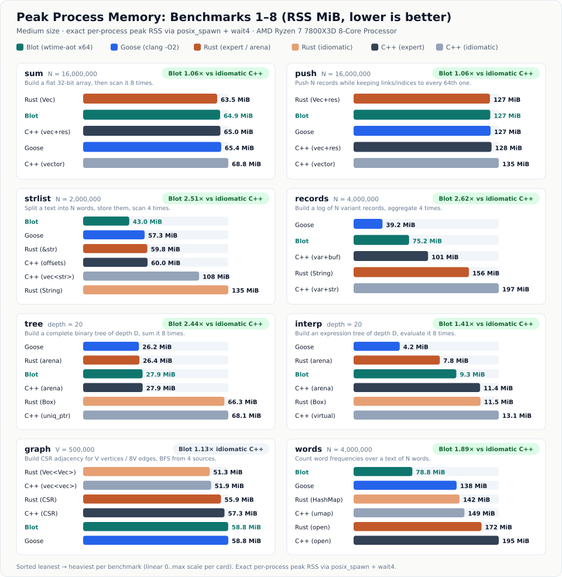

# Blot Benchmarks

Unified index of all recorded Blot benchmark suites, charts, and exact measurements on **AMD Ryzen 7 7800X3D (8C / 16T, Linux `x86_64`)**. Every cross-language workload verifies **bit-exact checksum parity** across implementations.

- [Suite 1: 16-Benchmark Cross-Language Suite (Blot vs Goose, Rust & C++)](#suite-1-16-benchmark-cross-language-suite-blot-vs-goose-rust--c)
- [Suite 2: Compute, Memory & Auto-SIMD Kernels (Blot vs Rust `-O3`, Default & `--wasm3`)](#suite-2-compute-memory--auto-simd-kernels-blot-vs-rust--o3-default---wasm3)
- [Suite 3: AoS Record SIMD, Multi-Core Isolated Guests & Persistent `#process`](#suite-3-aos-record-simd-multi-core-isolated-guests--persistent-process)
- [Suite 4: Ink ECS (Blot `#process`) vs Bevy ECS 0.20.1 (Native Rust)](#suite-4-ink-ecs-blot-process-vs-bevy-ecs-0201-native-rust)
- [Suite 5: Compiler Cold Build, Incremental Edit & Scaling](#suite-5-compiler-cold-build-incremental-edit--scaling)
- [Suite 6: `bddicken/languages` Suite (Blot vs Goose, C, C++ & Rust)](#suite-6-bddickenlanguages-suite-blot-vs-goose-c-c--rust)
- [Suite 7: Programming-Language-Benchmarks (PLB) Suite (Blot vs Go, Rust, C & C++)](#suite-7-programming-language-benchmarks-plb-suite-blot-vs-go-rust-c--c)
- [Regression & Boundary Suites](#regression--boundary-suites)

---

## Suite 1: 16-Benchmark Cross-Language Suite (Blot vs Goose, Rust & C++)

Full mirror of Goose's 16-benchmark main suite at **medium** size across **88 implementations** (**100% bit-exact stdout parity**): **Blot** (`blotc-goose` `f9ce96db` with native `U8`/`I32`/`U64`/`I64`/`F64`, `F64x2`/`U64x2`/`U8x16`/`I16x8` unboxed `v128` SIMD, whole-program unobservable-NaN canonicalization elision, Mode-4 `v128` wide-float recursive worker ABI + shared `v128.store` packing, direct `.rodata` constant tables & literal appends, recursive SCC Mode-R/Mode-M descriptor workers with `no_scope_alloc` elision, right-spine associative TCO, 1-level leaf peeling, and external direct worker dispatch, wide-aggregate leaf inlining, hoisted loop `CheckedGrow`/`CheckedArray` checks, masked/2-pointer/affine bounds hoisting with zero-duplication `mask == len - 1` proofs, proven `knownMutable` & non-resizing `own`-helper preservation, stack-backed top-level `Array.with_capacity`, `OP_br_table`, boxed-array direct projection & subfield updates, function-exit reclamation, and scalar-packed `DirectArray` stack/register inlining + `wtime-aot 0.1.10` `acb4fed` x64 `--guard-pages`), **Goose** (`d5ae5bb` + `clang 23.1.5 -O2`), **C++20** (`clang++ 23.1.5 -O2`, idiomatic & expert), and **Rust** (`rustc 1.96.0-nightly -O -C codegen-units=1`, idiomatic & arena/expert).

- **Best of 3 runs** (2 discarded warmups) measuring single-process CPU time (`ru_utime + ru_stime`) and exact per-child peak RSS (`ru_maxrss`) via [`measure_proc.c`](benchmarks/goose-suite/measure_proc.c) (`posix_spawnp` + `wait4`).
- **Details & diagnosis:** [benchmarks/goose-suite/README.md](benchmarks/goose-suite/README.md) · **Raw JSON:** [`results.json`](benchmarks/evidence/measurements/2026-11-27-goose-suite/results.json) (previous Nov 26 baseline preserved in [`2026-11-26-goose-suite/`](benchmarks/evidence/measurements/2026-11-26-goose-suite/results.json))

### Geometric Means Across All 16 Benchmarks

- **Runtime (vs C++ expert = `1.00×`, lower is better):** Goose **`0.93×`**, C++ expert **`1.00×`**, Rust expert **`1.05×`**, **Blot (`wtime-aot` x64 `--guard-pages`) `1.09×`** (down from `1.15×` Wave A, `1.41×` pre-Wave-A on Nov 27, `2.07×` on Nov 26, and `2.90×` earlier — **`0.54×` of idiomatic C++** at `1.99×` = **`1.84×` faster**, **`0.64×` of idiomatic Rust** at `1.70×` = **`1.57×` faster**, and **`1.17×` of Goose**; excluding `particles`, **`1.15×` C++ expert / `1.25×` Goose**). Blot beats idiomatic C++ on **14/16** benchmarks (`push`, `strlist`, `records`, `tree`, `interp`, `graph`, `words`, `particles`, `sexp`, `lru`, `scene`, `calc`, `bintrees`, `respond`), beats idiomatic Rust on **13/16** (`strlist`, `records`, `tree`, `interp`, `graph`, `words`, `particles`, `sexp`, `lru`, `scene`, `calc`, `bintrees`, `respond`), beats **C++ expert** on **5/16** (`push` `43.0 vs 43.4 ms`, `strlist` `73.5 vs 74.3 ms`, `records` `107.8 vs 121.1 ms`, `particles` `83.1 vs 185.6 ms`, `bintrees` `65.3 vs 86.5 ms`), beats **Rust expert** on **4/16** (`strlist`, `records`, `particles`, `bintrees`), beats **Goose** on **2/16** (`particles` `83.1 vs 192.5 ms`, `blur` `28.0 vs 29.8 ms`) while tying Goose on `strlist` (`73.5 vs 73.3 ms`) and `records` (`107.8 vs 107.3 ms`), and finishes **#1 fastest overall** on `particles`. Notable Wave B (`f9ce96db`) compiler speedups on top of Wave A (`1.15× → 1.09×` geomean): `particles` **`141.8 → 83.1 ms` (`1.71×`)**, `scene` **`66.4 → 58.9 ms` (`1.13×`)**, `interp` **`10.8 → 9.7 ms` (`1.12×`)**, `blur` **`29.5 → 28.0 ms` (`1.05×`)**, `words` **`199.4 → 190.9 ms` (`1.04×`)**, `lru` **`190.6 → 183.0 ms` (`1.04×`)**.
- **Peak Memory (exact per-process RSS vs C++ expert = `1.00×`, lower is better):** Goose **`0.73×`**, **Blot `0.86×`** (down from `1.03×` on Nov 26, **#2 lowest peak memory in the suite** — ahead of Rust expert **`0.87×`**, C++ expert **`1.00×`**, Rust idiomatic **`1.12×`**, and C++ idiomatic **`1.31×`**). Blot beats idiomatic C++ on **14/16**, C++ expert on **12/16**, idiomatic Rust on **8/16**, Goose on **6/16**, achieves **#1 lowest RSS of every language** on `strlist` (`43.4 MiB`), `words` (`79.6 MiB`), and `sexp` (`109.2 MiB`), and cuts `sum` (`129.3 → 64.9 MiB`) and `tree` (`61.1 → 27.8 MiB`) peak RSS in half via `Array.with_capacity`.
- **Cold Compile Time (geomean full build to native binary / `.so`):** **Blot `25.4 ms`** (`16.5 ms` `blotc-goose` + `8.8 ms` `wtime-aot`, `22.2–30.3 ms` range, **`5.6–17.0 KiB`** `.wasm`) — **`9.2×` faster than C++** (`234.5 ms`), **`5.1×` faster than Goose** (`128.2 ms`), and **`3.4×` faster than Rust** (`85.4 ms`).

### Runtime Charts & Per-Benchmark Results (ms)

### Peak Memory Charts (MiB)

### Compile Speed & Blot `.wasm` Size Chart

### Complete Per-Benchmark Numbers (`medium` size)

- **`sum`** (`N = 16,000,000`) — Time: **Blot `59.9 ms`** (down `1.55×` from `92.8 ms`), Goose `47.8 ms`, Rust `49.7 ms`, C++ exp `50.8 ms`, C++ id `52.5 ms` · RSS: **Blot `64.9 MiB`** (halved from `129.3 MiB`, beats C++ id `67.9` & Goose `65.2`), Rust `63.5`, C++ exp `64.8` · Compile: Blot `22.2 ms` (`15.3 + 6.9`, `5.6 KiB` `.wasm`).
- **`push`** (`N = 16,000,000`) — Time: **Blot `43.0 ms`** (**beats C++ exp `43.4 ms`**, **1.22× vs C++ id**, down `1.60×` from `68.6 ms`), Goose `36.3 ms`, Rust `39.7 ms`, C++ id `52.3 ms` · RSS: Blot `126.9 MiB` (beats C++ exp `128.0`, C++ id `134.8` & Goose `127.2`), Rust `126.5` · Compile: Blot `22.4 ms` (`14.6 + 7.8`, `6.9 KiB`).
- **`strlist`** (`N = 2,000,000`) — Time: **Blot `73.5 ms`** (**beats C++ exp `74.3 ms`**, **beats Rust exp `86.9 ms` by 1.18×**, **1.46× vs C++ id**, **1.88× vs Rust id**, ties Goose `73.3 ms`), C++ id `107.5 ms`, Rust id `138.3 ms` · RSS: **Blot `43.4 MiB` (#1 lowest overall)**, Goose `57.1`, Rust exp `59.6`, C++ exp `60.1`, C++ id `109.9`, Rust id `136.2` · Compile: Blot `23.9 ms` (`16.3 + 7.6`, `6.6 KiB`).
- **`records`** (`N = 4,000,000`) — Time: **Blot `107.8 ms`** (**beats C++ exp `121.1 ms` by 1.12×**, **1.50× vs C++ id**, **1.48× vs Rust**, ties Goose `107.3 ms`), Rust `159.8 ms`, C++ id `161.8 ms` · RSS: Blot `74.0 MiB` (**2.65× vs C++ id**, **2.12× vs Rust**), Goose `39.2`, C++ exp `100.4`, Rust `156.6`, C++ id `196.4` · Compile: Blot `23.5 ms` (`15.7 + 7.8`, `7.2 KiB`).
- **`tree`** (`depth = 20`) — Time: **Blot `30.9 ms`** (Mode-M/R recursive workers + 1-level leaf peeling + right-spine `I64` TCO, down `1.77×` from `54.7 ms` and `3.45×` from `106.8 ms`, **2.74× vs C++ id**, **2.47× vs Rust id**), Goose `24.7 ms`, C++ exp `25.3 ms`, Rust exp `25.4 ms`, Rust id `76.3 ms`, C++ id `84.8 ms` · RSS: **Blot `27.8 MiB`** (down from `61.1 MiB`, beats C++ exp `27.9 MiB`, **2.45× vs C++ id**), Goose `26.3`, Rust exp `26.5`, Rust id `66.3`, C++ id `68.0` · Compile: Blot `24.1 ms` (`16.0 + 8.1`, `6.8 KiB`).
- **`interp`** (`depth = 20`) — Time: **Blot `9.7 ms`** (Mode-M `build_rec` + Mode-R `eval_rec` workers + external direct worker calls, down `1.95×` from `18.9 ms`, **1.39× vs C++ id**, **1.57× vs Rust id**, within `1.7%` of Rust exp `9.5 ms`), C++ exp `7.3 ms`, Goose `7.9 ms`, Rust exp `9.5 ms`, C++ id `13.4 ms`, Rust id `15.2 ms` · RSS: Blot `8.1 MiB` (beats C++ exp `11.4` & Rust id `11.5`), Goose `4.2`, Rust exp `7.7`, C++ id `13.2` · Compile: Blot `22.4 ms` (`15.0 + 7.4`, `6.7 KiB`).
- **`graph`** (`V = 500,000`) — Time: **Blot `85.2 ms`** (**2.37× vs C++ id**, **1.65× vs Rust id**, within `0.2%` of C++ exp `85.1 ms` & `0.6%` of Rust exp `84.7 ms`), Goose `70.7 ms`, Rust id `140.6 ms`, C++ id `201.7 ms` · RSS: Blot `57.2 MiB` (beats Goose `59.0`), C++ exp `57.1`, Rust exp `55.9`, C++ id `51.9`, Rust id `50.9` · Compile: Blot `25.8 ms` (`16.8 + 9.0`, `8.2 KiB`).
- **`words`** (`N = 4,000,000`) — Time: **Blot `190.9 ms`** (hoisted masked loop-carry BCE + `mask == len - 1` zero-duplication proof + `Array.view` inlining, **1.48× vs C++ id `282.7 ms`**, **1.37× vs Rust `HashMap` `261.5 ms`**, down from `215.5 ms` and `351.2 ms`), Goose `124.4 ms`, C++ exp `159.9 ms`, Rust exp `181.2 ms` · RSS: **Blot `79.6 MiB` (#1 lowest overall, 1.87× vs C++ id)**, Goose `138.3`, Rust id `142.4`, C++ id `148.7`, Rust exp `171.2`, C++ exp `194.8` · Compile: Blot `25.7 ms` (`16.0 + 9.7`, `8.9 KiB`).
- **`particles`** (`N = 1,000,000`) — Time: **Blot SoA 4-wide SIMD `83.1 ms` (#1 fastest overall)** (whole-program unobservable-NaN elision, down `1.71×` from `141.8 ms`) — **`2.23×` faster than C++ exp** `185.6 ms`, **`2.24×` faster than Rust** `186.3 ms`, **`2.32×` faster than Goose** `192.5 ms`, and **`2.63×` faster than C++ id** `218.7 ms` · RSS: Blot `26.8 MiB`, Goose `25.1`, Rust `25.4`, C++ `26.8` · Compile: Blot `28.2 ms` (`19.6 + 8.6`, `9.4 KiB`).
- **`sexp`** (`N = 100,000`) — Time: **Blot `576.3 ms`** (Mode-M `gen_form` + Mode-R `walk_list` workers + `no_scope_alloc` elision, **2.01× vs C++ id**, **1.48× vs Rust id**), Goose `406.7 ms`, Rust exp `433.3 ms`, C++ exp `439.5 ms`, Rust id `851.4 ms`, C++ id `1,156.9 ms` · RSS: **Blot `109.2 MiB` (#1 lowest overall, 5.78× vs C++ id)**, Goose `128.0`, Rust exp `225.9`, C++ exp `292.0`, Rust id `481.4`, C++ id `631.5` · Compile: Blot `26.4 ms` (`17.0 + 9.4`, `11.8 KiB`).
- **`lru`** (`N = 8,000,000`) — Time: **Blot `183.0 ms`** (same-array `ifNode` merge reuse + Slot `CheckedMask`/`CheckedBound` propagation + zero hot-loop `runtime.check`, down `1.25×` from `228.1 ms` and `2.12×` from `388.2 ms`, **2.76× vs C++ id**, **1.52× vs Rust id**), Goose `120.3 ms`, C++ exp `129.6 ms`, Rust exp `135.5 ms`, Rust id `278.7 ms`, C++ id `505.6 ms` · RSS: Blot `39.0 MiB` (**1.94× vs C++ id**, beats Rust id `45.1`), Goose `34.3`, Rust exp `34.4`, C++ exp `35.9`, C++ id `75.5` · Compile: Blot `27.0 ms` (`17.7 + 9.3`, `10.9 KiB`).
- **`scene`** (`depth = 14`) — Time: **Blot `58.9 ms`** (unobservable-NaN elision + Mode-4 `v128` 12-`F32` worker ABI + shared `storeAtPack` `v128.store`, down `1.13×` from Wave A `66.4 ms`, `1.74×` from `102.3 ms`, and `3.55×` from Nov 26 `208.9 ms`, **1.56× vs C++ id `91.7 ms`**, **1.36× vs Rust id `79.9 ms`**), Rust exp `43.5 ms`, Goose `43.8 ms`, C++ exp `46.6 ms` · RSS: Blot `57.5 MiB` (down from `65.2 MiB`), Goose `32.2`, Rust exp `32.4`, C++ exp `35.0`, Rust id `41.9`, C++ id `42.7` · Compile: Blot `27.5 ms` (`17.7 + 9.7`, `9.5 KiB`).
- **`calc`** (`N = 400,000`) — Time: **Blot `177.9 ms`** (3-function mutual-SCC Mode-R/Mode-M parser workers + external direct worker calls, down `1.39×` from `247.9 ms` and `1.98×` from `352.5 ms`, **2.25× vs C++ id**, **1.21× vs Rust id `215.9 ms`**), C++ exp `119.9 ms`, Goose `121.6 ms`, Rust exp `150.7 ms`, C++ id `399.5 ms` · RSS: Blot `3.9 MiB`, Goose `2.3`, Rust `2.5`, C++ `4.1–4.3` · Compile: Blot `30.3 ms` (`17.8 + 12.5`, `17.0 KiB`).
- **`bintrees`** (`depth = 17`) — Time: **Blot `65.3 ms`** (Mode-M/R workers + 1-level leaf peeling + right-spine `U32` TCO, down `2.98×` from `194.5 ms` and `4.80×` from `312.9 ms`, **beats C++ exp `86.5 ms` by 1.33×**, **beats Rust exp `72.3 ms` by 1.11×**, **10.26× vs C++ id**, **8.58× vs Rust id**), Goose `50.9 ms`, Rust id `559.6 ms`, C++ id `669.2 ms` · RSS: Blot `11.2 MiB` (**1.79× vs C++ id**, beats C++ exp `11.9 MiB`), Goose `8.2`, Rust exp `8.6`, Rust id `18.4`, C++ id `20.1` · Compile: Blot `23.7 ms` (`15.0 + 8.7`, `8.0 KiB`).
- **`respond`** (`N = 400,000`) — Time: **Blot `184.6 ms`** (`.rodata` literal appends + scalar-packed `DirectArray` digit buffer, down `1.23×` from `226.4 ms`, **beats Goose DTO `188.8 ms`**, **1.31× vs C++ DTO `242.5 ms`**, **1.36× vs Rust DTO `251.0 ms`**), C++ stream `133.4 ms`, Goose stream `136.5 ms`, Rust stream `169.4 ms` · RSS: Blot `4.0 MiB`, Goose `2.2`, Rust `2.4–2.5`, C++ `4.1` · Compile: Blot `26.9 ms` (`16.0 + 10.9`, `10.8 KiB`).
- **`blur`** (`W = 2,048`) — Time: **Blot 16-wide `U8x16`/`I16x8` SIMD `28.0 ms`** (**beats Goose `29.8 ms`**, down `4.26×` from Nov 26 `119.3 ms`), Rust `19.9–20.8 ms`, C++ `21.7–24.4 ms` · RSS: **Blot `11.9 MiB`** (beats C++ `12.0 MiB`, Goose `11.3`, Rust `10.6`) · Compile: Blot `27.9 ms` (`18.8 + 9.1`, `8.1 KiB`).

---

## Suite 2: Compute, Memory & Auto-SIMD Kernels (Blot vs Rust `-O3`, Default & `--wasm3`)

Six compute, memory, sorting, and `spark` auto-SIMD kernels comparing **Blot** (`blotc-goose` `c79a8354` → `wtime-aot 0.1.7` `x64-v4`, explicit software bounds checks, canonical `0x7fc00000` NaN) against **`rustc 1.96.0-nightly -O3`** compiled both to `wasm32 +simd128` (same `wtime-aot 0.1.7`) and native `x86_64` (`-O3`, thin LTO). Medians of 15 runs; **6/6 bit-exact checksum parity**.

- **Source & runner:** [benchmarks/comparison/README.md](benchmarks/comparison/README.md) · **Raw JSON:** [`2026-11-26-rust-and-bevy-ecs-wtime-0.1.7.json`](benchmarks/evidence/measurements/2026-11-26-rust-and-bevy-ecs-wtime-0.1.7.json)

### Per-Kernel Results (Median ms)

- **`lcg_recurrence`** (1,000,000 U32 steps, checksum `54448`): Blot `0.095 ms` (`--wasm3`: `0.100 ms`) vs Rust Wasm `0.370 ms` (**3.88× faster**) vs Native Rust `0.350 ms` (**3.68× faster**).
- **`prime_sieve`** (100k Bool sieve, checksum `1881015445`): Blot `0.062 ms` (`--wasm3`: `0.061 ms`) vs Rust Wasm `0.132 ms` (**2.12× faster**) vs Native Rust `0.068 ms` (**1.09× faster**).
- **`matmul_64`** (64×64 F32 matmul, checksum `6538500`): Blot `0.0173 ms` (`--wasm3`: `0.0213 ms`) vs Rust Wasm `0.0301 ms` (**1.74× faster**) vs Native Rust `0.0197 ms` (**1.14× faster**).
- **`mandelbrot_f32`** (256×256 F32 escape-time, checksum `1686408`): Blot `0.629 ms` (`--wasm3`: `0.697 ms`) vs Rust Wasm `3.906 ms` (**6.21× faster**) vs Native Rust `3.630 ms` (**5.77× faster**).
- **`particle_spark_simd`** (65k × 32 `spark` SIMD, checksum `13338354`): Blot `0.439 ms` (`--wasm3`: `0.436 ms`) vs Rust Wasm `0.613 ms` (**1.40× faster**) vs Native Rust `0.645 ms` (**1.47× faster**).
- **`merge_sort`** (100k U32 ping-pong merge sort, checksum `2814210976`): Blot `4.020 ms` (`--wasm3`: `3.919 ms`) vs Rust Wasm `5.654 ms` (**1.41× faster**) vs Native Rust `5.353 ms` (**1.33× faster**).

---

## Suite 3: AoS Record SIMD, Multi-Core Isolated Guests & Persistent `#process`

Measured on the same `wtime-aot 0.1.7` (`x64-v4`) and native `rustc -O3` harness ([`multicore_aos_bench.blot`](benchmarks/comparison/multicore_aos_bench.blot), [`2026-11-26-rust-and-bevy-ecs-wtime-0.1.7.json`](benchmarks/evidence/measurements/2026-11-26-rust-and-bevy-ecs-wtime-0.1.7.json)):

### AoS Record Auto-SIMD (65,536 particles × 32 ticks, bit-exact checksums)

- **`aos_vec4_euler_65k_x32`** (`#[Vec4]`, checksum `16529059`): Blot `1.575 ms` (`--wasm3`: `1.618 ms`) vs Native Rust `2.880 ms` — **Blot `1.83×` faster**.
- **`aos_vec2_euler_65k_x32`** (`#[Vec2]`, checksum `19009988`): Blot `0.813 ms` (`--wasm3`: `0.798 ms`) vs Native Rust `0.539 ms` — Blot `1.51×` (`1.48×` `--wasm3`).

### Multi-Core Isolated Guests (`mandelbrot`, 8 × 256×256 tiles, checksum `13500030`)

- **1 thread:** Blot `5.735 ms` (`1.00×`) vs Native Rust `30.574 ms` (**Blot `5.33×` faster**).
- **2 threads:** Blot `3.235 ms` (`1.77×` scaling) vs Native Rust `16.310 ms` (**Blot `5.04×` faster**).
- **4 threads:** Blot `1.948 ms` (`2.94×` scaling) vs Native Rust `8.699 ms` (**Blot `4.47×` faster**).
- **8 threads:** Blot `1.237 ms` (`4.64×` scaling) vs Native Rust `4.536 ms` (**Blot `3.67×` faster**).

### Persistent `#process` (`particle_sim`, 4,096 particles, zero-alloc state commits)

- **No-op commit step:** **`53.1 ns/step`** (**`18.83M` steps/sec**).
- **Full AoS `Vec4` physics step (4,096 particles):** **`2.03 µs/step`**.

---

## Suite 4: Ink ECS (Blot `#process`) vs Bevy ECS 0.20.1 (Native Rust)

Real 10,000-entity ECS worlds comparing **Ink ECS** (`ink/ecs` + `ink/ecs/query` compiled by `blotc-goose` to `79.8 KiB` `.wasm` on `wtime-aot 0.1.7`) against native **Bevy ECS `0.20.1`** (`rustc -O3`). Medians of 15 runs; bit-exact checksum parity on `dense_iter`, `sparse_filtered_iter`, and `batch_spawn` ([`ink_ecs_bench.blot`](benchmarks/comparison/ink_ecs_bench.blot), [`2026-11-26-rust-and-bevy-ecs-wtime-0.1.7.json`](benchmarks/evidence/measurements/2026-11-26-rust-and-bevy-ecs-wtime-0.1.7.json)):

- **`dense_iter_10k_x100`** (`Pos += Vel`, 10k × 100 ticks, checksum `88466466`):
  - Blot SoA + `spark` SIMD: **`0.291 ms`** (**`4.40×` faster** than Bevy)
  - Ink ECS (`Pool` direct): **`0.605 ms`** (**`2.12×` faster** than Bevy)
  - Bevy ECS (native): `1.281 ms`
  - Ink ECS (cached query): `1.354 ms` (`1.06×` Bevy)
- **`sparse_filtered_iter_500_of_10k_x100`** (`With Active`, `Without Frozen`, checksum `71214832`): Bevy `0.069 ms` vs Ink cached query `0.081 ms` (`1.17×` Bevy).
- **`batch_spawn_10k`** (`Pos + Vel + 10% Active`, checksum `70292880`): **Ink `0.093 ms`** vs Bevy `0.330 ms` (**`3.57×` faster**).
- **`structural_churn_2000_tag_ops`** (insert/remove `Active` on 10k world): **Ink `25.9 µs`** vs Bevy `82.6 µs` (**`3.19×` faster**).
- **`world_snapshot_copy_10k`** (clone all 5 pools vs Bevy world rebuild): **Ink `16.2 µs`** vs Bevy `419.7 µs` (**`25.9×` faster**).
- **Ink ECS app build:** `26.3 ms` `blotc-goose` + `9.0 ms` `wtime-aot` (`79.8 KiB` `.wasm`).

---

## Suite 5: Compiler Cold Build, Incremental Edit & Scaling

- **6-kernel benchmark app (`blot_kernels.blot`):** `13.6 ms` cold `blotc-goose` (+ `5.2 ms` `wtime-aot`, `22.5 KiB` `.wasm`) vs `96.0 ms` `rustc -O3 wasm32` (**`7.0×` faster**, **`65×` smaller** than `1,468 KiB` `.wasm`) and `87.1 ms` `rustc -O3` native rlib.
- **16-benchmark Goose suite:** `25.4 ms` geomean cold build (`16.5 ms` `blotc-goose` + `8.8 ms` `wtime-aot`, `5.6–17.0 KiB` `.wasm`) vs `85.4 ms` `rustc -O` (`3.4×`), `128.2 ms` `goose + clang -O2` (`5.1×`), and `234.5 ms` `clang++ -O2` (`9.2×`).
- **Anonymous internal 3D game project:** ~**69k LOC** of Blot across **263** source modules + **62** shader/data asset modules (**325 modules / 4,572 functions / 6.71 MB `.wasm`**) — **~0.43–0.55 s** full cold build, **~41–44 ms** `fresh=1` single-file incremental edit, **~20 ms** literal/comment edit.
- **Synthetic 1M LOC scaling:** **~0.50 s** (**~2.0M LOC/s**).

---

## Suite 6: `bddicken/languages` Suite (Blot vs Goose, C, C++ & Rust)

All four workloads from [`bddicken/languages`](https://github.com/bddicken/languages) comparing **Blot** (`blotc-goose` `bac9eb2e` + `wtime-aot 0.1.7`, x64 native) against unmodified official C (`clang -O3`), C++ (`clang++ -O3 -march=native`), Rust (`cargo build --release`), and Goose (`clang -O3`). In-process benchmark loops (`500 ms` warmup, `2,000 ms` run window, best mean across 3 interleaved reps; `hello-world`: median wall ms over 100 launches); **100% verified outputs**.

- **Details & runner:** [benchmarks/bddicken/README.md](benchmarks/bddicken/README.md) · **Raw JSON:** [`results.json`](benchmarks/evidence/measurements/2026-11-26-bddicken/results.json)

- **`fibonacci(37)`** (`24,157,817`): Rust `41.7 ms`, Goose `42.6 ms`, **Blot `47.1 ms`** (**1.05× faster than C `49.4 ms`**, **1.11× faster than C++ `52.1 ms`**; compile `16.4 ms`, `4.0 KiB` `.wasm`).
- **`loops(40)`** (`10,000 × 10,000` modulo sum): Goose `34.7 ms`, **Blot `67.6 ms`** (**1.81× faster than C `122.6 ms`**, **1.81× faster than C++ `122.3 ms`**, **1.80× faster than Rust `121.5 ms`**; compile `17.5 ms`, `4.3 KiB` `.wasm`).
- **`levenshtein`** (72 words, `2,556` pairs, sum `554,324`): Rust `40.3 ms`, Goose `46.3 ms`, **Blot `51.3 ms`** (**1.08× faster than C `55.4 ms`**, beats C++ `51.9 ms`; compile `18.1 ms`, `6.4 KiB` `.wasm`).
- **`hello-world`** (100 launches, `Hello, World!`): C `0.32 ms`, Goose `0.41 ms`, Rust `0.41 ms`, **Blot `0.43 ms`** (**1.76× faster than C++ `0.75 ms`**; compile `16.0 ms`, `4.3 KiB` `.wasm`).

---

## Suite 7: Programming-Language-Benchmarks (PLB) Suite (Blot vs Go, Rust, C & C++)

Thirteen workloads from [`hanabi1224/Programming-Language-Benchmarks`](https://github.com/hanabi1224/Programming-Language-Benchmarks) (including all four `F64` / GeoJSON problems: `nbody`, `spectral-norm`, `mandelbrot`, and `json-serde`) comparing **Blot** (`blotc-goose` `f9ce96db` + `wtime-aot 0.1.10` `acb4fed` `--guard-pages`, x64 native) against unmodified official PLB **Go (`1.27.4`)**, **Rust (`rustc -O -C lto=fat`)**, **C (`clang -O3`)**, and **C++ (`clang++ -O3`)** reference sources (`GOMAXPROCS=1`, `OMP_NUM_THREADS=1`). Best single-process CPU time (`helloworld`: median wall ms over 15 launches) and median peak RSS via [`measure_proc.c`](benchmarks/goose-suite/measure_proc.c); **100% official unittest pass (all 26 fixtures) + identical full-input stdout SHA-256 across all languages**. Across the 12 non-trivial problems, Blot runs **`2.09×` faster than Go on geomean CPU time** (up from `2.06×` Wave A and `1.71×` earlier) with **`1.72×` less RAM**, beating Go on **9/12** (`binarytrees`, `merkletrees`, `fasta`, `lru`, `coro-prime-sieve`, `nbody`, `spectral-norm`, `mandelbrot`, `json-serde`).

- **Details, fairness notes & runner:** [benchmarks/plb/README.md](benchmarks/plb/README.md) · **Raw JSON:** [`results.json`](benchmarks/evidence/measurements/2026-11-27-plb/results.json) (previous Nov 26 9-problem baseline preserved in [`2026-11-26-plb/`](benchmarks/evidence/measurements/2026-11-26-plb/results.json))

- **`helloworld`** (`QwQ`): **Blot `0.36 ms` wall** (`0.33 ms` CPU, `3.8 MiB`, **`1.69×` faster than Go** `0.61 ms`, beats Rust `0.39 ms` & C++ `0.65 ms`; C `0.31 ms`).
- **`nsieve`** (`12`, up to `40,960,000`): C `132.6 ms` (`41.1 MiB`), Go `133.8 ms` (`73.7 MiB`), **Blot `142.0 ms` (`42.9 MiB`)** (beats Rust `154.4 ms` and C++ `162.7 ms`, `1.72×` less RAM than Go via best-fit stack chunk reuse).
- **`binarytrees`** (`18`, Mode-M/R workers + 1-level leaf peeling + right-spine TCO): **Blot `152.4 ms` (`21.2 MiB`)** (down **`2.67×`** from `406.8 ms`) — **`8.11×` faster than Go** (`1.24 s`, `48.0 MiB`, `2.3×` less RAM) and **`9.84×` faster than Rust `3.rs`** (`1.50 s`, `50.2 MiB`, `2.4×` less RAM).
- **`merkletrees`** (`17`, single `MNode` pool + Mode-M/R workers): **Blot `378.5 ms` (`17.9 MiB`, #1 fastest & #1 lowest RSS)** (down **`1.43×`** from `539.6 ms`) — **`1.82×` faster than Rust** (`690.5 ms`, `34.1 MiB`, `1.9×` less RAM) and **`2.15×` faster than Go** (`814.5 ms`, `47.5 MiB`, `2.7×` less RAM).
- **`fannkuch-redux`** (`11`, converging 2-pointer reversal BCE): C++ `957.9 ms` (`4.0 MiB`), Go `1.29 s` (`5.6 MiB`), Rust `1.50 s` (`2.3 MiB`), Blot `1.73 s` (`3.9 MiB`, down from `1.82 s`).
- **`fasta`** (`2,500,000`, `25.4 MB`): **Blot `124.3 ms` (`4.9 MiB`)** — **beats Rust** (`139.8 ms`, `2.2 MiB`) and **`1.79×` faster CPU than Go** (`222.1 ms`, `15.9 MiB`, `3.2×` less RAM).
- **`pidigits`** (`8,000` digits): Go `math/big` `650.1 ms` (`10.1 MiB`) vs **Blot pure-`U64` base-`2^64` spigot via `U64.mul_wide` `1.53 s` (`4.3 MiB`, `2.4×` less RAM)** (down **`1.84×`** from `2.82 s`, `3.08×` from `4.72 s`, and `6.60×` from original `10.13 s`).
- **`lru`** (`1,000`, `3,000,000` ops, single `#[Node]` arena + Wave B masked BCE): **Blot `61.0 ms` (`3.9 MiB`)** (down from `68.2 ms` and `75.1 ms`) — **`3.62×` faster than Go** (`220.7 ms`, `3.5 MiB`).
- **`coro-prime-sieve`** (`4,000`): **Blot `10.6 ms` (`3.9 MiB`)** (iterative filter chain) vs Go `1.go` `711.5 ms` (`15.6 MiB`, 4,000 goroutines).
- **`nbody`** (`5,000,000` steps, `F64x2` SIMD + NaN-canonicalization elision): C++ `144.4 ms` (`4.1 MiB`), Rust `182.7 ms` (`2.1 MiB`), **Blot `205.0 ms` (`3.9 MiB`)** (down **`2.25×`** from `461.4 ms`, **beats Go `218.9 ms` and C `237.3 ms`**).
- **`spectral-norm`** (`n = 4,000`, `F64x2` SIMD + NaN-canonicalization elision): **Blot `467.5 ms` (`3.9 MiB`, #1 fastest overall)** (down **`2.01×`** from `937.7 ms`, **beats Rust `487.3 ms`, Go `622.1 ms` by `1.33×`, and C `768.3 ms` by `1.64×`**).
- **`mandelbrot`** (`5,000 × 5,000`, `4×F64x2` SIMD + NaN-canonicalization elision): **Blot `827.6 ms` (`8.1 MiB`)** (down **`1.67×`** from `1.38 s`, **`1.98×` faster than Go** `1.64 s`, `7.8 MiB`).
- **`json-serde`** (`canada.json × 15`, `2.2 MiB` GeoJSON, `.rodata` MD5 tables + `--transport-mb 8` + Ryu `F64` formatter): **Blot `287.0 ms` (`53.1 MiB`)** (down **`1.81×`** from `520.6 ms`) — **`1.08×` faster than Go `310.3 ms`** with **`2.61×` less RAM** (`53.1 vs 138.4 MiB`) and bit-exact MD5 parity.

---

## Regression & Boundary Suites

Additional specialized suites and historical measurement archives live under [`benchmarks/`](benchmarks/):

- **Checked array & grid workloads (Wasmtime):** [benchmarks/checked-grid/README.md](benchmarks/checked-grid/README.md)
- **Runtime representation boundaries (Deno/V8, Wasmtime, Firefox):** [benchmarks/runtime-boundaries/README.md](benchmarks/runtime-boundaries/README.md)
- **Earlier `wtime-aot` baselines & compiler micro-measurements:** [`benchmarks/evidence/measurements/`](benchmarks/evidence/measurements/) (`2026-11-26-rust-and-bevy-ecs-wtime-0.1.6.json`, `2026-11-25-rust-and-bevy-ecs-wtime-0.1.3.json`, `2026-11-24-rust-and-bevy-ecs.json`).
