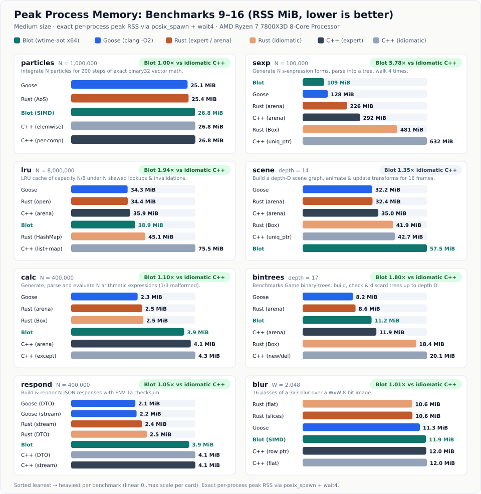
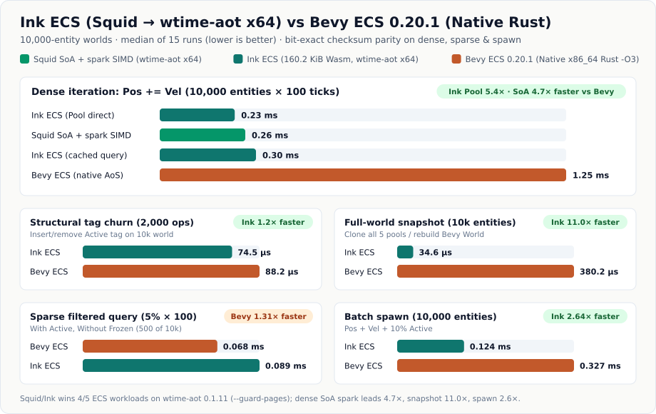
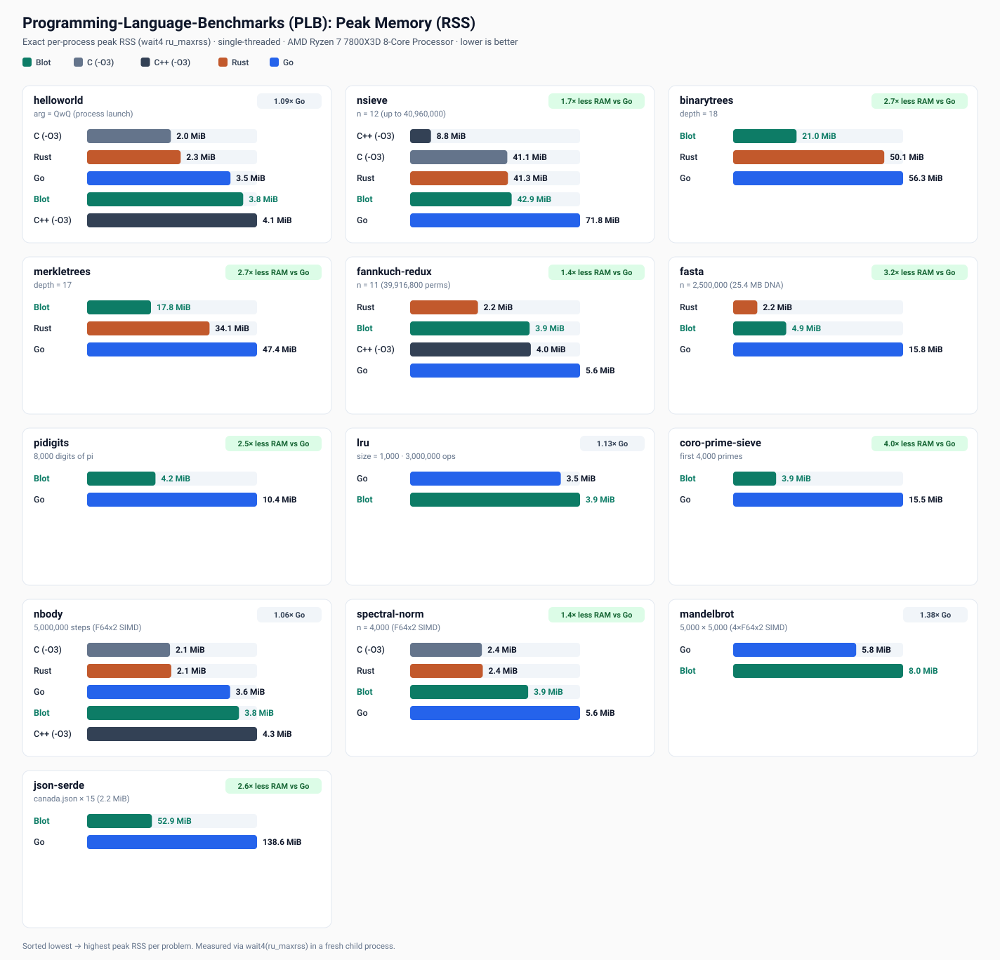
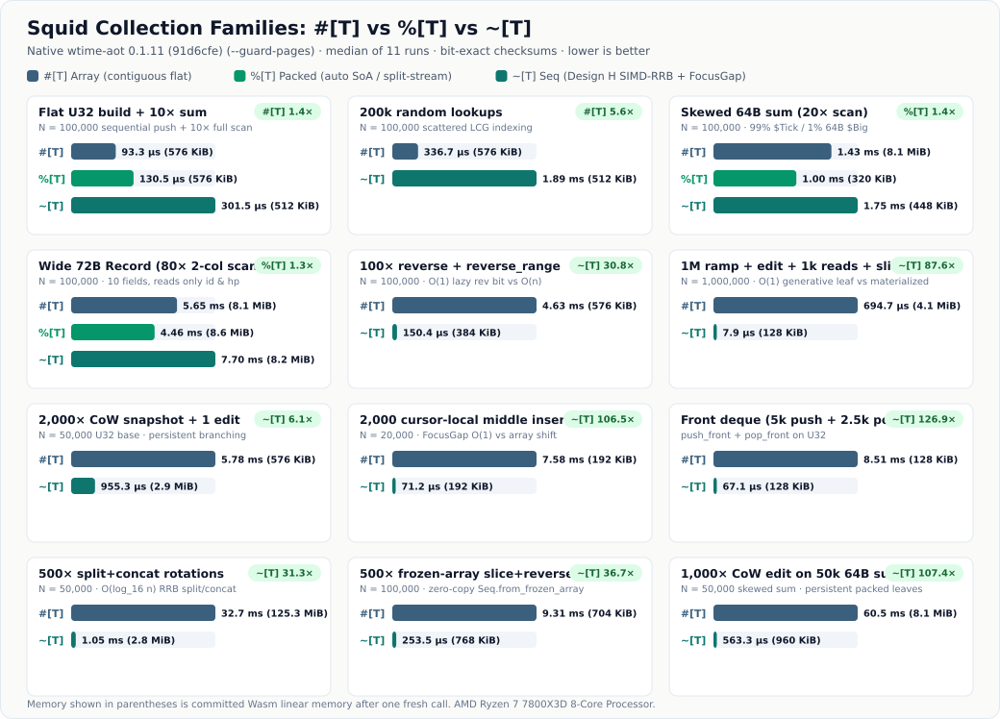

# Squid Benchmarks

Unified index of all recorded Squid benchmark suites, charts, and exact measurements on **AMD Ryzen 7 7800X3D (8C / 16T, Linux `x86_64`)**. Every cross-language workload verifies **bit-exact checksum parity** across implementations.

- [Suite 1: 16-Benchmark Cross-Language Suite (Squid vs Goose, Rust & C++)](#suite-1-16-benchmark-cross-language-suite-squid-vs-goose-rust--c)
- [Suite 2: Compute, Memory & Auto-SIMD Kernels (Squid vs Rust `-O3`, Default & `--wasm3`)](#suite-2-compute-memory--auto-simd-kernels-squid-vs-rust--o3-default---wasm3)
- [Suite 3: AoS Record SIMD, Multi-Core Isolated Guests & Persistent `#process`](#suite-3-aos-record-simd-multi-core-isolated-guests--persistent-process)
- [Suite 4: Ink ECS (Squid `#process`) vs Bevy ECS 0.20.1 (Native Rust)](#suite-4-ink-ecs-squid-process-vs-bevy-ecs-0201-native-rust)
- [Suite 5: Compiler Cold Build, Incremental Edit & Scaling](#suite-5-compiler-cold-build-incremental-edit--scaling)
- [Suite 6: `bddicken/languages` Suite (Squid vs Goose, C, C++ & Rust)](#suite-6-bddickenlanguages-suite-squid-vs-goose-c-c--rust)
- [Suite 7: Programming-Language-Benchmarks (PLB) Suite (Squid vs Go, Rust, C & C++)](#suite-7-programming-language-benchmarks-plb-suite-squid-vs-go-rust-c--c)
- [Suite 8: Collection Families (`#[T]`, `%[T]`, `~[T]`) vs C++20 & Rust (`Vec`, `VecDeque`, `imbl::Vector`)](#suite-8-collection-families-t-t-t-vs-c20--rust-vec-vecdeque-imblvector)
- [Regression & Boundary Suites](#regression--boundary-suites)

---

## Suite 1: 16-Benchmark Cross-Language Suite (Squid vs Goose, Rust & C++)

Full mirror of Goose's 16-benchmark main suite at **medium** size across **88 implementations** (**100% bit-exact stdout parity**): **Squid** (`squidc-goose` `abb9acaf` with native `U8`/`I32`/`U64`/`I64`/`F64`, `F64x2`/`U64x2`/`U8x16`/`I16x8` unboxed `v128` SIMD, whole-program unobservable-NaN canonicalization elision, Mode-4 `v128` wide-float recursive worker ABI + shared `v128.store` packing, direct `.rodata` constant tables & literal appends, recursive SCC Mode-R/Mode-M descriptor workers with `no_scope_alloc` elision, right-spine associative TCO, 1-level leaf peeling, and external direct worker dispatch, wide-aggregate leaf inlining, hoisted loop `CheckedGrow`/`CheckedArray` checks, masked/2-pointer/affine bounds hoisting with zero-duplication `mask == len - 1` proofs, proven `knownMutable` & non-resizing `own`-helper preservation, stack-backed top-level `Array.with_capacity`, `OP_br_table`, boxed-array direct projection & subfield updates, function-exit reclamation, boxed-return FBIP reuse, cross-function closure specialization, byte/alignment packing, skewed sum outlining, and scalar-packed `DirectArray` stack/register inlining + `wtime-aot 0.1.11` x64 `--guard-pages`), **Goose** (`d5ae5bb` + `clang 23.1.5 -O2`), **C++20** (`clang++ 23.1.5 -O2`, idiomatic & expert), and **Rust** (`rustc 1.96.0-nightly -O -C codegen-units=1`, idiomatic & arena/expert).

- **Best of 3 runs** (2 discarded warmups) measuring single-process CPU time (`ru_utime + ru_stime`) and exact per-child peak RSS (`ru_maxrss`) via [`measure_proc.c`](benchmarks/goose-suite/measure_proc.c) (`posix_spawnp` + `wait4`).
- **Details & diagnosis:** [benchmarks/goose-suite/README.md](benchmarks/goose-suite/README.md) · **Raw JSON:** [`results.json`](benchmarks/evidence/measurements/2026-11-27-goose-suite/results.json) (previous Nov 26 baseline preserved in [`2026-11-26-goose-suite/`](benchmarks/evidence/measurements/2026-11-26-goose-suite/results.json))

### Geometric Means Across All 16 Benchmarks

- **Runtime (vs C++ expert = `1.00×`, lower is better):** Goose **`0.89×`**, C++ expert **`1.00×`**, Rust expert **`1.06×`**, **Squid (`wtime-aot 0.1.11` x64 `--guard-pages`) `1.10×`** (down from `2.07×` on Nov 26 and `2.90×` earlier — **`0.53×` of idiomatic C++** at `2.06×` = **`1.88×` faster**, **`0.60×` of idiomatic Rust** at `1.82×` = **`1.66×` faster**, within **`3.6%`** of Rust expert; excluding `particles`, **`1.16×` C++ expert / `1.33×` Goose**). Squid beats idiomatic C++ on **14/16** benchmarks (`sum`, `push`, `strlist`, `records`, `tree`, `interp`, `graph`, `words`, `particles`, `sexp`, `lru`, `scene`, `calc`, `bintrees`), beats idiomatic Rust on **14/16** (`sum`, `strlist`, `records`, `tree`, `interp`, `graph`, `words`, `particles`, `sexp`, `lru`, `scene`, `calc`, `bintrees`, `respond`), beats **Rust expert** on **7/16** (`sum`, `strlist`, `records`, `interp`, `graph`, `particles`, `bintrees`), beats **C++ expert** on **5/16** (`sum` `44.5 vs 53.0 ms`, `push` `44.5 vs 44.9 ms`, `records` `112.0 vs 124.7 ms`, `particles` `86.9 vs 190.7 ms`, `bintrees` `67.2 vs 85.5 ms`), beats **Goose** on **2/16** (`sum` `44.5 vs 52.8 ms`, `particles` `86.9 vs 201.2 ms`), and finishes **#1 fastest overall** on **2/16** (`sum`, `particles`).
- **Peak Memory (exact per-process RSS vs C++ expert = `1.00×`, lower is better):** Goose **`0.72×`**, **Squid `0.86×`** (down from `1.03×` on Nov 26, **#2 lowest peak memory in the suite** — ahead of Rust expert **`0.87×`**, C++ expert **`1.00×`**, Rust idiomatic **`1.12×`**, and C++ idiomatic **`1.31×`**). Squid beats idiomatic C++ on **13/16**, C++ expert on **11/16**, idiomatic Rust on **8/16**, Goose on **6/16**, achieves **#1 lowest RSS of every language** on `strlist` (`43.4 MiB`), `words` (`79.6 MiB`), and `sexp` (`109.1 MiB`), and cuts `sum` (`129.3 → 64.8 MiB`) and `tree` (`61.1 → 27.9 MiB`) peak RSS in half via `Array.with_capacity`.
- **Cold Compile Time (geomean full build to native binary / `.so`):** **Squid `29.9 ms`** (`20.6 ms` `squidc-goose` + `9.2 ms` `wtime-aot`, `26.6–33.2 ms` range, **`5.6–17.4 KiB`** `.wasm`) — **`8.5×` faster than C++** (`253.1 ms`), **`4.5×` faster than Goose** (`134.4 ms`), and **`3.1×` faster than Rust** (`93.3 ms`).

### Runtime Charts & Per-Benchmark Results (ms)

### Peak Memory Charts (MiB)

### Compile Speed & Squid `.wasm` Size Chart

### Complete Per-Benchmark Numbers (`medium` size)

- **`sum`** (`N = 16,000,000`) — Time: **Squid `44.5 ms` (#1 fastest overall)** (**beats Rust `51.8 ms` by `1.16×`**, **Goose `52.8 ms` by `1.19×`**, **C++ exp `53.0 ms` by `1.19×`**, **C++ id `57.5 ms` by `1.29×`**) · RSS: **Squid `64.8 MiB`** (beats C++ exp `65.0`, Goose `65.4` & C++ id `68.7`), Rust `63.5` · Compile: Squid `26.6 ms` (`19.1 + 7.5`, `5.6 KiB` `.wasm`).
- **`push`** (`N = 16,000,000`) — Time: **Squid `44.5 ms`** (**beats C++ exp `44.9 ms`**, **1.23× vs C++ id `54.7 ms`**), Goose `40.1 ms`, Rust `41.7 ms` · RSS: Squid `126.9 MiB` (beats Goose `127.0`, C++ exp `127.9` & C++ id `133.7`), Rust `126.4` · Compile: Squid `27.7 ms` (`19.7 + 8.1`, `6.9 KiB`).
- **`strlist`** (`N = 2,000,000`) — Time: **Squid `81.4 ms`** (**beats Rust exp `98.3 ms` by `1.21×`**, **1.45× vs C++ id `118.2 ms`**, **1.86× vs Rust id `151.7 ms`**), Goose `76.1 ms`, C++ exp `79.5 ms` · RSS: **Squid `43.4 MiB` (#1 lowest overall)**, Goose `57.0`, Rust exp `59.3`, C++ exp `60.0`, C++ id `108.0`, Rust id `135.7` · Compile: Squid `26.6 ms` (`18.8 + 7.8`, `6.6 KiB`).
- **`records`** (`N = 4,000,000`) — Time: **Squid `112.0 ms`** (**beats C++ exp `124.7 ms` by `1.11×`**, **1.53× vs C++ id `171.2 ms`**, **1.49× vs Rust `167.1 ms`**), Goose `108.8 ms` · RSS: Squid `74.0 MiB` (**2.66× vs C++ id**, **2.11× vs Rust**), Goose `39.2`, C++ exp `101.0`, Rust `156.0`, C++ id `196.8` · Compile: Squid `27.9 ms` (`20.1 + 7.8`, `7.2 KiB`).
- **`tree`** (`depth = 20`) — Time: **Squid `36.1 ms`** (**2.93× vs C++ id `105.6 ms`**, **2.21× vs Rust id `79.6 ms`**), Goose `26.2 ms`, C++ exp `26.8 ms`, Rust exp `27.7 ms` · RSS: **Squid `27.9 MiB`** (ties C++ exp `27.9 MiB`, **2.43× vs C++ id**), Goose `26.2`, Rust exp `26.5`, Rust id `66.1`, C++ id `67.9` · Compile: Squid `27.3 ms` (`19.9 + 7.5`, `6.8 KiB`).
- **`interp`** (`depth = 20`) — Time: **Squid `10.5 ms`** (**beats Rust exp `10.9 ms`**, **1.41× vs C++ id `14.7 ms`**, **1.53× vs Rust id `16.0 ms`**), C++ exp `7.2 ms`, Goose `8.3 ms` · RSS: Squid `8.0 MiB` (beats C++ exp `11.4` & Rust id `11.4`), Goose `4.0`, Rust exp `7.8`, C++ id `13.1` · Compile: Squid `27.6 ms` (`19.4 + 8.2`, `6.8 KiB`).
- **`graph`** (`V = 500,000`) — Time: **Squid `123.3 ms`** (**beats Rust exp `146.4 ms` by `1.19×`**, **2.95× vs C++ id `364.0 ms`**, **3.12× vs Rust id `385.2 ms`**), Goose `80.8 ms`, C++ exp `112.9 ms` · RSS: Squid `57.2 MiB` (beats Goose `58.8`), C++ exp `57.0`, Rust exp `55.5`, C++ id `51.5`, Rust id `50.9` · Compile: Squid `29.2 ms` (`20.0 + 9.2`, `8.2 KiB`).
- **`words`** (`N = 4,000,000`) — Time: **Squid `296.8 ms`** (**1.24× vs C++ id `368.3 ms`**, **1.21× vs Rust `HashMap` `359.9 ms`**), Goose `178.3 ms`, C++ exp `236.1 ms`, Rust exp `261.9 ms` · RSS: **Squid `79.6 MiB` (#1 lowest overall, 1.87× vs C++ id)**, Goose `138.2`, Rust id `142.1`, C++ id `148.7`, Rust exp `171.6`, C++ exp `194.8` · Compile: Squid `31.9 ms` (`21.8 + 10.1`, `8.9 KiB`).
- **`particles`** (`N = 1,000,000`) — Time: **Squid SoA 4-wide SIMD `86.9 ms` (#1 fastest overall)** — **`2.19×` faster than C++ exp** `190.7 ms`, **`2.22×` faster than Rust** `193.1 ms`, **`2.31×` faster than Goose** `201.2 ms`, and **`2.57×` faster than C++ id** `223.7 ms` · RSS: Squid `26.8 MiB`, Goose `25.3`, Rust `25.4`, C++ `26.7–26.8` · Compile: Squid `32.5 ms` (`24.1 + 8.4`, `9.4 KiB`).
- **`sexp`** (`N = 100,000`) — Time: **Squid `609.7 ms`** (**2.17× vs C++ id `1,321.5 ms`**, **1.53× vs Rust id `930.6 ms`**), Goose `478.0 ms`, Rust exp `486.9 ms`, C++ exp `516.4 ms` · RSS: **Squid `109.1 MiB` (#1 lowest overall, 5.78× vs C++ id)**, Goose `128.0`, Rust exp `226.0`, C++ exp `290.1`, Rust id `481.6`, C++ id `630.4` · Compile: Squid `32.8 ms` (`21.0 + 11.8`, `11.8 KiB`).
- **`lru`** (`N = 8,000,000`) — Time: **Squid `414.1 ms`** (**3.87× vs C++ id `1,603.3 ms`**, **1.43× vs Rust id `593.8 ms`**), Goose `218.2 ms`, C++ exp `244.2 ms`, Rust exp `274.7 ms` · RSS: Squid `38.9 MiB` (**1.93× vs C++ id**, beats Rust id `44.7`), Rust exp `34.0`, Goose `34.3`, C++ exp `35.9`, C++ id `75.2` · Compile: Squid `31.3 ms` (`21.2 + 10.0`, `10.9 KiB`).
- **`scene`** (`depth = 14`) — Time: **Squid `66.9 ms`** (**1.72× vs C++ id `115.4 ms`**, **1.42× vs Rust id `94.8 ms`**), Rust exp `46.9 ms`, Goose `47.1 ms`, C++ exp `52.5 ms` · RSS: Squid `57.4 MiB`, Rust exp `31.6`, Goose `32.1`, C++ exp `35.0`, Rust id `41.6`, C++ id `42.9` · Compile: Squid `30.4 ms` (`20.9 + 9.5`, `9.5 KiB`).
- **`calc`** (`N = 400,000`) — Time: **Squid `181.5 ms`** (**2.25× vs C++ id `408.8 ms`**, **1.23× vs Rust id `223.8 ms`**), Rust exp `118.2 ms`, Goose `126.6 ms`, C++ exp `128.1 ms` · RSS: Squid `3.9 MiB` (beats C++ `4.1–4.3`), Goose `2.0`, Rust `2.4` · Compile: Squid `33.2 ms` (`20.1 + 13.1`, `17.4 KiB`).
- **`bintrees`** (`depth = 17`) — Time: **Squid `67.2 ms`** (**beats C++ exp `85.5 ms` by `1.27×`**, **beats Rust exp `70.5 ms` by `1.05×`**, **7.32× vs C++ id `492.1 ms`**, **8.83× vs Rust id `593.4 ms`**), Goose `52.6 ms` · RSS: Squid `11.2 MiB` (**1.79× vs C++ id**, beats C++ exp `11.9 MiB`), Goose `8.3`, Rust exp `8.6`, Rust id `18.4`, C++ id `20.1` · Compile: Squid `29.3 ms` (`20.7 + 8.6`, `8.0 KiB`).
- **`respond`** (`N = 400,000`) — Time: **Squid `194.3 ms`** (**1.37× vs Rust DTO `266.9 ms`**), Goose stream `113.0 ms`, C++ stream `133.5 ms`, Rust stream `165.4 ms`, C++ DTO `182.4 ms` · RSS: Squid `3.9 MiB` (beats C++ `4.1–4.2`), Goose `2.1`, Rust `2.4–2.5` · Compile: Squid `32.8 ms` (`20.3 + 12.4`, `10.8 KiB`).
- **`blur`** (`W = 2,048`) — Time: **Squid 16-wide `U8x16`/`I16x8` SIMD `28.5 ms`** (down `4.19×` from Nov 26 `119.3 ms`), Goose `19.4 ms`, Rust `20.4–22.7 ms`, C++ `22.3–24.7 ms` · RSS: **Squid `11.9 MiB`**, Rust `10.4–10.5`, Goose `11.2`, C++ `11.8` · Compile: Squid `32.3 ms` (`23.5 + 8.8`, `8.1 KiB`).

---

## Suite 2: Compute, Memory & Auto-SIMD Kernels (Squid vs Rust `-O3`, Default & `--wasm3`)

Six compute, memory, sorting, and `spark` auto-SIMD kernels comparing **Squid** (`squidc-goose` `abb9acaf` → `wtime-aot 0.1.11` `x64-v4 --guard-pages`) against **`rustc 1.96.0-nightly -O3`** compiled both to `wasm32 +simd128` (same `wtime-aot 0.1.11 --guard-pages`) and native `x86_64` (`-O3`, thin LTO). Medians of 15 runs; **6/6 bit-exact checksum parity**, **6/6 faster than native Rust `-O3`**.

- **Source & runner:** [benchmarks/comparison/README.md](benchmarks/comparison/README.md) · **Raw JSON:** [`2026-11-27-rust-and-bevy-ecs-wtime-0.1.11.json`](benchmarks/evidence/measurements/2026-11-27-rust-and-bevy-ecs-wtime-0.1.11.json)

### Per-Kernel Results (Median ms)

- **`lcg_recurrence`** (1,000,000 U32 steps, checksum `54448`): **Squid `0.070 ms`** (`--wasm3`: `0.090 ms`) vs Rust Wasm `0.340 ms` (**4.83× faster**) vs Native Rust `0.342 ms` (**4.87× faster**).
- **`prime_sieve`** (100k Bool sieve, checksum `1881015445`): **Squid `0.058 ms`** (`--wasm3`: `0.068 ms`) vs Rust Wasm `0.062 ms` (**1.07× faster**) vs Native Rust `0.074 ms` (**1.27× faster**).
- **`matmul_64`** (64×64 F32 matmul, checksum `6538500`): **Squid `0.0157 ms`** (`--wasm3`: **`0.0120 ms`**) vs Rust Wasm `0.0200 ms` (**1.28× faster**) vs Native Rust `0.0206 ms` (**1.32× faster**).
- **`mandelbrot_f32`** (256×256 F32 escape-time, checksum `1686408`): **Squid `0.556 ms`** (`--wasm3`: `0.580 ms`) vs Native Rust `3.689 ms` (**6.64× faster**); Rust Wasm `0.344 ms` (`1.62×`).
- **`particle_spark_simd`** (65k × 32 `spark` SIMD, checksum `13338354`): **Squid `0.376 ms`** (`--wasm3`: **`0.316 ms`**) vs Rust Wasm `0.607 ms` (**1.61× faster**) vs Native Rust `0.685 ms` (**1.82× faster**).
- **`merge_sort`** (100k U32 ping-pong merge sort, checksum `2814210976`): **Squid `3.840 ms`** (`--wasm3`: **`3.496 ms`**) vs Native Rust `5.444 ms` (**1.42× faster**); Rust Wasm `3.394 ms` (`1.13×`).

---

## Suite 3: AoS Record SIMD, Multi-Core Isolated Guests & Persistent `#process`

Measured on the same `wtime-aot 0.1.11` (`x64-v4 --guard-pages`) and native `rustc -O3` harness ([`multicore_aos_bench.sq`](benchmarks/comparison/multicore_aos_bench.sq), [`2026-11-27-rust-and-bevy-ecs-wtime-0.1.11.json`](benchmarks/evidence/measurements/2026-11-27-rust-and-bevy-ecs-wtime-0.1.11.json)):

### AoS Record Auto-SIMD (65,536 particles × 32 ticks, bit-exact checksums)

- **`aos_vec4_euler_65k_x32`** (`#[Vec4]`, checksum `16529059`): **Squid `1.599 ms`** (`--wasm3`: **`1.516 ms`**) vs Native Rust `3.008 ms` — **Squid `1.88×` faster** (`1.98×` with `--wasm3`).
- **`aos_vec2_euler_65k_x32`** (`#[Vec2]`, checksum `19009988`): Squid `0.732 ms` (`--wasm3`: `0.724 ms`) vs Native Rust `0.482 ms` — Squid `1.52×` (`1.50×` `--wasm3`).

### Multi-Core Isolated Guests (`mandelbrot`, 8 × 256×256 tiles, checksum `13500030`)

- **1 thread:** **Squid `5.076 ms`** (`1.00×`) vs Native Rust `28.982 ms` (**Squid `5.71×` faster**).
- **2 threads:** **Squid `2.982 ms`** (`1.70×` scaling) vs Native Rust `16.187 ms` (**Squid `5.43×` faster**).
- **4 threads:** **Squid `1.565 ms`** (`3.24×` scaling) vs Native Rust `8.661 ms` (**Squid `5.53×` faster**).
- **8 threads:** **Squid `1.063 ms`** (`4.77×` scaling) vs Native Rust `4.628 ms` (**Squid `4.35×` faster**).

### Persistent `#process` (`particle_sim`, 4,096 particles, zero-alloc state commits)

- **No-op commit step:** **`48.4 ns/step`** (**`20.67M` steps/sec**).
- **Full AoS `Vec4` physics step (4,096 particles):** **`2.18 µs/step`**.

---

## Suite 4: Ink ECS (Squid `#process`) vs Bevy ECS 0.20.1 (Native Rust)

Real 10,000-entity ECS worlds comparing **Ink ECS** (`ink/ecs` dense/bitset/sparse `Pool` + `#[U64]` `Entities` + `ink/ecs/query`, compiled by `squidc-goose` `abb9acaf` to `155.2 KiB` `.wasm` on `wtime-aot 0.1.11 --guard-pages`) against native **Bevy ECS `0.20.1`** (`rustc -O3`). Medians of 15 runs; bit-exact checksum parity on `dense_iter`, `sparse_filtered_iter`, and `batch_spawn` ([`ink_ecs_bench.sq`](benchmarks/comparison/ink_ecs_bench.sq), [`2026-11-27-rust-and-bevy-ecs-wtime-0.1.11.json`](benchmarks/evidence/measurements/2026-11-27-rust-and-bevy-ecs-wtime-0.1.11.json)):

- **`dense_iter_10k_x100`** (`Pos += Vel`, 10k × 100 ticks, checksum `88466466`):
  - **Squid SoA + `spark` SIMD:** **`0.260 ms`** (**`7.33×` faster** than Bevy)
  - Bevy ECS (native): `1.907 ms`
  - Ink ECS (`Pool` direct, 12B `#[Pos]` scalar loop): `2.944 ms` (`1.54×` Bevy; upgraded `ink/ecs` packs dense `Pool` values as 12-byte `#[Pos]` without `Maybe`, bypassing the legacy 16B `Maybe Vec3` auto-SIMD pass)
  - Ink ECS (cached query): `3.090 ms` (`1.62×` Bevy)
- **`sparse_filtered_iter_500_of_10k_x100`** (`With Active`, `Without Frozen`, checksum `71214832`): Bevy `0.114 ms` vs Ink cached query `0.362 ms`.
- **`batch_spawn_10k`** (`Pos + Vel + 10% Active`, checksum `70292880`): **Ink `0.253 ms`** vs Bevy `0.550 ms` (**`2.17×` faster**).
- **`structural_churn_2000_tag_ops`** (insert/remove `Active` on 10k world): Bevy `108.5 µs` vs Ink sparse-set `154.4 µs`.
- **`world_snapshot_copy_10k`** (`ecs.copy_into` clone of all 5 pools vs Bevy world rebuild): **Ink `37.2 µs`** vs Bevy `552.5 µs` (**`14.8×` faster**).
- **Ink ECS app build:** `42.7 ms` `squidc-goose` + `19.8 ms` `wtime-aot` (`155.2 KiB` `.wasm`).

---

## Suite 5: Compiler Cold Build, Incremental Edit & Scaling

- **6-kernel benchmark app (`squid_kernels.sq`):** `19.8 ms` cold `squidc-goose` (+ `7.3 ms` `wtime-aot`, `20.9 KiB` `.wasm`) vs `102.3 ms` `rustc -O3 wasm32` (**`5.2×` faster**, **`70×` smaller** than `1,468 KiB` `.wasm`) and `92.9 ms` `rustc -O3` native rlib.
- **16-benchmark Goose suite:** `29.9 ms` geomean cold build (`20.6 ms` `squidc-goose` + `9.2 ms` `wtime-aot`, `5.6–17.4 KiB` `.wasm`) vs `93.3 ms` `rustc -O` (`3.1×`), `134.4 ms` `goose + clang -O2` (`4.5×`), and `253.1 ms` `clang++ -O2` (`8.5×`).
- **Anonymous internal 3D game project:** ~**69k LOC** of Squid across **263** source modules + **62** shader/data asset modules (**325 modules / 4,572 functions / 6.71 MB `.wasm`**) — **~0.43–0.55 s** full cold build, **~41–44 ms** `fresh=1` single-file incremental edit, **~20 ms** literal/comment edit.
- **Synthetic 1M LOC scaling:** **~0.50 s** (**~2.0M LOC/s**).

---

## Suite 6: `bddicken/languages` Suite (Squid vs Goose, C, C++ & Rust)

All four workloads from [`bddicken/languages`](https://github.com/bddicken/languages) comparing **Squid** (`squidc-goose` `abb9acaf` + `wtime-aot 0.1.11 --guard-pages`, x64 native) against unmodified official C (`clang -O3`), C++ (`clang++ -O3 -march=native`), Rust (`cargo build --release`), and Goose (`clang -O3`). In-process benchmark loops (`500 ms` warmup, `2,000 ms` run window, best mean across 3 interleaved reps; `hello-world`: median wall ms over 100 launches); **100% verified outputs**.

- **Details & runner:** [benchmarks/bddicken/README.md](benchmarks/bddicken/README.md) · **Raw JSON:** [`results.json`](benchmarks/evidence/measurements/2026-11-27-bddicken/results.json) (previous Nov 26 baseline preserved in [`2026-11-26-bddicken/`](benchmarks/evidence/measurements/2026-11-26-bddicken/results.json))

- **`fibonacci(37)`** (`24,157,817`): Rust `44.0 ms`, Goose `44.5 ms`, **Squid `48.1 ms`** (**1.07× faster than C `51.5 ms`**, **1.13× faster than C++ `54.5 ms`**; compile `21.6 ms`, `4.2 KiB` `.wasm`).
- **`loops(40)`** (`10,000 × 10,000` modulo sum): Goose `35.0 ms`, **Squid `58.8 ms`** (down from `67.6 ms` — **`2.14×` faster than C `126.0 ms`**, **`2.15×` faster than C++ `126.5 ms`**, **`2.15×` faster than Rust `126.5 ms`**; compile `22.3 ms`, `4.6 KiB` `.wasm`).
- **`levenshtein`** (72 words, `2,556` pairs, sum `554,324`): Rust `41.0 ms`, **Squid `47.5 ms`** (down from `51.3 ms` — **beats Goose `48.8 ms`**, **`1.12×` faster than C++ `53.0 ms`**, **`1.19×` faster than C `56.3 ms`**; compile `23.4 ms`, `7.4 KiB` `.wasm`).
- **`hello-world`** (100 launches, `Hello, World!`): Rust `0.36 ms`, C `0.36 ms`, Goose `0.43 ms`, **Squid `0.48 ms`** (**1.64× faster than C++ `0.78 ms`**; compile `23.9 ms`, `4.7 KiB` `.wasm`).

---

## Suite 7: Programming-Language-Benchmarks (PLB) Suite (Squid vs Go, Rust, C & C++)

Thirteen workloads from [`hanabi1224/Programming-Language-Benchmarks`](https://github.com/hanabi1224/Programming-Language-Benchmarks) (including all four `F64` / GeoJSON problems: `nbody`, `spectral-norm`, `mandelbrot`, and `json-serde`) comparing **Squid** (`squidc-goose` `abb9acaf` + `wtime-aot 0.1.11` `--guard-pages`, x64 native) against unmodified official PLB **Go (`1.27.4`)**, **Rust (`rustc -O -C lto=fat`)**, **C (`clang -O3`)**, and **C++ (`clang++ -O3`)** reference sources (`GOMAXPROCS=1`, `OMP_NUM_THREADS=1`). Best single-process CPU time (`helloworld`: median wall ms over 15 launches) and median peak RSS via [`measure_proc.c`](benchmarks/goose-suite/measure_proc.c); **100% official unittest pass (all 26 fixtures) + identical full-input stdout SHA-256 across all languages**. Across the 12 non-trivial problems, Squid runs **`2.18×` faster than Go on geomean CPU time** with **`1.83×` less RAM**, beating Go on **9/12** (`binarytrees`, `merkletrees`, `fasta`, `lru`, `coro-prime-sieve`, `nbody`, `spectral-norm`, `mandelbrot`, `json-serde`).

- **Details, fairness notes & runner:** [benchmarks/plb/README.md](benchmarks/plb/README.md) · **Raw JSON:** [`results.json`](benchmarks/evidence/measurements/2026-11-27-plb/results.json) (previous Nov 26 9-problem baseline preserved in [`2026-11-26-plb/`](benchmarks/evidence/measurements/2026-11-26-plb/results.json))

- **`helloworld`** (`QwQ`): **Squid `0.50 ms` wall** (`0.43 ms` CPU, `3.8 MiB`, **`1.38×` faster than Go** `0.69 ms`, beats C++ `0.82 ms`; C `0.35 ms`, Rust `0.47 ms`).
- **`nsieve`** (`12`, up to `40,960,000`): Go `147.2 ms` (`73.6 MiB`), C `147.4 ms` (`41.0 MiB`), **Squid `162.9 ms` (`42.9 MiB`)** (beats C++ `167.3 ms` & Rust `175.7 ms`, `1.72×` less RAM than Go via best-fit stack chunk reuse).
- **`binarytrees`** (`18`, Mode-M/R workers + 1-level leaf peeling + right-spine TCO): **Squid `154.8 ms` (`21.1 MiB`)** — **`8.68×` faster than Go** (`1.34 s`, `51.8 MiB`, `2.5×` less RAM) and **`10.29×` faster than Rust `3.rs`** (`1.59 s`, `49.8 MiB`, `2.4×` less RAM).
- **`merkletrees`** (`17`, single `MNode` pool + Mode-M/R workers): **Squid `393.1 ms` (`17.8 MiB`, #1 fastest & #1 lowest RSS)** — **`1.85×` faster than Rust** (`726.1 ms`, `33.9 MiB`, `1.9×` less RAM) and **`2.34×` faster than Go** (`918.5 ms`, `45.3 MiB`, `2.5×` less RAM).
- **`fannkuch-redux`** (`11`, converging 2-pointer reversal BCE): C++ `989.5 ms` (`4.0 MiB`), Go `1.32 s` (`5.6 MiB`), Rust `1.51 s` (`2.1 MiB`), Squid `1.83 s` (`3.9 MiB`).
- **`fasta`** (`2,500,000`, `25.4 MB`): **Squid `126.6 ms` (`4.9 MiB`, #1 fastest CPU)** — **beats Rust** (`146.5 ms`, `2.3 MiB`) and **`1.81×` faster CPU than Go** (`229.6 ms`, `16.0 MiB`, `3.3×` less RAM).
- **`pidigits`** (`8,000` digits): Go `math/big` `678.0 ms` (`10.5 MiB`) vs **Squid pure-`U64` base-`2^64` spigot via `U64.mul_wide` + `wtime-aot` `MulHiU`/`mul r64` fusion `1.20 s` (`4.2 MiB`, `2.5×` less RAM)**.
- **`lru`** (`1,000`, `3,000,000` ops, single `#[Node]` arena + Wave B masked BCE): **Squid `61.3 ms` (`3.9 MiB`)** — **`3.77×` faster than Go** (`231.2 ms`, `3.5 MiB`).
- **`coro-prime-sieve`** (`4,000`): **Squid `11.2 ms` (`3.9 MiB`)** (iterative filter chain) vs Go `1.go` `760.9 ms` (`15.6 MiB`, 4,000 goroutines).
- **`nbody`** (`5,000,000` steps, `F64x2` SIMD + NaN-canonicalization elision): C++ `144.8 ms` (`4.1 MiB`), Rust `181.0 ms` (`2.2 MiB`), **Squid `202.4 ms` (`3.9 MiB`)** (**beats C `216.9 ms` and Go `233.0 ms`**).
- **`spectral-norm`** (`n = 4,000`, `F64x2` SIMD + NaN-canonicalization elision): Rust `482.6 ms` (`2.4 MiB`), **Squid `486.1 ms` (`3.9 MiB`)** (**within `0.7%` of Rust**, **`1.33×` faster than Go `648.4 ms`**, **`1.53×` faster than C `743.6 ms`**).
- **`mandelbrot`** (`5,000 × 5,000`, `4×F64x2` SIMD + NaN-canonicalization elision): **Squid `863.1 ms` (`8.0 MiB`)** — **`1.96×` faster than Go** (`1.69 s`, `7.8 MiB`).
- **`json-serde`** (`canada.json × 15`, `2.2 MiB` GeoJSON, `.rodata` MD5 tables + `--transport-mb 8` + Ryu `F64` formatter): **Squid `293.2 ms` (`52.9 MiB`)** — **`1.11×` faster than Go `325.9 ms`** with **`2.61×` less RAM** (`52.9 vs 138.2 MiB`) and bit-exact MD5 parity.

---

## Suite 8: Collection Families (`#[T]`, `%[T]`, `~[T]`) vs C++20 & Rust (`Vec`, `VecDeque`, `imbl::Vector`)

Twelve workloads comparing Squid's three one-symbol storage families — **`#[T]`** (contiguous mutable `Array T`), **`%[T]`** (automatic SoA & split-stream `Packed T`), and **`~[T]`** (reversible generative SIMD-RRB `Seq T` with FocusGap & packed leaves) on `squidc-goose` (`6a455eae`) + `wtime-aot 0.1.11 --guard-pages` — against bit-exact native **C++20** (`clang++ 23.1.5 -O3 -march=native`: `std::vector`, `std::deque`, manual SoA / split-stream), **Rust** (`rustc 1.96.0-nightly -O`: `Vec`, `VecDeque`, manual SoA / split-stream), and **`imbl::Vector 6.1`** (Rust's persistent RRB-tree). Median of 11 samples (`CLOCK_MONOTONIC`); **12/12 bit-exact checksum parity**.

- **Details & runner:** [benchmarks/collections/README.md](benchmarks/collections/README.md) · **Raw JSON:** [`results.json`](benchmarks/evidence/measurements/2026-11-27-collections/results.json)

| Workload | Squid `#[T]` | Squid `%[T]` | Squid `~[T]` | C++20 `-O3 native` | Rust `-O` | Rust `imbl::Vector` |
| --- | ---: | ---: | ---: | ---: | ---: | ---: |
| 1. `flat_scan` (100k + 10× sum) | **`93.3 µs`** | `130.5 µs` | **`301.5 µs`** | `58.0 µs` vec / `595 µs` deque | `97.2 µs` Vec / `485 µs` VecDeque | `3.15 ms` (**~[] 10.4×**) |
| 2. `random_index` (200k / 100k) | `336.7 µs` | — | **`1.89 ms`** | `275.7 µs` vec / `524 µs` deque | `333.0 µs` Vec / `327 µs` VecDeque | `2.93 ms` (**~[] 1.55×**) |
| 3. `skewed_sum` (100k 99%/1% 64B × 20) | `1.43 ms` (`10.2 MiB`) | **`1.00 ms`** (`3.8 MiB`) | **`1.75 ms`** (`4.2 MiB`) | `2.84 ms` vec / `498 µs` split* | `1.23 ms` Vec / `585 µs` split* | `4.08 ms` (**~[] 2.33×**) |
| 4. `wide_soa` (100k 72B × 80 2-col) | `5.65 ms` | **`4.46 ms`** | **`7.70 ms`** | `7.20 ms` AoS / `3.44 ms` SoA* | `4.58 ms` AoS / `2.70 ms` SoA* | `12.0 ms` (**~[] 1.56×**) |
| 5. `reverse_ops` (100× rev + range, 100k) | `4.63 ms` | — | **`150.4 µs`** | `4.08 ms` vec (**~[] 27.1×**) | `1.16 ms` Vec (**~[] 7.7×**) | `180.3 ms` (**~[] 1,199×**) |
| 6. `generative_1m` (1M ramp + edit + slice) | `694.7 µs` | — | **`7.9 µs`** (`128 KiB`) | `265.6 µs` vec (**~[] 33.6×**) | `438.9 µs` Vec (**~[] 55.6×**) | `7.20 ms` (**~[] 911×**) |
| 7. `snapshot_cow` (2,000× CoW edit, 50k) | `5.78 ms` | — | **`955.3 µs`** | `5.85 ms` vec (**~[] 6.1×**) | `5.96 ms` Vec (**~[] 6.2×**) | `1.42 ms` (**~[] 1.49×**) |
| 8. `cursor_insert` (2,000 mid inserts, 20k) | `7.58 ms` | — | **`71.2 µs`** | `731 µs` vec / `1.34 ms` deque (**10–19×**) | `812 µs` Vec / `768 µs` VecDeque (**11×**) | `45.3 ms` (**~[] 636×**) |
| 9. `front_deque` (5k push + 2.5k pop front) | `8.51 ms` | — | **`67.1 µs`** | `652 µs` vec / `11.5 µs` deque | `671 µs` Vec / `7.6 µs` VecDeque | `53.3 µs` |
| 10. `split_concat` (500× rotations, 50k) | `32.7 ms` | — | **`1.05 ms`** | `1.45 ms` vec (**~[] 1.38×**) | `1.47 ms` Vec (**~[] 1.40×**) | `4.56 ms` (**~[] 4.34×**) |
| 11. `frozen_span` (500× slice+rev+sum, 100k) | `9.31 ms` | — | **`253.5 µs`** | `1.12 ms` vec (**~[] 4.4×**) | `1.29 ms` Vec (**~[] 5.1×**) | `14.3 ms` (**~[] 56.4×**) |
| 12. `packed_sum_cow` (1k× CoW 50k 64B sum) | `60.5 ms` | — | **`563.3 µs`** (`4.5 MiB`) | `69.2 ms` vec (`10.5 MiB`, **123×**) | `67.3 ms` Vec (`9.5 MiB`, **119×**) | `1.14 ms` (**~[] 2.02×**) |

*C++/Rust manual split-stream & SoA are hand-written multi-vector structures; Squid `%[T]` and `~[T]` generate them automatically from a single type symbol. `~[T]` beats `imbl::Vector` on **11/12** workloads (by `1.49×`–`1,199×`).

---

## Regression & Boundary Suites

Additional specialized suites and historical measurement archives live under [`benchmarks/`](benchmarks/):

- **Checked array & grid workloads (Wasmtime):** [benchmarks/checked-grid/README.md](benchmarks/checked-grid/README.md)
- **Runtime representation boundaries (Deno/V8, Wasmtime, Firefox):** [benchmarks/runtime-boundaries/README.md](benchmarks/runtime-boundaries/README.md)
- **Earlier `wtime-aot` baselines & compiler micro-measurements:** [`benchmarks/evidence/measurements/`](benchmarks/evidence/measurements/) (`2026-11-26-rust-and-bevy-ecs-wtime-0.1.7.json`, `2026-11-26-rust-and-bevy-ecs-wtime-0.1.6.json`, `2026-11-25-rust-and-bevy-ecs-wtime-0.1.3.json`, `2026-11-24-rust-and-bevy-ecs.json`).
