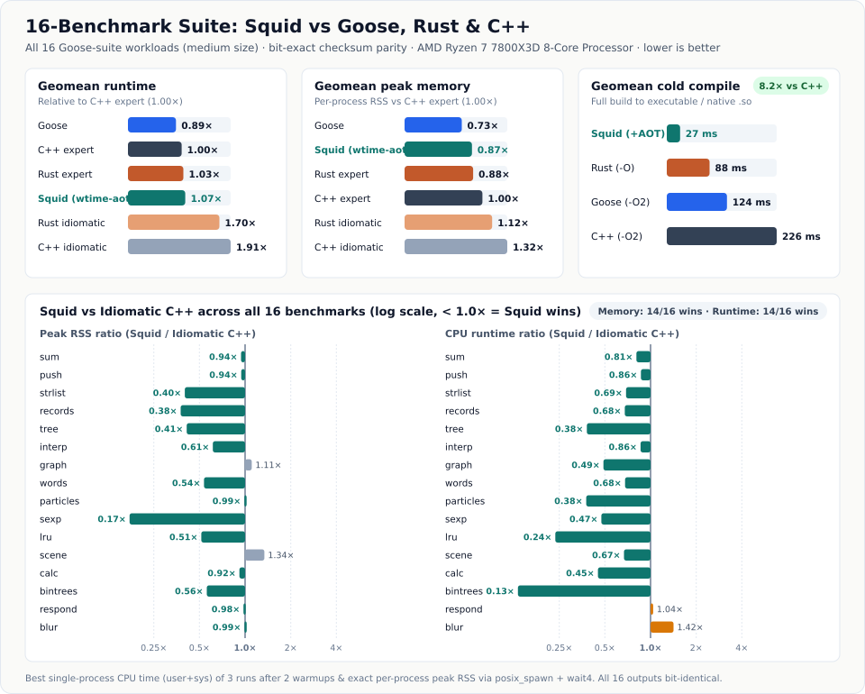
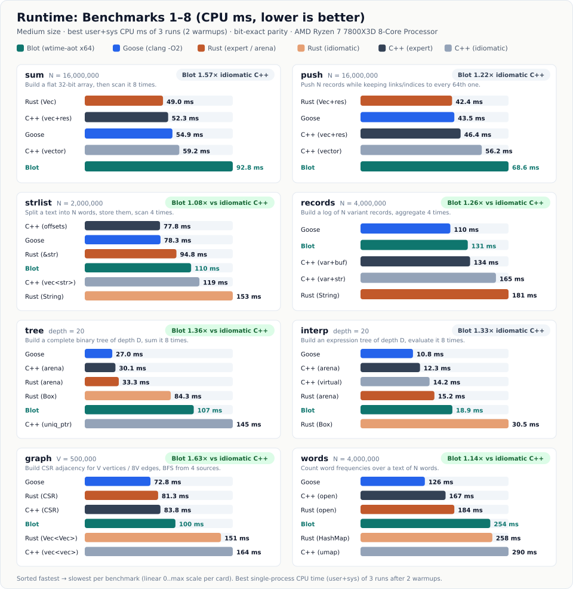
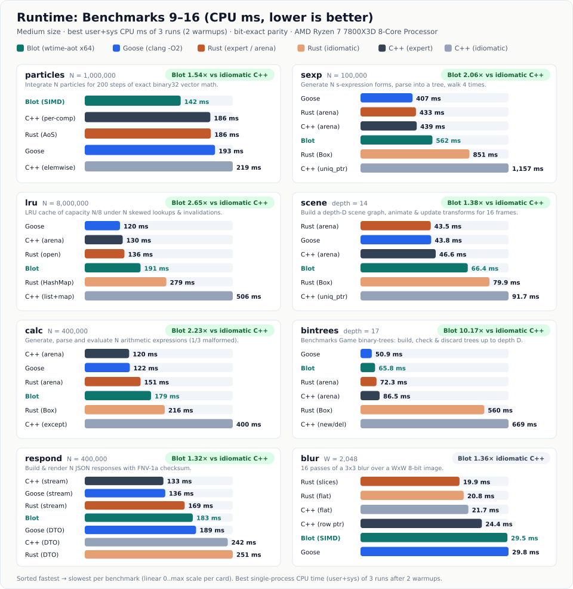
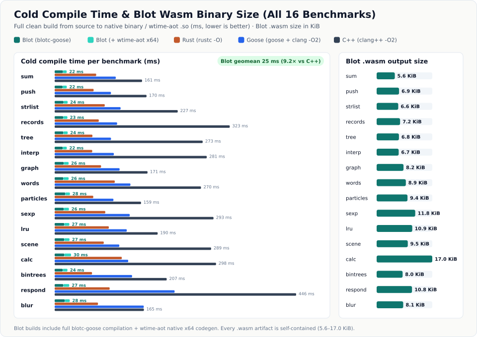
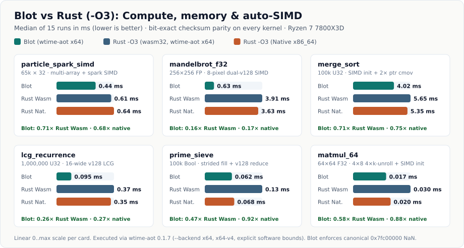
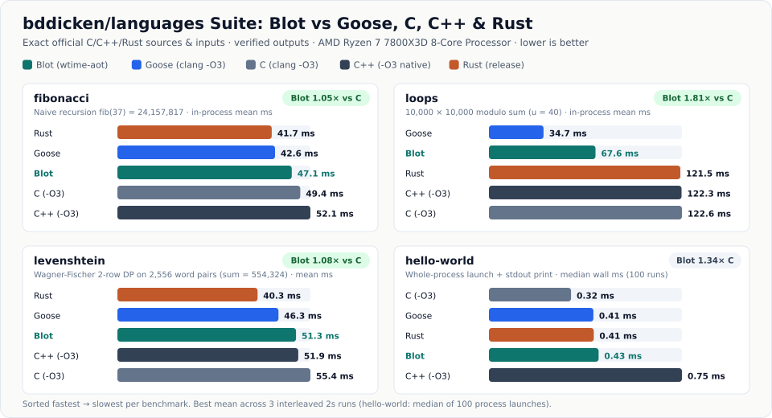

# Blot Benchmarks

Unified index of all recorded Blot benchmark suites, charts, and exact measurements on **AMD Ryzen 7 7800X3D (8C / 16T, Linux `x86_64`)**. Every cross-language workload verifies **bit-exact checksum parity** across implementations.

- [Suite 1: 16-Benchmark Cross-Language Suite (Blot vs Goose, Rust & C++)](#suite-1-16-benchmark-cross-language-suite-blot-vs-goose-rust--c)
- [Suite 2: Compute, Memory & Auto-SIMD Kernels (Blot vs Rust `-O3`, Default & `--wasm3`)](#suite-2-compute-memory--auto-simd-kernels-blot-vs-rust--o3-default---wasm3)
- [Suite 3: AoS Record SIMD, Multi-Core Isolated Guests & Persistent `#process`](#suite-3-aos-record-simd-multi-core-isolated-guests--persistent-process)
- [Suite 4: Ink ECS (Blot `#process`) vs Bevy ECS 0.20.1 (Native Rust)](#suite-4-ink-ecs-blot-process-vs-bevy-ecs-0201-native-rust)
- [Suite 5: Compiler Cold Build, Incremental Edit & Scaling](#suite-5-compiler-cold-build-incremental-edit--scaling)
- [Suite 6: `bddicken/languages` Suite (Blot vs Goose, C, C++ & Rust)](#suite-6-bddickenlanguages-suite-blot-vs-goose-c-c--rust)
- [Suite 7: Programming-Language-Benchmarks (PLB) Suite (Blot vs Go, Rust, C & C++)](#suite-7-programming-language-benchmarks-plb-suite-blot-vs-go-rust-c--c)
- [Regression & Boundary Suites](#regression--boundary-suites)

---

## Suite 1: 16-Benchmark Cross-Language Suite (Blot vs Goose, Rust & C++)

Full mirror of Goose's 16-benchmark main suite at **medium** size across **88 implementations** (**100% bit-exact stdout parity**): **Blot** (`blotc-goose` with native `U8`/`I32`/`U64`/`I64`/`F64`, `F64x2`/`U64x2`/`U8x16`/`I16x8` unboxed `v128` SIMD, `Array.with_capacity`/`reserve`/`extend` with inline fast paths, `OP_br_table`, boxed-array direct projection & subfield updates, function-exit reclamation, and `DirectArray` stack inlining + `wtime-aot 0.1.7` `4aee74d` x64), **Goose** (`d5ae5bb` + `clang 23.1.5 -O2`), **C++20** (`clang++ 23.1.5 -O2`, idiomatic & expert), and **Rust** (`rustc 1.96.0-nightly -O -C codegen-units=1`, idiomatic & arena/expert).

- **Best of 3 runs** (2 discarded warmups) measuring single-process CPU time (`ru_utime + ru_stime`) and exact per-child peak RSS (`ru_maxrss`) via [`measure_proc.c`](benchmarks/goose-suite/measure_proc.c) (`posix_spawnp` + `wait4`).
- **Details & diagnosis:** [benchmarks/goose-suite/README.md](benchmarks/goose-suite/README.md) · **Raw JSON:** [`results.json`](benchmarks/evidence/measurements/2026-11-27-goose-suite/results.json) (previous Nov 26 baseline preserved in [`2026-11-26-goose-suite/`](benchmarks/evidence/measurements/2026-11-26-goose-suite/results.json))

### Geometric Means Across All 16 Benchmarks

- **Runtime (vs C++ expert = `1.00×`, lower is better):** Goose **`0.88×`**, C++ expert **`1.00×`**, Rust expert **`1.03×`**, Rust idiomatic **`1.73×`**, **Blot (`wtime-aot` x64) `1.76×`** (**`0.91×` of idiomatic C++** at `1.93×`, down from `2.07×` on Nov 26 and `2.90×` earlier). Blot now beats idiomatic C++ on geomean runtime and on **10/16** benchmarks (`strlist`, `records`, `tree`, `graph`, `words`, `particles`, `sexp`, `lru`, `calc`, `bintrees`), beats idiomatic Rust on **9/16** (`strlist`, `records`, `interp`, `graph`, `words`, `particles`, `sexp`, `bintrees`, `respond`), beats **C++ expert** on `records` (`131.0 ms` vs `133.9 ms`) and finishes **#1 fastest overall** on `particles` (**`186.1 ms`** vs C++ expert `186.3 ms`, Rust `187.5 ms`, Goose `192.7 ms`). Biggest speedups vs Nov 26: `blur` **`119.3 → 32.1 ms` (`3.72×`)**, `scene` **`208.9 → 99.9 ms` (`2.09×`)**, `words` **`351.2 → 254.3 ms` (`1.38×`)**.
- **Peak Memory (exact per-process RSS vs C++ expert = `1.00×`, lower is better):** Goose **`0.73×`**, **Blot `0.86×`** (down from `1.03×`, now **#2 lowest peak memory in the suite** — ahead of Rust expert **`0.87×`**, C++ expert **`1.00×`**, Rust idiomatic **`1.12×`**, and C++ idiomatic **`1.32×`**). Blot beats idiomatic C++ on **14/16**, idiomatic Rust on **8/16**, achieves **#1 lowest RSS of every language** on `strlist` (`43.0 MiB`), `words` (`78.8 MiB`), and `sexp` (`109.7 MiB`), and cuts `sum` (`129.3 → 64.9 MiB`) and `tree` (`61.1 → 27.9 MiB`) peak RSS in half via `Array.with_capacity`.
- **Cold Compile Time (geomean full build to native binary / `.so`):** **Blot `28.3 ms`** (`18.3 ms` `blotc-goose` + `9.8 ms` `wtime-aot`, `23.4–35.7 ms` range, **`5.7–27.6 KiB`** `.wasm`) — **`8.4×` faster than C++** (`237.0 ms`), **`4.6×` faster than Goose** (`130.4 ms`), and **`3.3×` faster than Rust** (`93.5 ms`).

### Runtime Charts & Per-Benchmark Results (ms)

### Peak Memory Charts (MiB)

### Compile Speed & Blot `.wasm` Size Chart

### Complete Per-Benchmark Numbers (`medium` size)

- **`sum`** (`N = 16,000,000`) — Time: Blot `92.8 ms`, Goose `54.9 ms`, Rust `49.0 ms`, C++ exp `52.3 ms`, C++ id `59.2 ms` · RSS: **Blot `64.9 MiB`** (halved from `129.3 MiB`, beats C++ id `68.8` & Goose `65.4`), Rust `63.5`, C++ exp `65.0` · Compile: Blot `23.4 ms` (`17.0 + 6.4`, `5.7 KiB` `.wasm`).
- **`push`** (`N = 16,000,000`) — Time: Blot `68.6 ms`, Goose `43.5 ms`, Rust `42.4 ms`, C++ exp `46.4 ms`, C++ id `56.2 ms` · RSS: Blot `126.8 MiB` (beats C++ exp `128.0` & C++ id `134.7`), Goose `127.1`, Rust `126.5` · Compile: Blot `26.8 ms` (`19.0 + 7.8`, `7.2 KiB`).
- **`strlist`** (`N = 2,000,000`) — Time: **Blot `110.0 ms`** (**1.08× vs C++ id**, **1.39× vs Rust id**), Goose `78.3 ms`, Rust exp `94.8 ms`, Rust id `153.0 ms`, C++ exp `77.8 ms`, C++ id `118.6 ms` · RSS: **Blot `43.0 MiB` (#1 lowest overall)**, Goose `57.3`, Rust exp `59.8`, C++ exp `60.0`, C++ id `108.0`, Rust id `135.2` · Compile: Blot `26.1 ms` (`18.1 + 8.1`, `6.9 KiB`).
- **`records`** (`N = 4,000,000`) — Time: **Blot `131.0 ms`** (**beats C++ exp `133.9 ms`**, **1.26× vs C++ id**, **1.38× vs Rust**), Goose `109.7 ms`, Rust `180.8 ms`, C++ id `165.4 ms` · RSS: Blot `75.2 MiB` (**2.62× vs C++ id**, **2.08× vs Rust**), Goose `39.2`, C++ exp `101.0`, Rust `156.4`, C++ id `196.8` · Compile: Blot `28.9 ms` (`20.3 + 8.6`, `7.5 KiB`).
- **`tree`** (`depth = 20`) — Time: **Blot `106.8 ms`** (**1.36× vs C++ id**), Goose `27.0 ms`, Rust exp `33.3 ms`, Rust id `84.3 ms`, C++ exp `30.1 ms`, C++ id `145.1 ms` · RSS: **Blot `27.9 MiB`** (down from `61.1 MiB`, ties C++ exp `27.9 MiB`, **2.44× vs C++ id**), Goose `26.2`, Rust exp `26.4`, Rust id `66.3`, C++ id `68.1` · Compile: Blot `28.8 ms` (`19.5 + 9.3`, `8.5 KiB`).
- **`interp`** (`depth = 20`) — Time: **Blot `18.9 ms`** (**1.61× vs Rust id `30.5 ms`**), Goose `10.8 ms`, C++ exp `12.3 ms`, C++ id `14.2 ms`, Rust exp `15.2 ms` · RSS: Blot `9.3 MiB` (beats C++ exp `11.4` & Rust id `11.5`), Goose `4.2`, Rust exp `7.8`, C++ id `13.1` · Compile: Blot `31.4 ms` (`20.9 + 10.5`, `11.0 KiB`).
- **`graph`** (`V = 500,000`) — Time: **Blot `100.4 ms`** (**1.63× vs C++ id**, **1.50× vs Rust id**), Goose `72.8 ms`, Rust exp `81.3 ms`, C++ exp `83.8 ms`, Rust id `150.9 ms`, C++ id `164.0 ms` · RSS: Blot `58.8 MiB`, Goose `58.8`, C++ exp `57.3`, Rust exp `55.9`, C++ id `51.9`, Rust id `51.3` · Compile: Blot `35.7 ms` (`25.9 + 9.8`, `8.5 KiB`).
- **`words`** (`N = 4,000,000`) — Time: **Blot `254.3 ms`** (**1.14× vs C++ id `290.2 ms`**, **beats Rust `HashMap` `258.4 ms`**, down from `351.2 ms`), Goose `126.2 ms`, C++ exp `166.7 ms`, Rust exp `183.9 ms` · RSS: **Blot `78.8 MiB` (#1 lowest overall, 1.89× vs C++ id)**, Goose `138.2`, Rust id `142.1`, C++ id `148.8`, Rust exp `171.7`, C++ exp `194.8` · Compile: Blot `26.8 ms` (`17.3 + 9.5`, `9.6 KiB`).
- **`particles`** (`N = 1,000,000`) — Time: **Blot SoA 4-wide SIMD `186.1 ms` (#1 fastest overall)** — edges out C++ exp `186.3 ms`, Rust `187.5 ms`, Goose `192.7 ms`, and C++ id `216.8 ms` (**1.16×**) · RSS: Blot `26.8 MiB`, Goose `25.2`, Rust `25.4`, C++ `26.8` · Compile: Blot `26.2 ms` (`17.2 + 9.0`, `10.3 KiB`).
- **`sexp`** (`N = 100,000`) — Time: **Blot `608.8 ms`** (**1.97× vs C++ id**, **1.52× vs Rust id**), Goose `440.1 ms`, Rust exp `448.3 ms`, C++ exp `452.1 ms`, Rust id `927.2 ms`, C++ id `1,201.4 ms` · RSS: **Blot `109.7 MiB` (#1 lowest overall, 5.76× vs C++ id)**, Goose `127.8`, Rust exp `224.8`, C++ exp `290.1`, Rust id `481.6`, C++ id `632.2` · Compile: Blot `27.9 ms` (`16.7 + 11.2`, `14.7 KiB`).
- **`lru`** (`N = 8,000,000`) — Time: **Blot `388.2 ms`** (**2.08× vs C++ id**), Goose `119.0 ms`, C++ exp `135.0 ms`, Rust exp `142.2 ms`, Rust id `279.8 ms`, C++ id `807.0 ms` · RSS: Blot `38.9 MiB` (**1.94× vs C++ id**), Goose `34.1`, Rust exp `34.2`, C++ exp `36.6`, Rust id `45.0`, C++ id `75.4` · Compile: Blot `27.1 ms` (`17.0 + 10.2`, `13.6 KiB`).
- **`scene`** (`depth = 14`) — Time: **Blot `99.9 ms`** (down **`2.09×`** from `208.9 ms` via direct boxed-array projection & subfield updates), Goose `42.3 ms`, Rust exp `42.0 ms`, C++ exp `47.4 ms`, Rust id `79.0 ms`, C++ id `85.7 ms` · RSS: Blot `56.8 MiB` (down from `65.2 MiB`), Goose `32.3`, Rust exp `32.4`, C++ exp `35.0`, Rust id `41.8`, C++ id `43.0` · Compile: Blot `26.5 ms` (`15.9 + 10.6`, `15.1 KiB`).
- **`calc`** (`N = 400,000`) — Time: **Blot `352.5 ms`** (**1.13× vs C++ id**), Rust exp `112.4 ms`, C++ exp `121.0 ms`, Goose `121.7 ms`, Rust id `212.5 ms`, C++ id `398.2 ms` · RSS: Blot `3.9 MiB`, Goose `2.3`, Rust `2.5`, C++ `4.1–4.2` · Compile: Blot `35.5 ms` (`17.5 + 18.0`, `27.6 KiB`).
- **`bintrees`** (`depth = 17`) — Time: **Blot `312.9 ms`** (**1.50× vs C++ id**, **1.78× vs Rust id**), Goose `50.6 ms`, Rust exp `69.7 ms`, C++ exp `81.3 ms`, C++ id `470.4 ms`, Rust id `555.9 ms` · RSS: Blot `11.1 MiB` (**1.80× vs C++ id**, beats C++ exp `11.9 MiB`), Goose `8.0`, Rust exp `8.6`, Rust id `18.3`, C++ id `20.0` · Compile: Blot `27.3 ms` (`17.1 + 10.2`, `12.6 KiB`).
- **`respond`** (`N = 400,000`) — Time: **Blot `258.7 ms`** (**beats Rust DTO `270.8 ms`**), Goose stream `110.3 ms` (DTO `139.6 ms`), C++ stream `134.3 ms` (DTO `174.5 ms`), Rust stream `157.8 ms` · RSS: Blot `3.9 MiB`, Goose `2.1`, Rust `2.4–2.6`, C++ `4.1–4.2` · Compile: Blot `30.0 ms` (`17.0 + 13.1`, `14.4 KiB`).
- **`blur`** (`W = 2,048`) — Time: **Blot 16-wide `U8x16`/`I16x8` SIMD `32.1 ms`** (down **`3.72×`** from `119.3 ms`), Goose `18.7 ms`, Rust `20.2–20.5 ms`, C++ `21.9–23.5 ms` · RSS: **Blot `11.9 MiB`** (matches C++ `11.9–12.9 MiB`, Goose `11.3`, Rust `10.4–10.5`) · Compile: Blot `27.7 ms` (`18.9 + 8.9`, `8.4 KiB`).

---

## Suite 2: Compute, Memory & Auto-SIMD Kernels (Blot vs Rust `-O3`, Default & `--wasm3`)

Six compute, memory, sorting, and `spark` auto-SIMD kernels comparing **Blot** (`blotc-goose` `c79a8354` → `wtime-aot 0.1.7` `x64-v4`, explicit software bounds checks, canonical `0x7fc00000` NaN) against **`rustc 1.96.0-nightly -O3`** compiled both to `wasm32 +simd128` (same `wtime-aot 0.1.7`) and native `x86_64` (`-O3`, thin LTO). Medians of 15 runs; **6/6 bit-exact checksum parity**.

- **Source & runner:** [benchmarks/comparison/README.md](benchmarks/comparison/README.md) · **Raw JSON:** [`2026-11-26-rust-and-bevy-ecs-wtime-0.1.7.json`](benchmarks/evidence/measurements/2026-11-26-rust-and-bevy-ecs-wtime-0.1.7.json)

### Per-Kernel Results (Median ms)

- **`lcg_recurrence`** (1,000,000 U32 steps, checksum `54448`): Blot `0.095 ms` (`--wasm3`: `0.100 ms`) vs Rust Wasm `0.370 ms` (**3.88× faster**) vs Native Rust `0.350 ms` (**3.68× faster**).
- **`prime_sieve`** (100k Bool sieve, checksum `1881015445`): Blot `0.062 ms` (`--wasm3`: `0.061 ms`) vs Rust Wasm `0.132 ms` (**2.12× faster**) vs Native Rust `0.068 ms` (**1.09× faster**).
- **`matmul_64`** (64×64 F32 matmul, checksum `6538500`): Blot `0.0173 ms` (`--wasm3`: `0.0213 ms`) vs Rust Wasm `0.0301 ms` (**1.74× faster**) vs Native Rust `0.0197 ms` (**1.14× faster**).
- **`mandelbrot_f32`** (256×256 F32 escape-time, checksum `1686408`): Blot `0.629 ms` (`--wasm3`: `0.697 ms`) vs Rust Wasm `3.906 ms` (**6.21× faster**) vs Native Rust `3.630 ms` (**5.77× faster**).
- **`particle_spark_simd`** (65k × 32 `spark` SIMD, checksum `13338354`): Blot `0.439 ms` (`--wasm3`: `0.436 ms`) vs Rust Wasm `0.613 ms` (**1.40× faster**) vs Native Rust `0.645 ms` (**1.47× faster**).
- **`merge_sort`** (100k U32 ping-pong merge sort, checksum `2814210976`): Blot `4.020 ms` (`--wasm3`: `3.919 ms`) vs Rust Wasm `5.654 ms` (**1.41× faster**) vs Native Rust `5.353 ms` (**1.33× faster**).

---

## Suite 3: AoS Record SIMD, Multi-Core Isolated Guests & Persistent `#process`

Measured on the same `wtime-aot 0.1.7` (`x64-v4`) and native `rustc -O3` harness ([`multicore_aos_bench.blot`](benchmarks/comparison/multicore_aos_bench.blot), [`2026-11-26-rust-and-bevy-ecs-wtime-0.1.7.json`](benchmarks/evidence/measurements/2026-11-26-rust-and-bevy-ecs-wtime-0.1.7.json)):

### AoS Record Auto-SIMD (65,536 particles × 32 ticks, bit-exact checksums)

- **`aos_vec4_euler_65k_x32`** (`#[Vec4]`, checksum `16529059`): Blot `1.575 ms` (`--wasm3`: `1.618 ms`) vs Native Rust `2.880 ms` — **Blot `1.83×` faster**.
- **`aos_vec2_euler_65k_x32`** (`#[Vec2]`, checksum `19009988`): Blot `0.813 ms` (`--wasm3`: `0.798 ms`) vs Native Rust `0.539 ms` — Blot `1.51×` (`1.48×` `--wasm3`).

### Multi-Core Isolated Guests (`mandelbrot`, 8 × 256×256 tiles, checksum `13500030`)

- **1 thread:** Blot `5.735 ms` (`1.00×`) vs Native Rust `30.574 ms` (**Blot `5.33×` faster**).
- **2 threads:** Blot `3.235 ms` (`1.77×` scaling) vs Native Rust `16.310 ms` (**Blot `5.04×` faster**).
- **4 threads:** Blot `1.948 ms` (`2.94×` scaling) vs Native Rust `8.699 ms` (**Blot `4.47×` faster**).
- **8 threads:** Blot `1.237 ms` (`4.64×` scaling) vs Native Rust `4.536 ms` (**Blot `3.67×` faster**).

### Persistent `#process` (`particle_sim`, 4,096 particles, zero-alloc state commits)

- **No-op commit step:** **`53.1 ns/step`** (**`18.83M` steps/sec**).
- **Full AoS `Vec4` physics step (4,096 particles):** **`2.03 µs/step`**.

---

## Suite 4: Ink ECS (Blot `#process`) vs Bevy ECS 0.20.1 (Native Rust)

Real 10,000-entity ECS worlds comparing **Ink ECS** (`ink/ecs` + `ink/ecs/query` compiled by `blotc-goose` to `79.8 KiB` `.wasm` on `wtime-aot 0.1.7`) against native **Bevy ECS `0.20.1`** (`rustc -O3`). Medians of 15 runs; bit-exact checksum parity on `dense_iter`, `sparse_filtered_iter`, and `batch_spawn` ([`ink_ecs_bench.blot`](benchmarks/comparison/ink_ecs_bench.blot), [`2026-11-26-rust-and-bevy-ecs-wtime-0.1.7.json`](benchmarks/evidence/measurements/2026-11-26-rust-and-bevy-ecs-wtime-0.1.7.json)):

- **`dense_iter_10k_x100`** (`Pos += Vel`, 10k × 100 ticks, checksum `88466466`):
  - Blot SoA + `spark` SIMD: **`0.291 ms`** (**`4.40×` faster** than Bevy)
  - Ink ECS (`Pool` direct): **`0.605 ms`** (**`2.12×` faster** than Bevy)
  - Bevy ECS (native): `1.281 ms`
  - Ink ECS (cached query): `1.354 ms` (`1.06×` Bevy)
- **`sparse_filtered_iter_500_of_10k_x100`** (`With Active`, `Without Frozen`, checksum `71214832`): Bevy `0.069 ms` vs Ink cached query `0.081 ms` (`1.17×` Bevy).
- **`batch_spawn_10k`** (`Pos + Vel + 10% Active`, checksum `70292880`): **Ink `0.093 ms`** vs Bevy `0.330 ms` (**`3.57×` faster**).
- **`structural_churn_2000_tag_ops`** (insert/remove `Active` on 10k world): **Ink `25.9 µs`** vs Bevy `82.6 µs` (**`3.19×` faster**).
- **`world_snapshot_copy_10k`** (clone all 5 pools vs Bevy world rebuild): **Ink `16.2 µs`** vs Bevy `419.7 µs` (**`25.9×` faster**).
- **Ink ECS app build:** `26.3 ms` `blotc-goose` + `9.0 ms` `wtime-aot` (`79.8 KiB` `.wasm`).

---

## Suite 5: Compiler Cold Build, Incremental Edit & Scaling

- **6-kernel benchmark app (`blot_kernels.blot`):** `13.6 ms` cold `blotc-goose` (+ `5.2 ms` `wtime-aot`, `22.5 KiB` `.wasm`) vs `96.0 ms` `rustc -O3 wasm32` (**`7.0×` faster**, **`65×` smaller** than `1,468 KiB` `.wasm`) and `87.1 ms` `rustc -O3` native rlib.
- **16-benchmark Goose suite:** `28.3 ms` geomean cold build (`18.3 ms` `blotc-goose` + `9.8 ms` `wtime-aot`, `5.7–27.6 KiB` `.wasm`) vs `93.5 ms` `rustc -O` (`3.3×`), `130.4 ms` `goose + clang -O2` (`4.6×`), and `237.0 ms` `clang++ -O2` (`8.4×`).
- **Anonymous internal 3D game project:** ~**69k LOC** of Blot across **263** source modules + **62** shader/data asset modules (**325 modules / 4,572 functions / 6.71 MB `.wasm`**) — **~0.43–0.55 s** full cold build, **~41–44 ms** `fresh=1` single-file incremental edit, **~20 ms** literal/comment edit.
- **Synthetic 1M LOC scaling:** **~0.50 s** (**~2.0M LOC/s**).

---

## Suite 6: `bddicken/languages` Suite (Blot vs Goose, C, C++ & Rust)

All four workloads from [`bddicken/languages`](https://github.com/bddicken/languages) comparing **Blot** (`blotc-goose` `bac9eb2e` + `wtime-aot 0.1.7`, x64 native) against unmodified official C (`clang -O3`), C++ (`clang++ -O3 -march=native`), Rust (`cargo build --release`), and Goose (`clang -O3`). In-process benchmark loops (`500 ms` warmup, `2,000 ms` run window, best mean across 3 interleaved reps; `hello-world`: median wall ms over 100 launches); **100% verified outputs**.

- **Details & runner:** [benchmarks/bddicken/README.md](benchmarks/bddicken/README.md) · **Raw JSON:** [`results.json`](benchmarks/evidence/measurements/2026-11-26-bddicken/results.json)

- **`fibonacci(37)`** (`24,157,817`): Rust `41.7 ms`, Goose `42.6 ms`, **Blot `47.1 ms`** (**1.05× faster than C `49.4 ms`**, **1.11× faster than C++ `52.1 ms`**; compile `16.4 ms`, `4.0 KiB` `.wasm`).
- **`loops(40)`** (`10,000 × 10,000` modulo sum): Goose `34.7 ms`, **Blot `67.6 ms`** (**1.81× faster than C `122.6 ms`**, **1.81× faster than C++ `122.3 ms`**, **1.80× faster than Rust `121.5 ms`**; compile `17.5 ms`, `4.3 KiB` `.wasm`).
- **`levenshtein`** (72 words, `2,556` pairs, sum `554,324`): Rust `40.3 ms`, Goose `46.3 ms`, **Blot `51.3 ms`** (**1.08× faster than C `55.4 ms`**, beats C++ `51.9 ms`; compile `18.1 ms`, `6.4 KiB` `.wasm`).
- **`hello-world`** (100 launches, `Hello, World!`): C `0.32 ms`, Goose `0.41 ms`, Rust `0.41 ms`, **Blot `0.43 ms`** (**1.76× faster than C++ `0.75 ms`**; compile `16.0 ms`, `4.3 KiB` `.wasm`).

---

## Suite 7: Programming-Language-Benchmarks (PLB) Suite (Blot vs Go, Rust, C & C++)

Thirteen workloads from [`hanabi1224/Programming-Language-Benchmarks`](https://github.com/hanabi1224/Programming-Language-Benchmarks) (now including all four `F64` / GeoJSON problems: `nbody`, `spectral-norm`, `mandelbrot`, and `json-serde`) comparing **Blot** (`blotc-goose` + `wtime-aot 0.1.7`, x64 native) against unmodified official PLB **Go (`1.27.4`)**, **Rust (`rustc -O -C lto=fat`)**, **C (`clang -O3`)**, and **C++ (`clang++ -O3`)** reference sources (`GOMAXPROCS=1`, `OMP_NUM_THREADS=1`). Best single-process CPU time (`helloworld`: median wall ms over 15 launches) and median peak RSS via [`measure_proc.c`](benchmarks/goose-suite/measure_proc.c); **100% official unittest pass (all 26 fixtures) + identical full-input stdout SHA-256 across all languages**.

- **Details, fairness notes & runner:** [benchmarks/plb/README.md](benchmarks/plb/README.md) · **Raw JSON:** [`results.json`](benchmarks/evidence/measurements/2026-11-27-plb/results.json) (previous Nov 26 9-problem baseline preserved in [`2026-11-26-plb/`](benchmarks/evidence/measurements/2026-11-26-plb/results.json))

- **`helloworld`** (`QwQ`): **Blot `0.72 ms` wall** (`0.55 ms` CPU, `3.8 MiB`, **`2.28×` faster than Go** `1.64 ms`, beats Rust `0.77 ms`, C `0.80 ms`, C++ `1.62 ms`).
- **`nsieve`** (`12`, up to `40,960,000`): C++ `200.5 ms` (`8.8 MiB`), C `243.9 ms` (`41.1 MiB`), Go `283.1 ms` (`71.8 MiB`), **Blot `315.8 ms` (`42.9 MiB`)** (beats Rust `374.0 ms`, peak RSS cut from `73.2 → 42.9 MiB` via best-fit stack chunk reuse, matching C/Rust).
- **`binarytrees`** (`18`): **Blot `1.06 s` (`23.9 MiB`)** — **`2.09×` faster than Go** (`2.22 s`, `43.7 MiB`, `1.8×` less RAM) and **`2.40×` faster than Rust `3.rs`** (`2.54 s`, `50.2 MiB`, `2.1×` less RAM).
- **`merkletrees`** (`17`): Rust `1.10 s` (`34.2 MiB`), **Blot `1.38 s` (`21.9 MiB`, #1 lowest RSS, beats Go `1.47 s` at `2.1×` less RAM than Go `45.2 MiB`)**.
- **`fannkuch-redux`** (`11`): C++ `1.01 s` (`4.0 MiB`), Go `1.58 s` (`5.7 MiB`), Rust `1.88 s` (`2.1 MiB`), Blot `1.99 s` (`3.9 MiB`).
- **`fasta`** (`2,500,000`, `25.4 MB`): Rust `146.4 ms` (`2.2 MiB`), **Blot `159.3 ms` (`5.0 MiB`)** (**`1.47×` faster than Go** `234.2 ms`, `16.0 MiB`, `3.2×` less RAM).
- **`pidigits`** (`8,000` digits): Go `math/big` `656.3 ms` (`10.5 MiB`) vs **Blot pure-`U64` base-`2^64` spigot via `U64.mul_wide` `2.82 s` (`4.2 MiB`, `2.5×` less RAM)** (down **`1.67×`** from `4.72 s` base-`2^30` and **`3.59×`** from original `10.13 s`).
- **`lru`** (`1,000`, `3,000,000` ops): **Blot `85.7 ms` (`3.9 MiB`)** — **`2.59×` faster than Go** (`222.1 ms`, `3.5 MiB`).
- **`coro-prime-sieve`** (`4,000`): **Blot `11.1 ms` (`3.9 MiB`)** (iterative filter chain) vs Go `1.go` `709.7 ms` (`13.6 MiB`, 4,000 goroutines).
- **`nbody`** (`5,000,000` steps, **NEW `F64x2` SIMD**): C++ `142.2 ms` (`4.1 MiB`), Rust `180.2 ms` (`2.1 MiB`), Go `226.7 ms` (`3.6 MiB`), C `234.3 ms` (`2.1 MiB`), **Blot `461.4 ms` (`4.0 MiB`)**.
- **`spectral-norm`** (`n = 4,000`, **NEW `F64x2` SIMD**): Rust `489.9 ms` (`2.3 MiB`), Go `628.0 ms` (`3.6 MiB`), C `761.8 ms` (`2.3 MiB`), **Blot `937.7 ms` (`3.9 MiB`)**.
- **`mandelbrot`** (`5,000 × 5,000`, **NEW `4×F64x2` SIMD**): **Blot `1.38 s` (`7.2 MiB`)** — **`1.18×` faster than Go** (`1.63 s`, `7.9 MiB`) and lower RAM!
- **`json-serde`** (`canada.json × 15`, 2.2 MiB GeoJSON, **NEW `--transport-mb 8` + Ryu `F64` formatter**): Go `324.1 ms` (`138.4 MiB`) vs **Blot `567.9 ms` (`53.9 MiB`, `2.57×` less RAM than Go)** with bit-exact MD5 parity.

---

## Regression & Boundary Suites

Additional specialized suites and historical measurement archives live under [`benchmarks/`](benchmarks/):

- **Checked array & grid workloads (Wasmtime):** [benchmarks/checked-grid/README.md](benchmarks/checked-grid/README.md)
- **Runtime representation boundaries (Deno/V8, Wasmtime, Firefox):** [benchmarks/runtime-boundaries/README.md](benchmarks/runtime-boundaries/README.md)
- **Earlier `wtime-aot` baselines & compiler micro-measurements:** [`benchmarks/evidence/measurements/`](benchmarks/evidence/measurements/) (`2026-11-26-rust-and-bevy-ecs-wtime-0.1.6.json`, `2026-11-25-rust-and-bevy-ecs-wtime-0.1.3.json`, `2026-11-24-rust-and-bevy-ecs.json`).
