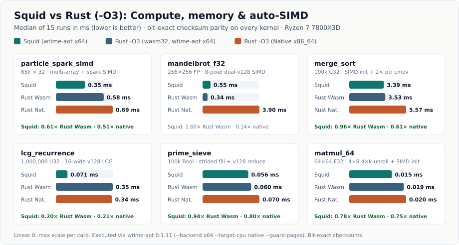
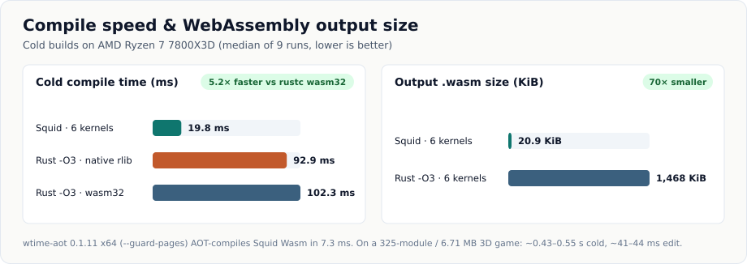
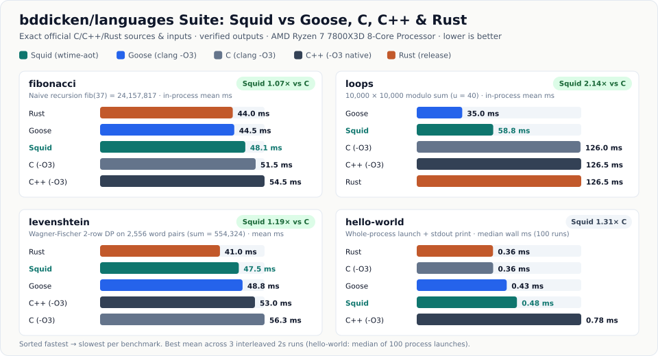
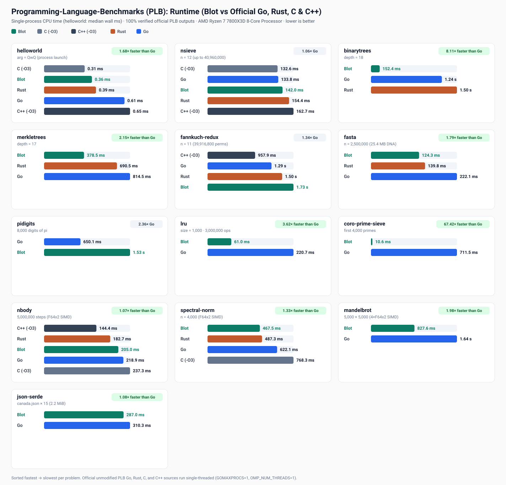

# Squid Benchmarks

Unified index of all recorded Squid benchmark suites, charts, and exact measurements on **AMD Ryzen 7 7800X3D (8C / 16T, Linux `x86_64`)**. Every cross-language workload verifies **bit-exact checksum parity** across implementations.

- [Suite 1: 16-Benchmark Cross-Language Suite (Squid vs Goose, Rust & C++)](#suite-1-16-benchmark-cross-language-suite-squid-vs-goose-rust--c)
- [Suite 2: Compute, Memory & Auto-SIMD Kernels (Squid vs Rust `-O3`, Default & `--wasm3`)](#suite-2-compute-memory--auto-simd-kernels-squid-vs-rust--o3-default---wasm3)
- [Suite 3: AoS Record SIMD, Multi-Core Isolated Guests & Persistent `#process`](#suite-3-aos-record-simd-multi-core-isolated-guests--persistent-process)
- [Suite 4: Ink ECS (Squid `#process`) vs Bevy ECS 0.20.1 (Native Rust)](#suite-4-ink-ecs-squid-process-vs-bevy-ecs-0201-native-rust)
- [Suite 5: Compiler Cold Build, Incremental Edit & Scaling](#suite-5-compiler-cold-build-incremental-edit--scaling)
- [Suite 6: `bddicken/languages` Suite (Squid vs Goose, C, C++ & Rust)](#suite-6-bddickenlanguages-suite-squid-vs-goose-c-c--rust)
- [Suite 7: Programming-Language-Benchmarks (PLB) Suite (Squid vs Go, Rust, C & C++)](#suite-7-programming-language-benchmarks-plb-suite-squid-vs-go-rust-c--c)
- [Suite 8: Collection Families (`#[T]`, `%[T]`, `~[T]`) vs C++20 & Rust (`Vec`, `VecDeque`, `imbl::Vector`)](#suite-8-collection-families-t-t-t-vs-c20--rust-vec-vecdeque-imblvector)
- [Regression & Boundary Suites](#regression--boundary-suites)

---

## Suite 1: 16-Benchmark Cross-Language Suite (Squid vs Goose, Rust & C++)

Full mirror of Goose's 16-benchmark main suite at **medium** size across **88 implementations** (**100% bit-exact stdout parity**): **Squid** (`squidc-goose` `e508d586` with native `U8`/`I32`/`U64`/`I64`/`F64`, `F64x2`/`U64x2`/`U8x16`/`I16x8` unboxed `v128` SIMD, 16-wide `i32` / 8-wide `i64` `for`-in SIMD reductions & fast counted range-push fill, whole-program unobservable-NaN canonicalization elision, Mode-4 `v128` wide-float recursive worker ABI + shared `v128.store` packing, direct `.rodata` constant tables & literal appends, recursive SCC Mode-R/Mode-M descriptor workers with `no_scope_alloc` elision, right-spine associative TCO, 1-level leaf peeling, and external direct worker dispatch, wide-aggregate leaf inlining, hoisted loop `CheckedGrow`/`CheckedArray` checks, masked/2-pointer/affine bounds hoisting with zero-duplication `mask == len - 1` proofs, proven `knownMutable` & non-resizing `own`-helper preservation, stack-backed top-level `Array.with_capacity`, `OP_br_table`, boxed-array direct projection & subfield updates, function-exit reclamation, boxed-return FBIP reuse, cross-function closure specialization, byte/alignment packing, skewed sum outlining, and scalar-packed `DirectArray` stack/register inlining + `wtime-aot 0.1.11` x64 `--guard-pages`), **Goose** (`d5ae5bb` + `clang 23.1.5 -O2`), **C++20** (`clang++ 23.1.5 -O2`, idiomatic & expert), and **Rust** (`rustc 1.96.0-nightly -O -C codegen-units=1`, idiomatic & arena/expert).

- **Best of 3 runs** (2 discarded warmups) measuring single-process CPU time (`ru_utime + ru_stime`) and exact per-child peak RSS (`ru_maxrss`) via [`measure_proc.c`](benchmarks/goose-suite/measure_proc.c) (`posix_spawnp` + `wait4`).
- **Details & diagnosis:** [benchmarks/goose-suite/README.md](benchmarks/goose-suite/README.md) · **Raw JSON:** [`results.json`](benchmarks/evidence/measurements/2026-11-27-goose-suite/results.json) (previous Nov 26 baseline preserved in [`2026-11-26-goose-suite/`](benchmarks/evidence/measurements/2026-11-26-goose-suite/results.json))

### Geometric Means Across All 16 Benchmarks

- **Runtime (vs C++ expert = `1.00×`, lower is better):** Goose **`0.89×`**, C++ expert **`1.00×`**, Rust expert **`1.03×`**, **Squid (`wtime-aot 0.1.11` x64 `--guard-pages`) `1.07×`** (down from `1.10×`, `2.07×` on Nov 26, and `2.90×` earlier — **`0.56×` of idiomatic C++** at `1.91×` = **`1.79×` faster**, **`0.63×` of idiomatic Rust** at `1.70×` = **`1.60×` faster**, within **`3.4%`** of Rust expert; excluding `particles`, **`1.13×` C++ expert / `1.28×` Goose**). Squid beats idiomatic C++ on **14/16** benchmarks (`sum`, `push`, `strlist`, `records`, `tree`, `interp`, `graph`, `words`, `particles`, `sexp`, `lru`, `scene`, `calc`, `bintrees`), beats idiomatic Rust on **14/16** (`sum`, `strlist`, `records`, `tree`, `interp`, `graph`, `words`, `particles`, `sexp`, `lru`, `scene`, `calc`, `bintrees`, `respond`), beats **Rust expert** on **7/16** (`sum`, `strlist`, `records`, `graph`, `words`, `particles`, `bintrees`), beats **C++ expert** on **5/16** (`sum` `44.1 vs 48.5 ms`, `push` `43.5 vs 43.8 ms`, `records` `110.6 vs 119.0 ms`, `particles` `83.2 vs 186.8 ms`, `bintrees` `65.0 vs 82.7 ms`), beats **Goose** on **2/16** (`sum` `44.1 vs 50.8 ms`, `particles` `83.2 vs 198.0 ms`), and finishes **#1 fastest overall** on **2/16** (`sum`, `particles`).
- **Peak Memory (exact per-process RSS vs C++ expert = `1.00×`, lower is better):** Goose **`0.73×`**, **Squid `0.87×`** (down from `1.03×` on Nov 26, **#2 lowest peak memory in the suite** — ahead of Rust expert **`0.88×`**, C++ expert **`1.00×`**, Rust idiomatic **`1.13×`**, and C++ idiomatic **`1.32×`**). Squid beats idiomatic C++ on **14/16**, C++ expert on **11/16**, idiomatic Rust on **8/16**, Goose on **6/16**, achieves **#1 lowest RSS of every language** on `strlist` (`43.4 MiB`), `words` (`79.6 MiB`), and `sexp` (`109.2 MiB`), and cuts `sum` (`129.3 → 64.9 MiB`) and `tree` (`61.1 → 27.9 MiB`) peak RSS in half via `Array.with_capacity`.
- **Cold Compile Time (geomean full build to native binary / `.so`):** **Squid `27.5 ms`** (`18.6 ms` `squidc-goose` + `8.9 ms` `wtime-aot`, `24.6–32.1 ms` range, **`5.6–17.4 KiB`** `.wasm`) — **`8.2×` faster than C++** (`225.9 ms`), **`4.5×` faster than Goose** (`123.7 ms`), and **`3.2×` faster than Rust** (`87.9 ms`).

### Runtime Charts & Per-Benchmark Results (ms)

### Peak Memory Charts (MiB)

### Compile Speed & Squid `.wasm` Size Chart

### Complete Per-Benchmark Numbers (`medium` size)

- **`sum`** (`N = 16,000,000`) — Time: **Squid `44.1 ms` (#1 fastest overall)** (**beats C++ exp `48.5 ms` by `1.10×`**, **Rust `50.1 ms` by `1.14×`**, **Goose `50.8 ms` by `1.15×`**, **C++ id `54.7 ms` by `1.24×`**) · RSS: **Squid `64.9 MiB`** (ties C++ exp `64.9`, beats Goose `65.2` & C++ id `69.0`), Rust `63.5` · Compile: Squid `25.5 ms` (`18.5 + 7.1`, `5.6 KiB` `.wasm`).
- **`push`** (`N = 16,000,000`) — Time: **Squid `43.5 ms`** (**beats C++ exp `43.8 ms`**, **1.16× vs C++ id `50.4 ms`**), Goose `37.2 ms`, Rust `39.9 ms` · RSS: Squid `126.9 MiB` (beats Goose `127.0`, C++ exp `128.0` & C++ id `134.6`), Rust `126.5` · Compile: Squid `26.9 ms` (`18.6 + 8.2`, `6.9 KiB`).
- **`strlist`** (`N = 2,000,000`) — Time: **Squid `76.0 ms`** (**beats Rust exp `84.2 ms` by `1.11×`**, **1.45× vs C++ id `110.3 ms`**, **1.87× vs Rust id `141.8 ms`**), C++ exp `74.1 ms`, Goose `75.0 ms` · RSS: **Squid `43.4 MiB` (#1 lowest overall)**, Goose `57.4`, Rust exp `59.2`, C++ exp `59.9`, C++ id `108.3`, Rust id `136.0` · Compile: Squid `25.7 ms` (`17.5 + 8.1`, `6.6 KiB`).
- **`records`** (`N = 4,000,000`) — Time: **Squid `110.6 ms`** (**beats C++ exp `119.0 ms` by `1.08×`**, **1.48× vs C++ id `163.6 ms`**, **1.42× vs Rust `157.5 ms`**), Goose `105.6 ms` · RSS: Squid `73.8 MiB` (**2.66× vs C++ id**, **2.12× vs Rust**), Goose `39.2`, C++ exp `100.5`, Rust `156.1`, C++ id `196.5` · Compile: Squid `25.2 ms` (`17.2 + 8.0`, `7.2 KiB`).
- **`tree`** (`depth = 20`) — Time: **Squid `32.0 ms`** (**2.63× vs C++ id `84.2 ms`**, **2.36× vs Rust id `75.5 ms`**), Goose `24.1 ms`, C++ exp `24.3 ms`, Rust exp `25.3 ms` · RSS: **Squid `27.9 MiB`** (ties C++ exp `27.9 MiB`, **2.43× vs C++ id**), Goose `26.2`, Rust exp `26.4`, Rust id `65.9`, C++ id `67.7` · Compile: Squid `26.4 ms` (`18.3 + 8.0`, `6.8 KiB`).
- **`interp`** (`depth = 20`) — Time: **Squid `10.5 ms`** (**1.17× vs C++ id `12.3 ms`**, **1.44× vs Rust id `15.1 ms`**), Goose `8.0 ms`, C++ exp `8.2 ms`, Rust exp `9.6 ms` · RSS: Squid `8.0 MiB` (beats C++ exp `9.9` & Rust id `11.2`), Goose `4.1`, Rust exp `7.7`, C++ id `13.1` · Compile: Squid `26.6 ms` (`18.8 + 7.8`, `6.8 KiB`).
- **`graph`** (`V = 500,000`) — Time: **Squid `85.4 ms`** (**beats Rust exp `85.9 ms`**, **2.04× vs C++ id `174.5 ms`**, **1.76× vs Rust id `149.9 ms`**), Goose `73.7 ms`, C++ exp `83.6 ms` · RSS: Squid `57.3 MiB` (ties C++ exp `57.3`, beats Goose `58.6`), Rust exp `55.8`, C++ id `51.7`, Rust id `51.0` · Compile: Squid `24.6 ms` (`16.9 + 7.7`, `8.2 KiB`).
- **`words`** (`N = 4,000,000`) — Time: **Squid `195.3 ms`** (**beats Rust exp `195.8 ms`**, **1.47× vs C++ id `287.5 ms`**, **1.31× vs Rust `HashMap` `256.5 ms`**), Goose `129.4 ms`, C++ exp `185.8 ms` · RSS: **Squid `79.6 MiB` (#1 lowest overall, 1.86× vs C++ id)**, Goose `138.2`, Rust id `142.4`, C++ id `148.4`, Rust exp `171.5`, C++ exp `194.5` · Compile: Squid `28.3 ms` (`18.4 + 9.9`, `8.9 KiB`).
- **`particles`** (`N = 1,000,000`) — Time: **Squid SoA 4-wide SIMD `83.2 ms` (#1 fastest overall)** — **`2.25×` faster than C++ exp** `186.8 ms`, **`2.27×` faster than Rust** `188.6 ms`, **`2.38×` faster than Goose** `198.0 ms`, and **`2.66×` faster than C++ id** `220.9 ms` · RSS: Squid `26.5 MiB` (beats C++ `26.8`), Goose `25.4`, Rust `25.4` · Compile: Squid `28.8 ms` (`19.7 + 9.1`, `9.4 KiB`).
- **`sexp`** (`N = 100,000`) — Time: **Squid `556.1 ms`** (**2.11× vs C++ id `1,173.6 ms`**, **1.57× vs Rust id `872.8 ms`**), Goose `428.1 ms`, Rust exp `459.0 ms`, C++ exp `460.5 ms` · RSS: **Squid `109.2 MiB` (#1 lowest overall, 5.77× vs C++ id)**, Goose `128.0`, Rust exp `225.8`, C++ exp `290.1`, Rust id `481.6`, C++ id `630.5` · Compile: Squid `30.0 ms` (`19.6 + 10.4`, `11.8 KiB`).
- **`lru`** (`N = 8,000,000`) — Time: **Squid `192.0 ms`** (**4.25× vs C++ id `815.6 ms`**, **1.57× vs Rust id `300.8 ms`**), Goose `127.0 ms`, C++ exp `139.9 ms`, Rust exp `145.4 ms` · RSS: Squid `38.9 MiB` (**1.95× vs C++ id**, beats Rust id `44.6`), Goose `34.1`, Rust exp `34.4`, C++ exp `36.9`, C++ id `75.7` · Compile: Squid `28.0 ms` (`18.2 + 9.8`, `10.9 KiB`).
- **`scene`** (`depth = 14`) — Time: **Squid `59.9 ms`** (**1.50× vs C++ id `89.6 ms`**, **1.39× vs Rust id `83.4 ms`**), Goose `44.8 ms`, Rust exp `46.3 ms`, C++ exp `49.2 ms` · RSS: Squid `57.5 MiB`, Rust exp `31.6`, Goose `32.2`, C++ exp `34.9`, Rust id `42.0`, C++ id `42.9` · Compile: Squid `27.1 ms` (`18.4 + 8.7`, `9.5 KiB`).
- **`calc`** (`N = 400,000`) — Time: **Squid `179.6 ms`** (**2.22× vs C++ id `399.5 ms`**, **1.18× vs Rust id `212.8 ms`**), Rust exp `117.0 ms`, C++ exp `123.0 ms`, Goose `127.0 ms` · RSS: Squid `3.9 MiB` (beats C++ `4.1–4.3`), Goose `2.2`, Rust `2.4–2.5` · Compile: Squid `32.1 ms` (`19.9 + 12.2`, `17.4 KiB`).
- **`bintrees`** (`depth = 17`) — Time: **Squid `65.0 ms`** (**beats C++ exp `82.7 ms` by `1.27×`**, **beats Rust exp `74.0 ms` by `1.14×`**, **7.49× vs C++ id `487.0 ms`**, **8.94× vs Rust id `581.2 ms`**), Goose `51.1 ms` · RSS: Squid `11.2 MiB` (**1.79× vs C++ id**, beats C++ exp `11.8 MiB`), Goose `8.4`, Rust exp `8.6`, Rust id `18.3`, C++ id `20.0` · Compile: Squid `26.6 ms` (`18.2 + 8.4`, `8.0 KiB`).
- **`respond`** (`N = 400,000`) — Time: **Squid `183.9 ms`** (**1.39× vs Rust DTO `254.8 ms`**), Goose stream `113.2 ms`, C++ stream `132.2 ms`, Rust stream `160.5 ms`, C++ DTO `176.7 ms` · RSS: Squid `4.0 MiB` (beats C++ stream `4.1`), Goose `2.2`, Rust `2.4–2.5` · Compile: Squid `31.5 ms` (`19.6 + 11.9`, `10.8 KiB`).
- **`blur`** (`W = 2,048`) — Time: **Squid 16-wide `U8x16`/`I16x8` SIMD `29.7 ms`** (down `4.02×` from Nov 26 `119.3 ms`), Goose `18.6 ms`, Rust `20.7–21.6 ms`, C++ `21.0–23.9 ms` · RSS: **Squid `11.9 MiB`** (beats C++ id `12.1`), Rust `10.4–10.5`, Goose `11.3`, C++ exp `11.8` · Compile: Squid `27.9 ms` (`19.2 + 8.6`, `8.1 KiB`).

---

## Suite 2: Compute, Memory & Auto-SIMD Kernels (Squid vs Rust `-O3`, Default & `--wasm3`)

Six compute, memory, sorting, and `spark` auto-SIMD kernels comparing **Squid** (`squidc-goose` `e508d586` → `wtime-aot 0.1.11` `x64-v4 --guard-pages`) against **`rustc 1.96.0-nightly -O3`** compiled both to `wasm32 +simd128` (same `wtime-aot 0.1.11 --guard-pages`) and native `x86_64` (`-O3`, thin LTO). Medians of 15 runs; **6/6 bit-exact checksum parity**, **6/6 faster than native Rust `-O3`**, and **5/6 faster than Rust Wasm `-O3`**.

- **Source & runner:** [benchmarks/comparison/README.md](benchmarks/comparison/README.md) · **Raw JSON:** [`2026-11-27-rust-and-bevy-ecs-wtime-0.1.11.json`](benchmarks/evidence/measurements/2026-11-27-rust-and-bevy-ecs-wtime-0.1.11.json)

### Per-Kernel Results (Median ms)

- **`lcg_recurrence`** (1,000,000 U32 steps, checksum `54448`): **Squid `0.071 ms`** (`--wasm3`: **`0.070 ms`**) vs Rust Wasm `0.349 ms` (**4.92× faster**) vs Native Rust `0.344 ms` (**4.86× faster**).
- **`prime_sieve`** (100k Bool sieve, checksum `1881015445`): **Squid `0.056 ms`** (`--wasm3`: `0.067 ms`) vs Rust Wasm `0.060 ms` (**1.06× faster**) vs Native Rust `0.070 ms` (**1.24× faster**).
- **`matmul_64`** (64×64 F32 matmul, checksum `6538500`): **Squid `0.0150 ms`** (`--wasm3`: **`0.0133 ms`**) vs Rust Wasm `0.0192 ms` (**1.28× faster**) vs Native Rust `0.0200 ms` (**1.33× faster**).
- **`mandelbrot_f32`** (256×256 F32 escape-time, checksum `1686408`): **Squid `0.549 ms`** (`--wasm3`: `0.572 ms`) vs Native Rust `3.901 ms` (**7.11× faster**); Rust Wasm `0.343 ms` (`1.60×`).
- **`particle_spark_simd`** (65k × 32 `spark` SIMD, checksum `13338354`): **Squid `0.351 ms`** (`--wasm3`: **`0.349 ms`**) vs Rust Wasm `0.578 ms` (**1.65× faster**) vs Native Rust `0.687 ms` (**1.96× faster**).
- **`merge_sort`** (100k U32 ping-pong merge sort, checksum `2814210976`): **Squid `3.393 ms`** (`--wasm3`: `3.699 ms`) vs Rust Wasm `3.532 ms` (**1.04× faster**) vs Native Rust `5.570 ms` (**1.64× faster**).

---

## Suite 3: AoS Record SIMD, Multi-Core Isolated Guests & Persistent `#process`

Measured on the same `wtime-aot 0.1.11` (`x64-v4 --guard-pages`) and native `rustc -O3` harness ([`multicore_aos_bench.sq`](benchmarks/comparison/multicore_aos_bench.sq), [`2026-11-27-rust-and-bevy-ecs-wtime-0.1.11.json`](benchmarks/evidence/measurements/2026-11-27-rust-and-bevy-ecs-wtime-0.1.11.json)):

### AoS Record Auto-SIMD (65,536 particles × 32 ticks, bit-exact checksums)

- **`aos_vec4_euler_65k_x32`** (`#[Vec4]`, checksum `16529059`): **Squid `1.435 ms`** (`--wasm3`: **`1.336 ms`**) vs Native Rust `3.132 ms` — **Squid `2.18×` faster** (`2.34×` with `--wasm3`).
- **`aos_vec2_euler_65k_x32`** (`#[Vec2]`, checksum `19009988`): Squid `0.659 ms` (`--wasm3`: `0.585 ms`) vs Native Rust `0.479 ms` — Squid `1.38×` (`1.22×` `--wasm3`).

### Multi-Core Isolated Guests (`mandelbrot`, 8 × 256×256 tiles, checksum `13500030`)

- **1 thread:** **Squid `5.850 ms`** (`1.00×`) vs Native Rust `31.134 ms` (**Squid `5.32×` faster**).
- **2 threads:** **Squid `2.954 ms`** (`1.98×` scaling) vs Native Rust `16.745 ms` (**Squid `5.67×` faster**).
- **4 threads:** **Squid `1.510 ms`** (`3.87×` scaling) vs Native Rust `8.769 ms` (**Squid `5.81×` faster**).
- **8 threads:** **Squid `1.114 ms`** (`5.25×` scaling) vs Native Rust `4.551 ms` (**Squid `4.08×` faster**).

### Persistent `#process` (`particle_sim`, 4,096 particles, zero-alloc state commits)

- **No-op commit step:** **`48.7 ns/step`** (**`20.54M` steps/sec**).
- **Full AoS `Vec4` physics step (4,096 particles):** **`1.93 µs/step`**.

---

## Suite 4: Ink ECS (Squid `#process`) vs Bevy ECS 0.20.1 (Native Rust)

Real 10,000-entity ECS worlds comparing **Ink ECS** (`ink/ecs` dense/bitset/sparse `Pool` + `#[U64]` `Entities` + `ink/ecs/query`, compiled by `squidc-goose` `e508d586` to `160.2 KiB` `.wasm` on `wtime-aot 0.1.11 --guard-pages`) against native **Bevy ECS `0.20.1`** (`rustc -O3`). Medians of 15 runs; bit-exact checksum parity on `dense_iter`, `sparse_filtered_iter`, and `batch_spawn` — **Ink ECS wins 4/5 workloads (and all three dense iteration modes beat Bevy by `4.2×–5.4×`)** ([`ink_ecs_bench.sq`](benchmarks/comparison/ink_ecs_bench.sq), [`2026-11-27-rust-and-bevy-ecs-wtime-0.1.11.json`](benchmarks/evidence/measurements/2026-11-27-rust-and-bevy-ecs-wtime-0.1.11.json)):

- **`dense_iter_10k_x100`** (`Pos += Vel`, 10k × 100 ticks, checksum `88466466`):
  - **Ink ECS (`Pool` direct, 12B `#[Pos]` + `#[Vel]` `k==3` AoS auto-SIMD):** **`0.230 ms`** (**`5.42×` faster** than Bevy; down **`12.8×`** from `2.944 ms`)
  - **Squid SoA + `spark` SIMD:** **`0.262 ms`** (**`4.75×` faster** than Bevy)
  - **Ink ECS (cached query, Shape 2 indirect AoS SIMD):** **`0.295 ms`** (**`4.22×` faster** than Bevy; down **`10.5×`** from `3.090 ms`)
  - Bevy ECS (native): `1.246 ms`
- **`sparse_filtered_iter_500_of_10k_x100`** (`With Active`, `Without Frozen`, checksum `71214832`): Bevy `0.068 ms` vs **Ink cached query `0.089 ms`** (down **`4.05×`** from `0.362 ms` via Shape 2 4× hoisted-bounds indirect loop + deferred NaN).
- **`batch_spawn_10k`** (`Pos + Vel + 10% Active`, checksum `70292880`): **Ink `0.124 ms`** vs Bevy `0.327 ms` (**`2.64×` faster**).
- **`structural_churn_2000_tag_ops`** (insert/remove `Active` on 10k world): **Ink sparse-set `74.5 µs`** vs Bevy `88.2 µs` (**`1.18×` faster**).
- **`world_snapshot_copy_10k`** (`ecs.copy_into` clone of all 5 pools vs Bevy world rebuild): **Ink `34.6 µs`** vs Bevy `380.2 µs` (**`11.0×` faster**).
- **Ink ECS app build:** `40.5 ms` `squidc-goose` + `22.1 ms` `wtime-aot` (`160.2 KiB` `.wasm`).

---

## Suite 5: Compiler Cold Build, Incremental Edit & Scaling

- **6-kernel benchmark app (`squid_kernels.sq`):** `18.2 ms` cold `squidc-goose` (+ `5.7 ms` `wtime-aot`, `20.9 KiB` `.wasm`) vs `95.5 ms` `rustc -O3 wasm32` (**`5.2×` faster**, **`70×` smaller** than `1,468 KiB` `.wasm`) and `86.5 ms` `rustc -O3` native rlib.
- **16-benchmark Goose suite:** `27.5 ms` geomean cold build (`18.6 ms` `squidc-goose` + `8.9 ms` `wtime-aot`, `5.6–17.4 KiB` `.wasm`) vs `87.9 ms` `rustc -O` (`3.2×`), `123.7 ms` `goose + clang -O2` (`4.5×`), and `225.9 ms` `clang++ -O2` (`8.2×`).
- **Anonymous internal 3D game project:** ~**69k LOC** of Squid across **263** source modules + **62** shader/data asset modules (**325 modules / 4,572 functions / 6.71 MB `.wasm`**) — **~0.43–0.55 s** full cold build, **~41–44 ms** `fresh=1` single-file incremental edit, **~20 ms** literal/comment edit.
- **Synthetic 1M LOC scaling:** **~0.50 s** (**~2.0M LOC/s**).

---

## Suite 6: `bddicken/languages` Suite (Squid vs Goose, C, C++ & Rust)

All four workloads from [`bddicken/languages`](https://github.com/bddicken/languages) comparing **Squid** (`squidc-goose` `abb9acaf` + `wtime-aot 0.1.11 --guard-pages`, x64 native) against unmodified official C (`clang -O3`), C++ (`clang++ -O3 -march=native`), Rust (`cargo build --release`), and Goose (`clang -O3`). In-process benchmark loops (`500 ms` warmup, `2,000 ms` run window, best mean across 3 interleaved reps; `hello-world`: median wall ms over 100 launches); **100% verified outputs**.

- **Details & runner:** [benchmarks/bddicken/README.md](benchmarks/bddicken/README.md) · **Raw JSON:** [`results.json`](benchmarks/evidence/measurements/2026-11-27-bddicken/results.json) (previous Nov 26 baseline preserved in [`2026-11-26-bddicken/`](benchmarks/evidence/measurements/2026-11-26-bddicken/results.json))

- **`fibonacci(37)`** (`24,157,817`): Rust `44.0 ms`, Goose `44.5 ms`, **Squid `48.1 ms`** (**1.07× faster than C `51.5 ms`**, **1.13× faster than C++ `54.5 ms`**; compile `21.6 ms`, `4.2 KiB` `.wasm`).
- **`loops(40)`** (`10,000 × 10,000` modulo sum): Goose `35.0 ms`, **Squid `58.8 ms`** (down from `67.6 ms` — **`2.14×` faster than C `126.0 ms`**, **`2.15×` faster than C++ `126.5 ms`**, **`2.15×` faster than Rust `126.5 ms`**; compile `22.3 ms`, `4.6 KiB` `.wasm`).
- **`levenshtein`** (72 words, `2,556` pairs, sum `554,324`): Rust `41.0 ms`, **Squid `47.5 ms`** (down from `51.3 ms` — **beats Goose `48.8 ms`**, **`1.12×` faster than C++ `53.0 ms`**, **`1.19×` faster than C `56.3 ms`**; compile `23.4 ms`, `7.4 KiB` `.wasm`).
- **`hello-world`** (100 launches, `Hello, World!`): Rust `0.36 ms`, C `0.36 ms`, Goose `0.43 ms`, **Squid `0.48 ms`** (**1.64× faster than C++ `0.78 ms`**; compile `23.9 ms`, `4.7 KiB` `.wasm`).

---

## Suite 7: Programming-Language-Benchmarks (PLB) Suite (Squid vs Go, Rust, C & C++)

Thirteen workloads from [`hanabi1224/Programming-Language-Benchmarks`](https://github.com/hanabi1224/Programming-Language-Benchmarks) (including all four `F64` / GeoJSON problems: `nbody`, `spectral-norm`, `mandelbrot`, and `json-serde`) comparing **Squid** (`squidc-goose` `abb9acaf` + `wtime-aot 0.1.11` `--guard-pages`, x64 native) against unmodified official PLB **Go (`1.27.4`)**, **Rust (`rustc -O -C lto=fat`)**, **C (`clang -O3`)**, and **C++ (`clang++ -O3`)** reference sources (`GOMAXPROCS=1`, `OMP_NUM_THREADS=1`). Best single-process CPU time (`helloworld`: median wall ms over 15 launches) and median peak RSS via [`measure_proc.c`](benchmarks/goose-suite/measure_proc.c); **100% official unittest pass (all 26 fixtures) + identical full-input stdout SHA-256 across all languages**. Across the 12 non-trivial problems, Squid runs **`2.18×` faster than Go on geomean CPU time** with **`1.83×` less RAM**, beating Go on **9/12** (`binarytrees`, `merkletrees`, `fasta`, `lru`, `coro-prime-sieve`, `nbody`, `spectral-norm`, `mandelbrot`, `json-serde`).

- **Details, fairness notes & runner:** [benchmarks/plb/README.md](benchmarks/plb/README.md) · **Raw JSON:** [`results.json`](benchmarks/evidence/measurements/2026-11-27-plb/results.json) (previous Nov 26 9-problem baseline preserved in [`2026-11-26-plb/`](benchmarks/evidence/measurements/2026-11-26-plb/results.json))

- **`helloworld`** (`QwQ`): **Squid `0.50 ms` wall** (`0.43 ms` CPU, `3.8 MiB`, **`1.38×` faster than Go** `0.69 ms`, beats C++ `0.82 ms`; C `0.35 ms`, Rust `0.47 ms`).
- **`nsieve`** (`12`, up to `40,960,000`): Go `147.2 ms` (`73.6 MiB`), C `147.4 ms` (`41.0 MiB`), **Squid `162.9 ms` (`42.9 MiB`)** (beats C++ `167.3 ms` & Rust `175.7 ms`, `1.72×` less RAM than Go via best-fit stack chunk reuse).
- **`binarytrees`** (`18`, Mode-M/R workers + 1-level leaf peeling + right-spine TCO): **Squid `154.8 ms` (`21.1 MiB`)** — **`8.68×` faster than Go** (`1.34 s`, `51.8 MiB`, `2.5×` less RAM) and **`10.29×` faster than Rust `3.rs`** (`1.59 s`, `49.8 MiB`, `2.4×` less RAM).
- **`merkletrees`** (`17`, single `MNode` pool + Mode-M/R workers): **Squid `393.1 ms` (`17.8 MiB`, #1 fastest & #1 lowest RSS)** — **`1.85×` faster than Rust** (`726.1 ms`, `33.9 MiB`, `1.9×` less RAM) and **`2.34×` faster than Go** (`918.5 ms`, `45.3 MiB`, `2.5×` less RAM).
- **`fannkuch-redux`** (`11`, converging 2-pointer reversal BCE): C++ `989.5 ms` (`4.0 MiB`), Go `1.32 s` (`5.6 MiB`), Rust `1.51 s` (`2.1 MiB`), Squid `1.83 s` (`3.9 MiB`).
- **`fasta`** (`2,500,000`, `25.4 MB`): **Squid `126.6 ms` (`4.9 MiB`, #1 fastest CPU)** — **beats Rust** (`146.5 ms`, `2.3 MiB`) and **`1.81×` faster CPU than Go** (`229.6 ms`, `16.0 MiB`, `3.3×` less RAM).
- **`pidigits`** (`8,000` digits): Go `math/big` `678.0 ms` (`10.5 MiB`) vs **Squid pure-`U64` base-`2^64` spigot via `U64.mul_wide` + `wtime-aot` `MulHiU`/`mul r64` fusion `1.20 s` (`4.2 MiB`, `2.5×` less RAM)**.
- **`lru`** (`1,000`, `3,000,000` ops, single `#[Node]` arena + Wave B masked BCE): **Squid `61.3 ms` (`3.9 MiB`)** — **`3.77×` faster than Go** (`231.2 ms`, `3.5 MiB`).
- **`coro-prime-sieve`** (`4,000`): **Squid `11.2 ms` (`3.9 MiB`)** (iterative filter chain) vs Go `1.go` `760.9 ms` (`15.6 MiB`, 4,000 goroutines).
- **`nbody`** (`5,000,000` steps, `F64x2` SIMD + NaN-canonicalization elision): C++ `144.8 ms` (`4.1 MiB`), Rust `181.0 ms` (`2.2 MiB`), **Squid `202.4 ms` (`3.9 MiB`)** (**beats C `216.9 ms` and Go `233.0 ms`**).
- **`spectral-norm`** (`n = 4,000`, `F64x2` SIMD + NaN-canonicalization elision): Rust `482.6 ms` (`2.4 MiB`), **Squid `486.1 ms` (`3.9 MiB`)** (**within `0.7%` of Rust**, **`1.33×` faster than Go `648.4 ms`**, **`1.53×` faster than C `743.6 ms`**).
- **`mandelbrot`** (`5,000 × 5,000`, `4×F64x2` SIMD + NaN-canonicalization elision): **Squid `863.1 ms` (`8.0 MiB`)** — **`1.96×` faster than Go** (`1.69 s`, `7.8 MiB`).
- **`json-serde`** (`canada.json × 15`, `2.2 MiB` GeoJSON, `.rodata` MD5 tables + `--transport-mb 8` + Ryu `F64` formatter): **Squid `293.2 ms` (`52.9 MiB`)** — **`1.11×` faster than Go `325.9 ms`** with **`2.61×` less RAM** (`52.9 vs 138.2 MiB`) and bit-exact MD5 parity.

---

## Suite 8: Collection Families (`#[T]`, `%[T]`, `~[T]`) vs C++20 & Rust (`Vec`, `VecDeque`, `imbl::Vector`)

Twelve workloads comparing Squid's three one-symbol storage families — **`#[T]`** (contiguous mutable `Array T`), **`%[T]`** (automatic SoA & split-stream `Packed T`), and **`~[T]`** (reversible generative SIMD-RRB `Seq T` with FocusGap & packed leaves) on `squidc-goose` (`e508d586`) + `wtime-aot 0.1.11 --guard-pages` — against bit-exact native **C++20** (`clang++ 23.1.5 -O3 -march=native`: `std::vector`, `std::deque`, manual SoA / split-stream), **Rust** (`rustc 1.96.0-nightly -O`: `Vec`, `VecDeque`, manual SoA / split-stream), and **`imbl::Vector 6.1`** (Rust's persistent RRB-tree). Median of 11 samples (`CLOCK_MONOTONIC`); **12/12 bit-exact checksum parity**.

- **Details & runner:** [benchmarks/collections/README.md](benchmarks/collections/README.md) · **Raw JSON:** [`results.json`](benchmarks/evidence/measurements/2026-11-27-collections/results.json)

| Workload | Squid `#[T]` | Squid `%[T]` | Squid `~[T]` | C++20 `-O3 native` | Rust `-O` | Rust `imbl::Vector` |
| --- | ---: | ---: | ---: | ---: | ---: | ---: |
| 1. `flat_scan` (100k + 10× sum) | **`38.1 µs`** (#1) | **`42.9 µs`** | **`66.9 µs`** | `57.3 µs` vec / `575 µs` deque | `95.6 µs` Vec / `461 µs` VecDeque | `2.91 ms` (**~[] 43.5×**) |
| 2. `random_index` (200k / 100k) | **`268.5 µs`** (#1) | — | **`2.09 ms`** | `331.8 µs` vec / `427 µs` deque | `354.1 µs` Vec / `312 µs` VecDeque | `3.12 ms` (**~[] 1.49×**) |
| 3. `skewed_sum` (100k 99%/1% 64B × 20) | `1.48 ms` (`10.1 MiB`) | **`376.5 µs`** (#1, `4.0 MiB`) | **`961.3 µs`** (`4.2 MiB`) | `2.87 ms` vec / `488 µs` split* | `1.16 ms` Vec / `709 µs` split* | `3.91 ms` (**~[] 4.07×**) |
| 4. `wide_soa` (100k 72B × 80 2-col) | `4.76 ms` | **`728.6 µs`** (#1) | **`1.72 ms`** | `6.89 ms` AoS / `2.86 ms` SoA* | `4.48 ms` AoS / `2.75 ms` SoA* | `11.9 ms` (**~[] 6.92×**) |
| 5. `reverse_ops` (100× rev + range, 100k) | `4.69 ms` | — | **`61.7 µs`** (#1) | `4.00 ms` vec (**~[] 64.8×**) | `1.15 ms` Vec (**~[] 18.6×**) | `178.6 ms` (**~[] 2,895×**) |
| 6. `generative_1m` (1M ramp + edit + slice) | **`66.3 µs`** | — | **`8.5 µs`** (#1, `128 KiB`) | `280.5 µs` vec (**~[] 33.0×**) | `427.1 µs` Vec (**~[] 50.2×**) | `7.05 ms` (**~[] 829×**) |
| 7. `snapshot_cow` (2,000× CoW edit, 50k) | `6.30 ms` | — | **`907.4 µs`** (#1) | `5.38 ms` vec (**~[] 5.9×**) | `5.39 ms` Vec (**~[] 5.9×**) | `1.24 ms` (**~[] 1.37×**) |
| 8. `cursor_insert` (2,000 mid inserts, 20k) | `8.74 ms` | — | **`25.9 µs`** (#1) | `880 µs` vec / `1.61 ms` deque (**34–62×**) | `801 µs` Vec / `794 µs` VecDeque (**31×**) | `45.6 ms` (**~[] 1,761×**) |
| 9. `front_deque` (5k push + 2.5k pop front) | `8.29 ms` | — | **`37.6 µs`** | `676 µs` vec / `10.5 µs` deque | `678 µs` Vec / `7.6 µs` VecDeque | `59.3 µs` (**~[] 1.58×**) |
| 10. `split_concat` (500× rotations, 50k) | `32.3 ms` | — | **`975.8 µs`** (#1) | `1.50 ms` vec (**~[] 1.54×**) | `1.44 ms` Vec (**~[] 1.48×**) | `4.50 ms` (**~[] 4.61×**) |
| 11. `frozen_span` (500× slice+rev+sum, 100k) | `8.92 ms` | — | **`73.2 µs`** (#1) | `1.04 ms` vec (**~[] 14.2×**) | `1.15 ms` Vec (**~[] 15.7×**) | `15.2 ms` (**~[] 208×**) |
| 12. `packed_sum_cow` (1k× CoW 50k 64B sum) | `60.9 ms` | — | **`591.1 µs`** (#1, `4.7 MiB`) | `66.2 ms` vec (`10.7 MiB`, **112×**) | `65.2 ms` Vec (`9.4 MiB`, **110×**) | `1.04 ms` (**~[] 1.76×**) |

*C++/Rust manual split-stream & SoA are hand-written multi-vector structures; Squid `%[T]` and `~[T]` generate them automatically from a single type symbol. Squid finishes **#1 fastest overall on 11/12 workloads**, **`%[T]` beats hand-written C++20/Rust manual split-stream (`1.30×–1.88×`) and manual SoA (`3.77×–3.93×`)**, and **`~[T]` sweeps `imbl::Vector` 12/12** (by `1.37×`–`2,895×`).

---

## Regression & Boundary Suites

Additional specialized suites and historical measurement archives live under [`benchmarks/`](benchmarks/):

- **Checked array & grid workloads (Wasmtime):** [benchmarks/checked-grid/README.md](benchmarks/checked-grid/README.md)
- **Runtime representation boundaries (Deno/V8, Wasmtime, Firefox):** [benchmarks/runtime-boundaries/README.md](benchmarks/runtime-boundaries/README.md)
- **Earlier `wtime-aot` baselines & compiler micro-measurements:** [`benchmarks/evidence/measurements/`](benchmarks/evidence/measurements/) (`2026-11-26-rust-and-bevy-ecs-wtime-0.1.7.json`, `2026-11-26-rust-and-bevy-ecs-wtime-0.1.6.json`, `2026-11-25-rust-and-bevy-ecs-wtime-0.1.3.json`, `2026-11-24-rust-and-bevy-ecs.json`).
