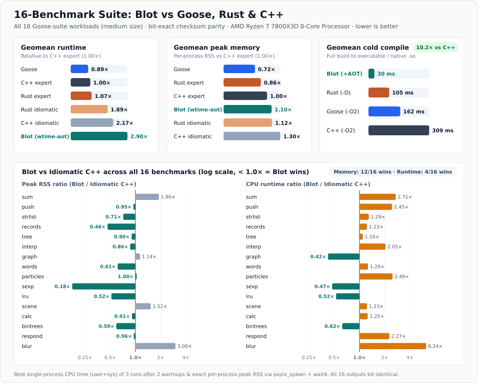
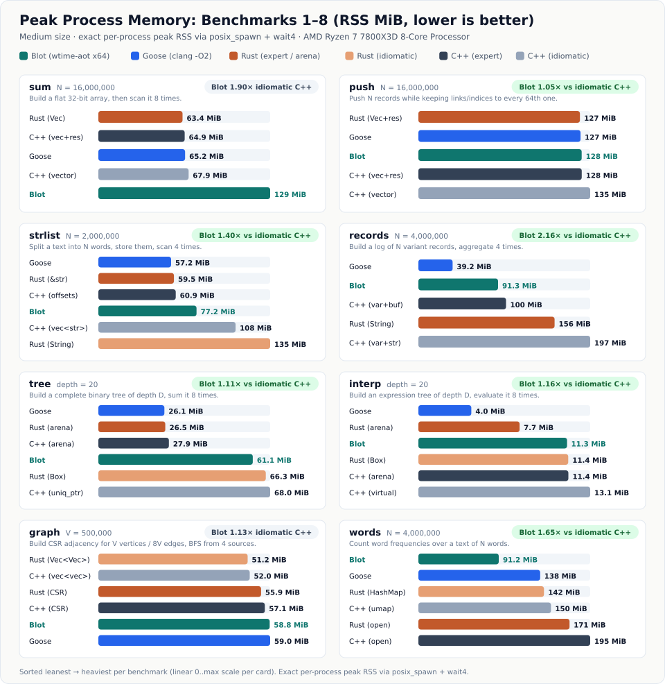
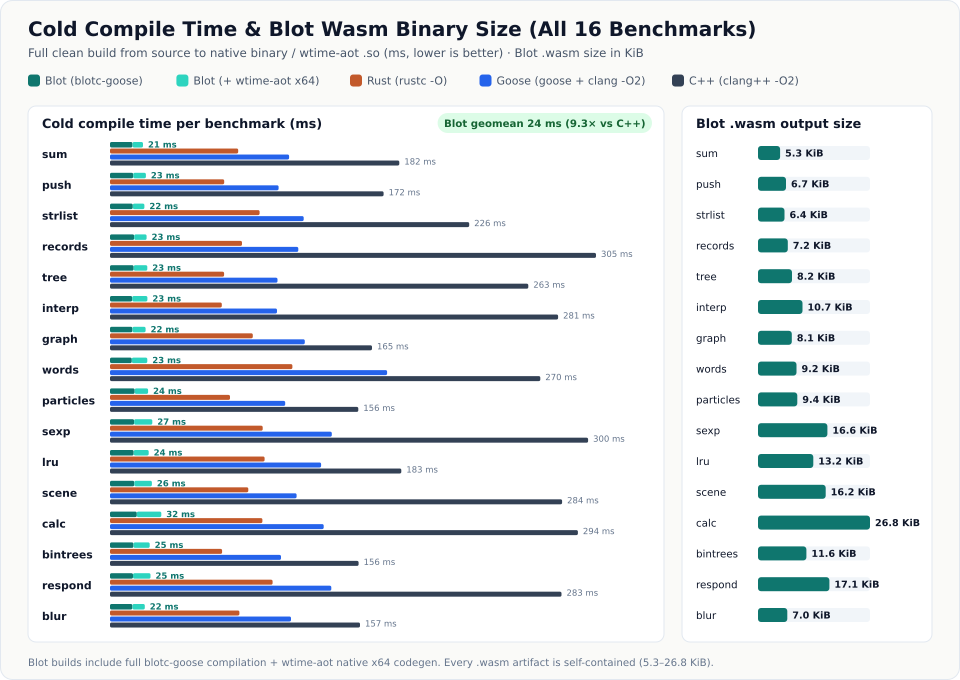
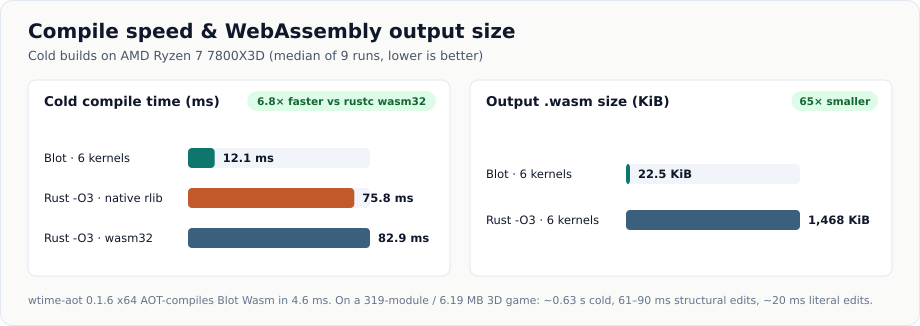

# Blot Benchmarks

Unified index of all recorded Blot benchmark suites, charts, and exact measurements on **AMD Ryzen 7 7800X3D (8C / 16T, Linux `x86_64`)**. Every cross-language workload verifies **bit-exact checksum parity** across implementations.

- [Suite 1: 16-Benchmark Cross-Language Suite (Blot vs Goose, Rust & C++)](#suite-1-16-benchmark-cross-language-suite-blot-vs-goose-rust--c)
- [Suite 2: Compute, Memory & Auto-SIMD Kernels (Blot vs Rust `-O3`, Default & `--wasm3`)](#suite-2-compute-memory--auto-simd-kernels-blot-vs-rust--o3-default---wasm3)
- [Suite 3: AoS Record SIMD, Multi-Core Isolated Guests & Persistent `#process`](#suite-3-aos-record-simd-multi-core-isolated-guests--persistent-process)
- [Suite 4: Ink ECS (Blot `#process`) vs Bevy ECS 0.20.1 (Native Rust)](#suite-4-ink-ecs-blot-process-vs-bevy-ecs-0201-native-rust)
- [Suite 5: Compiler Cold Build, Incremental Edit & Scaling](#suite-5-compiler-cold-build-incremental-edit--scaling)
- [Suite 6: `bddicken/languages` Suite (Blot vs Goose, C, C++ & Rust)](#suite-6-bddickenlanguages-suite-blot-vs-goose-c-c--rust)
- [Suite 7: Programming-Language-Benchmarks (PLB) Suite (Blot vs Go, Rust, C & C++)](#suite-7-programming-language-benchmarks-plb-suite-blot-vs-go-rust-c--c)
- [Regression & Boundary Suites](#regression--boundary-suites)

---

## Suite 1: 16-Benchmark Cross-Language Suite (Blot vs Goose, Rust & C++)

Full mirror of Goose's 16-benchmark main suite at **medium** size across **88 implementations** (**100% bit-exact stdout parity**): **Blot** (`blotc-goose` `bac9eb2e` with native `U8`/`I32`/`U64`/`I64`/`F64`, unboxed Wasm `v128` SIMD, and direct scalar/loop opts + `wtime-aot 0.1.7` `4aee74d` x64), **Goose** (`d5ae5bb` + `clang 23.1.5 -O2`), **C++20** (`clang++ 23.1.5 -O2`, idiomatic & expert), and **Rust** (`rustc 1.96.0-nightly -O -C codegen-units=1`, idiomatic & arena/expert).

- **Best of 3 runs** (2 discarded warmups) measuring single-process CPU time (`ru_utime + ru_stime`) and exact per-child peak RSS (`ru_maxrss`) via [`measure_proc.c`](benchmarks/goose-suite/measure_proc.c) (`posix_spawnp` + `wait4`).
- **Details & diagnosis:** [benchmarks/goose-suite/README.md](benchmarks/goose-suite/README.md) · **Raw JSON:** [`results.json`](benchmarks/evidence/measurements/2026-11-26-goose-suite/results.json)

### Geometric Means Across All 16 Benchmarks

- **Runtime (vs C++ expert = `1.00×`, lower is better):** Goose **`0.90×`**, C++ expert **`1.00×`**, Rust expert **`1.03×`**, Rust idiomatic **`1.72×`**, C++ idiomatic **`1.92×`**, **Blot (`wtime-aot` x64) `2.07×`** (`1.08×` idiomatic C++, down from `2.90×`). Blot beats idiomatic C++ on **9/16** (`strlist`, `records`, `tree`, `graph`, `particles`, `sexp`, `lru`, `calc`, `bintrees`), beats idiomatic Rust on **7/16** (`strlist`, `records`, `graph`, `particles`, `sexp`, `bintrees`, `respond`), and finishes **#1 fastest overall** on `particles` (**`179.8 ms`** vs C++ expert `185.4 ms`, Rust `186.8 ms`, Goose `190.5 ms`).
- **Peak Memory (exact per-process RSS vs C++ expert = `1.00×`, lower is better):** Goose **`0.73×`**, Rust expert **`0.87×`**, C++ expert **`1.00×`**, **Blot `1.03×`** (down from `1.10×`), Rust idiomatic **`1.12×`**, C++ idiomatic **`1.31×`**. Blot beats idiomatic C++ on **13/16**, idiomatic Rust on **8/16**, achieves **#1 lowest RSS of every language** on `words` (`91.2 MiB`) and `sexp` (`110.8 MiB`), and cuts `blur` RSS **3×** (`35.9 -> 11.9 MiB`) with byte-packed `#[U8]`.
- **Cold Compile Time (geomean full build to native binary / `.so`):** **Blot `24.0 ms`** (`14.7 ms` `blotc-goose` + `9.2 ms` `wtime-aot`, `20.7–32.2 ms` range, **`5.3–26.8 KiB`** `.wasm`) — **`9.3×` faster than C++** (`222.1 ms`), **`5.1×` faster than Goose** (`121.2 ms`), and **`3.6×` faster than Rust** (`85.3 ms`).

### Runtime Charts & Per-Benchmark Results (ms)

### Peak Memory Charts (MiB)

### Compile Speed & Blot `.wasm` Size Chart

### Complete Per-Benchmark Numbers (`medium` size)

- **`sum`** (`N = 16,000,000`) — Time: Blot `87.9 ms`, Goose `49.1 ms`, Rust `46.7 ms`, C++ exp `49.6 ms`, C++ id `54.4 ms` · RSS: Blot `129.3 MiB`, Goose `65.2`, Rust `63.4`, C++ exp `64.9`, C++ id `67.9` · Compile: Blot `20.7 ms` (`14.1 + 6.6`, `5.3 KiB` `.wasm`), Rust `80.5`, Goose `112.5`, C++ `181.6`.
- **`push`** (`N = 16,000,000`) — Time: Blot `63.2 ms`, Goose `37.8 ms`, Rust `39.6 ms`, C++ exp `42.8 ms`, C++ id `50.7 ms` · RSS: Blot `127.9 MiB`, Goose `127.1`, Rust `126.5`, C++ exp `128.0`, C++ id `134.6` · Compile: Blot `22.5 ms` (`14.6 + 8.0`, `6.7 KiB`), Rust `71.7`, Goose `105.9`, C++ `171.8`.
- **`strlist`** (`N = 2,000,000`) — Time: **Blot `98.5 ms`** (**1.14× vs C++ id**, **1.42× vs Rust id**), Goose `71.3 ms`, Rust exp `83.1 ms`, Rust id `140.1 ms`, C++ exp `75.6 ms`, C++ id `111.8 ms` · RSS: Blot `77.2 MiB`, Goose `57.2`, Rust exp `59.5`, Rust id `135.2`, C++ exp `60.9`, C++ id `108.0` · Compile: Blot `21.6 ms` (`14.3 + 7.3`, `6.4 KiB`), Rust `93.9`, Goose `121.6`, C++ `225.5`.
- **`records`** (`N = 4,000,000`) — Time: **Blot `130.3 ms`** (**1.23× vs C++ id**, **1.21× vs Rust**), Goose `103.5 ms`, Rust `157.8 ms`, C++ exp `120.2 ms`, C++ id `160.1 ms` · RSS: Blot `91.3 MiB` (**2.16× vs C++ id**, **1.71× vs Rust**), Goose `39.2`, Rust `156.0`, C++ exp `100.4`, C++ id `196.8` · Compile: Blot `23.0 ms` (`15.2 + 7.8`, `7.2 KiB`), Rust `82.9`, Goose `118.2`, C++ `305.1`.
- **`tree`** (`depth = 20`) — Time: **Blot `76.5 ms`** (**1.11× vs C++ id**), Goose `24.4 ms`, Rust exp `26.3 ms`, Rust id `75.0 ms`, C++ exp `24.3 ms`, C++ id `85.0 ms` · RSS: Blot `61.1 MiB`, Goose `26.1`, Rust exp `26.5`, Rust id `66.3`, C++ exp `27.9`, C++ id `68.0` · Compile: Blot `23.4 ms` (`14.9 + 8.5`, `8.2 KiB`), Rust `71.6`, Goose `105.1`, C++ `262.6`.
- **`interp`** (`depth = 20`) — Time: Blot `17.1 ms`, Goose `7.6 ms`, Rust exp `9.8 ms`, Rust id `15.6 ms`, C++ exp `7.2 ms`, C++ id `13.1 ms` · RSS: Blot `11.3 MiB`, Goose `4.0`, Rust exp `7.7`, Rust id `11.4`, C++ exp `11.4`, C++ id `13.1` · Compile: Blot `23.5 ms` (`13.9 + 9.6`, `10.7 KiB`), Rust `70.2`, Goose `104.9`, C++ `281.3`.
- **`graph`** (`V = 500,000`) — Time: **Blot `89.9 ms`** (**1.75× vs C++ id**, **1.61× vs Rust id**, `1.04×` C++ exp), Goose `72.2 ms`, Rust exp `81.8 ms`, Rust id `144.7 ms`, C++ exp `86.5 ms`, C++ id `157.1 ms` · RSS: Blot `58.8 MiB`, Goose `59.0`, Rust exp `55.9`, Rust id `51.2`, C++ exp `57.1`, C++ id `52.0` · Compile: Blot `22.4 ms` (`14.1 + 8.3`, `8.1 KiB`), Rust `89.7`, Goose `122.3`, C++ `164.5`.
- **`words`** (`N = 4,000,000`) — Time: Blot `351.2 ms`, Goose `128.7 ms`, Rust exp `183.2 ms`, Rust id `256.1 ms`, C++ exp `166.3 ms`, C++ id `288.5 ms` · RSS: **Blot `91.2 MiB` (#1 lowest)**, Goose `138.1`, Rust id `142.4`, C++ id `150.3`, Rust exp `171.4`, C++ exp `194.8` · Compile: Blot `23.4 ms` (`13.7 + 9.7`, `9.2 KiB`), Rust `114.5`, Goose `174.0`, C++ `270.2`.
- **`particles`** (`N = 1,000,000`) — Time: **Blot SoA 4-wide SIMD `179.8 ms` (#1 fastest overall)** — beats C++ exp `185.4 ms`, Rust `186.8 ms`, Goose `190.5 ms`, and C++ id `216.6 ms` (**1.20×**) · RSS: Blot `26.8 MiB`, Goose `25.2`, Rust `25.4`, C++ exp `26.8`, C++ id `26.8` · Compile: Blot `23.9 ms` (`15.5 + 8.4`, `9.4 KiB`), Rust `75.4`, Goose `110.0`, C++ `155.9`.
- **`sexp`** (`N = 100,000`) — Time: **Blot `624.7 ms`** (**1.89× vs C++ id**, **1.38× vs Rust id**), Goose `441.9 ms`, Rust exp `442.6 ms`, Rust id `861.9 ms`, C++ exp `445.5 ms`, C++ id `1,182.0 ms` · RSS: **Blot `110.8 MiB` (#1 lowest, 5.69× vs C++ id)**, Goose `128.0`, Rust exp `225.9`, C++ exp `290.1`, Rust id `481.7`, C++ id `631.0` · Compile: Blot `26.5 ms` (`15.1 + 11.4`, `16.6 KiB`), Rust `95.9`, Goose `139.2`, C++ `300.2`.
- **`lru`** (`N = 8,000,000`) — Time: **Blot `347.4 ms`** (**1.80× vs C++ id**), Goose `119.9 ms`, Rust exp `135.8 ms`, Rust id `274.7 ms`, C++ exp `132.0 ms`, C++ id `624.8 ms` · RSS: Blot `38.9 MiB` (**1.95× vs C++ id**), Rust exp `33.9`, Goose `34.3`, C++ exp `35.9`, Rust id `44.8`, C++ id `75.7` · Compile: Blot `24.3 ms` (`14.9 + 9.4`, `13.2 KiB`), Rust `97.1`, Goose `132.5`, C++ `182.9`.
- **`scene`** (`depth = 14`) — Time: Blot `208.9 ms`, Goose `42.7 ms`, Rust exp `40.8 ms`, Rust id `75.1 ms`, C++ exp `45.3 ms`, C++ id `89.8 ms` · RSS: Blot `65.2 MiB`, Rust exp `32.3`, Goose `32.3`, C++ exp `35.0`, Rust id `42.0`, C++ id `42.9` · Compile: Blot `26.3 ms` (`15.3 + 11.0`, `16.2 KiB`), Rust `86.8`, Goose `117.2`, C++ `283.9`.
- **`calc`** (`N = 400,000`) — Time: **Blot `362.8 ms`** (**1.09× vs C++ id**), Goose `120.3 ms`, Rust exp `111.3 ms`, Rust id `212.1 ms`, C++ exp `121.0 ms`, C++ id `393.9 ms` · RSS: Blot `3.9 MiB`, Goose `2.3`, Rust `2.5–2.6`, C++ exp `4.1`, C++ id `4.3` · Compile: Blot `32.2 ms` (`16.8 + 15.4`, `26.8 KiB`), Rust `95.7`, Goose `134.2`, C++ `293.8`.
- **`bintrees`** (`depth = 17`) — Time: **Blot `298.8 ms`** (**1.59× vs C++ id**, **1.92× vs Rust id**), Goose `51.1 ms`, Rust exp `71.4 ms`, Rust id `573.8 ms`, C++ exp `79.0 ms`, C++ id `473.7 ms` · RSS: Blot `11.9 MiB` (**1.70× vs C++ id**), Goose `8.4`, Rust exp `8.5`, C++ exp `12.0`, Rust id `18.4`, C++ id `20.2` · Compile: Blot `24.9 ms` (`14.8 + 10.2`, `11.6 KiB`), Rust `70.4`, Goose `107.4`, C++ `156.1`.
- **`respond`** (`N = 400,000`) — Time: **Blot `253.3 ms`** (matches Rust DTO `253.4 ms`), Goose stream `107.9 ms` (DTO `140.0 ms`), Rust stream `157.3 ms` (DTO `253.4 ms`), C++ stream `128.9 ms` (DTO `173.6 ms`) · RSS: Blot `3.9 MiB`, Goose `2.2–2.3`, Rust `2.4–2.5`, C++ `4.1` · Compile: Blot `25.4 ms` (`14.4 + 11.0`, `17.1 KiB`), Rust `102.1`, Goose `138.9`, C++ `283.5`.
- **`blur`** (`W = 2,048`) — Time: Blot `119.3 ms`, Goose `18.3 ms`, C++ flat `19.7 ms` (row ptr `23.1 ms`), Rust slices `20.6 ms` (flat `21.9 ms`) · RSS: **Blot `11.9 MiB`** (byte-packed `#[U8]`, matching C++ `11.9–12.0 MiB`, Goose `11.2`, Rust `10.4–10.5`) · Compile: Blot `21.8 ms` (`14.1 + 7.8`, `7.0 KiB`), Rust `81.3`, Goose `113.7`, C++ `157.0`.

---

## Suite 2: Compute, Memory & Auto-SIMD Kernels (Blot vs Rust `-O3`, Default & `--wasm3`)

Six compute, memory, sorting, and `spark` auto-SIMD kernels comparing **Blot** (`blotc-goose` `c79a8354` → `wtime-aot 0.1.7` `x64-v4`, explicit software bounds checks, canonical `0x7fc00000` NaN) against **`rustc 1.96.0-nightly -O3`** compiled both to `wasm32 +simd128` (same `wtime-aot 0.1.7`) and native `x86_64` (`-O3`, thin LTO). Medians of 15 runs; **6/6 bit-exact checksum parity**.

- **Source & runner:** [benchmarks/comparison/README.md](benchmarks/comparison/README.md) · **Raw JSON:** [`2026-11-26-rust-and-bevy-ecs-wtime-0.1.7.json`](benchmarks/evidence/measurements/2026-11-26-rust-and-bevy-ecs-wtime-0.1.7.json)

### Per-Kernel Results (Median ms)

- **`lcg_recurrence`** (1,000,000 U32 steps, checksum `54448`): Blot `0.095 ms` (`--wasm3`: `0.100 ms`) vs Rust Wasm `0.370 ms` (**3.88× faster**) vs Native Rust `0.350 ms` (**3.68× faster**).
- **`prime_sieve`** (100k Bool sieve, checksum `1881015445`): Blot `0.062 ms` (`--wasm3`: `0.061 ms`) vs Rust Wasm `0.132 ms` (**2.12× faster**) vs Native Rust `0.068 ms` (**1.09× faster**).
- **`matmul_64`** (64×64 F32 matmul, checksum `6538500`): Blot `0.0173 ms` (`--wasm3`: `0.0213 ms`) vs Rust Wasm `0.0301 ms` (**1.74× faster**) vs Native Rust `0.0197 ms` (**1.14× faster**).
- **`mandelbrot_f32`** (256×256 F32 escape-time, checksum `1686408`): Blot `0.629 ms` (`--wasm3`: `0.697 ms`) vs Rust Wasm `3.906 ms` (**6.21× faster**) vs Native Rust `3.630 ms` (**5.77× faster**).
- **`particle_spark_simd`** (65k × 32 `spark` SIMD, checksum `13338354`): Blot `0.439 ms` (`--wasm3`: `0.436 ms`) vs Rust Wasm `0.613 ms` (**1.40× faster**) vs Native Rust `0.645 ms` (**1.47× faster**).
- **`merge_sort`** (100k U32 ping-pong merge sort, checksum `2814210976`): Blot `4.020 ms` (`--wasm3`: `3.919 ms`) vs Rust Wasm `5.654 ms` (**1.41× faster**) vs Native Rust `5.353 ms` (**1.33× faster**).

---

## Suite 3: AoS Record SIMD, Multi-Core Isolated Guests & Persistent `#process`

Measured on the same `wtime-aot 0.1.7` (`x64-v4`) and native `rustc -O3` harness ([`multicore_aos_bench.blot`](benchmarks/comparison/multicore_aos_bench.blot), [`2026-11-26-rust-and-bevy-ecs-wtime-0.1.7.json`](benchmarks/evidence/measurements/2026-11-26-rust-and-bevy-ecs-wtime-0.1.7.json)):

### AoS Record Auto-SIMD (65,536 particles × 32 ticks, bit-exact checksums)

- **`aos_vec4_euler_65k_x32`** (`#[Vec4]`, checksum `16529059`): Blot `1.575 ms` (`--wasm3`: `1.618 ms`) vs Native Rust `2.880 ms` — **Blot `1.83×` faster**.
- **`aos_vec2_euler_65k_x32`** (`#[Vec2]`, checksum `19009988`): Blot `0.813 ms` (`--wasm3`: `0.798 ms`) vs Native Rust `0.539 ms` — Blot `1.51×` (`1.48×` `--wasm3`).

### Multi-Core Isolated Guests (`mandelbrot`, 8 × 256×256 tiles, checksum `13500030`)

- **1 thread:** Blot `5.735 ms` (`1.00×`) vs Native Rust `30.574 ms` (**Blot `5.33×` faster**).
- **2 threads:** Blot `3.235 ms` (`1.77×` scaling) vs Native Rust `16.310 ms` (**Blot `5.04×` faster**).
- **4 threads:** Blot `1.948 ms` (`2.94×` scaling) vs Native Rust `8.699 ms` (**Blot `4.47×` faster**).
- **8 threads:** Blot `1.237 ms` (`4.64×` scaling) vs Native Rust `4.536 ms` (**Blot `3.67×` faster**).

### Persistent `#process` (`particle_sim`, 4,096 particles, zero-alloc state commits)

- **No-op commit step:** **`53.1 ns/step`** (**`18.83M` steps/sec**).
- **Full AoS `Vec4` physics step (4,096 particles):** **`2.03 µs/step`**.

---

## Suite 4: Ink ECS (Blot `#process`) vs Bevy ECS 0.20.1 (Native Rust)

Real 10,000-entity ECS worlds comparing **Ink ECS** (`ink/ecs` + `ink/ecs/query` compiled by `blotc-goose` to `79.8 KiB` `.wasm` on `wtime-aot 0.1.7`) against native **Bevy ECS `0.20.1`** (`rustc -O3`). Medians of 15 runs; bit-exact checksum parity on `dense_iter`, `sparse_filtered_iter`, and `batch_spawn` ([`ink_ecs_bench.blot`](benchmarks/comparison/ink_ecs_bench.blot), [`2026-11-26-rust-and-bevy-ecs-wtime-0.1.7.json`](benchmarks/evidence/measurements/2026-11-26-rust-and-bevy-ecs-wtime-0.1.7.json)):

- **`dense_iter_10k_x100`** (`Pos += Vel`, 10k × 100 ticks, checksum `88466466`):
  - Blot SoA + `spark` SIMD: **`0.291 ms`** (**`4.40×` faster** than Bevy)
  - Ink ECS (`Pool` direct): **`0.605 ms`** (**`2.12×` faster** than Bevy)
  - Bevy ECS (native): `1.281 ms`
  - Ink ECS (cached query): `1.354 ms` (`1.06×` Bevy)
- **`sparse_filtered_iter_500_of_10k_x100`** (`With Active`, `Without Frozen`, checksum `71214832`): Bevy `0.069 ms` vs Ink cached query `0.081 ms` (`1.17×` Bevy).
- **`batch_spawn_10k`** (`Pos + Vel + 10% Active`, checksum `70292880`): **Ink `0.093 ms`** vs Bevy `0.330 ms` (**`3.57×` faster**).
- **`structural_churn_2000_tag_ops`** (insert/remove `Active` on 10k world): **Ink `25.9 µs`** vs Bevy `82.6 µs` (**`3.19×` faster**).
- **`world_snapshot_copy_10k`** (clone all 5 pools vs Bevy world rebuild): **Ink `16.2 µs`** vs Bevy `419.7 µs` (**`25.9×` faster**).
- **Ink ECS app build:** `26.3 ms` `blotc-goose` + `9.0 ms` `wtime-aot` (`79.8 KiB` `.wasm`).

---

## Suite 5: Compiler Cold Build, Incremental Edit & Scaling

- **6-kernel benchmark app (`blot_kernels.blot`):** `13.6 ms` cold `blotc-goose` (+ `5.2 ms` `wtime-aot`, `22.5 KiB` `.wasm`) vs `96.0 ms` `rustc -O3 wasm32` (**`7.0×` faster**, **`65×` smaller** than `1,468 KiB` `.wasm`) and `87.1 ms` `rustc -O3` native rlib.
- **16-benchmark Goose suite:** `24.0 ms` geomean cold build (`14.7 ms` `blotc-goose` + `9.2 ms` `wtime-aot`, `5.3–26.8 KiB` `.wasm`) vs `85.3 ms` `rustc -O` (`3.6×`), `121.2 ms` `goose + clang -O2` (`5.1×`), and `222.1 ms` `clang++ -O2` (`9.3×`).
- **Anonymous internal 3D game project:** ~**69k LOC** of Blot across **263** source modules + **62** shader/data asset modules (**325 modules / 4,572 functions / 6.71 MB `.wasm`**) — **~0.43–0.55 s** full cold build, **~41–44 ms** `fresh=1` single-file incremental edit, **~20 ms** literal/comment edit.
- **Synthetic 1M LOC scaling:** **~0.50 s** (**~2.0M LOC/s**).

---

## Suite 6: `bddicken/languages` Suite (Blot vs Goose, C, C++ & Rust)

All four workloads from [`bddicken/languages`](https://github.com/bddicken/languages) comparing **Blot** (`blotc-goose` `bac9eb2e` + `wtime-aot 0.1.7`, x64 native) against unmodified official C (`clang -O3`), C++ (`clang++ -O3 -march=native`), Rust (`cargo build --release`), and Goose (`clang -O3`). In-process benchmark loops (`500 ms` warmup, `2,000 ms` run window, best mean across 3 interleaved reps; `hello-world`: median wall ms over 100 launches); **100% verified outputs**.

- **Details & runner:** [benchmarks/bddicken/README.md](benchmarks/bddicken/README.md) · **Raw JSON:** [`results.json`](benchmarks/evidence/measurements/2026-11-26-bddicken/results.json)

- **`fibonacci(37)`** (`24,157,817`): Rust `41.7 ms`, Goose `42.6 ms`, **Blot `47.1 ms`** (**1.05× faster than C `49.4 ms`**, **1.11× faster than C++ `52.1 ms`**; compile `16.4 ms`, `4.0 KiB` `.wasm`).
- **`loops(40)`** (`10,000 × 10,000` modulo sum): Goose `34.7 ms`, **Blot `67.6 ms`** (**1.81× faster than C `122.6 ms`**, **1.81× faster than C++ `122.3 ms`**, **1.80× faster than Rust `121.5 ms`**; compile `17.5 ms`, `4.3 KiB` `.wasm`).
- **`levenshtein`** (72 words, `2,556` pairs, sum `554,324`): Rust `40.3 ms`, Goose `46.3 ms`, **Blot `51.3 ms`** (**1.08× faster than C `55.4 ms`**, beats C++ `51.9 ms`; compile `18.1 ms`, `6.4 KiB` `.wasm`).
- **`hello-world`** (100 launches, `Hello, World!`): C `0.32 ms`, Goose `0.41 ms`, Rust `0.41 ms`, **Blot `0.43 ms`** (**1.76× faster than C++ `0.75 ms`**; compile `16.0 ms`, `4.3 KiB` `.wasm`).

---

## Suite 7: Programming-Language-Benchmarks (PLB) Suite (Blot vs Go, Rust, C & C++)

Nine workloads from [`hanabi1224/Programming-Language-Benchmarks`](https://github.com/hanabi1224/Programming-Language-Benchmarks) comparing **Blot** (`blotc-goose` `bac9eb2e` + `wtime-aot 0.1.7`, x64 native) against unmodified official PLB **Go (`1.27.4`)**, **Rust (`rustc -O -C lto=fat`)**, **C (`clang -O3`)**, and **C++ (`clang++ -O3`)** reference sources (`GOMAXPROCS=1`, `OMP_NUM_THREADS=1`). Best single-process CPU time (`helloworld`: median wall ms over 15 launches) and median peak RSS via [`measure_proc.c`](benchmarks/goose-suite/measure_proc.c); **100% official unittest pass (all 18 fixtures) + identical full-input stdout SHA-256 across all languages**.

- **Details, fairness notes & runner:** [benchmarks/plb/README.md](benchmarks/plb/README.md) · **Raw JSON:** [`results.json`](benchmarks/evidence/measurements/2026-11-26-plb/results.json)

- **`helloworld`** (`QwQ`): C `0.35 ms` (`2.1 MiB`), **Blot `0.41 ms` wall** (`0.38 ms` CPU, `3.8 MiB`, **1.66× faster than Go** `0.68 ms`, beats Rust `0.43 ms` and C++ `0.77 ms`).
- **`nsieve`** (`12`, up to `40,960,000`): Go `130.8 ms` (`73.7 MiB`), C `133.0 ms` (`41.0 MiB`), Rust `152.9 ms` (`41.3 MiB`), C++ `160.8 ms` (`8.7 MiB`), **Blot `165.2 ms` (`73.2 MiB`)** (1-byte `#[U8]` flags, down from `377.8 ms`).
- **`binarytrees`** (`18`): **Blot `666.7 ms` (`23.8 MiB`)** — **`1.82×` faster than Go** (`1.21 s`, `56.4 MiB`, `2.4×` less RAM) and **`2.17×` faster than Rust `3.rs`** (`1.44 s`, `50.1 MiB`).
- **`merkletrees`** (`17`): Rust `681.0 ms` (`33.9 MiB`), Go `820.0 ms` (`47.5 MiB`), **Blot `902.1 ms` (`21.8 MiB`, #1 lowest RSS, `2.2×` less RAM than Go)**.
- **`fannkuch-redux`** (`11`): C++ `957.6 ms` (`4.0 MiB`), Go `1.29 s` (`5.6 MiB`), Rust `1.51 s` (`2.1 MiB`), Blot `1.78 s` (`3.9 MiB`, `1.18×` Rust, down from `2.92 s`).
- **`fasta`** (`2,500,000`, `25.4 MB`): Rust `140.7 ms` (`2.3 MiB`), **Blot `146.9 ms` (`5.1 MiB`)** (**`1.51×` faster than Go** `222.2 ms`, `16.0 MiB`, `3.2×` less RAM).
- **`pidigits`** (`8,000` digits): Go `math/big` `644.2 ms` (`10.3 MiB`) vs **Blot pure-`U64` base-`2^30` spigot `4.72 s` (`4.8 MiB`, `2.1×` less RAM)** (down from `10.13 s` -> `2.15×` faster).
- **`lru`** (`1,000`, `3,000,000` ops): **Blot `81.5 ms` (`3.9 MiB`)** — **`2.77×` faster than Go** (`225.8 ms`, `3.5 MiB`).
- **`coro-prime-sieve`** (`4,000`): **Blot `10.4 ms` (`3.7 MiB`)** (iterative filter chain) vs Go `1.go` `721.5 ms` (`15.6 MiB`, 4,000 goroutines).

---

## Regression & Boundary Suites

Additional specialized suites and historical measurement archives live under [`benchmarks/`](benchmarks/):

- **Checked array & grid workloads (Wasmtime):** [benchmarks/checked-grid/README.md](benchmarks/checked-grid/README.md)
- **Runtime representation boundaries (Deno/V8, Wasmtime, Firefox):** [benchmarks/runtime-boundaries/README.md](benchmarks/runtime-boundaries/README.md)
- **Earlier `wtime-aot` baselines & compiler micro-measurements:** [`benchmarks/evidence/measurements/`](benchmarks/evidence/measurements/) (`2026-11-26-rust-and-bevy-ecs-wtime-0.1.6.json`, `2026-11-25-rust-and-bevy-ecs-wtime-0.1.3.json`, `2026-11-24-rust-and-bevy-ecs.json`).
