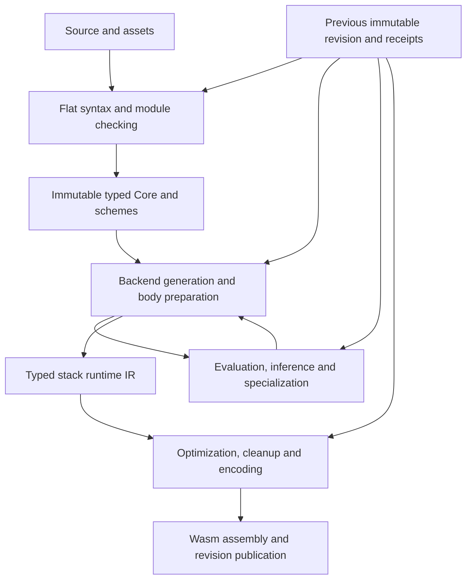

# Compiler architecture review

Reviewed 25 October 2026 against `e56375d` and the qualified CT110 release.

The next large improvement should change the unit of compilation and reuse. Blot
has a coherent ownership model and substantial incremental machinery, but
ordinary edits still reconstruct too much semantic work inside backend
generation. Another series of local caches is unlikely to take the measured
three-to-five-second edits below one second by itself.

Preserve immutable Core, dense IDs, separate semantic and representation
identities, transactional publication, and the current Wasm backend. Build a
stronger boundary around completed function judgments: stable interfaces,
explicit semantic dependencies, reusable elaborated bodies, and a development
policy that limits specialization. This is an incremental architectural change,
not a recommendation to discard the compiler.

## What the measurements establish

The [CT110 qualification](zig-native/CT110_QUALIFICATION.md) contains seven
alternating, unprofiled release pairs on the frozen 554-file workload with 189
game dependency modules. The compiler uses LLVM, four codegen workers, serial
semantic work, optimized code generation, and no restart cache. These timings
exclude compiler construction and game execution.

| Build          | Wall median | Process CPU median |
| -------------- | ----------: | -----------------: |
| Fresh game     |     7.335 s |            7.600 s |
| Literal edit   |     3.034 s |            3.270 s |
| Literal revert |     2.735 s |            2.730 s |
| Body edit      |     5.035 s |            5.200 s |
| Body revert    |     4.912 s |            4.920 s |

A separate CT110 diagnostic profile locates the work. Its slower timings are not
additional samples of the unprofiled distribution. The following CPU columns are
exclusive time on the coordinating thread; worker CPU is separate.

| Work                 | Literal edit | Body edit |
| -------------------- | -----------: | --------: |
| Inference CPU        |      1.380 s |   3.954 s |
| Fragment lookup CPU  |      0.441 s |   0.399 s |
| Evaluation CPU       |      0.289 s |   0.259 s |
| Constants CPU        |      0.180 s |   0.204 s |
| Layout CPU           |      0.090 s |   0.102 s |
| Query validation CPU |      0.082 s |   0.076 s |
| Replay CPU           |      0.076 s |   0.071 s |
| Inference regions    |        2,934 |     7,216 |
| Principal reuse      |        20/20 |     17/20 |

The changed module's frontend check takes 73–76 ms; lexing, parsing, lowering,
freezing and validation together add about 47–49 ms. Backend generation still
occupies 3.198/5.638 s in those profiled builds. Its name is misleading if read
as just machine-code emission: it includes the semantic work above.

The three missed body principals account for 3,346,924 solver nodes and 2.594 s
of inclusive region time. Inclusive region clocks can overlap and must not be
added to the exclusive inference clock. The dependencies still requiring body
proof include inferred requirements in `walk_material` and `haul_all_observed`;
CT110's written-header improvement did not eliminate them.

Even subtracting all measured exclusive inference wall time leaves about 1.95 s
for the literal edit and 1.81 s for the body edit. This is arithmetic on the
serial profile, not a realizable speedup prediction. It shows why fixing only
the three principals would still leave the sub-second goal open.

CT110 removes 86% of literal effect-label visits but improves paired total CPU
only 4.4%. Most eliminated visits were already cheap certificate hits. Solver
region counts are unchanged. This is evidence to prioritize avoiding whole
computations over making another individual visit cheaper.

Fresh compilation is a different target: the diagnostic profile spends 1.733 s
in frontend checking alone, plus lowering, freezing and backend work. The
ordinary-edit target must not be advertised as a sub-second fresh build.

### Development tier and semantic-worker screen

This review also runs the unchanged qualified release through 115 builds: 15
independent fresh controls, 75 unprofiled samples and 25 profiled samples. All
outputs validate as Wasm. Optimized outputs match the existing strict pins;
development outputs match independent fresh controls in that tier. The game is
not executed in this screen, so it does not independently establish cross-tier
runtime equivalence. Input and binary pins pass before and after each group.

Three alternating unprofiled rounds with the default semantic policy give:

| Build        | Optimized wall | Development wall | Optimized CPU | Development CPU |
| ------------ | -------------: | ---------------: | ------------: | --------------: |
| Fresh        |        6.363 s |          6.288 s |       6.600 s |         6.320 s |
| Literal edit |        2.637 s |          2.504 s |       2.840 s |         2.570 s |
| Body edit    |        4.407 s |          4.365 s |       4.560 s |         4.360 s |

These are screening medians on the shared host, not a new seven-pair
qualification or a comparison against the earlier CT110 run. Within-round median
CPU differences are -3.8% fresh, -9.5% literal and -4.6% body. Both tiers retain
exactly 2,934/7,216 literal/body inference regions and 20/20 versus 17/20
principal hits. Skipping optimization helps, but leaves the dominant semantic
work intact.

A separate group compares explicit one-worker component mode with four-worker
component mode, plus development mode with one component worker. Explicit
`semanticWorkers: 1` enables the component path; omission preserves the default
inference path. Do not merge these sequential groups into one paired comparison.
The component group encounters substantial host noise, including a four-worker
fresh wall range of 6.36–22.06 s, so it does not establish a useful
worker-policy speedup or a reliable regression magnitude.

Its profiles are more diagnostic: both one and four workers schedule 281 jobs in
14 batches and retain 17/20 body principal hits. The body edit records 9,718
recording-gated and 4,405 no-IO scheduling attempts out of 14,227 attempts.
Component mode counts 8,646 body regions, versus 7,216 in the default path. The
extra private work and unchanged expensive principals show why raising the
worker limit is not a substitute for changing query boundaries.

Raw samples, executed harnesses, pins, summaries and completion records are in
`build/bench/architecture-review-20261025/`, preserved in the
[review measurement archive](zig-native/measurements/architecture-review-2026-10-25.tar.gz).
The 14-file archive is 171,828 bytes with SHA-256
`70af4bcdeb790f0c63ad05b501b6f7cc5084da1b66c0a4a075a6a24c3224d337`; every
archived member was compared with its local original. It contains no compiler
binaries or private source snapshot.

## How the compiler actually works

1. The native compiler owns parsing, checking, evaluation, specialization and
   Wasm construction. Deno supplies the client, formatter and guest host.
2. Checking produces frozen Core with schemes, residual requirements, source
   origins and exact identities. This is useful typed input, but it does not
   settle every selected call, capture, effect and runtime representation.
3. A compilation attempt creates a new Generator and evaluator Session. Retained
   candidates are admitted, translated into the current owners, and replayed.
   Unchanged frontend dependency modules are already shared well.
4. Backend preparation requests semantic judgments as it discovers concrete
   calls and representations. Expected physical shapes can seed new semantic
   inference. Staged values and captured generic callables can require further
   checking. Prepared bodies record decisions within the current Generator.
5. The compact typed stack IR goes through cleanup and optional optimizations;
   function fragments are relocated and the complete Wasm module is assembled.
6. Only successful compilation publishes the next revision. Failure preserves
   the previous successful revision.

The feedback edge is visible in
[specialization](zig-native/src/eval/specialization.zig), where layout seeds are
converted to evidence and a miss calls `bodyEvidencePartialFullCode` or
`closureEvidencePartialCapturesCode`. It is also explicit in
[core_backend](zig-native/src/backend/core_backend.zig): function requests first
attempt retained reconstruction, then prepare a fresh specialization.

The existing [resolved body](zig-native/src/backend/resolved_body.zig) is a good
foundation. It owns selected decisions, mappings and rows, and a missing
prepared slot is an implementation error. However, its handles belong to one
Generator. The proposed stronger boundary is a reusable semantic artifact before
emission, not merely another extraction of methods into a file.

## Coherence and remaining architectural tensions

| Area                               | Assessment                                                       | Consequence                                                                                             |
| ---------------------------------- | ---------------------------------------------------------------- | ------------------------------------------------------------------------------------------------------- |
| Ownership and failed edits         | Strong, explicit, transactional                                  | Keep these boundaries while changing work scheduling.                                                   |
| Dense storage and immutable source | Appropriate for this compiler                                    | A pointer-heavy object model would not address the measured problem.                                    |
| Frontend reuse                     | Effective on ordinary edits                                      | Parser and module-loading work are low-priority for the edit target.                                    |
| Semantic completion                | Distributed between checking, evaluation and backend preparation | A checked function can still cause substantial later inference.                                         |
| Retained reuse                     | Many useful, carefully guarded proof families                    | Rebuilding and proving correspondence can cost more than retaining a completed result.                  |
| Generic code policy                | Rich specialization plus selected dictionary paths               | There is no universal cheap development path for ordinary generic bodies.                               |
| Parallelism                        | Private jobs and deterministic publication already exist         | Eligibility and shared semantic dependencies matter more than worker count alone.                       |
| Documentation                      | Detailed contracts, mixed historical checkpoints                 | Current architecture and current qualification need clear links; old counts are not current guarantees. |

Evidence, values, executable bodies and physical layouts answer different
questions. They should not become one interchangeable cache or one
undifferentiated type ID. A common dependency engine can manage them while
retaining distinct keys, ownership, validation rules and result types.

Similarly, chronology is a real solver contract. `types.Store` resolves the
first substitution at or after a cursor and preserves rollback. Replacing this
with ordinary destructive union-find would change behavior. A different solver
can be explored, but it needs either an equivalent account of versions or an
explicit language change with a migration story.

## Highest-priority architectural changes

### 1. Make public semantic interfaces stable across implementation edits

Introduce a completed interface result containing types, effect relationships,
residual requirements, relevant nominal/provider identities and dependency
observations. Check an implementation against that result. Callers should depend
on the result they consume, rather than automatically depending on its
producer's body syntax.

Blot already has checked schemes, `where` predicates, principal graphs and
interface observations. Extend those mechanisms first. A parameter annotation
alone is not enough: omitted effects and residual obligations can still require
body inference. An inferred interface can also be stable if it is recomputed
locally, compared exactly, and unchanged results stop further invalidation.

First experiment: isolate the two inferred-requirement producers behind the
three expensive principal misses. Record their complete old/new interfaces.
Prove whether the body edit changes those interfaces, and whether every caller
observation is represented. Admit reuse only after that proof. A different
inferred obligation, provider or compile-time read must invalidate it.

A textual body edit is not automatically an interface-preserving edit in an
inference-heavy language. The benchmark changes `floor` to `ceil`; both are F32
helpers in the frozen prelude, but that fact alone does not prove every residual
requirement and dependent observation unchanged. Keep a separate fixture whose
complete exported interface is explicitly fixed when testing the new cutoff.

### 2. Retain completed semantic queries with explicit dependencies

Move gradually from candidate reconstruction toward stable declaration and
instance identities, immutable query results, and recorded dependency reads. Use
separate input versions for implementation bodies, public interfaces, catalogs,
constant values, captures and representation decisions. An unchanged result
after recomputation should stop propagation.

The existing
[semantic query table](zig-native/src/reuse/semantic_query_table.zig) provides
bounded storage and indices, but adapters still perform their own equality,
validation and replay. It is not yet a complete persistent dependency database.
Start with one principal or refinement family, rather than replacing all cache
families simultaneously.

Dependencies must include negative lookup results, nominal generation,
captured-value aliases, provider selection and compiler memo effects. Recursive
components need an explicit component/fixed-point result. Diagnostic locations
should be rebound through current source origins where sound, without treating
an old diagnostic as evidence for a changed source.

Rust's documented incremental query design is a useful precedent for recording
reads and stopping invalidation when a recomputed result is unchanged. It is not
evidence that adopting the mechanism alone makes Blot fast.
[Rust compiler guide](https://rustc-dev-guide.rust-lang.org/queries/incremental-compilation-in-detail.html)

### 3. Finish elaboration before runtime emission

Define an owned function artifact with selected call targets, explicit type and
effect arguments, captures, requirements/witnesses, staging results, and the
information required for representation and cleanup. A closed instance can then
lower without starting a new general inference region.

This can be a generic checked body with explicit evidence parameters, or a fully
selected instance. It does not require changing the existing stack IR to SSA.
Begin with first-order functions and complete callback interfaces; keep the
existing path for unsupported staging and open captures during migration.

The key acceptance condition is observable: lowering an admitted artifact starts
zero inference regions. Moving the same recursive solve into a function called
`elaborate` without retaining its result would not achieve the goal.

### 4. Give development builds a cheaper generic code policy

The current development tier skips optional scalar/vector passes. It still uses
the semantic and specialization pipeline. Explore one checked body per generic
declaration, explicit operation dictionaries, and a small number of
representation classes for runtime code. Preserve concrete semantic identities
even when two types share machine code.

There are already dictionary and parametric-body paths in
[package_core](zig-native/src/check/package_core.zig) and specialization keys.
Measure their coverage and extend them; do not propose dictionaries as though
the compiler has none. Likewise, layout-based keys already share some code. The
additional goal is to avoid repeating semantic work for each code shape.

Costs include indirect calls, representation adapters, potentially more boxes,
and less inlining. Keep optimized specialization for release and explicitly hot
functions. Measure game execution and allocation as well as compile time. Go's
documented dictionary/shape approach demonstrates a concrete design space, not a
directly transferable ABI or promised speedup.
[Go generics implementation](https://go.googlesource.com/proposal/+/refs/heads/master/design/generics-implementation-dictionaries-go1.18.md)

### 5. Share immutable semantic graphs across revisions

Keep open variables and mutable substitutions local to a solver region. Publish
closed results into compact immutable graphs with owned, stable handles.
Reference the unchanged graphs across revisions instead of copying/importing
them into a fresh mutable graph simply to recover equivalent evidence.

Canonical graphs and graph-copy helpers already exist. The new work is their
lifetime, dependency identity, and use without repeated translation. Avoid an
unbounded global interner: reclaim unreachable generations and measure retained
bytes, lookup cost and admission work. The fresh Generator can remain a useful
transaction owner while borrowing these immutable results.

### 6. Make invalidation and emission local to a function

Extend function-local reuse earlier into semantic preparation and fragment
admission. Optimized bodies already use structural candidate keys and exact
graph correspondence to relocate changed function IDs; that work does not need
to be reinvented. Encoded machine bytes require unchanged physical indices.
A symbolic relocation stream could extend byte reuse, but its potential gain
must be measured separately from the existing optimized-IR relocation.

An implementation edit with the same interface should regenerate that function
and any actually affected inline/specialized dependents. Development mode can
avoid cross-boundary inlining to keep this set small. Whole-module assembly
costs about 205–210 ms in the diagnostic edit profiles; it matters for a
sub-second budget, but removing it alone cannot solve several seconds of
semantic reconstruction.

## Language changes worth considering

These are alternatives with costs, not current syntax promises or an instruction
to implement all of them together. Prefer the first three experiments before
removing expressive features.

| Change                                                                                  | Work it could avoid                                                               | Cost or condition                                                                                                                                      |
| --------------------------------------------------------------------------------------- | --------------------------------------------------------------------------------- | ------------------------------------------------------------------------------------------------------------------------------------------------------ |
| Require complete public signatures, including effects and requirements                  | Reopening exported bodies to discover caller obligations                          | More annotations; generate suggested signatures from inference. Existing `where` syntax covers part of this.                                           |
| Default declarations to private; opt into a stable public interface                     | Accidental public surface and broad dependency obligations                        | Source migration; privacy alone does not remove genuinely consumed dependencies.                                                                       |
| Separate ordinary runtime functions from explicit static/generator functions            | Use-dependent staging and speculative local promotion                             | Change the current convenience of constant callable values and some inferred promotion. Existing `const`/`let` and quote/emit staging are foundations. |
| Make generic runtime execution parametric by default; request specialization explicitly | Body duplication and instance-specific semantic reconstruction                    | Dictionaries/adapters can cost runtime performance; retain optimized release policy.                                                                   |
| Require explicit polymorphic local bindings or package generic values explicitly        | Repeated selected-use treatment of generalized locals and captured generic values | Less automatic local generalization; need migration diagnostics and equivalence tests.                                                                 |
| Resolve associated operations through explicit contracts/witnesses at public boundaries | Repeated implementation search and result-directed resolution                     | More explicit APIs; avoid banning ordinary overloaded syntax inside a checked body.                                                                    |
| Require closed effect/capability interfaces across compilation units                    | Propagation of open row and generative relationships into callers                 | Less cross-boundary inference; preserve generative provider identity and lifetime checks.                                                              |
| Offer a restricted fast-compilation subset                                              | Bound the worst-case work of runtime modules                                      | Two feature envelopes to explain and test; explicit interop with staging modules.                                                                      |

More radical options:

- **Interpret checked bytecode during development.** Keep the existing Wasm path
  for release. This avoids specialization/optimization for the edit loop, but
  requires a maintained interpreter, guest ABI integration and runtime parity.
  Interpreting after the same expensive semantic reconstruction would not help
  enough; it still needs the completed generic-body boundary.
- **Patch functions through stable Wasm table slots.** Load a replacement module
  sharing the runtime memory/table, then atomically switch selected slots. Reuse
  the existing fragment design. Live closures, globals, data layout, initializer
  ordering and ownership changes require explicit compatibility rules and a
  whole-reload fallback. This changes the host protocol as well as the compiler.
- **Redesign the inference calculus around explicit binders and lexical
  versions.** A scoped solver or trailed union-find might replace some
  historical substitution work. Prototype it on the relevant laws before
  changing the language. Do not erase row multiplicity, generative identities or
  rollback behavior merely to make a benchmark pass.
- **Use a uniform boxed development representation.** This can maximize generic
  body sharing and make reload ABIs stable, at a likely runtime and memory cost.
  Start with a restricted function family or a few representation classes;
  whole-language boxing is a much larger experiment.

Currying syntax, immutable collections, effects and Zig are not themselves
established bottlenecks. Function keys already carry multiple parameters;
removing curried surface syntax would not automatically remove the expensive
work. Similarly, changing the Wasm encoder or adopting LLVM/MLIR for Blot code
generation does not address late semantic inference.

## Memory, CPU and algorithm review

Literal/body profiles request approximately 1.089/2.044 GB cumulatively from
solver and scratch allocators, across 1.456/3.939 million allocation requests.
Those are logical allocation requests, including arena traffic; they are not
simultaneously live bytes, malloc syscall counts, or measured DRAM transfers.
The largest solver live count is about 195 MB. Qualified lifetime process peaks
are about 481 MiB fresh and 755 MiB after the body sequence, essentially
unchanged by CT110. RSS includes more than solver storage.

Dense arrays, small-buffer scratch and pooled arenas are already sensible.
Repeated construction, traversal, proof import and graph correspondence remain
the better targets. Stable immutable results can reduce both CPU work and
temporary allocation; a larger arena pool mainly retains capacity and does not
remove the work that fills it.

The body edit visits 6.57 million worklist subscribers for about 267,000
constraint examinations. That is a measured scheduling cost worth attributing by
variable/component; it does not establish that the notifications are redundant.
Count notifications that actually change readiness before redesigning the
scheduler. The 127 million `lexical_region_candidates` counter is a
counterfactual scan bound: current code traverses per-scope links and actually
counts 35,326 `lexical_scope_candidates`. Do not report the former as an active
127-million-iteration loop.

Fragment matching visits roughly four million plan positions on the literal
edit. This is a plausible intermediate hill: retain an admission result for an
unchanged dependency generation, or index it by the completed request. Existing
successful-request memoization is useful, but the architectural objective is
less graph correspondence per edit, not ever-larger candidate buckets.

CPU is close to wall time in the serial semantic profile, while the four late
codegen workers have roughly an 80 ms critical worker interval on the body edit.
Adding more of those workers cannot remove seconds of serial semantics. The
semantic scheduler already has private jobs; recording and observation gates can
prevent dispatch. Prefer independent immutable query jobs and deterministic
publication over locking a shared mutable solver.

The host has a large cache, but current counters do not establish a DRAM
bandwidth, cache-miss or branch-prediction bottleneck. Phase-scoped hardware
counters would help distinguish expensive instructions from stalled loads after
the avoidable work is isolated. Allocation volume alone is not that proof.

## Measurements needed for the next decision

1. **Region identity:** count distinct semantic keys, repeated keys, and keys
   that cannot be made complete; classify mandatory new work separately from
   repeated work. The current 2,934/7,216 totals do not do this.
2. **Invalidation explanations:** for every recomputed query, record which
   dependency changed, whether its result changed, and how many dependents it
   invalidated. Distinguish body, interface, value, catalog and capture changes.
3. **Reuse economics:** time validation, graph translation and replay beside the
   cost of recomputing the same query; include misses and bounded-cache
   eviction.
4. **Specialization fan-out:** per declaration, count semantic instances, code
   shapes, capture variants and emitted bodies. Identify which dimensions
   produce new behavior versus merely distinct owner-local IDs.
5. **Late inference causes:** every inference request from backend preparation
   should explain the missing fact. This identifies the next artifact field or
   language restriction needed to close the boundary.
6. **Graph and allocator lifetimes:** separate copied immutable nodes, mutable
   solver nodes, retained query graphs, peak simultaneous revisions, raw arena
   capacity and process RSS. Follow distinct edits, errors, recovery and idle.
7. **Semantic parallelism:** measure eligibility, queue width, worker copying,
   publication, failed admission and total CPU, not only worker count.
8. **Real edit latency:** retain native response timing and separately measure
   host loading, Wasm engine compilation and first updated frame. Current
   compiler timings do not include the latter steps.

Keep expensive attribution opt-in. Validate fresh/retained parity, invalid-edit
recovery, changing requirements, nominal/provider identity, capture aliases and
allocation failures at each new boundary. Existing exact output checks remain
appropriate for semantics-preserving refactors; a new generic ABI or interpreter
needs executed behavioral equivalence and an explicit reason for different Wasm,
rather than silently relaxing the current byte comparisons.

## Compiler-development iteration is a separate problem

The selected CT110 development cycle is 25.54 s. Complete native test
compilation takes 9.70 s, exhaustive execution takes 1,228.48 s on two shards,
and the LLVM release build takes 318.80 s while native execution overlaps. These
are different intervals and not a paired construction comparison.

Continue using Safe/noLLVM for development and complete native test compilation.
The historical release trace places most construction time in LLVM emission.
Before splitting more files, inspect Zig declaration timing and generic
instantiation fan-out. Narrow `anytype`/comptime interfaces when measured to
duplicate large engines; merely moving a routine between files does not ensure
less code generation. Private semantic artifact APIs could help this boundary
too, but their Zig build benefit must be measured.

Keep runtime selection of the complete installed native inventory and the
existing development/full-qualification separation. Full-gate fault sweeps are
primarily execution work; replacing them with sampled checks would change the
qualification guarantee. Better sharding and eliminating genuinely duplicate
setup need their own evidence, separate from Blot program compile times.

## Recommended sequence and stopping rules

1. Add query-identity, invalidation and late-inference attribution. Use the
   frozen workload and one small imported-generic fixture. Do not start another
   general list of unrelated microoptimizations.
2. Complete the semantic interface for the producers behind the three principal
   misses. Demonstrate an unchanged public result stopping invalidation and
   changed obligations correctly propagating.
3. Carry one family of completed generic/function results across revisions and
   lower it without new inference. Share its immutable graphs and keep fallback
   paths explicit. Expand only after this vertical slice works.
4. If selected-use inference still dominates, trial the development dictionary
   or representation-class ABI. Consider explicit public contracts and staging
   rules as language changes alongside that trial.
5. Make code regeneration follow the actual dirty function set. Consider table
   patching or bytecode interpretation only if the host/assembly budget warrants
   their added runtime architecture.

A useful proposed acceptance target is under 750 ms median and under one second
observed p95 for ordinary retained literal/body edits, including native output
delivery, with separate host-reload measurements. This is an engineering target,
not a forecast. Large interface changes and fresh builds have separate budgets.

Reject a prototype if its new validation, cloning or retention costs absorb the
saved inference, or if the benefit depends on dropping a real dependency. Do not
keep expanding a cache when its admitted coverage stays negligible. If complete
semantic keys remain impossible for the hot paths under current language
behavior, that is the point to choose explicit contracts/staging or a restricted
development model. The user has explicitly allowed that tradeoff.

## CT112 implementation checkpoint

The [completed-result experiment](zig-native/CT112_QUALIFICATION.md) preserves
outer and frozen-capture completion through selected-query replay and canonical
remapping. It repairs a narrow boundary: literal regions fall 2,914 to 2,905;
body regions fall 7,196 to 7,191. Fresh work and three costly principal queries
are unchanged. The three-pair timing screen shows lower edit CPU and higher fresh
CPU, but these small work reductions do not establish the apparent timing gain.

The next body boundary must account for existing refinement reuse. On the body
edit, 9,408 of 11,782 requests hit locally and 1,087 hit across revisions. The
remaining 1,287 solves comprise 1,106 named bodies and 181 captured closures.
Admission excludes certain instance mappings, explicit captures, custom
projections and nested queries; publication declines physical-hole observations.
Candidate-level rejection counters cannot tell how many whole requests each
condition costs. Classify those misses and distinct semantic requests first.

`SolvedEvidence` currently retains exported type/row mappings and selected source
implementations. It is not the complete resolved body consumed by emission.
The broader implementation should extend this existing service with owned inputs
and completed body results, rather than introducing another overlapping query
layer. No new syntax is required by the CT112 change. All five recommendations
remain incomplete; the installed CT110 compiler is unchanged.
