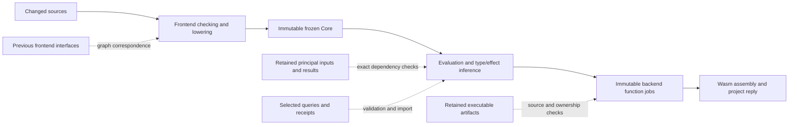

# Compiler performance review after CT105

24 October 2026. **The next substantial gains should come from avoiding repeated
semantic work, narrowing reuse lookups, and reducing transient graph copying.**
The compiler remains mostly serial on this workload. Allocation churn is large;
the measurements do not establish either a memory leak or a DRAM bandwidth
bottleneck. More backend workers alone will not address the dominant cost.

This review contains **86 suggestions**, including measurements, bounded local
experiments and architectural alternatives. They are not 86 confirmed bugs or a
recommendation to implement every alternative. Start with the six experiments
below, then use their results to choose the next work.

## What was reviewed and measured

Implementation commit `a0645de542cc08929e6236e5e17a75e2201104c0` is on upstream
`main`. The installed release and repository release are identical:
`0eadf4bb1a0cc7448f59156091a7287e2456aedfd4b31452197a0a3437a1da78`. No compiler
implementation changed during this review. The
[CT105 qualification](zig-native/CT105_QUALIFICATION.md) remains applicable:
2,555 exhaustive native laws, 1,654 guests, 48 smoke checks, 57 tooling checks
and zero Zig lint findings. Those checks were not rerun for documentation.

Measurements use the same frozen 554-file gdev/Ink/stdlib snapshot, 189 game
modules, optimized codegen, four backend workers, a 200-million inference budget
and disabled persistent restart cache. Manifest SHA-256:
`d54b0078ea7c8f94fae131e19f7ea46699891d6aba14b61803386595e9704146`. The host
reports a Ryzen 7 7800X3D, eight cores and 16 logical CPUs, Zig 0.17.0 and Deno
2.9.7. Shared-host load changed during measurement.

Linux reports 32 KiB L1 data and instruction caches per core, 1 MiB L2 per core,
a shared 96 MiB L3 and 64-byte cache lines. SMT siblings share the core caches.
CT105's maximum solver-live allocation is about 195 MB, larger than L3, but
allocated bytes are not the actively accessed working set. This makes locality
worth measuring; it does not establish cache thrashing or bandwidth saturation.
The dominant semantic thread also leaves most cores unavailable to the critical
path unless independent semantic work can be exposed.

Three alternating pairs use **the same binary** with phase profiling off/on. The
benchmark's `baseline` and `candidate` labels mean those modes, not two
implementations. All benchmark and sampled-build Wasm hashes match the strict
existing pins. The source tree and installed compiler hashes remain unchanged.

| Build                               | Unprofiled wall median | Process CPU median | Profiled check median | Profiled inference median |
| ----------------------------------- | ---------------------: | -----------------: | --------------------: | ------------------------: |
| Fresh game                          |                6.878 s |            7.090 s |               1.209 s |                   4.483 s |
| First literal edit after population |                3.786 s |            3.910 s |               0.765 s |                   1.282 s |
| Literal revert                      |                2.580 s |            2.840 s |               0.060 s |                   1.272 s |
| Body edit after the literal pair    |                4.816 s |            5.010 s |               0.060 s |                   3.440 s |
| Body revert                         |                4.752 s |            4.980 s |               0.059 s |                   3.410 s |
| Unchanged game                      |                0.016 s |            0.020 s |                  zero |                      zero |
| Fresh devtools                      |                0.645 s |            0.690 s |               0.262 s |                   0.151 s |

CPU is process user+system time, including exited threads, in 10 ms ticks. These
are three-run medians of project-client requests, excluding process startup;
they are neither p95s nor CLI latency promises. Profiling-on CPU medians differ
by about -2.3% to +2.9% across substantive build classes, including population.
That is an overhead/noise screen, not proof that instrumentation is free.
Quieter current measurements do not replace CT105's seven-pair improvement
claims of 13.3% fresh, 12.9% body and 3.3% first-literal CPU savings.

Inference is nested inside the backend phase. For literal revert, subtracting
inference from the **same profiled total** leaves a median **1.326 s**. Nested
lookup is 362 ms, constant handling 171 ms, replay 56 ms, and assembly 175 ms.
These clocks may overlap; do not add them into a second total. Even eliminating
inference would leave the current remainder above a second.

### CPU stacks

Random 5–15 ms GDB stops attribute CPU using per-thread scheduler time, rather
than giving sleeping workers equal weight. Fresh has 636 complete intervals;
literal edit+revert has 621; body edit+revert has 1,213. Accounted CPU coverage
is 99.05%, 99.58% and 99.73%, with no reported missing or truncated stack CPU.
Coverage measures accounting completeness, not statistical accuracy. GDB stops
perturb execution, so use these runs for attribution, not latency comparisons.

| Nearest compiler-directory owner |  Fresh | Literal edit + revert | Body edit + revert |
| -------------------------------- | -----: | --------------------: | -----------------: |
| `check`                          | 56.21% |                39.25% |             47.82% |
| `eval`                           | 24.29% |                19.51% |             27.25% |
| `reuse`                          |  6.56% |                21.12% |             12.81% |
| `backend`                        |  9.11% |                15.97% |              9.94% |

These are exclusive nearest-owner categories; directory ownership is not a phase
boundary. The remaining share belongs to runtime, parsing, profiling and other
frames. Inclusive function rows in the raw report overlap.

`closedHeight` alone owns 4.33% of sampled fresh self CPU and 4.13% of body self
CPU. Literal self CPU includes 4.08% in one `memcpy` implementation and 3.78% in
`resolveNode`; body has 1.59% in the generic epoch-cache lookup routine. These
identify repeated work to investigate, not functions to remove indiscriminately.
The epoch routine serves multiple uses; its samples cannot all be assigned to
the zero-hit operation-row cache.

### Memory and hardware

A separate unprofiled run executes 40 builds: five cycles of eight revision
states, representing **seven distinct source texts** because the first and last
state restore the original. All outputs match earlier fresh controls.

| Cycle | RSS after final restoration | Lifetime RSS high-water mark |
| ----- | --------------------------: | ---------------------------: |
| 1     |                  418.54 MiB |                   761.13 MiB |
| 2     |                  419.14 MiB |                   762.84 MiB |
| 3     |                  419.76 MiB |                   762.84 MiB |
| 4     |                  419.35 MiB |                   762.84 MiB |
| 5     |                  419.54 MiB |                   762.84 MiB |

After the first cycle, post-build RSS ranges from 418.55 to 482.07 MiB. Changed
builds incur 158,241–245,979 minor faults, with zero major faults and zero swap.
The dominant surviving thread accounts for roughly 89.7–95.3% of process CPU;
its share is approximate because process ticks and thread scheduler clocks have
different resolution and exited workers are absent from the final thread list.
Observed live-thread runqueue wait is 9–273 ms per changed build. The repeated
forms settle; this does **not** establish a bound for hundreds of distinct
edits.

The preceding CT105 hardware comparison remains relevant: it reduced retired
instructions, but some literal cycle and generic cache-miss results worsened.
Those counters covered only the dominant compiler thread in user space. They
were fully scheduled, yet shared-host load was variable. There is no new PMU
comparison in this review and no evidence here for a specific cache-level or
bandwidth diagnosis. Future hardware reports must retain thread scope and
`time_enabled`/`time_running`; multiplexed counts require explicit treatment.
See the
[Linux perf event interface](https://man7.org/linux/man-pages/man2/perf_event_open.2.html).

### A correction to the frontend diagnosis

The existing `graph` decline stage does **not** prove a semantic mismatch.
[Graph correspondence](zig-native/src/reuse/frontend_graph_correspondence.zig)
can decline on a size cap, work/depth limit, unsupported node, conflicting
bijection or unequal content. A new GDB probe of the first literal edit observes
20,178 old versus 20,179 new type nodes, 3,896 rows on both sides and 2,667 row
variables on both sides. All are below the 65,536 size cap, ruling out that
specific guard for this comparison. The exact declining branch is still unknown.
The probe leaves the compiler unchanged and emits the expected Wasm hash.

Previous wording that called this a “real graph mismatch” was too strong. The
binding/catalog work budget remaining at entry does not prove the independent
graph walk has enough budget. Do not raise caps or relax equivalence blindly.

## Architecture and the next six experiments

There are already several reuse layers, immutable backend jobs and a semantic
parallelism path. The problem is the amount of work surviving their eligibility,
matching and publication rules. Principal hits do not imply that specialization,
evidence import or validation disappears.

| Order | Bounded experiment                                                                                                               | Target and stopping rule                                                                                                                                                                                                 |
| ----- | -------------------------------------------------------------------------------------------------------------------------------- | ------------------------------------------------------------------------------------------------------------------------------------------------------------------------------------------------------------------------ |
| 1     | Add precise graph-decline reasons, then fix the demonstrated first-edit boundary (#1, #67–69).                                   | Attribute the single observed comparison before changing policy. Seek at least 50% less first-edit checking; preserve exact interfaces, errors and output. Stop after two failed local approaches and record the reason. |
| 2     | Add source-bucket chain statistics and index selected queries with safe additional discriminators (#29–31).                      | Seek at least 25% less lookup CPU/work and 5% less retained-literal process CPU. Preserve oldest-match order, receipts and owner-local IDs. Stop if hashing costs replace the savings.                                   |
| 3     | Measure operation interner chain lengths; trial closed-argument fingerprints and closed-DAG comparison deduplication (#10, #16). | Seek at least 50% fewer candidate comparisons and 10% less fresh/body process CPU. Keep exact collision checks and depth/rollback laws. Reject gains obtained by increasing memory without a stated budget.              |
| 4     | Narrow one of the four body-principal dependencies and identify residual work after all literal hits (#28, #35–37).              | Make one real body region reusable or remove a measured residual query family. Seek 15% less body process CPU, with unseen edits, restored sources and fresh controls. Stop if provenance cannot be represented exactly. |
| 5     | Attribute arena capacity/faults, then trial header-aware bins or a bounded pool policy (#41–46).                                 | Seek 25% less mapped/zeroed or copied capacity in the targeted path and 5% less changed-build CPU. Keep retained RSS and lifetime peak within 5% unless an explicit tradeoff is justified. Do not optimize RSS alone.    |
| 6     | Measure the literal non-inference remainder by owner; trial import deduplication and changed-function emission (#38–40, #70–74). | First milestone: same-profile remainder below 0.8 s, alongside real end-to-end gains. Track output bytes and runtime quality; stop a subproject after two candidates without a whole-build benefit.                      |

These are proposed acceptance thresholds, not predicted savings. Use seven
alternating release pairs for decisions, preserve the devtools regression guard,
and record memory as well as CPU. Avoid tuning exclusively for source reverts.

## 86 suggestions

Evidence: **M** = measured activity/cost, **C** = verified code structure, **H**
= architectural or hardware hypothesis. A measured cost does not prove the
proposed change will help. Priority: **P0** = next experiment, **P1** = follow
after attribution, **P2** = larger or conditional exploration. Related rows are
separate mechanisms; some are alternatives rather than additive gains.

### Measurements and decision quality — 1–8

Sources: [phase profiling](zig-native/src/phase_profile.zig),
[stack attribution](scripts/bench/summarize_stacks.py),
[compile benchmark](scripts/bench_compile.ts), and the evidence below.

| # | Priority / evidence | Suggestion and decision boundary                                                                                                                                                                                                                          |
| - | ------------------- | --------------------------------------------------------------------------------------------------------------------------------------------------------------------------------------------------------------------------------------------------------- |
| 1 | P0 / C              | Record precise frontend graph-decline reasons, first failing tag/pair, consumed work and depth. Keep bounded diagnostics outside the hot success path. The present `graph` category cannot distinguish an algorithmic limit from incompatible content.    |
| 2 | P0 / M              | Measure query preparation, bucket traversal, cheap-key rejection, graph matching, receipt validation and replay separately. The 362 ms lookup clock is useful but cannot tell whether a better index or cheaper matching is the right change.             |
| 3 | P0 / M              | Add per-owner allocation capacity, resize/copy bytes, peak live bytes and retained bytes. Existing logical requested-byte totals overlap with arena backing requests; never sum them as independent physical allocation.                                  |
| 4 | P1 / M              | Collect phase-scoped PMU groups on all relevant compiler threads, with scheduling coverage and explicit user/kernel scope. Use model-supported cache/TLB events before claiming locality or bandwidth limits; keep generic miss counts as generic counts. |
| 5 | P1 / M              | Run opposite-order pairs with CPU placement and host-load/frequency records. Separate scheduling interference from instruction and cycle changes. An affinity experiment must also test whether packing workers onto SMT siblings hurts the serial owner. |
| 6 | P1 / M              | Separate first literal, subsequent unseen literals, body changes, reverts, errors/recovery and no-ops in performance gates. The 765 ms first-edit checking cost disappears from later edits and would otherwise distort conclusions.                      |
| 7 | P1 / M              | Extend memory qualification to hundreds of distinct edits, cache saturation and repeated failures. The current 40-build cycle reuses seven texts; measure retained payload/capacity and post-idle RSS before asserting long-session stability.            |
| 8 | P1 / H              | Add a small held-out workload matrix: large records/effects, deep closures, shared type DAGs, many modules and small projects. Keep real gdev as a primary workload, but reject optimizations that merely fit one program's graph shapes.                 |

### Type and effect algorithms — 9–20

Sources: [type store](zig-native/src/check/types.zig),
[effect store](zig-native/src/check/effects.zig),
[epoch cache](zig-native/src/reuse/epoch_resolution_cache.zig).

| #  | Priority / evidence | Suggestion and decision boundary                                                                                                                                                                                                                                                                                                  |
| -- | ------------------- | --------------------------------------------------------------------------------------------------------------------------------------------------------------------------------------------------------------------------------------------------------------------------------------------------------------------------------- |
| 9  | P0 / M              | Reduce repeated closedness checks at the caller: propagate a proven closed argument-vector/row fact through a normalization operation. `closedHeight` is already a cached load; making that load marginally cheaper is less promising than removing millions of repeated calls. Respect owner, cursor and depth.                  |
| 10 | P0 / M+C            | Index operation interning by a stable fingerprint of closed arguments as well as identity, instance and arity. Fresh builds still inspect 90.45 million candidates. Hashes only select candidates; retain exact equality, first-match semantics and collision handling. Symbolic arguments need separate version-aware treatment. |
| 11 | P1 / C              | Make the closed-row sidecar adaptive or paged for sparse access. It currently grows toward the full row inventory and contributes to a larger solver working set. Compare touched-row density and cache misses against the cheap dense lookup before changing the default.                                                        |
| 12 | P1 / M+C            | Ablate the exact-epoch operation-row cache, which records zero hits in these runs. Measure its own probes and invalidation causes before removing it or making it dependency-sensitive. The generic cache routine's CPU samples also include other consumers.                                                                     |
| 13 | P1 / C              | Optimize historical effect-version lookup for long chains using cursor-aware search or skip indexes. Current lookup walks forward through versions. Preserve historical cursors, variable birth and rollback behavior; existing safe prefix/path compression is not permission for unrestricted compression.                      |
| 14 | P1 / C              | Replace repeated effect-label multiplicity scans in graph equality with a canonical multiset or a temporary count index above a measured size threshold. Preserve duplicate counts and argument closedness; sorting away duplicate labels would change the answer.                                                                |
| 15 | P1 / C              | Give wide-record equality an indexed or canonical field-name comparison path instead of nested searches. Retain layout/order semantics where they matter; do not charge small records for a large-record optimization.                                                                                                            |
| 16 | P0 / C              | Deduplicate repeated pairs in closed DAG equality when safe. `equalGraphWalk` currently enables its visited-pair structure for symbolic/projection cases; ordinary closed comparisons can revisit shared descendants. Prove leaves closed before reusing a result, retain cycle rejection and test diamond DAGs.                  |
| 17 | P1 / C              | Memoize free-type/free-row-variable summaries for immutable subgraphs within an exact owner/version. Several closure/evidence paths ask for these traversals again. Use bounded summaries and invalidate on substitutions; measure summary construction against avoided visits.                                                   |
| 18 | P1 / C              | Measure why the 16-slot composite-resolution cache misses: collisions, oversized dependency frontiers, depth, or epoch changes. Trial associativity or dependency-specific validity only for the dominant reason; increasing capacity alone may worsen locality.                                                                  |
| 19 | P1 / C              | Consider cross-call occurs-result reuse for an exact variable/root/substitution generation. `occurs` already has a dense visited-generation array within each traversal. A new cache must save repeated traversals, preserve projection accounting and never reuse an earlier negative after mutation.                            |
| 20 | P2 / H              | Compare canonical immutable composite nodes plus a separate substitution overlay with today's append-heavy resolved nodes. This could reduce repeated node creation and equality work, but introduces interning and lifetime costs. Prototype one type family before attempting a store rewrite.                                  |

### Constraint scheduling and lexical scopes — 21–28

Sources: [solver worklist](zig-native/src/check/solver_worklist.zig),
[closure-region collection and lexical sharing](zig-native/src/eval/core_eval.zig).

| #  | Priority / evidence | Suggestion and decision boundary                                                                                                                                                                                                                                                      |
| -- | ------------------- | ------------------------------------------------------------------------------------------------------------------------------------------------------------------------------------------------------------------------------------------------------------------------------------- |
| 21 | P1 / C              | Add bounded visited-node tracking to watcher-frontier discovery for shared DAGs. This walker has visit/key limits and can fall back to `any_write`; unlike `occurs`, it does not already deduplicate all visited nodes. Measure fallback reduction and preserve conservative wakeups. |
| 22 | P1 / C              | Use a tiny-list-to-set transition for watcher-key deduplication if the current linear search through up to 64 keys is costly. Keep the small case allocation-free and retain conservative behavior on limit/OOM paths.                                                                |
| 23 | P1 / C              | Coalesce repeated writes to the same watched key within one observation batch before walking subscribers. Ready-bit deduplication avoids duplicate execution but does not necessarily avoid duplicate subscriber traversal. Preserve the solver's publication and error order.        |
| 24 | P1 / C              | Update watcher registrations by difference when a constraint's dependency frontier barely changes. Links already use a freelist; the remaining question is traversal and rebuild work. Fall back to full registration when dependencies are uncertain.                                |
| 25 | P1 / C              | Trial a summary of nonempty ready words for very sparse large queues. CT105 already added word-wise pending/ready masks; another layer helps only if scanning empty words is measurable. Keep deterministic selection order.                                                          |
| 26 | P0 / M+C            | Extend lexical indexing to row variables. Type variables now have per-scope links, but `shareLexical` still scans the region's row-variable map; its iterator appears in body samples. Keep insertion boundaries and avoid invalidating iterators during unification.                 |
| 27 | P1 / C              | Replace repeated linear quantified-variable/closed-row membership checks with per-scheme membership summaries where lists are large. Use compact sorted or dense representations according to measured density; preserve exact scheme ownership and small-case cost.                  |
| 28 | P0 / M              | Attribute the 2,422 residual literal inference regions by caller, principal, query kind and reason for creation. All 20 principal hits still leave 94,349 constraint visits. Eliminate a proven redundant region family rather than treating principal hit rate as a work metric.     |

### Incremental queries, evidence and reuse — 29–40

Sources: [selected queries](zig-native/src/eval/selected_query.zig),
[canonical specialization](zig-native/src/eval/canonical_specialization.zig),
[query table](zig-native/src/reuse/semantic_query_table.zig),
[principal input images](zig-native/src/reuse/principal_input_image.zig),
[source value templates](zig-native/src/reuse/source_value_template.zig), and
[artifact import](zig-native/src/reuse/artifact_import.zig).

| #  | Priority / evidence | Suggestion and decision boundary                                                                                                                                                                                                                                                               |
| -- | ------------------- | ---------------------------------------------------------------------------------------------------------------------------------------------------------------------------------------------------------------------------------------------------------------------------------------------- |
| 29 | P0 / C              | Partition selected-query chains using additional safe key fields. The current fingerprint covers source only; input, expected type, options and depth are filtered later. Start with cheap stable fields; owner-local IDs must not accidentally become cross-owner equality proofs.            |
| 30 | P1 / C              | Add mode, expected type, options and depth to canonical-specialization bucket discrimination where valid. Its fingerprint is based on capture-input words while these fields filter afterward. Keep exact capture graph/alias checks and stable candidate order.                               |
| 31 | P0 / M+C            | Avoid building a full canonical capture key for demonstrably ineligible queries. Fresh has only 4 hits in 499 canonical queries, literal revert 1 in 350. Add cheap eligibility gates or lazy key construction, then measure lost opportunities as well as saved work.                         |
| 32 | P1 / C              | Preflight optional-query admission before copying all replay value/evidence/record/child arrays. The bounded table can decline after preparation. Preserve atomic ownership transfer, complete receipts and the distinction between cache rejection and real allocation failure.               |
| 33 | P1 / C              | Add a session-owned unit-ID-to-index lookup for replay. `unitIndex` currently scans session units for reads/publication. Preserve exact unit identity and rebuild the index with its owner; measure whether 189-unit scans matter outside synthetic cases.                                     |
| 34 | P1 / H              | Evaluate cache admission by measured reuse value per retained byte, rather than simply enlarging fixed limits. Keep deterministic behavior and bounded capacity. Records with different observations cannot be merged solely because their apparent result or shallow key matches.             |
| 35 | P0 / M+C            | Narrow whole-module input images to the exact consumed declaration/closure dependency graph. Three body principals reject module 42's changed image. Capture literals, control flow, namespace/catalog reads, absence observations and provenance; a result type alone is insufficient.        |
| 36 | P0 / M+C            | Investigate stable declaration-origin correspondence for the remaining source 42:35 identity decline. Separate a harmless ordinal change from a changed producer/capture graph. Never equate numeric IDs from different owners or accept executable reuse merely because signatures match.     |
| 37 | P1 / C              | Share already-proven dependency checks across queries in one immutable owner pair. A bounded validation memo may avoid walking the same receipts repeatedly. Include configuration, graph owners and observation state; a prior artifact's admission is not blanket authority for a new graph. |
| 38 | P0 / M+C            | Deduplicate semantic-type/effect evidence imports across compatible replay operations. `Importer.semanticType` is a leading literal owner and imports still copy graph structure. Key by exact source owner and destination state; preserve anchors and reject stale proofs.                   |
| 39 | P1 / C              | Extend existing touched-ID scratch reuse to remaining import/matching fallbacks that allocate and zero full anchor maps. `QueryScratch` already reuses several arrays; target uncovered paths and measure cleared bytes, rather than introducing a second redundant scratch layer.             |
| 40 | P1 / C              | Batch small replay arrays or transfer an owned contiguous payload when lifetimes permit. Canonical replay owns several separate arrays. Reduce allocation/copy count without retaining an entire large snapshot for a tiny result; keep abort and partial-publication recovery exact.          |

### Allocation, retained memory and physical layout — 41–52

Sources: [region arena](zig-native/src/eval/region_arena.zig),
[session heap](zig-native/src/runtime/session_heap.zig),
[memory accounting](zig-native/src/runtime/memory.zig), and
[backend jobs](zig-native/src/backend/runtime_parallel.zig).

| #  | Priority / evidence | Suggestion and decision boundary                                                                                                                                                                                                                                                       |
| -- | ------------------- | -------------------------------------------------------------------------------------------------------------------------------------------------------------------------------------------------------------------------------------------------------------------------------------- |
| 41 | P0 / C              | Measure and reduce arena header/alignment bin cliffs. A 4,096-byte large payload plus metadata rounds to an 8,192-byte block. Consider header-aware capacities or external metadata; verify alignment, resize/remap and exhaustive allocation failure behavior.                        |
| 42 | P1 / C              | Trial borrowing a bounded larger free arena bin when the exact bin is empty. Current large-block reuse is exact-bin. Measure fragmentation and additional retention; indiscriminate best-fit reuse can retain oversized blocks or starve a later request.                              |
| 43 | P1 / C              | Compare the one-slot arena pool with a small size-classed pool under a total byte budget. Nested/concurrent leases cannot all reuse one slot. Track hit sizes and lease overlap before adding slots.                                                                                   |
| 44 | P0 / C              | Count arena discards above the 64 MiB retention cap, then trial a bounded large-region policy. The 195 MB maximum solver-live metric is not itself arena capacity. Require measured discard/remapping savings and an explicit RSS guard before retaining larger arenas.                |
| 45 | P1 / C              | Split temporary traversal buffers from region-long solver data where lifetimes are demonstrably different. A growing scratch list can strand earlier buffers until arena reset. Scope reset points around completed operations and prove no imported result retains scratch addresses. |
| 46 | P1 / M+C            | Reserve graph/list capacities from reliable local bounds, or use chunks for growth-heavy structures. Avoid copying a large contiguous list repeatedly. Measure copied bytes and wasted capacity; speculative maximum-size reservation would worsen the working set.                    |
| 47 | P1 / C              | Record session-heap slab occupancy and add idle trimming for fully free slabs if retained pages dominate. Small slabs currently remain mapped. Reclaiming them requires unlinking every free-list entry and synchronized ownership, not just calling unmap.                            |
| 48 | P1 / H              | Measure allocator lock contention before trying per-size-class locks or bounded worker magazines. The redundant outer lock is gone, but the session heap still has one small-allocation lock. Avoid reintroducing the historical per-thread retention problem.                         |
| 49 | P1 / C              | Move slab mapping outside the heap critical section where a race-safe publication protocol permits it. Mapping currently occurs while locked. Handle simultaneous refill and OOM without leaking spare slabs; benefit depends on measured refill contention.                           |
| 50 | P1 / C              | Consider ownership transfer of completed worker output buffers instead of cloning locals/instructions from each worker arena. Transfer only detachable allocations; retaining a whole worker arena can cost more memory than the copy it removes.                                      |
| 51 | P1 / H              | Separate frequently read solver/query fields from cold diagnostics and bookkeeping after measuring cache-line use. Keep dense IDs and compact nodes; a broad structure-of-arrays rewrite without access-pattern evidence can increase pointer chasing and allocations.                 |
| 52 | P2 / H              | Test chunk placement, page reuse and optional large-page behavior only after TLB/page-fault attribution. The minor-fault count is large but is not proof that huge pages help. Compare latency, RSS and page-release behavior on the actual host.                                      |

### CPU execution and compiler-binary efficiency — 53–60

Sources: [build configuration](zig-native/build.zig), the stack evidence above,
and the exact stores/query loops linked in preceding sections.

| #  | Priority / evidence | Suggestion and decision boundary                                                                                                                                                                                                                                                |
| -- | ------------------- | ------------------------------------------------------------------------------------------------------------------------------------------------------------------------------------------------------------------------------------------------------------------------------- |
| 53 | P1 / C              | Benchmark a separately identified host-native compiler against the current baseline CPU target. Preserve the portable distributed build. Verify Zig 0.17 support, artifact identity and exact Wasm/numeric semantics; CPU features are an experiment, not a guaranteed speedup. |
| 54 | P2 / H              | Explore profile-guided compiler-binary layout/inlining using representative training and held-out programs. LLVM documents PGO and BOLT, but Zig 0.17 integration must be established first. Keep this in a reproducible build path with separate identity and qualification.   |
| 55 | P1 / M              | Inspect hot tiny accessors in disassembly before selectively inlining or combining loads. `closedHeight`, `node` and `resolveNode` dominate several samples. Measure call/load removal against instruction-cache growth; blanket forced inlining can make things worse.         |
| 56 | P1 / C              | Track hash-map probe lengths, load factors and tombstones in the few hot maps. Rebuild or change a representation only where probes dominate. SIMD hashing or a new hash function cannot repair a deliberately broad source-only bucket.                                        |
| 57 | P1 / H              | Replace hot dense-ID maps with generation-tagged arrays where density and bounded owner lifetime justify it. Preserve sparse fallback and measured memory caps; never allocate to a large external ID merely to avoid hashing.                                                  |
| 58 | P1 / M              | Attribute large memcpy/memset samples to allocation sites and eliminate the owning copy/clear first. Then compare compiler-generated bulk operations if needed. A faster memcpy implementation leaves avoidable graph duplication and its memory footprint intact.              |
| 59 | P2 / H              | Specialize the most common type/effect tag paths only after branch distributions and disassembly identify a real bottleneck. Preserve uncommon diagnostics and bounded work. Manual branch hints or branchless transformations can hurt predictable common paths.               |
| 60 | P2 / H              | Trial batched independent lookups or prefetching for proven long pointer chains. Require cache-latency evidence and enough independent work to overlap misses. Prefer removing candidate chains first; speculative prefetch can consume bandwidth without useful data.          |

PGO uses execution profiles to guide optimization; training representativeness
matters. BOLT optimizes binary layout after linking using profiles. These are
conditional options, not claims that Blot's current build supports them. See the
[Clang PGO documentation](https://clang.llvm.org/docs/UsersManual.html#profile-guided-optimization)
and
[LLVM BOLT documentation](https://github.com/llvm/llvm-project/blob/main/bolt/README.md).

### Parallelism and scheduling — 61–66

Sources: [semantic component scheduling](zig-native/src/eval/core_eval.zig),
[backend scheduling](zig-native/src/backend/runtime_parallel.zig).

| #  | Priority / evidence | Suggestion and decision boundary                                                                                                                                                                                                                                                              |
| -- | ------------------- | --------------------------------------------------------------------------------------------------------------------------------------------------------------------------------------------------------------------------------------------------------------------------------------------- |
| 61 | P0 / M+C            | Count why existing semantic parallelism is ineligible: active receipts/principal reads/recorders, refinement observers, insufficient ready components or budget state. Current semantic job counts are zero. Establish the actual blocker before designing another thread pool.               |
| 62 | P2 / C              | Build an explicit dependency-ready queue for semantic components if eligibility becomes useful. Current ready discovery can scan jobs and dependencies repeatedly. Preserve recursion/SCC barriers, deterministic budgets and publication ordering.                                           |
| 63 | P2 / H              | Give independent semantic components private proof/observation logs and merge them deterministically. This may unlock paths currently disabled during recording. Require atomic publication, stable errors and isolated mutable solvers; sharing a session between workers is not a shortcut. |
| 64 | P1 / C              | Schedule a compact list of actual backend jobs and evaluate heavy-first ordering or small chunks. Workers currently scan slots via an atomic next index. Keep output/error publication deterministic and avoid spending more on scheduling estimates than the jobs save.                      |
| 65 | P1 / H              | Measure per-worker CPU, finish times and shared-slot cache contention before adding padding or workers. Adjacent result slots could cause false sharing, but the current evidence does not prove it. Four workers already leave semantic work mostly serial.                                  |
| 66 | P1 / C              | Cache backend lifetime/RC planning under an exact optimized-body and lifetime-facts key where it repeats for retained bodies. Separate optional planning from code reuse; a retained function alone does not prove that its surrounding ownership facts are unchanged.                        |

### Frontend, validation and output — 67–74

Sources:
[frontend correspondence](zig-native/src/reuse/frontend_graph_correspondence.zig),
[binding relocation](zig-native/src/reuse/frontend_binding_relocation.zig),
[frozen Core validation](zig-native/src/check/frozen_core_validation.zig),
[Wasm backend](zig-native/src/backend/wasm.zig), and
[project server](zig-native/src/reuse/zig_project_server.zig).

| #  | Priority / evidence | Suggestion and decision boundary                                                                                                                                                                                                                                                                   |
| -- | ------------------- | -------------------------------------------------------------------------------------------------------------------------------------------------------------------------------------------------------------------------------------------------------------------------------------------------- |
| 67 | P0 / C              | If depth/work limits cause the observed frontend decline, replace the recursive comparison with a bounded iterative reachable-pair walk. The new probe rules out the graph-size cap for this case. Do not spend implementation effort on an unobserved limit first.                                |
| 68 | P1 / C              | Distinguish semantically required alias/variable correspondence from incidental sharing of equal immutable constructor nodes. The current bijection rejects both. Relax only proven harmless sharing differences, with negative tests for alias and variable-identity changes.                     |
| 69 | P1 / C              | Compare and fingerprint only interface-reachable graph content when an exact dependency boundary permits it. Full graph lengths need not equal exported-interface size. Include catalog/nominal identity and required hidden dependencies; a matching hash is only a prefilter.                    |
| 70 | P0 / M+C            | Reuse validation certificates for exactly unchanged frozen Core owners or validated subgraphs. `Graph.edge` remains visible in retained samples. Preserve checks at every untrusted/new ownership boundary; existing `ModulePin.validated` must be honored rather than duplicated or bypassed.     |
| 71 | P1 / M              | Attribute repeated retained-function optimization, especially SROA, before adding another cache. The literal stack still includes substantial SROA work. Track which functions are genuinely changed versus rejected by matching, and keep optimizer options/lifetime facts in any key.            |
| 72 | P0 / M+C            | Retain encoded unchanged function bodies and rebuild only affected Wasm sections/relocations when stable identities permit it. Assembly still costs about 175 ms on literal revert. Validate exports, indices, constants, table entries and exact output order.                                    |
| 73 | P1 / C              | Avoid the extra concatenation buffer for replies carrying asset payloads, using bounded scatter/gather or owned segments. The server already passes Wasm bytes directly when there are no assets; do not claim an unconditional Wasm copy. Measure end-to-end client cost.                         |
| 74 | P2 / H              | Evaluate the existing development codegen tier and, separately, a consumer-supported incremental output protocol. Measure application runtime quality and actual edit-to-running latency. A delta protocol needs version agreement and full-output fallback; it cannot merely omit required bytes. |

### Building and verifying the compiler — 75–80

Sources: [build hills](BUILD_HILLS.md),
[development turnaround](DEVELOPMENT_TURNAROUND.md),
[build script](scripts/build_compiler.ts), [Zig build](zig-native/build.zig).

| #  | Priority / evidence | Suggestion and decision boundary                                                                                                                                                                                                                                                             |
| -- | ------------------- | -------------------------------------------------------------------------------------------------------------------------------------------------------------------------------------------------------------------------------------------------------------------------------------------- |
| 75 | P1 / M              | Collect at least 20 representative edit/check cycles with per-stage times. The current 21.28 s development observation includes 3.31 s compiler and 5.91 s full native compilation, but is not a p95. Optimize the actual dominant stage for the edit class.                                 |
| 76 | P1 / M              | Record detailed Zig compilation/LLVM/link timing on the next necessary release build. Separate generic instantiation, optimization and linking before changing module structure or flags. Do not spend an extra release build merely to rediscover a known total.                            |
| 77 | P2 / C              | Reduce expensive generic instantiations at stable internal interfaces where build traces show duplication. A narrow erased interface can trade runtime dispatch for build time; prototype cold boundaries and verify application CPU before touching hot solver code.                        |
| 78 | P1 / M              | Reduce production allocations in expensive allocation-fault laws, then rerun every resulting failure position. The exhaustive gate took 674.30 s, including 625.86 s native execution. Fixture setup may move only when it preserves the intended ownership/failure boundary.                |
| 79 | P1 / M              | Use recorded per-law durations to rebalance full-gate shards when drift is material. The current four shards are already roughly 581–626 s, so perfect balancing alone offers limited gain. Preserve exact inventory, failure cancellation and raw shard evidence.                           |
| 80 | P1 / M              | Protect stable writable caches and benchmark real retained edits before changing Zig incremental defaults. Existing incremental measurements were negative. Keep Safe/noLLVM development and native tests, reserve LLVM for releases, and preserve full-suite compilation in focused cycles. |

### Larger architecture options — 81–86

These are alternatives to evaluate after local attribution, not prerequisites
for the next improvement. Preserve the
[ownership contract](zig-native/CONTRACT.md).

| #  | Priority / evidence | Suggestion and decision boundary                                                                                                                                                                                                                                                                        |
| -- | ------------------- | ------------------------------------------------------------------------------------------------------------------------------------------------------------------------------------------------------------------------------------------------------------------------------------------------------- |
| 81 | P2 / H              | Make semantic dependencies a first-class query graph with stable declaration keys and exact recorded reads. Invalidate reachable consumers instead of rediscovering dependencies through multiple reuse layers. Retain negative/absence reads, cycle handling, budgets and deterministic diagnostics.   |
| 82 | P2 / H              | Explore an immutable shared typed-IR/evidence owner between frontend, evaluator and backend, with explicit local substitution overlays. This targets repeated projection/import copies. Ownership, release timing and cross-revision identity must be designed before replacing copies with references. |
| 83 | P2 / H              | Prototype resumable inference for one bounded region: checkpoint constraints/substitutions, invalidate the affected slice, and replay to a deterministic fixed point. Logs can grow and invalidation can spread; require measured edit locality before generalizing beyond the prototype.               |
| 84 | P2 / H              | Separate source/interface/value/executable dependency surfaces explicitly so a body edit invalidates only the products that consume it. Blot already distinguishes several of these; unify their contracts before introducing another cache, and retain captures and compile-time observations.         |
| 85 | P2 / H              | Add a demand-limited interactive checking product if the editor needs diagnostics sooner than complete executable output. Reuse its work in the eventual full build and label incomplete results honestly. This can improve feedback latency without claiming a sub-second full compile.                |
| 86 | P2 / H              | Evolve the existing retained session/restart cache into a bounded content-addressed module service if process restarts remain costly. Use compiler/config/source identities, exact validation and eviction ownership. Do not confuse a fast cache hit with fast ordinary changed-source compilation.    |

## Validation and evidence

For implementation candidates, use the applicable five-minute development area,
then the complete compiler gate before committing compiler changes. Native tests
must compile with Zig 0.17.0 Safe/noLLVM. Measure the final release with LLVM,
keep fresh/retained/error/restart controls, exact Wasm and executed behavior,
and record RSS, allocation costs and negative results. A cache optimization must
also survive saturation, rollback, distinct source owners and allocation
failures.

Raw evidence is in
[compiler-review-ct105-2026-10-24.tar.gz](zig-native/measurements/compiler-review-ct105-2026-10-24.tar.gz),
with its
[SHA-256 sidecar](zig-native/measurements/compiler-review-ct105-2026-10-24.tar.gz.sha256).
It contains source/binary/manifest pins, commands, profiling-off/on samples,
CPU-weighted stacks, the 40-build memory series, the GDB graph-size probe and
analysis scripts. An internal `SHA256SUMS` covers each archived file. Compiler
binaries, private workload source and build caches are excluded. Extract under a
temporary directory to inspect the reports; benchmark reruns require the
separately preserved frozen snapshot.

The earlier [CT105 evidence](zig-native/CT105_QUALIFICATION.md) supplies the
paired improvement, PMU and full qualification records. The preceding
[50-observation audit](PERFORMANCE_REVIEW.md#current-cpu-memory-and-algorithm-audit--24-october-2026)
describes the older compiler and is retained as history. Already implemented
scope indexing, pending masks, closed-row certificates, sorted evidence hits,
cache-update fixes and removal of the redundant outer mutex are not new tasks.
