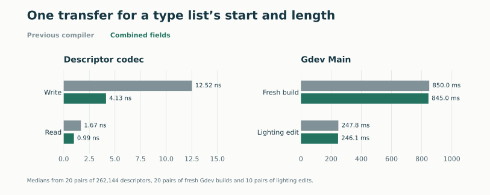
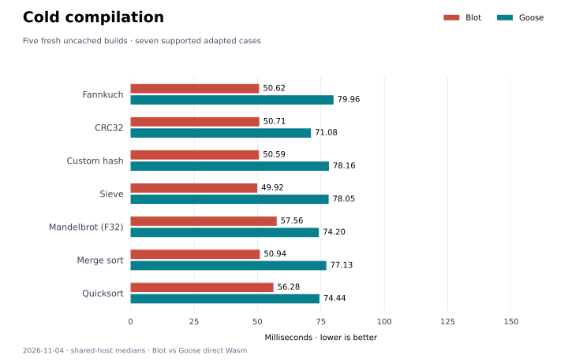

# Blot

Blot is a functional language that compiles to WebAssembly. Deno provides the
CLI, project client, formatter and guest host. See the
[repository map](docs/README.md) for code, tests, documentation and evidence.

The compiler is written in Goose and lives in
[compiler-goose/](compiler-goose/README.md). It was ported from a compiler
written in Zig, which was removed on 15 November 2026 once the port matched it;
[tasks/GOOSE_PORT.md](tasks/GOOSE_PORT.md) has the comparison.

The owned-storage rewrite and backend cutover are unfinished. One real Gdev
frame has passed native Pen with an inspected screenshot; broader compiler and
application qualification remains open. Start with [CONTINUE.md](CONTINUE.md)
and [tasks/STORAGE_REWRITE.md](tasks/STORAGE_REWRITE.md) for the current
candidate, evidence and requirements.

## Benchmarks

The release compiles Gdev Main’s 46,109 lines in **845.0 ms** median across
20 fresh sessions with eight worker slots. A lighting preset edit rebuilds
in **246.1 ms** median across ten retained sessions. The previous release
took 850.0 ms and 247.8 ms in the same runs. A fresh compile checks
all 269 modules and produces 2,639,228 bytes of Wasm.
[Gdev measurements](benchmarks/evidence/measurements/2026-11-18-gdev-packet-list.json)



An earlier compiler took **938 ms** for ordinary lighting and **1,015 ms** for
`#run true` in the same field. Both produced identical Wasm.
[Compile-time execution benchmark](benchmarks/evidence/measurements/2026-11-18-gdev-staging-interfaces.json)

Blot versus Goose's direct Wasm backend, measured on 2026-11-04. Seven adapted
pairs now pass: six original-numeric workloads and a Mandelbrot F32 control.
Merge sort and quicksort retain their original recursive algorithms.




Against the preceding compiler, merge improves **1.19x**, custom hash **7.00x**
and Sieve **1.16x**. Hash and merge now roughly match Goose. Both charts use
fresh five-sample measurements. Blot uses U32 byte/flag buffers where Goose uses
U8; both sorts use four-byte elements. Original F64 remains unsupported.

On the November 4 snapshot, local-index ordering reduced Main from 10.04 MB
to 9.20 MB. [Historical measurements](benchmarks/goose/results/2026-11-04-array-engines.md)

## Development

Use the existing sibling `pen`, `ink` and `gdev` checkouts, Deno 2, and clang,
cmake, ninja and Python 3 for the compiler's build. From the repository root:

```sh
deno task build:compiler
deno run -A scripts/integration/build_gdev.ts --timeout-ms 10000 > /tmp/gdev-main.log 2>&1
python3 scripts/integration/report.py /tmp/gdev-main.log
```

`deno task build:compiler` writes the optimized compiler to
`compiler-goose/build/blotc-goose` (about seven minutes; the first build also
builds the patched Goose compiler it needs). Pen and the sibling checkouts run
that file. `deno task build:compiler:dev` writes a debug compiler to
`compiler-goose/build/blotc-goose-dev` in about a minute and a half. Keep a
compiler with the matching `std/`. The handoff describes the Pen one-frame
runner and the required PNG inspection.

Current syntax uses `func`, explicit `return`, curried `->`, `$Constructor`,
`true` / `false`, `and` / `or`, and `#[...]` arrays. The counted-storage and ABI
8 data-stack backends are both still live; task 120 tracks retirement.

## Navigation

- [Repository map](docs/README.md): source, tests, documentation and evidence.
- [Language guide](docs/language/guide.md) and
  [standard library](std/README.md).
- [Compiler](compiler-goose/README.md) and [Deno host](host/README.md).
- [Goose benchmark suite](benchmarks/goose/README.md) and
  [current results](benchmarks/goose/results/2026-11-04-array-engines.md).
- [Agent instructions](AGENTS.md), [current frontier](CONTINUE.md) and
  [active plan](PLAN.md).
