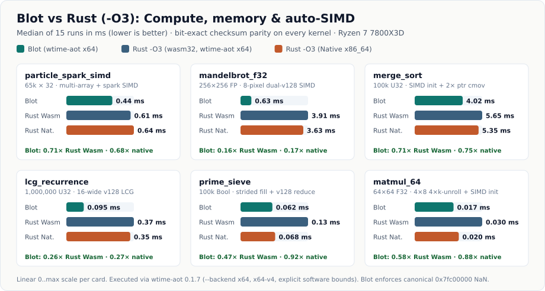

# Blot

**A zero-GC, pure-ownership language that compiles directly to fast, deterministic WebAssembly in milliseconds.**

Blot sits between garbage-collected scripting languages and LLVM-heavy systems languages: you get in-place native-class performance, memory safety without `'a` lifetime annotations, algebraic effects, compile-time reflection, and subsecond iteration — all inside a deterministic WebAssembly sandbox.

[Features & Examples](#features--examples) · [Performance](#performance) · [Benchmarks](BENCHMARK.md) · [Getting Started](#getting-started) · [Documentation](#documentation)

---

## Why Blot?

- **No GC pauses, no `'a` lifetimes.** Values are immutable by default; uniquely owned dynamic arrays (`#[T]`) mutate in place with `:=`, while the compiler infers local borrows (`&T`, `&[T]`) and ownership transfers (`own`) statically.
- **Native-class speed, direct to Wasm.** No LLVM in the loop — a 6-kernel benchmark compiles in **13.6 ms** (**22.5 KiB** `.wasm`) and beats native `rustc -O3` across all 6 kernels on `wtime-aot`.
- **Deterministic & sandboxed by construction.** Pure by default, explicit algebraic effects for I/O and state, granular scalar types (`U8`, `U32`, `I32`, `U64`, `I64`, `F32`, `F64`) with 1-byte `#[U8]` arrays and canonical IEEE 754 quiet NaN (`0x7fc00000` / `0x7ff8000000000000`) across scalar, SIMD, and `#run`.
- **Low-friction metaprogramming & parallelism.** Field defaults, `@[...]` data tags, compile-time `#for #fields` / `#variants`, speculative `fork` rollback, auto-SIMD `spark #[...]`, and first-class `#kernel` / `#process` concurrency.

---

## Features & Examples

### 1. In-Place Ownership Without Lifetimes

Mutate uniquely owned arrays in place with `:=` and `.push`, take an explicit snapshot with `copy`, and hand ownership across functions with `own` — zero lifetime parameters, zero hidden aliasing, and `self` shorthand for clean updates:

```blot
func scale_and_append (items: own #[F32]) -> (factor: F32): #[F32] =>
  for i in 0 .. items.length:
    items[i] := self * factor
  items := self.push factor
  return items

io main (): F32 =>
  let base = #[1.0, 2.0, 3.0]
  let snapshot = copy base             // explicit deep snapshot
  let updated = scale_and_append base 2.0
  return snapshot[0] + updated[3]      // 1.0 + 2.0 = 3.0
```

### 2. Zero-Boilerplate Comptime Reflection, Defaults & Tags

Annotate fields with ordinary data tags (`@[...]`), give fields defaults, and iterate any record or sum type at compile time with `#for #fields` / `#variants`. Heterogeneous trait dispatch (`Codec.encode val.(field)`) unrolls statically with zero macros and zero runtime reflection cost:

```blot
type Skip is data = $Skip
type FieldId is data = $FieldId U32

type Codec a is trait = { encode: a -> #[U32] }
const U32.Codec: Codec U32 = { encode: func x => #[x] }
const Bool.Codec: Codec Bool = { encode: func b => #[if b then 1 else 0] }

type Player is data = $Player {
  @[$FieldId 10]
  id: U32,
  @[$FieldId 20]
  hp: U32 = 100,
  @[$FieldId 30]
  alive: Bool = true,
  @[$Skip]
  cached_score: U32 = 0,
}

func encode_record (val: t): #[U32] =>
  let out: #[U32] = #[]
  #for field in #fields t:
    #if not (field.has_tag $Skip):
      out := self.push (field.tag $FieldId)
      for word in Codec.encode val.(field):
        out := self.push word
  return out

io main (): #[U32] =>
  // Defaults fill in `hp`, `alive`, and `cached_score` automatically.
  let p = $Player { id: 7 }
  return encode_record p               // #[10, 7, 20, 100, 30, 1]
```

### 3. Scoped Algebraic Effects with `with`

No ambient globals, hidden I/O, or DI boilerplate. Declare capabilities as effects and bind them inline with `with` — deterministic tests, replay, and mocking take a single block:

```blot
type Rng is effect = { next: Unit -> U32 }
type Log is effect = { write: U32 -> Unit }

func roll_loot (count: U32): Unit !{ Rng, Log } =>
  for _ in 0 .. count:
    use r <- Rng.next ()
    use Log.write (r % 100)
  return ()

io main (): U32 =>
  let seed: U32 = 42
  let total: U32 = 0
  let step_rng = func () =>
    seed := self * 1664525 + 1013904223
    return seed >> 16
  with Rng = { next: step_rng }, Log = { write: func loot => total := self + loot }:
    use roll_loot 5
  return total
```

### 4. Speculative Rollback with `fork`

Need lookahead search, move evaluation, or transactional validation? `fork` lets you mutate an owned array directly in place while journaling touched bytes — exiting the scope automatically restores the original array without pre-cloning it:

```blot
func score_move (board: own #[U32]) -> (slot: U32) -> (piece: U32): (U32, #[U32]) =>
  let score = fork board:
    board[slot] := piece
    board := self.push piece
    let acc: U32 = 0
    for cell in board:
      acc := self + cell
    return acc
  // `board` is back to its exact pre-fork contents and length.
  return (score, board)

io main (): #[U32] =>
  let board: #[U32] = #[1, 2, 3]
  let (preview, restored) = score_move board 1 99
  return #[preview, restored[1], restored.length]   // #[202, 2, 3]
```

### 5. Auto-Vectorized `spark` SIMD & AoS Loops

Write straightforward math with `spark #[...]` (or flat `#[Vec4]` loops) and the compiler proves data independence and emits 4-wide WebAssembly `v128` SIMD automatically:

```blot
func integrate (px: #[F32]) -> (vx: #[F32]) -> (ax: #[F32]) -> (dt: F32): #[F32] =>
  let half_dt2 = 0.5 * dt * dt
  return spark #[px[i] + vx[i] * dt + ax[i] * half_dt2 | i <- 0 .. px.length]
```

### 6. First-Class Multi-Core Kernels, Persistent Processes & In-Language Coordination

Two built-in Wasm ABI 8 entry points cover parallel fan-out and long-lived stateful systems without threads or shared mutable memory — and programs can orchestrate both directly inside Blot via `std/runtime`, `std/kernel`, and `std/process`:

```blot
import * as runtime from "std/runtime"
import * as kernel from "std/kernel"
import * as process from "std/process"

// Pure data-parallel worker dispatched across host worker pools:
#kernel func shade_row (row: U32): U32 =>
  let acc: U32 = 0
  for x in 0 .. 256:
    acc := self + ((row * 31 + x) & 255)
  return acc

// Isolated persistent state machine with zero-alloc commits and rollback on trap:
type Counter is data = $Counter { tick: U32, history: #[U32] }

func init_counter (start: U32): Counter =>
  return $Counter { tick: start, history: #[] }

func step_counter (st: own Counter) -> (delta: U32): (Counter, U32) =>
  let $Counter { tick, history } = st
  let next = tick + delta
  history := self.push next
  return ($Counter { tick: next, history }, next)

#process const counter: Process [U32, U32, U32] = {
  init: init_counter,
  step: step_counter,
}

// Orchestrate both directly in Blot over a single mockable `Runtime` effect:
io main (host: #[U32] -> #[U32] ! {Foreign}): U32 ! {Foreign} => do (runtime.provider host):
  use rows_res <- kernel.run shade_row #[0, 1, 2, 3]
  let $Ok rows = rows_res else:
    break 0
  use pid_res <- process.spawn counter 10
  let $Ok pid = pid_res else:
    break 0
  use reply_res <- process.call pid rows[0]
  let $Ok total = reply_res else:
    break 0
  use _ <- process.close pid
  break total
```

See [examples/runtime_coordination.blot](examples/runtime_coordination.blot) for the full runnable pipeline (including prepared kernels, concurrent `submit`/`await_job`, async `send`/`advance`/`poll`, and pure-Blot mocking) and [examples/io_entries.blot](examples/io_entries.blot) for `io` entry declarations.

### 7. Ergonomics That Stay Out of Your Way

Curried functions (`->`), exhaustive `case ... of` matching, `let $Some x = ... else:` early exits, `self` update shorthand, and structured Solid-2–inspired diagnostics (`blot explain <code>`) with ownership blame spans keep everyday code concise and readable.

---

## Performance

Measured on **AMD Ryzen 7 7800X3D (Linux)** with `blotc-goose` + **`wtime-aot 0.1.7`** (`x64-v4`, explicit software bounds checks, canonical NaN) vs `rustc 1.96.0-nightly -O3`. Every run verifies bit-exact checksum parity.




- **Real-world builds:** Anonymous internal 3D game (~69k LOC, 325 modules, 6.71 MB `.wasm`) compiles in **~0.43–0.55 s** cold, **~41–44 ms** incremental (`fresh=1`), and **~20 ms** on literal edits (**~2.0M LOC/s** synthetic).
- **AoS SIMD & concurrency:** `#[Vec4]` loops beat native Rust **1.83×**; 8-thread isolated guests scale **4.64×** (**3.67×** faster than native Rust); `#process` commits in **~53 ns/step**.
- **Cross-language suites (Goose 16, `bddicken/languages`, PLB 9):** **9.3× faster** cold builds than `clang++ -O2` (**24.0 ms** geomean, `5.3–26.8 KiB` `.wasm`); beats idiomatic C++ on **9/16** runtimes and **13/16** peak RSS (`1.03×` geomean RSS vs C++ expert, **#1 overall** on `particles` with unboxed `v128` SIMD, **#1 lowest RSS** on `words` and `sexp`); beats C (`clang -O3`) on **3/4** `bddicken` compute workloads (`1.81×` on `loops`, `1.08×` on `levenshtein`, `1.05×` on `fibonacci`); and beats official Go on **5/9** PLB workloads (`1.82×` on `binarytrees`, `2.77×` on `lru`, `1.51×` on `fasta`) with **2–4×** lower peak RSS on memory-heavy problems.
- **Optional Wasm 3.0 (`--wasm3`):** Tail calls (`return_call`) and relaxed SIMD (FMA) on V8/Deno and `wtime-aot 0.1.7`.

See **[BENCHMARK.md](BENCHMARK.md)** for full per-suite results, SVG bar charts, Ink vs Bevy ECS numbers, `bddicken` & PLB suites, and raw JSON evidence.

---

## Getting Started

### Prerequisites

- **Deno 2** (CLI, formatter, and Wasm guest host)
- **clang, cmake, ninja, and Python 3** (to build `blotc-goose` from source)

### Build, Run & Test

```sh
# Build the optimized compiler (or build:compiler:dev for fast debug builds)
deno task build:compiler

# Type-check, compile to Wasm (ABI 8), or format
deno task blot check examples/syntax.blot
deno task blot build examples/syntax.blot --out build/syntax.wasm
deno task blot build examples/syntax.blot --out build/syntax.wasm --wasm3
deno task blot fmt examples/syntax.blot

# Inspect any diagnostic code or print the quick cheatsheet
deno task blot explain SPENT_VALUE
deno task blot guide --cheatsheet

# Run tests (or deno task test:compiler for the full release qualification gate)
deno task test:guest
```

---

## Documentation

- **Language & Examples:** [Cheatsheet](CHEATSHEET.md) · [Language guide](docs/language/guide.md) · [Effects & I/O](docs/language/effects-and-io.md) · [Diagnostic handbook](skills/blot-diagnostics/SKILL.md) · [Standard library](std/README.md) · [Syntax showcase](examples/syntax.blot) · [`io` entries](examples/io_entries.blot) · [Runtime coordination](examples/runtime_coordination.blot)
- **Compiler & Host:** [Goose compiler](compiler-goose/README.md) · [Deno host & CLI](host/README.md) · [Guest ABI](docs/host/guest-abi.md) · [Packages](docs/host/packages.md)
- **Benchmarks & State:** [All benchmarks (BENCHMARK.md)](BENCHMARK.md) · [Comparison suite](benchmarks/comparison/README.md) · [16-benchmark Goose suite](benchmarks/goose-suite/README.md) · [`bddicken` suite](benchmarks/bddicken/README.md) · [PLB suite](benchmarks/plb/README.md) · [Repository map](docs/README.md) · [Current frontier](CONTINUE.md) · [Contributor rules](AGENTS.md)
