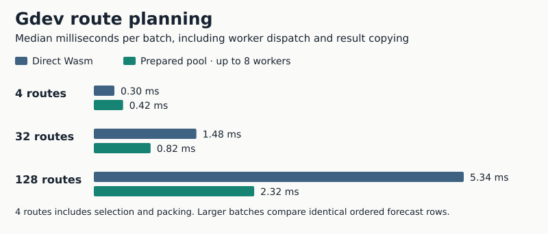
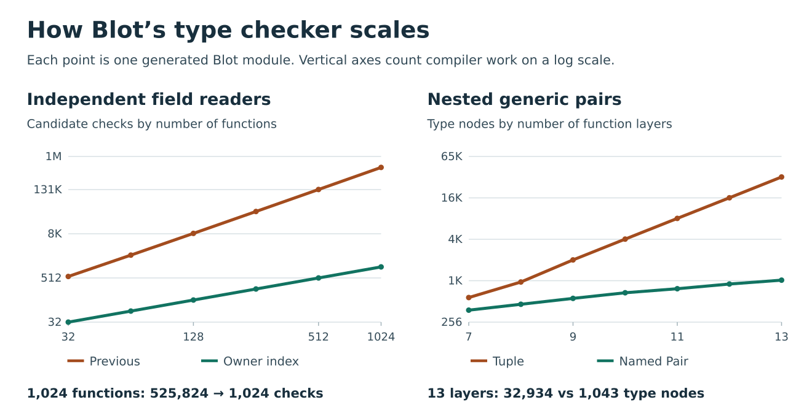
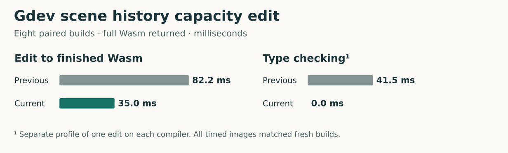
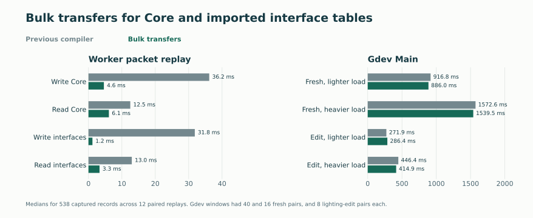
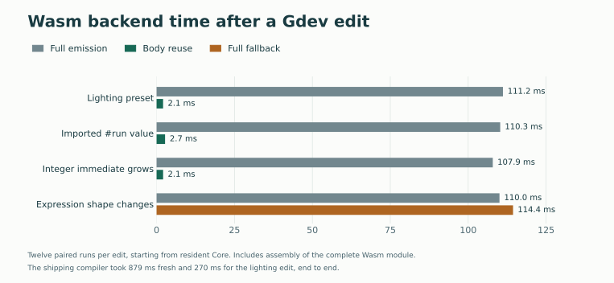
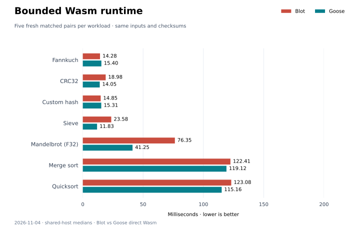

# Blot

Blot is a functional language that compiles to WebAssembly. Deno provides the
CLI, project client, formatter and guest host. See the
[repository map](docs/README.md) for code, tests, documentation and evidence.

The compiler is written in Goose and lives in
[compiler-goose/](compiler-goose/README.md). It was ported from a compiler
written in Zig, which was removed on 15 November 2026 once the port matched it;
[tasks/GOOSE_PORT.md](tasks/GOOSE_PORT.md) has the comparison.

The owned-storage rewrite and backend cutover are unfinished. One real Gdev
frame has passed native Pen with an inspected screenshot; broader compiler and
application qualification remains open. Start with [CONTINUE.md](CONTINUE.md)
and [tasks/STORAGE_REWRITE.md](tasks/STORAGE_REWRITE.md) for the current
candidate, evidence and requirements.

## Benchmarks

Eight prepared Deno workers ran 128 Ink route forecasts for Gdev in **2.32 ms**
versus **5.34 ms** for one direct Wasm call. The existing four-route gameplay
result stayed faster directly, **0.30 ms** versus **0.42 ms**. Preparing the
pool took 123–138 ms across the two runs. [Benchmark and raw samples](benchmarks/evidence/measurements/2026-11-19-spark-spawn.json)



Changing scene history capacity in Gdev returns the complete Wasm in
**35.0 ms**, down from **82.2 ms** on the same source.
The compiler reuses all checked bodies and updates one operand.
[Capacity edit measurements](benchmarks/evidence/measurements/2026-11-19-gdev-call-literals.json)

Fresh Gdev Main took **743.7 ms** across 20 alternating process pairs.
Indexing requirements by their function cut Gdev's candidate scans from
**2,417,106 to 180,773**. Thirteen layers of inferred tuples still create
32,934 type nodes. Naming the repeated shape takes 1,043.
[Cold timings and type-system assessment](tasks/FAST_COMPILE.md#type-inference-and-ownership-19-november-2026)

A six-layer mixed tuple that used to exceed three seconds now compiles in
**3.4 ms**. Ownership analysis reuses the answer when a type is reached
through multiple fields. [Shared-type measurements](benchmarks/evidence/measurements/2026-11-19-shared-ownership.json)





The Gdev intent benchmark that appends inside two case arms builds its list in
**21.2 µs**, down from **110.8 µs**. [List benchmark and chart](benchmarks/intent/README.md#growing-one-list-across-case-arms)

An earlier 269-module snapshot compiled 46,109 lines in 886.0 ms median
across 40 fresh builds on a lightly loaded host, down from 916.8 ms.
Under heavier CPU contention the same snapshot took 1,539.5 ms, down from
1,572.6 ms across 16 pairs. Lighting edits took 286.4 and 414.9 ms in
those two windows and showed no consistent speedup.
[Gdev measurements](benchmarks/evidence/measurements/2026-11-18-gdev-worker-tables.json)



A retained-backend experiment reduced Wasm emission for a lighting edit from
**111.2 ms to 2.1 ms**. It re-emitted one of 6,859 function bodies and
reassembled Main. The full-emission compiler in that experiment took **270 ms end to end** on that edit.
[Retained backend measurements](benchmarks/evidence/measurements/2026-11-18-gdev-body-reuse.json)



An earlier compiler took **938 ms** for ordinary lighting and **1,015 ms** for
`#run true` in the same field. Both produced identical Wasm.
[Compile-time execution benchmark](benchmarks/evidence/measurements/2026-11-18-gdev-staging-interfaces.json)

Blot versus Goose's direct Wasm backend, measured on 2026-11-04. Seven adapted
pairs now pass: six original-numeric workloads and a Mandelbrot F32 control.
Merge sort and quicksort retain their original recursive algorithms.




Against the preceding compiler, merge improves **1.19x**, custom hash **7.00x**
and Sieve **1.16x**. Hash and merge now roughly match Goose. Both charts use
fresh five-sample measurements. Blot uses U32 byte/flag buffers where Goose uses
U8; both sorts use four-byte elements. Original F64 remains unsupported.

On the November 4 snapshot, local-index ordering reduced Main from 10.04 MB
to 9.20 MB. [Historical measurements](benchmarks/goose/results/2026-11-04-array-engines.md)

## Development

Use the existing sibling `pen`, `ink` and `gdev` checkouts, Deno 2, and clang,
cmake, ninja and Python 3 for the compiler's build. From the repository root:

```sh
deno task build:compiler
deno run -A scripts/integration/build_gdev.ts --timeout-ms 10000 > /tmp/gdev-main.log 2>&1
python3 scripts/integration/report.py /tmp/gdev-main.log
```

`deno task build:compiler` writes the optimized compiler to
`compiler-goose/build/blotc-goose` (about seven minutes; the first build also
builds the patched Goose compiler it needs). Pen and the sibling checkouts run
that file. `deno task build:compiler:dev` writes a debug compiler to
`compiler-goose/build/blotc-goose-dev` in about a minute and a half. Keep a
compiler with the matching `std/`. The handoff describes the Pen one-frame
runner and the required PNG inspection.

Current syntax uses `func`, explicit `return`, curried `->`, `$Constructor`,
`true` / `false`, `and` / `or`, and `#[...]` arrays. The counted-storage and ABI
8 data-stack backends are both still live; task 120 tracks retirement.

## Navigation

- [Repository map](docs/README.md): source, tests, documentation and evidence.
- [Language guide](docs/language/guide.md) and
  [standard library](std/README.md).
- [Compiler](compiler-goose/README.md) and [Deno host](host/README.md).
- [Goose benchmark suite](benchmarks/goose/README.md) and
  [current results](benchmarks/goose/results/2026-11-04-array-engines.md).
- [Agent instructions](AGENTS.md), [current frontier](CONTINUE.md) and
  [active plan](PLAN.md).
