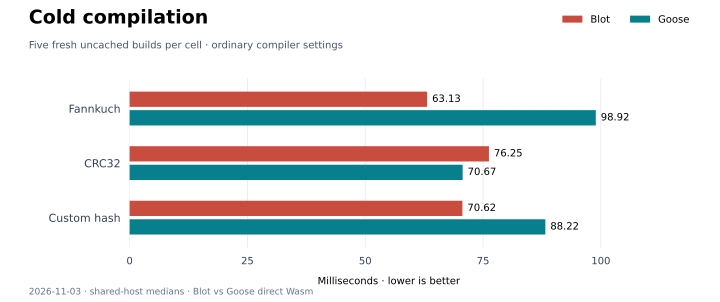
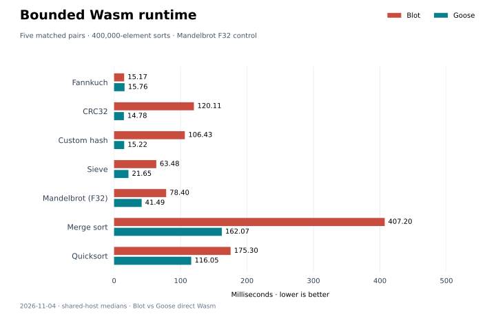

# Blot 2

Blot is a functional language whose handwritten Zig compiler emits WebAssembly.
Deno supplies its CLI, project client, formatter and guest host.

The owned-storage rewrite is **unfinished**. One real Gdev main frame has passed
native Pen with an inspected screenshot. Active source/generator conversion is
checkpointed; remaining compiler and runtime qualification continue. Later
semantic revisions require a fresh frame. Start with [CONTINUE.md](CONTINUE.md)
and the [active task index](tasks/STORAGE_REWRITE.md) for exact candidate
evidence.

This is a greenfield project. Breaking changes are welcome; remove superseded
implementations and APIs rather than maintaining legacy compatibility.

## Benchmarks

Blot versus Goose's direct Wasm backend, measured on 2026-11-03. Four
original-numeric pairs plus a Mandelbrot F32 control; two sorting ports are
blocked by owned-storage recursion.





Five matched pairs expose **7.4x CRC32**, **6.9x custom hash**, **3.1x Sieve**
and **1.9x F32 Mandelbrot** gaps; Fannkuch is roughly at parity. Unsupported
cases have no bar. Byte buffers use U32 in Blot and U8 in Goose. Shared call
contexts and one hook environment reduce Gdev Wasm **12.11 → 10.24MB**; fresh
compile medians are **5.63 → 5.28s**. Numeric timings are controls. See
[results, qualification and next hills](scripts/bench/goose/results/2026-11-03-call-contexts.md).

## Development

Use the existing sibling `blot2`, `pen`, `ink` and `gdev` checkouts. Requires
Zig **0.17.0** and Deno 2. From this directory:

```sh
zig version
ZIG_GLOBAL_CACHE_DIR="$PWD/build/zig-global-cache" deno task build:compiler:dev
deno run -A scripts/storage_handoff/build_gdev.ts > /tmp/gdev-main.log 2>&1
python3 scripts/storage_handoff/report.py /tmp/gdev-main.log
```

Development uses the native Zig backend (`-Dllvm=false`) and writes
`zig-native/zig-out-dev/bin/blotc`. Keep the compiler and `std/` from the same
checkout. After main compiles, rebuild the matching Pen host and use the
one-frame runner described in the handoff. These commands are the continuation
workflow; their presence here does not establish a successful run.

Current syntax uses `func`, explicit `return`, curried `->`, `$Constructor`,
`true` / `false`, `and` / `or`, and `#[...]` arrays. Named owners, borrowed
views and explicit copies define the new memory model. Language tasks are
retired; isolated host workers and copied numeric packets remain.

## Documentation

- [Agent instructions](AGENTS.md): build rules and validation scope.
- [Language guide](compiler/guide.md): source and named-owner contracts, with
  the unfinished backend cutover stated explicitly.
- [Scoped storage](zig-native/SCOPED_STORAGE.md) and
  [rewrite review](zig-native/STORAGE_REWRITE_REVIEW.md): ownership and scope.
- [Compiler ownership contract](zig-native/CONTRACT.md).
- [Host tools](compiler/README.md),
  [project client](zig-native/PROJECT_CLIENT.md),
  [packages](compiler/packages.md), and [guest ABI](compiler/guest-abi.md).
- [Standard library](std/README.md).
- [Documentation map and historical evidence](docs/README.md): current
  references and pinned earlier evidence. Those results do not qualify this
  candidate.

Use a coherent affected test batch while integrating. Full compiler/release and
application qualification remain pending; follow `AGENTS.md` before claiming a
pass. Existing task requirements remain in `tasks/` and `PLAN.md`.
