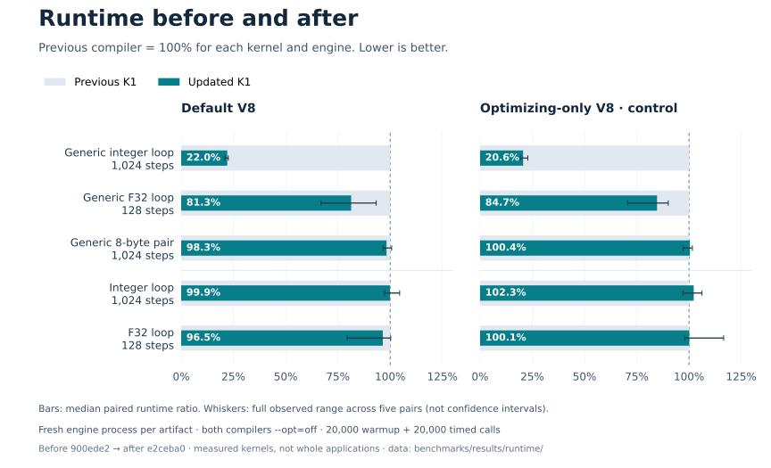

# Blot K1 — Goose rewrite

A clean implementation of [issue #37](https://github.com/mewhhaha/blot2/issues/37)
in [Goose](https://github.com/aardappel/goose), on `rewrite/goose-k1`.
The previous Zig compiler is preserved on `main`.

**Linux qualification is complete:** 116 native tests, 92 integration
tests and the editor gate pass. The [implementation ledger](IMPLEMENTATION.md)
maps the specification to executable evidence. The
[versioned specification](docs/spec/INDEX.md) defines the language and ABI.

The compiler checks explicit storage ownership, initialized lengths, integer
arithmetic and collection identities before lowering. It emits WebAssembly
with fixed memory, bounded frames, uniform generic bodies and no runtime
reference counting or garbage collector. Serialized Core is independently
validated; a disk artifact cannot authorize skipping source checks.

## Build and use

```sh
scripts/bootstrap-goose.sh
scripts/build.sh
build/blot check examples/identity.blot --language=k1 --timings
build/blot build examples/identity.blot -o build/identity.wasm
scripts/check.sh
scripts/check.sh --release
```

The pinned Goose revision is `a108677d300cb0e8bbb842c35a353abe67a20c6c`.
Set `GOOSE` to an existing compatible executable to avoid bootstrapping.
Building requires CMake and a C++ compiler for Goose, then Clang for the
compiler executable. Deno runs host and emitted-Wasm tests; Node/npm run the
pinned TextMate/Oniguruma editor gate. Linux is the
currently exercised platform, including real arena-allocation fault injection.

A complete scalar export declares effects and resource bounds:

```blot
pub let identity: U32 -> U32 ! {} resources {depth: 1, frame: 0} =
  fn value => return value
```

Ordinary U32 arithmetic needs checked preconditions. For modular arithmetic,
use explicit operations such as `U32.wrapping_add`. Functions return explicitly;
value blocks use `break`. See [the language guide](docs/guide.md) and
[examples](examples/) for loops, arrays, callbacks and owned storage.

Raw scalar exports check numeric preconditions and canonical Bool inputs before
source execution. Invalid input traps; callers must discard that instance.
The copy-only array bridge instead reports invalid input through its status API.

The particle example uses the copy-only host array bridge:

```sh
build/blot build examples/particles.blot -o build/particles.wasm \
  --bridge-config=examples/particles.json --opt=off --timings
```

[host/blot.ts](host/blot.ts) validates the manifest, copies values across the
boundary, rejects reentry and permanently disables an instance after an
unexpected Wasm trap. Memory and raw descriptors remain private. Zero-sized
array elements use `{length: count}` rather than allocating an array of units.

## Repeated edits

`build/blot serve` reads one JSON build request per line and writes one JSON
result per line. A request has `input`, `output`, and optionally `package_root`,
`export`, `bridge_config`, `opt`, `cancel_file`, `trace` and `telemetry`:

```json
{"input":"examples/identity.blot","output":"build/identity.wasm","package_root":"."}
```

The process retains its last successful checked revision. Exact declaration
text, actual name lookups and complete dependency interfaces govern reuse.
Changing a callee body can preserve its callers' checked bodies; lowering binds
calls to the current callee. Static evaluation also depends on executed bodies.
The response reports `completed_bodies`, `reused_bodies`, `revision` and timings.
Failed and cancelled builds preserve the last output and successful revision.
It also reports semantic/validation visits, retained bytes, completed modules,
active completion regions and downstream completion attempts. The last two
remain zero after admission. `--trace` reports phase/module progress on stderr.

Reuse is conservative: unresolved inferred resource interfaces can decline it.
The current cache keeps one complete revision, bounded by the 16 MiB artifact
limit and 16,384 receipts, below the 128 MiB retained-payload ceiling. It is
process-local; `inspect FILE.bk1` validates an external object but does not import
its receipt into the trusted source cache.

## Other commands and verification

```sh
build/blot format examples/identity.blot
build/blot migrate old-program.blot
build/blot complete builder.
build/blot build examples/identity.blot -o build/identity.wasm \
  --emit-core=build/identity.bk1
build/blot inspect build/identity.bk1
build/blot rebuild build/identity.bk1 -o build/rebuilt.wasm
```

Migration produces a syntax-aware review report. See the
[complete migration example](docs/migration.md), including an imported generic
helper and its copy-only host. Optional optimization is selected with
`--opt=off|fast|release`; enabled transformations are bounded and revalidated.
`release` adds bounded direct scalar inlining to the R01–R12 kernel. Fusion and
SIMD remain optional future work. `rebuild` independently admits required
Core and regenerates Wasm locally, without source files or trusted disk receipts.

Build with `--telemetry` to collect reservations/failures, releases/resets,
backing/frame/result high-water bytes, initialized/copied bytes, source calls and
loop iterations. `host.telemetry()` returns an immutable BigInt snapshot.
Instrumentation has separate geometry and is excluded from ordinary timing
measurements. See [the measurement methodology](benchmarks/README.md).

`scripts/check.sh` discovers the complete current native inventory, verifies
start/end timing evidence, builds the compiler and runs executed-Wasm, host,
retained-session and allocation-failure suites. Logs belong in `test-results/`.
The gate checks source hashes before/after and writes
`test-results/qualification.json`; changes during the run invalidate it.
Passing that inventory is separate from finishing every specification law.
The particle test inspects the actual baseline loop for four F32 loads, two
stores, two multiplies, two adds and no calls inside the loop.

## Performance

Compared directly with **`main` at `1e39b5d`**, ordinary integer/F32 loops are
roughly at parity. Generic loops still take longer: **1.13–1.20×** main's time for
integers, **3.61–4.24×** for F32 and **6.40–6.55×** for eight-byte pairs, across
default and optimizing-only V8. These are median paired ratios from equivalent
loop kernels, with the required export ownership boundaries included.
[The direct comparison](benchmarks/MAIN_COMPARISON.md) records all 209 measurements,
absolute timings, ranges, source equivalence and exact compiler provenance.


Main is 100% for each workload and engine; lower is better. Whiskers show all
five observed pairs, not confidence intervals. The generic gaps persist in the
optimizing-only control. Ordinary-loop differences are small and unresolved.

Against the previous K1, the latest runtime pass makes the measured **generic
integer loop 4.5–4.9× faster** and reduces generic F32 loop time by **15–19%** across default and
optimizing-only V8. It removes unused phi scratch and lowers four-byte payload
copies to raw word loads/stores. Ordinary loops and the aggregate-copy fallback
remain roughly unchanged. These are five reference-checked kernels, with a fresh
engine process for every sample, rather than a whole-application speedup.
[Runtime results and limitations](benchmarks/RUNTIME.md) preserve all 228 records.



Previous K1 is 100% for each workload and engine; lower is better. Bars show
paired medians and whiskers show the full observed ranges across five pairs.

The preceding structural changes reduced **fresh compile time by roughly 7–15%**
against the previous qualified K1 at the largest measured scales. They borrow
validator table views and use a forward-only proof-graph traversal. The
[structural report](benchmarks/STRUCTURAL.md) separates isolated changes, combined
results and remaining limits.

The fresh comparison against `main` uses five counterbalanced pairs on a Ryzen 7
7800X3D, 128 functions/callers except the 127-depth chain. Both are native release
compilers; K1 uses `--opt=off` and main uses its default pipeline. Fresh process
compilation medians include startup and publication:

| Workload | Main ms | K1 ms |
| --- | ---: | ---: |
| Independent functions | 5.03 | 4.84 |
| Shared callee | 5.24 | 4.55 |
| Call chain (127) | 8.65 | 5.23 |
| Diamonds | 18.17 | 15.71 |
| Generic calls | 5.50 | 4.89 |
| Captured closures | 10.90 | 7.85 |
| Imported modules | 11.69 | 11.13 |
| Guarded arithmetic | 22.27 | 24.90 |
| Static domains | 7.71 | 13.03 |

The [compile-time chart and paired ranges](benchmarks/MAIN_COMPARISON.md#fresh-compilation)
show clear gains on chains, closures, diamonds and generic calls. Independent
functions, shared-callee and module ranges cross parity. Proof-heavy and
static-domain compilation still take about 13% and 71% more time respectively.
These are synthetic program compilations, not compiler rebuilds or migrated `gdev`.

In the separate previous/new K1 comparison, 128-caller body edits fell from
6.96 to 6.29 ms and unchanged requests from 7.31 to 6.34 ms. All off-tier Wasm
is byte-identical, so these structural changes do not imply a runtime speedup.

Release now includes bounded scalar inlining, with fixed size/depth/growth/work
limits and independent candidate validation. Its first integer/F32 loop kernels
show no resolved runtime gain. Diamond timings change direction across engine
controls, so no general inlining speedup is claimed. The report retains the
original regression and all controls.

The preceding snapshot also recorded default-engine runtime gaps: diamonds measured 23.02 → 56.25 ns/call and
generic calls 15.80 → 30.63 ns (legacy → K1). Captured closures measured
37.43 → 33.96 ns and static domains 40.64 → 28.74 ns. Both use the same Deno/V8
engine, one million warmup calls and checksum-checked export sweeps. Runtime
includes the JS/Wasm boundary; engine state and host load affect the results.

[Current qualification and raw evidence](benchmarks/results/runtime/manifest.json)
pin 116 native tests, 92 integration tests, the editor gate and 228 measurement
records. The [direct main comparison](benchmarks/results/main-comparison/manifest.json)
adds 209 records with the same qualified compiler; the earlier structural package
preserves its 1,177 records. These are synthetic workloads and five loop kernels,
not migrated `gdev`.
Modules are near compile-time parity; proof-heavy and static-domain compilation
still trail legacy. Required validation, syntax, ABI and shared generic bodies
remain intact. Ordinary Wasm publication guarantees atomic visibility rather
than durable media acknowledgement; explicit Core and paired outputs retain
their synchronization paths.

Compiler rebuild time was not remeasured; the historical **37.36 s debug / 57.67 s
release** medians remain separate work. [Earlier parity](benchmarks/PARITY.md),
[Sol results](benchmarks/SOL_REVIEW.md) and the [initial comparison](benchmarks/RESULTS.md)
remain immutable historical reports.
