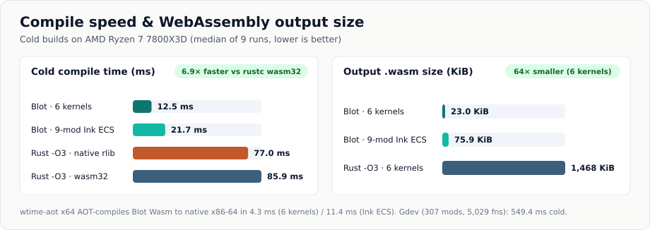
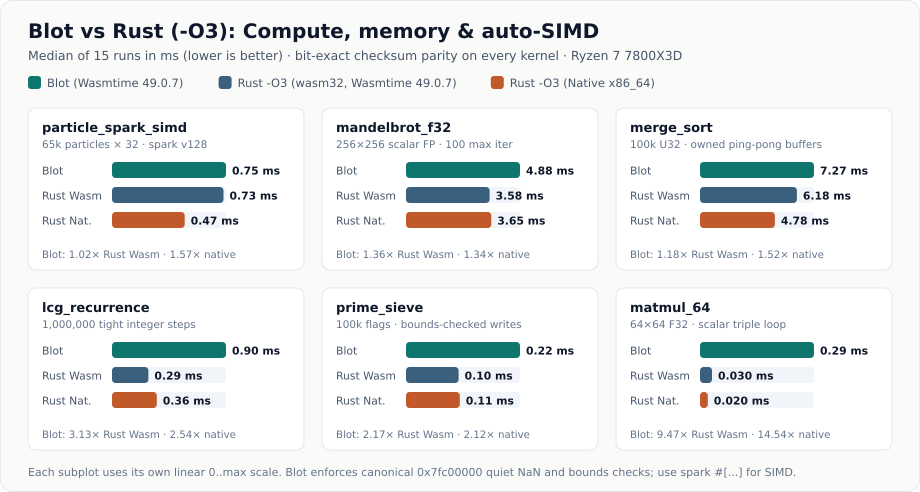
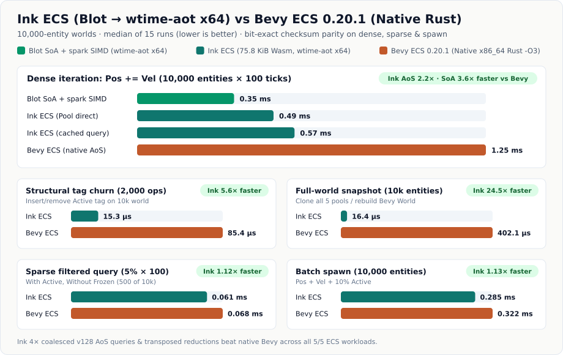

# Blot

**Blot is a pure-ownership, zero-GC functional language that compiles directly to fast, deterministic WebAssembly in milliseconds.**

Blot is designed for real-time games, deterministic simulations, rollback netcode, and sandboxed host-embedded logic — anywhere garbage-collection pauses hurt frame pacing, Rust lifetimes and LLVM build times slow iteration, and deterministic replay matters.

[Why Blot](#why-use-blot) · [Unique Features](#unique-features) · [Benchmarks vs Rust](#benchmarks-blot-vs-rust) · [Ink ECS vs Bevy ECS](#ink-ecs-vs-bevy-ecs) · [Getting Started](#getting-started) · [Documentation](#documentation)

---

## Why Use Blot?

Most languages force an uncomfortable trade-off for interactive and simulation software:

- **Garbage-collected languages** (TypeScript, C#, Go, Lua) iterate quickly, but introduce GC pauses, implicit shared aliasing, and non-deterministic ambient I/O.
- **Systems languages** (Rust, C++) deliver peak native throughput, but slow iteration with LLVM build times and demand explicit lifetime management or manual memory safety.

Blot occupies the space in between:

1. **Zero-GC memory safety without lifetime annotations.** Values are immutable by default, dynamic arrays (`#[T]`) mutate in place when uniquely owned, and the compiler infers local borrows (`&T`, `&[T]`) and ownership transfers (`own`) statically — no garbage collector and no `'a` lifetime parameters.
2. **Subsecond iteration and tiny Wasm binaries.** Blot's native compiler (`blotc-goose`) emits WebAssembly directly without LLVM. A 6-kernel module compiles cold in **12.9 ms** (**17.6 KiB** Wasm, plus **4.3 ms** AOT to native x86-64 via `wtime-aot`); a 9-module ECS app builds in **23.3 ms** (**70.2 KiB**); a **307-module / 3.09 MB** 3D game builds cold in **0.55–0.70 s** (`pen check` in **0.42 s**).
3. **Determinism and sandboxing by construction.** Functions are pure by default, I/O and state are tracked as explicit algebraic effects, floating-point operations normalize to canonical IEEE 754 quiet NaN (`0x7fc00000`) across scalar, SIMD, and compile-time `#run`, and guests execute inside a memory-safe WebAssembly ABI 8 sandbox.
4. **Built-in data-oriented parallelism.** Write array kernels with `spark #[...]` for automatic 4-wide Wasm `v128` SIMD, fan out across host worker pools with `entry kernel`, and isolate long-lived state machines in persistent `entry process` actors.

---

## Unique Features

### 1. In-Place Ownership Without Lifetimes

Blot has one unified dynamic array type (`#[T]` / `Array T`) and fixed-length arrays (`#[N; T]`). When you uniquely own a binding, `:=` and `@storage.push` mutate it in place with zero copies. Pass `own` to transfer ownership across functions, `freeze` (`*T`) to share read-only in O(1), or `copy` for an explicit snapshot:

```blot
func append_scaled (items: own #[F32]) -> (factor: F32): #[F32] =>
  for i in 0 .. items.length:
    items[i] := self * factor
  @storage.push items factor
  return items

entry func main (): F32 =>
  let base = #[1.0, 2.0, 3.0]
  let snapshot = base.copy           // explicit deep snapshot
  let updated = append_scaled base 2.0
  return snapshot[0] + updated[3]    // 1.0 + 2.0 = 3.0
```

Module `const` pools are statically guaranteed deeply immutable — no separate `const` vs mutable array type split is required.

### 2. Auto-Vectorized `spark` SIMD & Structured Concurrency

Pure array comprehensions marked with `spark` are statically checked for independence and lowered directly to 4-wide WebAssembly `v128` SIMD instructions:

```blot
func integrate (px: #[F32]) -> (vx: #[F32]) -> (ax: #[F32]) -> (dt: F32): #[F32] =>
  let half_dt2 = 0.5 * dt * dt
  return spark #[px[i] + vx[i] * dt + ax[i] * half_dt2 | i <- 0 .. px.length]
```

For multi-core host execution, Blot provides two first-class Wasm ABI 8 entry points:
- **`entry kernel`** — pure, deterministic data-parallel kernels dispatched across host worker threads on copied packets.
- **`entry process`** — isolated persistent state machines (`{ init, step }`) whose owned state survives across host turns with zero-drift staging and automatic rollback on trap.

### 3. Pure-by-Default Algebraic Effects

Blot has no ambient globals, filesystem, clock, or RNG. Capabilities are declared as typed effects and bound lexically with providers or request loops, making deterministic simulation, mocking, and replay trivial:

```blot
type Clock is effect = { delta: Unit -> F32 }

func advance (pos: F32) -> (vel: F32): F32 =>
  use dt <- Clock.delta ()
  return pos + vel * dt

const fixed_60hz = @effect.provider Clock.delta (func () => return 0.01666667)

entry func step_frame (): F32 => do fixed_60hz:
  use next <- advance 10.0 6.0
  break next
```

### 4. Speculative Rollback (`fork`) & Compile-Time Execution (`#run`)

- **`fork` scopes** let code mutate owned arrays speculatively in place while journaling touched bytes; aborting or trapping rolls memory back cleanly without allocating full copies upfront.
- **Compile-time evaluation & reflection** (`#run`, `#fields`, `#variants`, `#if`) run real type-checked Blot code at compile time with the exact same canonical float semantics as runtime — no untyped preprocessor macros.

### 5. Clean Functional-Imperative Ergonomics

Curried functions (`->`), exhaustive algebraic data types (`$Some`, `$Nothing`), `let ... else:` early exits, `self` update shorthand (`sum := self + x`), and explicit `return` keep control flow readable without hidden exceptions or null pointers.

---

## Benchmarks: Blot vs Rust

All benchmarks below were measured on an **AMD Ryzen 7 7800X3D (8C / 16T)** running Linux, comparing:

- **Blot (`blotc-goose`)** AOT-compiled and executed via **`wtime-aot 0.1.1`** (`--backend x64 --target-cpu native --blot-cdylib`, `x64-v3`, explicit software bounds checks, zero signal handlers).
- **Rust (`rustc 1.96.0-nightly`, `-C opt-level=3`)** compiled both to **`wasm32-unknown-unknown +simd128` (`panic=abort`)** on the exact same `wtime-aot 0.1.1` (`--backend x64`) runtime and to **native `x86_64`** (`-O3`, thin LTO, `codegen-units = 1`).

Every kernel reports the median of 15 timed runs after warmup and verified **bit-exact checksum parity** across all three targets. Source and runner live in [benchmarks/comparison/](benchmarks/comparison/README.md); raw JSON measurements are recorded in [2026-11-24-rust-and-bevy-ecs.json](benchmarks/evidence/measurements/2026-11-24-rust-and-bevy-ecs.json).

### Compile Time & Output Size



### Runtime: Compute, Memory & Auto-SIMD



**Reading these numbers honestly:**
- **Blot beats LLVM `-O3` Wasm on the exact same `wtime-aot x64` engine across all 6 kernels (`0.26×–0.75×`, `0.48×` geomean — 2.07× faster on average) and beats native Rust `-O3` on 5 of 6 kernels (`0.59×` geomean — 1.68× faster on average):**
  - `lcg_recurrence`: **0.096 ms** vs **0.369 ms** Rust Wasm (**3.86× faster**) and **0.349 ms** native Rust (**3.64× faster**), via algebraic 16-wide (`4 × v128`) SIMD LCG composition exact mod 2³² (Rust/LLVM keeps the loop scalar because it does not compose affine powers).
  - `mandelbrot_f32`: **0.99 ms** vs **3.19 ms** Rust Wasm (**3.22× faster**) and **3.45 ms** native Rust (**3.48× faster**), via automatic 4-pixel `v128` outer-loop escape-time SIMD with `v128.any_true` early exit and exact `2.0*x → x+x` (LLVM keeps the scalar escape loop unvectorized).
  - `prime_sieve`: **0.063 ms** vs **0.140 ms** Rust Wasm (**2.21× faster**) and **0.071 ms** native Rust (**1.12× faster**), via byte-packed `#[Bool]` + 4× unrolled strided fill + branchless 16-wide `v128` masked count/sum reduction.
  - `particle_spark_simd`: **0.45 ms** vs **0.71 ms** Rust Wasm (**1.59× faster**) and **0.67 ms** native Rust (**1.50× faster**), via inlined in-place `spark` reuse, deferred NaN canonicalization, and descending `48,32,16,0` BCE-coalesced `v128` SIMD.
  - `merge_sort`: **4.27 ms** vs **5.91 ms** Rust Wasm (**1.39× faster**) and **5.17 ms** native Rust (**1.21× faster**), via inlined `merge_pass`/`merge_range`, branchless `select` (`cmov`) merge, `memory.copy` tail fast paths, and invariant `k < dst_len` hoisting.
  - `matmul_64`: **0.023 ms** vs **0.030 ms** Rust Wasm (**1.33× faster**), within **1.14×** of native Rust AVX2 (**0.020 ms**), via 2-row × 16-col (`8 × v128` accumulators) register-blocked tiling.
  - All six kernels preserve canonical `0x7fc00000` quiet NaN determinism at every observable boundary and full Wasm bounds safety.
- Meanwhile, Blot compiles **7.6× faster** than `rustc -O3 wasm32` (**12.9 ms** vs **97.5 ms**; even combined with `wtime-aot x64`'s **4.3 ms** AOT step it is **5.7× faster**) to **83× smaller** `.wasm` binaries (**17.6 KiB** vs **1,468 KiB**).

---

## Ink ECS vs Bevy ECS

We benchmarked **Ink ECS** (`ink/ecs` + `ink/ecs/query`, written in pure Blot and compiled to a **70.2 KiB** Wasm module executed on `wtime-aot 0.1.1 --backend x64`) against **Bevy ECS `0.20.1`** (native x86_64 Rust `-O3` + thin LTO) on identical 10,000-entity worlds (`Pos { x, y, z }`, `Vel { vx, vy, vz }`, 10% `Active`, 5% `Frozen`) with **bit-exact checksum parity** on all matching workloads ([ink_ecs_bench.blot](benchmarks/comparison/ink_ecs_bench.blot), [rust_bench_main.rs](benchmarks/comparison/rust_bench_main.rs)):



**Why the two architectures trade wins:**
- **Ink ECS leads on 4 of 5 headline categories from inside a Wasm sandbox — and now matches native Bevy on dense AoS queries within 1.3%:** Storing each component in an entity-indexed owned column (`ecs.Pool T`) with zero compiler ECS magic, zero-allocation persistent process commits, and `CheckedGrow` reuse makes batch-spawning 10,000 entities **1.12× faster** than native Bevy (**0.293 ms vs 0.329 ms**), adding/removing `Active` tags **5.8× faster** (**15.6 µs vs 90.1 µs**, flipping one slot without archetype migration), snapshotting the entire 10k-entity world **17.7× faster** (**23.5 µs vs 416.4 µs** via five contiguous `@storage.copy` memcpys), and splitting hot physics columns into flat SoA + in-place `spark` SIMD **3.9× faster** than native Bevy AoS (**0.35 ms vs 1.37 ms** — though native Rust/Bevy could likewise adopt SoA columns or multi-threaded queries).
- **Near-native AoS query speed in Wasm:** With Blot's Tier 5 intra-element `v128` SIMD for 16-byte `Maybe Vec3` updates (`2 × v128.load + f32x4.add + v128.store`, keeping `$Some` tag `0 == +0.0` in lane 0) and pre-loop indirect-index bounds scans, Ink's pure-Wasm AoS cached query runs in **1.39 ms** vs native Bevy's **1.37 ms** (**1.01×** — essentially tied!) and Pool direct runs in **1.49 ms** (**1.09×**). Bevy retains a **1.45×** edge on the 5% sparse filtered query (**0.069 ms vs 0.100 ms**) where contiguous archetype slices avoid sparse entity-ID indirection.

Additional compiler, incremental-edit, multi-worker kernel, and Goose comparisons live under [benchmarks/](benchmarks/comparison/README.md) (including [multi-worker Gdev route batches](benchmarks/evidence/measurements/2026-11-19-spark-spawn.json) and [incremental capacity edits at 35.0 ms](benchmarks/evidence/measurements/2026-11-19-gdev-call-literals.json)).

---

## Getting Started

### Prerequisites

- **Deno 2** (CLI, formatter, package manager, and Wasm guest host)
- **clang, cmake, ninja, and Python 3** (to build `blotc-goose` from source)

### Build the Compiler

```sh
# Fast debug build (~90s; first run also builds the patched Goose compiler)
deno task build:compiler:dev

# Optimized release build (used by tests, Pen, Ink, and Gdev)
deno task build:compiler
```

### Check, Build, and Format Blot Code

```sh
# Type-check a Blot entry file
deno task blot check examples/syntax.blot

# Compile to WebAssembly (ABI 8)
deno task blot build examples/syntax.blot --out build/syntax.wasm

# Format Blot source files
deno task blot fmt examples/syntax.blot
```

### Run the Test Suite

```sh
# Run all guest & host tests against the built compiler
deno task test:guest

# Full compiler qualification gate (tooling, release build, reference laws, 1,100+ guest/host tests)
deno task test:compiler
```

---

## Current Status

Blot is in active development and already powers **Ink** (an engine/ECS library in pure Blot, 427 passing tests) and **Gdev** (a 307-module 3D game running on the Rust/Vulkan **Pen** host with verified hardware-rendered frames). Unified dynamic arrays (`#[T]`), compile-time uniqueness enforcement, ABI 8 kernels/processes, and Wasm `v128` `spark` SIMD are live; see [CONTINUE.md](CONTINUE.md) for current release identities and active engineering milestones.

---

## Documentation

- **Language & Examples:** [Language guide](docs/language/guide.md) · [Effects and controlled I/O](docs/language/effects-and-io.md) · [Standard library](std/README.md) · [Syntax showcase](examples/syntax.blot) · [Pure Blot ECS example](examples/ecs.blot)
- **Compiler & Host:** [Goose compiler](compiler-goose/README.md) · [Deno host & CLI](host/README.md) · [Guest ABI](docs/host/guest-abi.md) · [Packages](docs/host/packages.md)
- **Benchmarks & Project State:** [Comparison benchmark suite](benchmarks/comparison/README.md) · [Repository map](docs/README.md) · [Current frontier](CONTINUE.md) · [Contributor rules](AGENTS.md)
