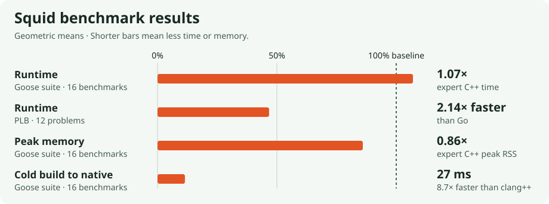
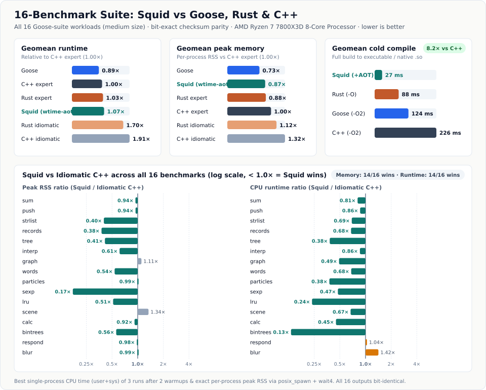

<p align="center">
  <a href="docs/artwork/README.md"></a>
</p>

<h1 align="center">Squid</h1>

<p align="center">
  <b>A zero-GC, ownership-checked language compiling straight to WebAssembly in milliseconds.</b><br>
  The safety and ergonomics of functional scripting with native-class speed, without a garbage collector or LLVM.
</p>

<p align="center">
  <a href="#tour">Tour</a> ·
  <a href="#performance">Performance</a> ·
  <a href="#getting-started">Get started</a> ·
  <a href="CHEATSHEET.md">Cheatsheet</a> ·
  <a href="DESIGN.md">Design</a>
</p>



<sub>AMD Ryzen 7 7800X3D · <code>squidc-goose</code> → <code>wtime-aot 0.1.11</code> AOT-compiled Wasm · 100% bit-exact output parity · <a href="BENCHMARK.md">Methodology →</a></sub>

```squid
type Clock is effect = { tick: Unit -> U32 }
type Action is data = $Add U32 | $Clear

func apply (log: own #[U32]) -> (act: Action): #[U32] !{ Clock } =>
  use t <- Clock.tick ()
  case act of
    $Add n =>
      log := self.push (t + n)
    $Clear =>
      log := self.truncate 0
  return log

io main (): #[U32] =>
  handler clock: Clock =>
    tick () => 10
  return (apply #[1, 2]).handle clock
    .run ($Add 5) // #[1, 2, 15]
```

## Why Squid

- **No GC, no lifetimes.** Values have a single owner, update in place with `:=`, and free deterministically when their scope ends.
- **Native-class, no LLVM.** Direct compilation to compact WebAssembly (`wtime-aot` to native x64/ARM64) delivers millisecond cold builds and competitive runtime.
- **Deterministic by construction.** Every guest runs in a memory-isolated sandbox where all host I/O enters through typed, swappable algebraic effects.
- **Comptime without macros.** `#for`, `#if`, and `#fields` inspect types and generate specialized code at compile time using ordinary Squid syntax.

## Tour

### Owned, in place

Pass `own` to mutate arrays and recursive data in place without garbage collection, borrow-checker lifetimes, or accidental aliasing.

```squid
type Tree is data = $Leaf U32 | $Branch (Tree, Tree)

func map_tree (t: own Tree) -> (k: U32): Tree => case t of
  $Leaf n => $Leaf (n * k)
  $Branch (l, r) => $Branch (map_tree l k, map_tree r k)

func scale (items: own #[F32]) -> (k: F32): #[F32] =>
  for i in 0 .. items.length:
    items[i] := self * k
  items := self.push k
  return items
```

| When timelines diverge | Cost | Gives you |
|---|---|---|
| `x.copy` | O(n) | An independent, mutable clone |
| `freeze x` | O(1) | A read-only `*T` shared freely across scopes |
| `fork x:` | O(edits) | Speculative mutations that roll back automatically on exit |

→ [Owned updates and copies](docs/language/guide.md#owned-updates-and-copies)

### Data layout is a symbol

Squid puts memory layout directly in the type so you choose dense storage without changing how code reads.

| Write | Means |
|---|---|
| `#[T]` | Dynamic contiguous array, mutated in place |
| `#[n; T]` | Fixed-length array with compile-time bounds-check elimination |
| `%[T]` | Packed sequential storage: SoA record columns and split-stream sums |
| `~[T]` | Reversible sequence (`Seq T`) with constant-time reverse and copy. Use `~[]` for an empty sequence when the element type is known. |
| `*T` | Frozen value, shared by handle with zero copying |

```squid
type Event is data = $Hit U32 | $Miss

func damage (raw: #[U32]): U32 =>
  let events: %[Event] = %[if x > 0 then $Hit x else $Miss | x <- raw]
  let total: U32 = 0
  for ev in events:
    case ev of
      $Hit d =>
        total := self + d
      $Miss => ()
  return total
```

→ [Arrays and packed storage](docs/language/guide.md#arrays-and-libraries)

### Effects that compose

All I/O, randomness, and host state enter through typed effects—stack `handler` values with `layer` (or `@handle`) to test and replay deterministically.

```squid
type Rng is effect = { next: Unit -> U32 }
type Log is effect = { write: U32 -> Unit }

func roll_loot (n: U32): Unit !{ Rng, Log } =>
  for _ in 0 .. n:
    use r <- Rng.next ()
    use Log.write (r % 100)
  return ()

io main (): U32 =>
  let seed: U32 = 42
  let total: U32 = 0
  handler rng: Rng =>
    next () =>
      seed := self * 1664525 + 1013904223
      return seed >> 16
  handler log: Log =>
    write loot => total := self + loot
  let env = layer rng log
  roll_loot.handle env
    .run 5
  return total
```

→ [Effects & I/O](docs/language/effects-and-io.md)

### Reflection at compile time

Attach typed `@[...]` tags to record fields and walk `#fields t` at compile time—no proc macros, no runtime reflection.

```squid
type Skip is data = $Skip
type FieldId is data = $FieldId U32

type Player is data = $Player {
  @[$FieldId 10] id: U32,
  @[$FieldId 20] hp: U32 = 100,
  @[$Skip] cached_score: U32 = 0,
}

func encode_fields (val: t): #[U32] =>
  let out: #[U32] = #[]
  #for field in #fields t:
    #if not (field.has_tag $Skip):
      out := self.push (field.tag $FieldId)
      out := self.push val.(field)
  return out

io main (): #[U32] => encode_fields ($Player { id: 7 }) // #[10, 7, 20, 100]
```

→ [Expression tags & comptime](docs/language/guide.md#expression-tags)

### SIMD by default with `spark`

Mark an elementwise comprehension with `spark` to auto-vectorize straight to Wasm `v128` SIMD—the mechanism behind Squid's **2.19×** lead over C++ on `particles`.

```squid
func integrate (px: #[F32]) -> (vx: #[F32]) -> (ax: #[F32]) -> (dt: F32): #[F32] =>
  let half_dt2 = 0.5 * dt * dt
  return spark #[px[i] + vx[i] * dt + ax[i] * half_dt2 | i <- 0 .. px.length]
```

→ [Sparks, kernels & processes](docs/language/guide.md#sparks-kernels-and-isolated-processes)

<details>
<summary><b>Kernels &amp; persistent processes</b> — isolated compute kernels and long-lived stateful actors</summary>

```squid
#kernel func shade_row (row: U32): U32 =>
  let acc: U32 = 0
  for x in 0 .. 256:
    acc := self + ((row * 31 + x) & 255)
  return acc

func init_counter (start: U32): U32 => start
func step_counter (st: own U32) -> (delta: U32): (U32, U32) => (st + delta, st + delta)

#process const counter: Process [U32, U32, U32] = {
  init: init_counter,
  step: step_counter,
}
```

→ [Full coordination pipeline](examples/runtime_coordination.sq)
</details>

<details>
<summary><b>Custom operators &amp; diagnostics</b> — user-defined operators, guarded destructuring, and blame-tracked errors</summary>

```squid
func (+*) (a: U32) -> (b: U32): U32 => a * b + 1

func first_or_zero (xs: #[U32]): U32 =>
  let $Some x = xs.get 0 else:
    return 0
  return x +* 3
```

```text
[SPENT_VALUE] `items` was already moved at line 5 and can no longer be used here.
in spent_demo.sq › io main
at spent_demo.sq:6:14
 5 |   let n = consume items
   |           ------------- `items` moved here
 6 |   return n + items[0]
   |              ^^^^^ `items` used after move
fix: Pass `items.copy` at line 5 to keep `items` live, or use the owned value returned by that call.
doc: squid explain SPENT_VALUE (skills/squid-diagnostics/SKILL.md#SPENT_VALUE)
```

Run `deno task squid explain <CODE>` for the full cause, minimal repro, and fix guide for any diagnostic code.
</details>

## Performance

<sub>Measured on AMD Ryzen 7 7800X3D (Linux <code>x86_64</code>) · <code>squidc-goose</code> → <code>wtime-aot 0.1.11 --guard-pages</code> · single-process CPU time &amp; exact peak RSS · 100% bit-exact output parity.</sub>



| Workload | Squid | Comparison | Result |
|---|---:|---:|---|
| `particles` (16-suite) | 86.9 ms | C++ expert 190.7 ms | **#1 overall · 2.19× faster** |
| `sum` (16-suite) | 44.5 ms | Rust 51.8 ms · Goose 52.8 ms | **#1 overall · 1.19× vs C++ exp** |
| `bintrees` (16-suite) | 67.2 ms | C++ expert 85.5 ms | **1.27× vs C++ exp · 1.05× vs Rust exp** |
| PLB `binarytrees` | 154.8 ms | Go 1.34 s · Rust 1.59 s | **8.68× vs Go · 10.29× vs Rust** |
| PLB `spectral-norm` | 486.1 ms | Rust 482.6 ms · Go 648.4 ms | **1.33× vs Go · 1.53× vs C** |
| PLB `merkletrees` | 393.1 ms · 17.8 MiB | Rust 726.1 ms · 33.9 MiB | **#1 speed & lowest RSS** |
| `sexp` / `words` RSS | 109.1 / 79.6 MiB | Goose 128.0 / 138.2 MiB | **#1 lowest RSS in suite** |
| `~[T]` / `%[T]` collections | 563 µs CoW · 1.00 ms sum | C++ `vector` 69.2 ms · `2.84 ms` | **123× CoW · beats `imbl` 11/12** |

Where Squid trails: Goose leads the 16-suite geomean at `0.89×`, and on PLB Squid trails C++/Rust on SIMD-heavy `fannkuch-redux` (`1.83 s` vs C++ `989.5 ms`) and Go's assembly `math/big` on `pidigits` (`1.20 s` vs `678.0 ms`).

| Iteration speed | Time |
|---|---:|
| 16-suite cold build to native (geomean) | **29.9 ms** (8.5× faster than `clang++ -O2`) |
| 69k-LOC 3D game, cold build (325 modules) | **0.43–0.55 s** |
| Single-file incremental edit | **41–44 ms** |
| Literal / comment edit | **~20 ms** |
| 1M-LOC synthetic scaling | **~0.50 s** (~2.0M LOC/s) |

<details>
<summary>PLB runtime chart (13 problems vs Go, Rust, C &amp; C++)</summary>


</details>

<details>
<summary>Collection families chart (Squid <code>#[T]</code> / <code>%[T]</code> / <code>~[T]</code> vs C++20, Rust &amp; <code>imbl::Vector</code>)</summary>


</details>

→ **[BENCHMARK.md](BENCHMARK.md)** — full per-benchmark tables, collection families, Ink vs Bevy ECS, `bddicken/languages`, and raw JSON.

## Getting started

Requires **Deno 2** (plus `clang`, `cmake`, `ninja`, and `Python 3` to build from source). Prebuilt Linux `x86_64` binaries are available on [Releases](https://github.com/mewhhaha/squid-lang/releases).

```sh
# Build the compiler (first run bootstraps Goose in ~2 min; ~7 min optimized, or :dev in ~1.5 min)
deno task build:compiler

# Type-check, compile to Wasm, and format
deno task squid check path/to/app.sq
deno task squid build path/to/app.sq -o app.wasm
deno task squid fmt path/to/app.sq

# Inspect diagnostics and browse the built-in cheatsheet
deno task squid explain SPENT_VALUE
deno task squid guide --cheatsheet

# Run the guest and host test suite
deno task test:guest
```

## Documentation

| I want to… | Read |
|---|---|
| Learn the syntax fast | [Cheatsheet](CHEATSHEET.md) |
| Understand the design philosophy | [Design](DESIGN.md) |
| Read the language guide & formal spec | [Guide](docs/language/guide.md) · [Spec](docs/language/spec.md) |
| Work with effects, handlers & host I/O | [Effects & I/O](docs/language/effects-and-io.md) |
| Look up a compiler diagnostic | [Diagnostics Guide](skills/squid-diagnostics/SKILL.md) |
| Explore the standard library | [Standard Library](std/README.md) |
| Inspect all benchmark suites & raw data | [Benchmarks](BENCHMARK.md) |
| Dive into compiler internals | [Compiler README](compiler-goose/README.md) |
| Embed Squid or inspect the Wasm ABI | [Host Runtime](host/README.md) · [Guest ABI](docs/host/guest-abi.md) |
| Contribute or check active priorities | [AGENTS.md](AGENTS.md) · [CONTINUE.md](CONTINUE.md) · [Docs Index](docs/README.md) |

> [!NOTE]
> Squid is a greenfield project under active development—expect breaking changes. Prebuilt releases currently target Linux `x86_64`, and the compiler targets WebAssembly guest ABI 8.
