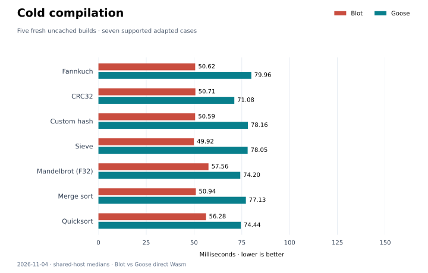
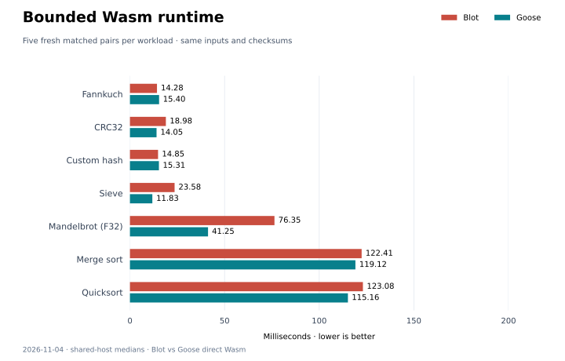

# Blot

Blot is a functional language whose sole compiler is written in Zig and emits
WebAssembly. Deno provides the CLI, project client, formatter and guest host.
See the [repository map](docs/README.md) for code, tests, documentation and
evidence.

The owned-storage rewrite and backend cutover are unfinished. One real Gdev
frame has passed native Pen with an inspected screenshot; broader compiler and
application qualification remains open. Start with [CONTINUE.md](CONTINUE.md)
and [tasks/STORAGE_REWRITE.md](tasks/STORAGE_REWRITE.md) for the current
candidate, evidence and requirements.

## Benchmarks

Blot versus Goose's direct Wasm backend, measured on 2026-11-04. Seven adapted
pairs now pass: six original-numeric workloads and a Mandelbrot F32 control.
Merge sort and quicksort retain their original recursive algorithms.





Merge sort improves another **1.15x**, from **156.70 → 137.19ms**. The fresh
Goose gap is **1.19x**; quicksort is **1.09x**, and custom hash **7.06x**. Both
charts use fresh five-sample measurements for all seven pairs. Merge Wasm grows
**6,810 → 7,196B** for the guarded fast path. Byte buffers use U32 in Blot and
U8 in Goose; both sorts use four-byte elements. Original F64 remains
unsupported.

Gdev saves **10,976B** to **10.039MB**, with fresh paired compilation **5.362 →
5.306s**: no material compilation gain. See
[measurements and pending qualification](benchmarks/goose/results/2026-11-04-merge-ranges.md).

## Development

Use the existing sibling `pen`, `ink` and `gdev` checkouts, Zig **0.17.0** and
Deno 2. From the repository root:

```sh
zig version
ZIG_GLOBAL_CACHE_DIR="$PWD/build/zig-global-cache" deno task build:compiler:dev
deno run -A scripts/integration/build_gdev.ts --timeout-ms 10000 > /tmp/gdev-main.log 2>&1
python3 scripts/integration/report.py /tmp/gdev-main.log
```

The development compiler uses Zig's native backend (`-Dllvm=false`) and writes
to `compiler/zig-out-dev/bin/blotc`. Keep it with the matching `std/`. The
handoff describes the Pen one-frame runner and the required PNG inspection.

Current syntax uses `func`, explicit `return`, curried `->`, `$Constructor`,
`true` / `false`, `and` / `or`, and `#[...]` arrays. The counted-storage and ABI
8 data-stack backends are both still live; task 120 tracks retirement.

## Navigation

- [Repository map](docs/README.md): source, tests, documentation and evidence.
- [Language guide](docs/language/guide.md) and
  [standard library](std/README.md).
- [Zig compiler](compiler/README.md) and [Deno host](host/README.md).
- [Goose benchmark suite](benchmarks/goose/README.md) and
  [current results](benchmarks/goose/results/2026-11-04-merge-ranges.md).
- [Agent instructions](AGENTS.md), [current frontier](CONTINUE.md) and
  [active plan](PLAN.md).
