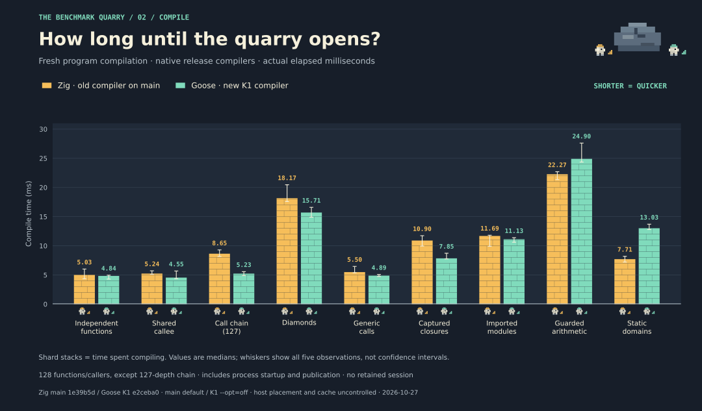

# Current Goose K1 versus main

The rewrite is close to `main` on ordinary integer/F32 loops, but still takes
substantially longer on generic F32 and generic pair loops. Fresh compilation
is faster in several measured families; proof-heavy and static-domain compilation
remain slower. The earlier **4.5–4.9× generic integer improvement was against the
previous K1**, not against `main`.

This comparison was measured on 2026-10-27 using the unchanged qualified K1
compiler and the installed, hash-matched release from `main` at `1e39b5d`.
It adds measurements and charts; it makes no compiler changes.

## Runtime


Times below are median microseconds per complete kernel call. Ratios are medians
of the five paired K1/main observations, rather than ratios of the two medians.
Ranges show all observed paired ratios and are not confidence intervals.

### Default V8

| Kernel | Main µs | K1 µs | K1/main | Paired range |
| --- | ---: | ---: | ---: | ---: |
| Integer loop (1,024 steps) | 0.918 | 0.884 | 0.962× | 0.919–1.033× |
| F32 loop (128 steps) | 0.149 | 0.135 | 0.907× | 0.811–1.059× |
| Generic integer (1,024 steps) | 0.928 | 1.160 | 1.200× | 1.175–1.481× |
| Generic F32 (128 steps) | 0.158 | 0.565 | 3.613× | 3.319–4.550× |
| Generic pair (1,024 steps) | 0.906 | 5.827 | 6.396× | 6.170–6.464× |

### Optimizing-only V8 control

| Kernel | Main µs | K1 µs | K1/main | Paired range |
| --- | ---: | ---: | ---: | ---: |
| Integer loop (1,024 steps) | 0.916 | 0.882 | 0.942× | 0.936–1.004× |
| F32 loop (128 steps) | 0.136 | 0.140 | 1.090× | 0.968–1.144× |
| Generic integer (1,024 steps) | 0.930 | 1.047 | 1.134× | 1.069–1.194× |
| Generic F32 (128 steps) | 0.133 | 0.561 | 4.237× | 3.463–4.389× |
| Generic pair (1,024 steps) | 0.895 | 5.861 | 6.550× | 6.307–6.611× |

The ordinary-loop ranges cross parity, and F32 changes direction between engine
modes; these measurements do not establish an ordinary-loop speedup. The generic
slowdowns remain in both modes: integer takes 1.13–1.20× main's time, F32 takes
3.61–4.24×, and the eight-byte pair takes 6.40–6.55×. These ranges summarize
paired medians across the two engine modes, not all individual samples.

K1 retains a shared generic body and its layout/payload calling convention.
The previous runtime pass improved four-byte transfers; the eight-byte pair
still exercises the bulk-copy fallback. These facts identify the next area to
investigate, but this comparison does not isolate the cost of each mechanism
or prove that specialization is necessary.

## Fresh compilation



Each family has 128 functions/callers, except the 127-depth chain. Wall time
includes fresh process startup, loading, checking, validation, lowering and
Wasm publication. These are program compilation times, not times to rebuild
the compiler executable.

| Family | Main ms | K1 ms | K1/main | Paired range |
| --- | ---: | ---: | ---: | ---: |
| Independent functions | 5.03 | 4.84 | 0.963× | 0.804–1.140× |
| Shared callee | 5.24 | 4.55 | 0.890× | 0.764–1.085× |
| Call chain (127) | 8.65 | 5.23 | 0.595× | 0.549–0.675× |
| Diamonds | 18.17 | 15.71 | 0.844× | 0.811–0.893× |
| Generic calls | 5.50 | 4.89 | 0.883× | 0.785–0.899× |
| Captured closures | 10.90 | 7.85 | 0.767× | 0.661–0.797× |
| Imported modules | 11.69 | 11.13 | 0.964× | 0.905–1.149× |
| Guarded arithmetic | 22.27 | 24.90 | 1.135× | 1.073–1.294× |
| Static domains | 7.71 | 13.03 | 1.710× | 1.655–1.807× |

Call chains, closures, diamonds and generic calls are faster in every measured
pair. Independent declarations, shared-callee and imported-module ranges cross
parity. Proof guards take about 13% more time and static domains about 71% more,
using paired medians. Do not aggregate these synthetic families into an
application-wide speedup. K1 and main also perform different language checks.

## Method and provenance

- AMD Ryzen 7 7800X3D, Linux x86-64, Deno 2.9.7 / V8 15.0.245.2-rusty.
  CPU placement, frequency, other host load and filesystem cache are uncontrolled.
- Both compilers are native release builds. K1 uses `--opt=off`; main uses its
  default pipeline with `--prelude none --frontend-workers 1 --semantic-workers 1`.
  This does not compare every optimization tier or language feature.
- Five counterbalanced pairs per workload, sequential processes. All five pairs
  are retained; no timing threshold, sample rejection or tuning after measurement.
- Each runtime artifact gets a fresh Deno process, seven exact varying-seed
  integer/F32 reference checks, 20,000 warmup calls and 20,000 timed calls.
  Each call performs 1,024 integer or 128 F32 iterations. Timed checksums must
  match the reference model. Process startup, instantiation and checks are outside
  runtime timing; the JS/Wasm boundary is inside it.
- Main's exported ownership enter/leave hooks are invoked around each call when
  present, including inside the timed loop. In these fixtures only main's pair
  kernel exports them; all other kernels on both sides omit them. The same worker
  handles both compilers. No host array bridge or telemetry instrumentation runs.
- The two engine modes stay separate. `--no-liftoff` is an optimizing-only control;
  ordinary warmup does not prove a fixed engine tier.
- Compile-family runtime sweeps check behavior but are short, share the harness
  engine and are **not used for runtime performance claims** in this report.
  The 209 records comprise 190 paired timing samples and 19 separate K1 phase
  builds. CPU/RSS, raw commands, sources, hashes, reference results and logs remain
  in the archive. Generated executables and Wasm are excluded; their hashes remain.

`main` was verified through the GitHub branch API as
`1e39b5d8a4268b9edf769c2813d5231abe1c963b`. Its committed `CONTINUE.md` and
`benchmarks/results/runtime-memory-2026-10-26.json` identify the installed release
SHA-256 as `fd2119f5528cb164131e1156d35ba97c434393647f1b326ae5aa154db137d923`.
Both committed blobs, their Git/SHA-256 identities and the host observation are
archived. Main was not rebuilt or replaced.

The K1 binary SHA-256 remains
`94b3d24012f8868a8eb7e8e6351edcfea9529c3d7de36845d10b0b2e47f032bd` (compiler
change `e2ceba0`). Its 197 qualified inputs and gate logs still match input manifest
`27e9627f595ffe94ff0a2955c600ef977cd1262638152326700716c8fb85d67e`: 116 native
entries, 92 Deno tests and the editor gate. The new harness was type-checked and
both source spellings passed a small functional smoke run before the fixed
measurement rounds. No qualified compiler input changed; the release gate was
not repeated for this benchmark/documentation addition.

A Sol review checked the paired source semantics, exact references, raw paired
checksums and main's scalar ownership boundary. It found no comparison blocker
and confirmed that the ordinary F32 results do not establish a stable gain.

This is not a migrated `gdev` measurement, a retained-edit comparison, a compiler
rebuild-time comparison or a universal runtime parity claim. Historical evidence
packages remain unchanged.

## Reproduction

Use the exact qualified compiler binaries recorded above. These commands produce
new raw measurements; the archive contains this run's exact commands and inputs.

```sh
deno check benchmarks/compare_main.ts benchmarks/main_runtime_worker.ts
deno run -A benchmarks/compare_main.ts \
  --baseline=/path/to/main/blotc --rounds=5 --engine=default \
  --out=build/bench-main-runtime
deno run -A benchmarks/compare_main.ts \
  --baseline=/path/to/main/blotc --rounds=5 --engine=optimizing \
  --out=build/bench-main-optimizing
deno run -A scripts/benchmark.ts \
  --baseline=/path/to/main/blotc --baseline-kind=legacy --opt=off \
  --rounds=5 --scales=128 \
  --families=independent,calls,diamonds,generics,closures,modules,proofs,domains \
  --runtime-warmup=0 --runtime-calls=20000 \
  --build-label=qualified-main-comparison --out=build/bench-main-compile
deno run -A scripts/benchmark.ts \
  --baseline=/path/to/main/blotc --baseline-kind=legacy --opt=off \
  --rounds=5 --scales=127 --families=chains \
  --runtime-warmup=0 --runtime-calls=20000 \
  --build-label=qualified-main-comparison --out=build/bench-main-chains
python3 benchmarks/plot_main.py
```

The plotter reads the published JSON and verifies its hashes; it does not rerun
measurements. The snapshot-specific `package_main.py` validates both compiler
identities, provenance, qualified inputs, logs, exact pair inventory, sources,
Wasm hashes and matching results, then refuses to overwrite a published package.
It expects the provenance snapshot archived under
`build/main-comparison-provenance/`; use a new `--out` directory when reproducing.

[Evidence manifest](results/main-comparison/manifest.json) ·
[Raw evidence](results/main-comparison/raw-evidence.tar.gz) ·
[Main provenance](results/main-comparison/provenance.json) ·
[Previous/new K1 runtime comparison](RUNTIME.md)
