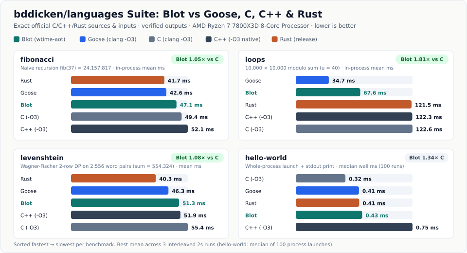

# `bddicken/languages` Suite: Blot vs Goose, C, C++ & Rust

Side-by-side results on all four workloads from [`bddicken/languages`](https://github.com/bddicken/languages), running Blot (`blotc-goose` + `wtime-aot 0.1.7`, x64-v4) against the unmodified official upstream C (`clang -O3`), C++ (`clang++ -O3 -march=native`), Rust (`cargo build --release`), and Goose (`clang -O3`) implementations on the same AMD Ryzen 7 7800X3D host.



## Protocol & Verification

- **Workloads**:
  - `fibonacci`: naive recursive `fib(37)` (`24,157,817`).
  - `loops`: `10,000 × 10,000` modulo inner loop with parameter `u = 40` (output in `195,000..204,999`).
  - `levenshtein`: Wagner-Fischer 2-row DP across all `2,556` pairs of the official 72-word dictionary (`554,324`).
  - `hello-world`: whole-process launch + stdout emit (`Hello, World!`), median wall time over 100 launches.
- **Timing**: For `fibonacci`, `loops`, and `levenshtein`, each language runs its in-process benchmark loop (`500 ms` warmup, `2,000 ms` measurement window) across 3 interleaved repetitions; charts report the best mean per language.
- **Reproduce**:

```bash
python3 benchmarks/bddicken/run_bddicken.py --run-ms 2000 --warmup-ms 500 --reps 3 --hello-runs 100
```

- **Raw evidence**: [`results.json`](../evidence/measurements/2026-11-26-bddicken/results.json)
