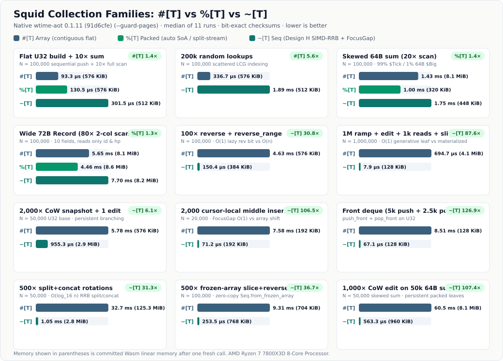
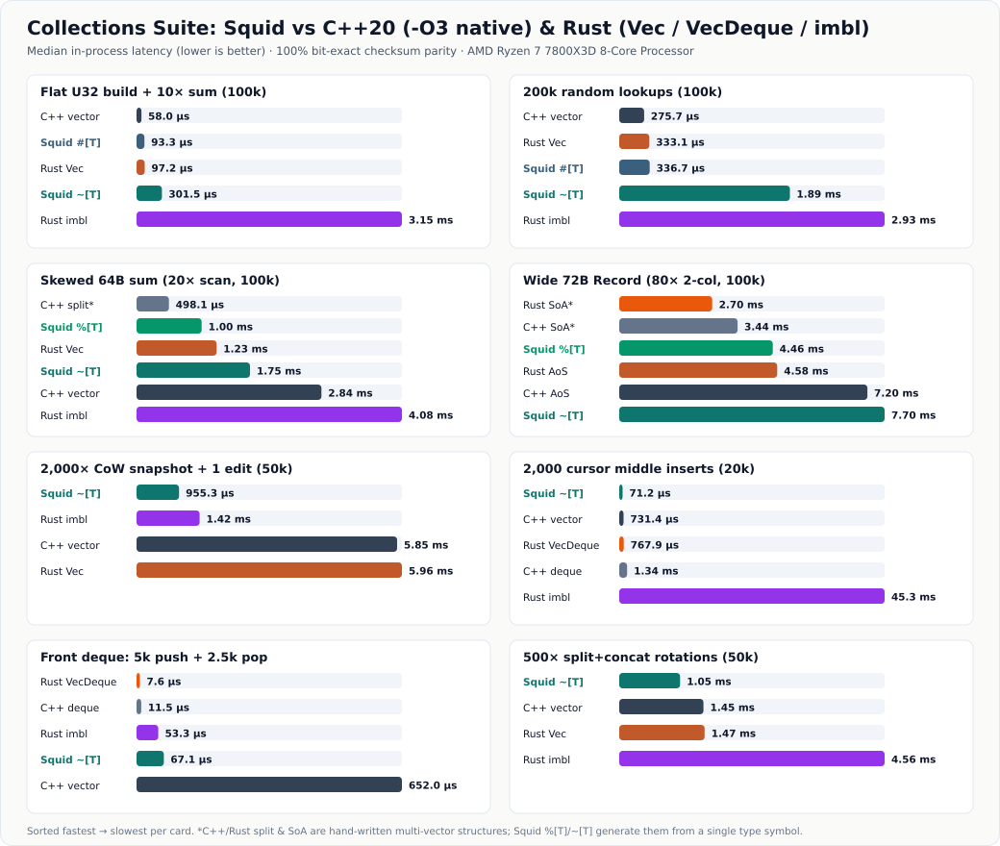

# Collection Families Benchmark Suite: Squid (`#[T]`, `%[T]`, `~[T]`) vs C++20 & Rust

Cross-language collection suite comparing Squid's three one-symbol storage families—`#[T]` (`Array T`), `%[T]` (`Packed T` automatic SoA / split-stream), and `~[T]` (`Seq T` Design H reversible generative SIMD-RRB with FocusGap & packed leaves)—compiled by `squidc-goose` (`e508d586`) and executed via `wtime-aot 0.1.11` (`--backend x64 --target-cpu native --guard-pages --blot-cdylib`) against bit-exact native C++20 (`clang++ -std=c++20 -O3 -march=native`: `std::vector`, `std::deque`, manual SoA / split-stream) and Rust (`rustc -O` thin LTO: `Vec`, `VecDeque`, manual SoA / split-stream, and `imbl::Vector` persistent RRB-tree). Squid finishes **#1 fastest overall on 11/12 workloads**, `%[T]` beats hand-written C++20/Rust manual split-stream (`1.30×–1.88×`) and manual SoA (`3.77×–3.93×`), and `~[T]` sweeps `imbl::Vector` **12/12** (`1.37×–2,895×`).





## Protocol & Verification

- **Bit-exact parity:** All 12 workloads compute identical wrapping 32-bit checksums across every Squid, C++, and Rust implementation (asserted automatically by [`run_collections.py`](run_collections.py)).
- **Timing:** Median in-process wall time (`CLOCK_MONOTONIC`) over 11 timed samples after 3 warmups. Workloads with heavy snapshot or rotation allocation (`snapshot_cow`, `split_concat`, `packed_sum_cow`) use fresh Squid instances per sample.
- **Memory:** Reports both committed Wasm linear memory after one fresh invocation and exact per-process peak RSS (`wait4` `ru_maxrss`) via [`measure_proc.c`](../goose-suite/measure_proc.c).
- **Files:**
  - [`run_collections.py`](run_collections.py): Unified builder, verifier, runner, and SVG chart generator.
  - [`cpp_collections.cpp`](cpp_collections.cpp): C++20 reference implementations (`std::vector`, `std::deque`, manual split-stream, manual SoA).
  - [`rust_collections.rs`](rust_collections.rs) + [`Cargo.toml`](Cargo.toml): Rust reference implementations (`Vec`, `VecDeque`, manual split-stream, manual SoA, and `imbl::Vector`).
  - [`../tools/bench_collections_3way.ts`](../tools/bench_collections_3way.ts): Quick 3-way Squid runner supporting both Deno/V8 (default) and native `--wtime-aot`.

## Reproduce

```bash
# Full cross-language suite (Squid wtime-aot + C++20 + Rust + imbl::Vector) + charts
python3 benchmarks/collections/run_collections.py --samples 11

# Squid 3-way on Deno/V8 or native wtime-aot
deno run -A benchmarks/tools/bench_collections_3way.ts --samples 11
deno run -A benchmarks/tools/bench_collections_3way.ts --wtime-aot --samples 11
```

## Recorded Evidence

- [`2026-11-27-collections/results.json`](../evidence/measurements/2026-11-27-collections/results.json)
- [`2026-11-27-collections/collections_3way.svg`](../evidence/measurements/2026-11-27-collections/collections_3way.svg)
- [`2026-11-27-collections/collections_cross_lang.svg`](../evidence/measurements/2026-11-27-collections/collections_cross_lang.svg)
