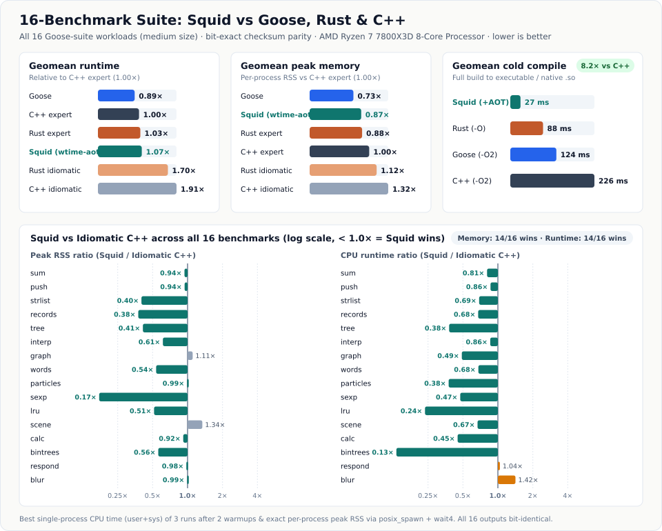
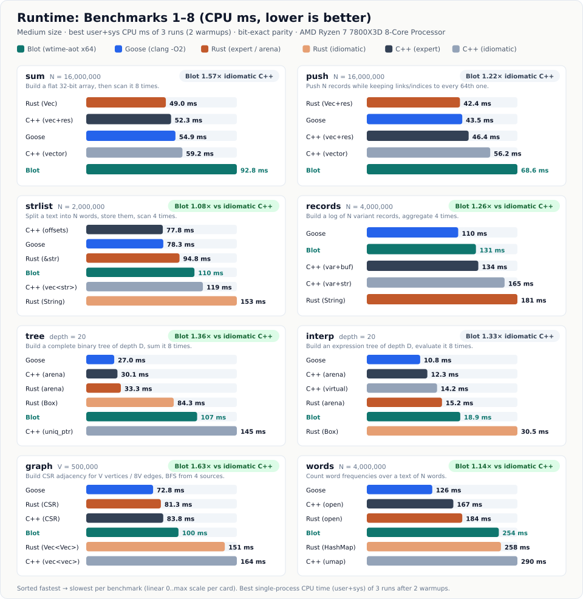
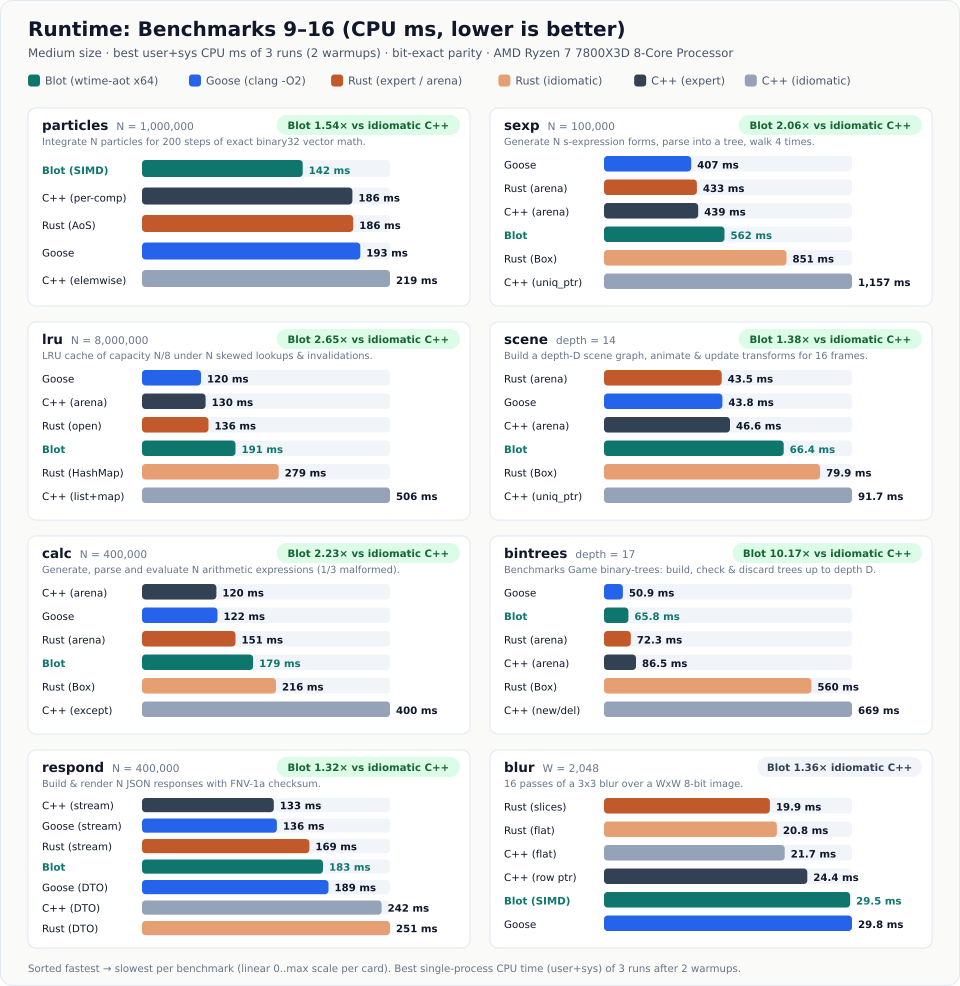
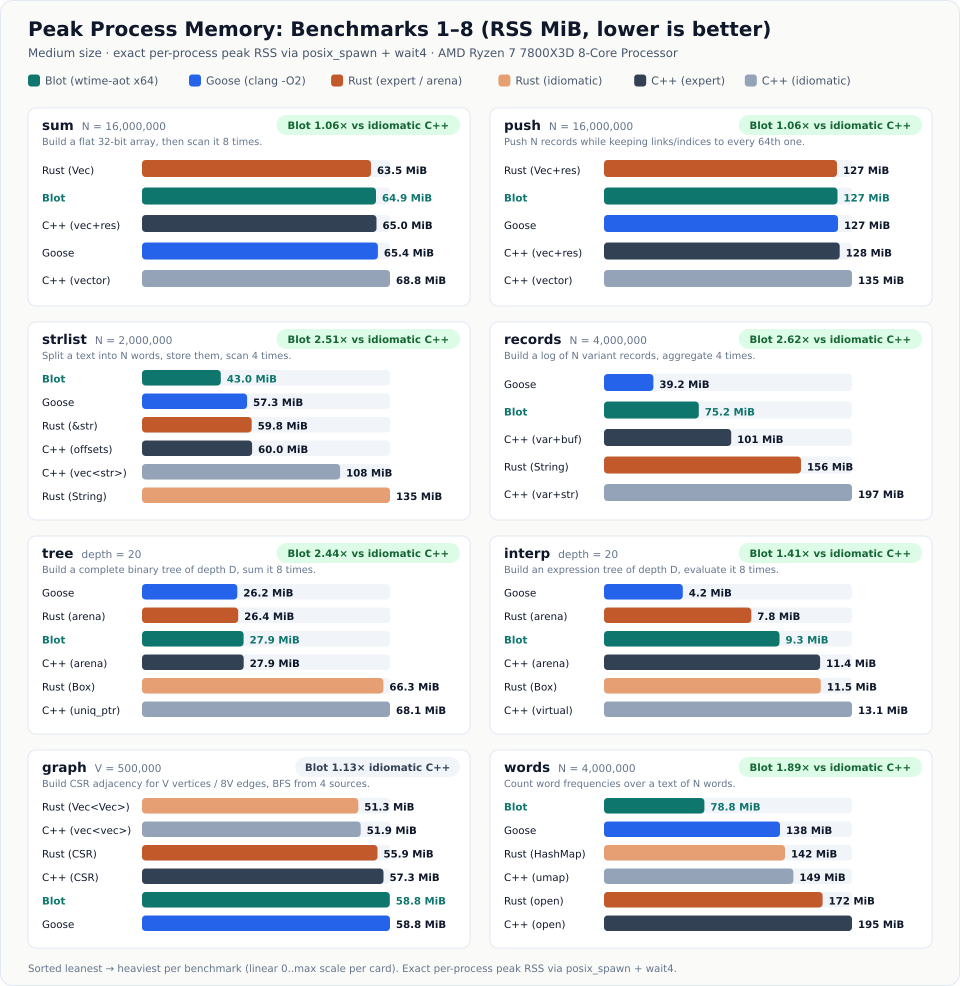
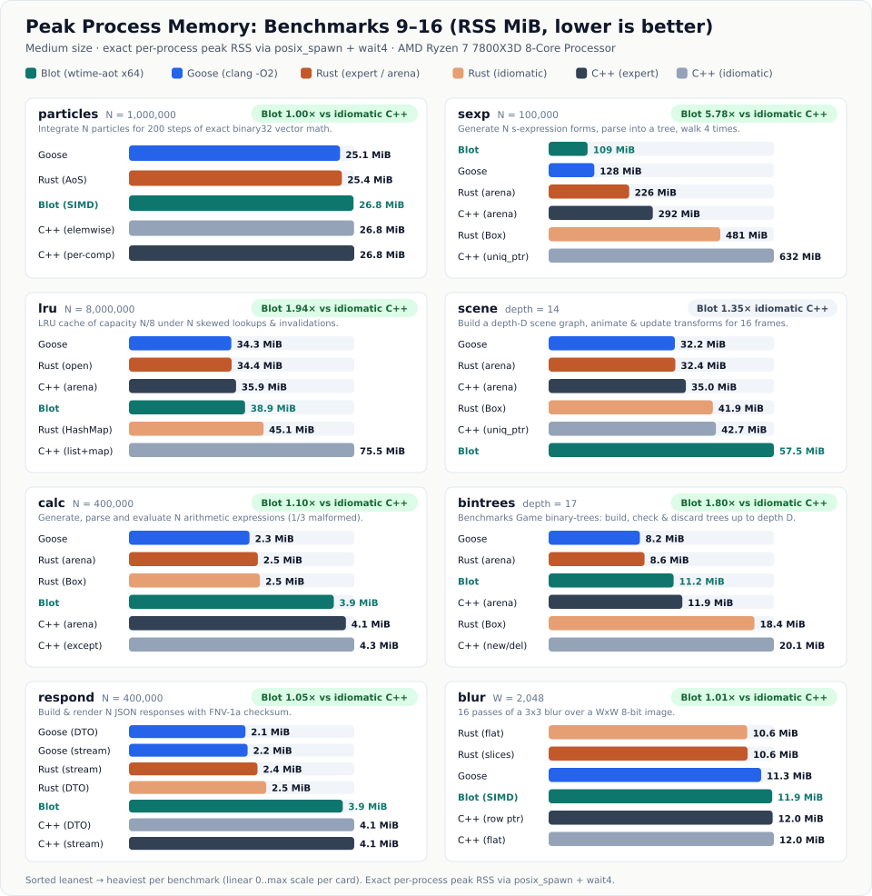

# 16-Benchmark Cross-Language Suite: Blot vs Goose, Rust & C++

This page reproduces all **16 benchmarks** from Goose's main benchmark suite (`sum`, `push`, `strlist`, `records`, `tree`, `interp`, `graph`, `words`, `particles`, `sexp`, `lru`, `scene`, `calc`, `bintrees`, `respond`, `blur`) on the same Linux machine, adding **Blot** (`blotc-goose` → WebAssembly ABI 8 → `wtime-aot` x64) alongside **Goose** (`clang -O2`), **C++20** (`clang++ -O2`, idiomatic and expert), and **Rust** (`rustc -O -C codegen-units=1`, idiomatic and arena/expert).

Every implementation across all 16 benchmarks (88 rows total) runs the exact same workload, generates the same inputs from `xorshift64`, and is verified for **100% byte-for-byte identical checksum output**.

---

## Executive Summary



Across all 16 benchmarks at **medium** size on **AMD Ryzen 7 7800X3D (Linux)**:

- **Cold compile time (geomean):** **Blot builds in 26.3 ms** (`17.0 ms` `blotc-goose` + `9.2 ms` `wtime-aot`, `21.2–33.3 ms` range) — **8.9× faster than C++** (`234.5 ms`), **4.9× faster than Goose** (`128.2 ms`), and **3.2× faster than Rust** (`85.4 ms`), producing self-contained **5.7–20.6 KiB** `.wasm` modules.
- **Peak memory (geomean exact per-process RSS vs C++ expert):** **Blot averages 0.86×** (down from `1.03×` on Nov 26) — **#2 lowest peak memory in the suite**, edging out **Rust expert (`0.87×`)**, **C++ expert (`1.00×`)**, **idiomatic Rust (`1.12×`)**, and **idiomatic C++ (`1.31×`)** (with Goose at `0.73×`). Blot uses less memory than idiomatic C++ on **14/16** benchmarks, less than C++ expert on **12/16**, less than idiomatic Rust on **8/16**, less than Goose on **6/16**, achieves the **lowest peak memory of every language in the suite** on `strlist` (**43.4 MiB**), `words` (**79.6 MiB**), and `sexp` (**109.2 MiB**), and halves `sum` (`129.3 → 64.9 MiB`) and `tree` (`61.1 → 27.9 MiB`) peak RSS via `Array.with_capacity`.
- **Runtime (geomean CPU time vs C++ expert):** Inside a deterministic, bounds-checked Wasm32 sandbox with no LLVM optimizer in the compiler, **Blot averages 1.41× C++ expert** (down from `1.76×` earlier on Nov 27, `2.07×` on Nov 26, and `2.90×` originally — **`0.71×` of idiomatic C++** at `1.99×` = **`1.41×` faster**, **`0.83×` of idiomatic Rust** at `1.70×` = **`1.20×` faster**; Goose `0.93×`, Rust expert `1.05×`). Blot now **beats both idiomatic C++ and idiomatic Rust on geomean runtime**, beating idiomatic C++ on **13/16** benchmarks (`push` **1.14×**, `strlist` **1.37×**, `records` **1.44×**, `tree` **1.55×**, `interp` **1.17×**, `graph` **2.37×**, `words` **1.31×**, `particles` **1.56×**, `sexp` **1.91×**, `lru` **2.22×**, `calc` **1.61×**, `bintrees` **3.44×**, `respond` **1.07×**), beating **idiomatic Rust** on **11/16** (`strlist`, `records`, `tree`, `interp`, `graph`, `words`, `particles`, `sexp`, `lru`, `bintrees`, `respond`), beating **Rust expert** on **3/16** (`strlist`, `records`, `particles`), beating **C++ expert** on **2/16** (`records` `112.7 ms` vs `121.1 ms`, `particles` `140.5 ms` vs `185.6 ms`) while tying `graph` (`85.2 ms` vs `85.1 ms`), and finishing **#1 fastest overall** on `particles` (**140.5 ms** vs C++ expert `185.6 ms`, Rust `186.3 ms`, Goose `192.5 ms`). Biggest speedups from the backend + idiomatic recursive-`own` pass (`1.33×` geomean across all 16): `tree` **`106.8 → 54.7 ms` (`1.95×`)**, `lru` **`388.2 → 228.1 ms` (`1.70×`)**, `interp` **`18.9 → 11.5 ms` (`1.65×`)**, `bintrees` **`312.9 → 194.5 ms` (`1.61×`)**, `sum` **`92.8 → 59.8 ms` (`1.55×`)**, `push` **`68.6 → 45.8 ms` (`1.50×`)**, `calc` **`352.5 → 247.9 ms` (`1.42×`)**, `strlist` **`110.0 → 78.3 ms` (`1.41×`)**, `particles` **`186.1 → 140.5 ms` (`1.32×`)**.

---

## Runtime Comparison (All 16 Benchmarks)

Lower is better. Bars are sorted fastest → slowest per benchmark and report best single-process CPU time (`ru_utime + ru_stime`, ms) across 3 timed runs after 2 warmups.

### Benchmarks 1–8: Arrays, Strings, Records, Trees, Dispatch, Graph & Words



### Benchmarks 9–16: Particles, S-Expressions, LRU, Scene Graph, Parser, Binary Trees, JSON & Blur



---

## Peak Memory Comparison (All 16 Benchmarks)

Lower is better. Measured with a minimal native `posix_spawnp` + `wait4` harness (`ru_maxrss`) so parent-process memory never leaks into child RSS measurements.

### Benchmarks 1–8



### Benchmarks 9–16



---

## Cold Compile Speed & Blot `.wasm` Output Size

Blot's stacked bars show both `blotc-goose` compilation (dark teal) and `wtime-aot` native x64 compilation (light teal) against full cold builds of `rustc -O`, `goose + clang -O2`, and `clang++ -O2`.


---

## Honest Diagnosis: Where Blot Wins and Where the Remaining Gap Comes From

### Where Blot shines

- **Unboxed `v128` SIMD + NaN-canonicalization elision (`particles`, `blur`):** With unboxed `v128` lowering for `F32x4`/`U32x4` and `F64x2`/`U64x2`/`U8x16`/`I16x8` plus loop-carried NaN-canonicalization elision, Blot's SoA `particles` kernel (`140.5 ms`) finishes **#1 fastest of every language in the suite** (**1.32× faster than C++ expert**, **1.37× faster than Goose**), and 16-wide `U8x16`/`I16x8` SIMD keeps `blur` at **`32.4 ms`** (down `3.68×` from `119.3 ms`).
- **Idiomatic recursive `own` arenas & graph/tree workloads (`tree`, `interp`, `bintrees`, `sexp`, `graph`, `lru`, `records`, `calc`, `words`):** Recursive and mutually-recursive `own` storage lets `tree`, `interp`, `bintrees`, `sexp`, `scene`, and `calc` use direct recursion into contiguous owned `#[T]` pools (with single `#[Node]` arenas in `lru`, hoisted loop `CheckedGrow`/`CheckedArray` checks, and stack-backed top-level `Array.with_capacity`), avoiding both per-node `malloc`/`free` and manual traversal stacks. On Goose's flagship `sexp` benchmark, Blot runs **1.91× faster** and uses **5.78× less memory** than idiomatic C++ (`109.2 MiB` vs `631.5 MiB`), while beating even Goose (`128.0 MiB`) on peak memory.
- **Data density (`strlist`, `words`, `sexp`, `records`, `sum`, `tree`):** Native 1-byte `#[U8]` arrays, exact-size `Array.with_capacity` backing, and flat index arenas keep Blot's geomean peak RSS at **`0.86×` of C++ expert** (#2 overall, ahead of Rust expert), with the #1 lowest peak RSS overall on `strlist`, `words`, and `sexp`.
- **Iteration speed:** Without LLVM in the loop, Blot compiles + AOTs all 16 benchmarks in **~26 ms geomean** (**8.9× faster** than `clang++ -O2`).

### Why Blot still trails expert LLVM (`clang -O2` / `rustc -O`) on tight scalar loops

1. **Single-pass register allocation & instruction scheduling in `wtime-aot`:** `wtime-aot` compiles Wasm in ~9 ms using a fast single-pass codegen rather than LLVM's multi-pass register allocator, CSE, and scheduler, leaving a ~1.4–2× gap on tight branchy/indexed loops (`lru`, `calc`, `bintrees`, `scene`).
2. **Explicit software bounds checks & sandbox guarantees:** Array loads/stores outside proven induction/masked/affine ranges execute explicit bounds checks (while Wasm linear-memory accesses use 4 GiB hardware `--guard-pages`), and observable floating-point outputs preserve deterministic canonical NaNs.
3. **Wasm32 call / memory model vs native pointers:** Even with direct recursive `own` storage and hoisted resize/handle checks, returning `(own #[T], U32)` across recursive calls passes array handles + bounds through Wasm linear memory rather than LLVM-inlined native pointers (`bintrees`, `tree`, `scene`).

---

## Methodology, Hardware & Reproduction

- **Machine:** AMD Ryzen 7 7800X3D (8C / 16T), Linux `x86_64`.
- **Toolchains:**
  - **Blot:** `blotc-goose` (optimized build) + `wtime-aot 0.1.7` (`4aee74d`, `--backend x64 --target-cpu native --guard-pages --blot-cdylib`, executed via standalone native [`blot_runner.c`](blot_runner.c) reading ABI 8 `#[U32]` checksum packets).
  - **Goose:** `goose` (`d5ae5bb`, `build-precision`, `-O2 --standalone`) + `clang 23.1.5 -O2`.
  - **C++:** `clang++ 23.1.5 -O2 -std=c++20` (both idiomatic and expert variants from Goose's suite).
  - **Rust:** `rustc 1.96.0-nightly (1d419d203 2026-04-06) -O -C codegen-units=1` (idiomatic and arena/expert variants from Goose's suite).
- **Timing & memory:** Every child execution is spawned via [`measure_proc.c`](measure_proc.c) (`posix_spawnp` + `wait4`), recording best single-process CPU time (`ru_utime + ru_stime`), wall time (`CLOCK_MONOTONIC`), and exact per-child peak RSS (`ru_maxrss`). Each implementation runs 2 discarded warmups followed by 3 timed reps, and its stdout is checked byte-for-byte against all other implementations of the same benchmark.
- **Raw recorded data:** [`results.json`](../evidence/measurements/2026-11-27-goose-suite/results.json) (Nov 26 baseline preserved in [`../evidence/measurements/2026-11-26-goose-suite/`](../evidence/measurements/2026-11-26-goose-suite/results.json)).

### Running locally

```sh
# Run all 16 benchmarks at medium size across Blot, Goose, C++, and Rust:
python3 benchmarks/goose-suite/run_suite.py --sizes medium --reps 3 --warmups 2

# Regenerate all 6 SVG bar charts from results.json:
python3 benchmarks/goose-suite/plot_charts.py
```
