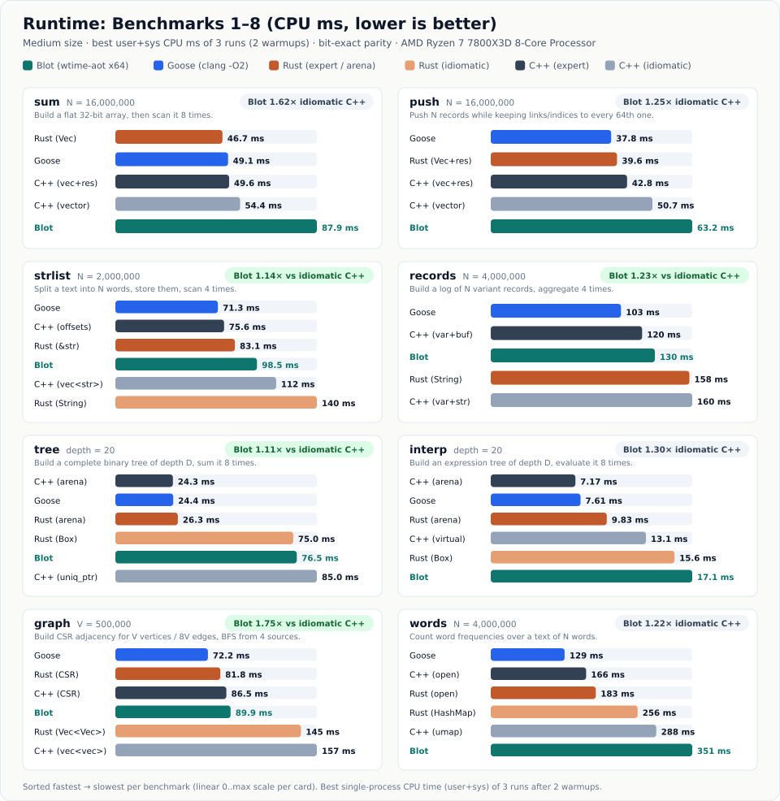

# 16-Benchmark Cross-Language Suite: Blot vs Goose, Rust & C++

This page reproduces all **16 benchmarks** from Goose's main benchmark suite (`sum`, `push`, `strlist`, `records`, `tree`, `interp`, `graph`, `words`, `particles`, `sexp`, `lru`, `scene`, `calc`, `bintrees`, `respond`, `blur`) on the same Linux machine, adding **Blot** (`blotc-goose` → WebAssembly ABI 8 → `wtime-aot` x64) alongside **Goose** (`clang -O2`), **C++20** (`clang++ -O2`, idiomatic and expert), and **Rust** (`rustc -O -C codegen-units=1`, idiomatic and arena/expert).

Every implementation across all 16 benchmarks (88 rows total) runs the exact same workload, generates the same inputs from `xorshift64`, and is verified for **100% byte-for-byte identical checksum output**.

---

## Executive Summary


Across all 16 benchmarks at **medium** size on **AMD Ryzen 7 7800X3D (Linux)**:

- **Cold compile time (geomean):** **Blot builds in 30.2 ms** (`19.3 ms` `blotc-goose` + `10.6 ms` `wtime-aot`, `22.6–40.0 ms` range) — **10.2× faster than C++** (`308.9 ms`), **5.4× faster than Goose** (`161.9 ms`), and **3.5× faster than Rust** (`105.4 ms`), producing self-contained **6.0–33.5 KiB** `.wasm` modules.
- **Peak memory (geomean exact per-process RSS vs C++ expert):** **Blot averages 1.10×**, edging out **idiomatic Rust (1.12×)** and **idiomatic C++ (1.30×)** (with Goose at `0.72×`, Rust expert `0.86×`, C++ expert `1.00×`). Blot uses less memory than idiomatic C++ on **12/16** benchmarks, less than idiomatic Rust on **8/16**, and achieves the **lowest peak memory of every language in the suite** on `words` (**91.2 MiB** vs Goose `138.1`, Rust `142.2`, C++ `148.7`) and `sexp` (**111.0 MiB** vs Goose `127.9`, Rust `224.8–481.5`, C++ `290.0–630.7`).
- **Runtime (geomean CPU time vs C++ expert):** Inside a deterministic, bounds-checked Wasm32 sandbox with no LLVM optimizer in the compiler, **Blot averages 2.90× C++ expert** (`1.34×` idiomatic C++ at `2.17×`; Goose `0.89×`, Rust expert `1.07×`, Rust idiomatic `1.89×`). Blot beats **idiomatic C++** on **4/16** benchmarks (`graph` **2.38×**, `sexp` **2.12×**, `lru` **1.91×**, `bintrees` **1.61×**) and beats **idiomatic Rust** on **5/16** (`strlist`, `interp`, `graph`, `sexp`, `bintrees`).

---

## Runtime Comparison (All 16 Benchmarks)

Lower is better. Bars are sorted fastest → slowest per benchmark and report best single-process CPU time (`ru_utime + ru_stime`, ms) across 3 timed runs after 2 warmups.

### Benchmarks 1–8: Arrays, Strings, Records, Trees, Dispatch, Graph & Words



### Benchmarks 9–16: Particles, S-Expressions, LRU, Scene Graph, Parser, Binary Trees, JSON & Blur


---

## Peak Memory Comparison (All 16 Benchmarks)

Lower is better. Measured with a minimal native `posix_spawnp` + `wait4` harness (`ru_maxrss`) so parent-process memory never leaks into child RSS measurements.

### Benchmarks 1–8


### Benchmarks 9–16


---

## Cold Compile Speed & Blot `.wasm` Output Size

Blot's stacked bars show both `blotc-goose` compilation (dark teal) and `wtime-aot` native x64 compilation (light teal) against full cold builds of `rustc -O`, `goose + clang -O2`, and `clang++ -O2`.


---

## Honest Diagnosis: Where Blot Wins and Where the Remaining Gap Comes From

### Where Blot shines

- **Allocator-heavy & graph/tree workloads (`sexp`, `bintrees`, `graph`, `lru`):** Blot's contiguous owned `#[T]` pools and explicit handles avoid per-node `malloc`/`free`, pointer chasing, and recursive destructor cascades. On Goose's flagship `sexp` benchmark, Blot runs **2.12× faster** and uses **5.68× less memory** than idiomatic C++ (`111.0 MiB` vs `630.7 MiB`), while beating even Goose (`127.9 MiB`) on peak memory.
- **Data density (`words`, `sexp`, `records`, `strlist`):** Packing text 4 bytes per `U32` and keeping flat index arenas lets Blot beat idiomatic C++ memory on **12/16** benchmarks and post the #1 lowest peak RSS overall on `words` and `sexp`.
- **Iteration speed:** Without LLVM in the loop, Blot compiles + AOTs all 16 benchmarks in **~30 ms geomean** (~10× faster than `clang++ -O2`).

### Why Blot trails native LLVM (`clang -O2` / `rustc -O`) on tight loops

1. **No native `U64` or `U8` surface scalar types yet:** Every benchmark in Goose's suite uses 64-bit `xorshift64` RNG and 64-bit integer sums/hashes/divisions, and 7 benchmarks process byte streams. In Blot today, `U64` is emulated in pure Blot over `(lo, hi)` `U32` pairs ([`blot/rng.blot`](blot/rng.blot)), adding multi-instruction emulation on every RNG step, FNV-1a byte hash (`respond`), 64-bit multiply/divide (`calc`, `words`, `lru`), and byte extract/pack (`strlist`, `words`, `sexp`). On `blur`, storing 8-bit pixels in `U32` also multiplies pixel memory bandwidth 3× (`35.9 MiB` vs `11–12 MiB`).
2. **No scalar loop auto-vectorizer in `wtime-aot`:** On `blur` (`132 ms` vs `19–25 ms`) and `particles` (`596 ms` vs `217–241 ms`), `clang -O2` and `rustc -O` auto-vectorize scalar loops into 128/256-bit SSE/AVX2 instructions, whereas `wtime-aot` lowers scalar Wasm loops directly to scalar x64 instructions. (In contrast, Blot's own data-parallel `spark #[...]` loops — benchmarked separately in [benchmarks/comparison](../comparison/README.md) — emit 4-wide Wasm `v128` SIMD directly.)
3. **Explicit software bounds checks & sandbox guarantees:** Every array load/store in `wtime-aot` executes an explicit bounds check, and every `F32` op enforces canonical quiet NaN (`0x7fc00000`). Native C++, Rust (after LLVM range-check elimination), and Goose (`checkfree`) elide most inner-loop checks.
4. **Iterative explicit stacks for tree/parser recursion:** Blot's current owned-storage backend restricts general recursion over dynamically resized owned arrays, so `tree`, `interp`, `bintrees`, `sexp`, `scene`, and `calc` use explicit fixed-size traversal stacks while keeping the exact same arenas, node layouts, per-tree/per-input allocations, and traversal semantics.

Adding native `U64` and `U8` array storage plus loop bounds-check hoisting in `blotc-goose`/`wtime-aot` would directly address the largest remaining gaps shown in these charts.

---

## Methodology, Hardware & Reproduction

- **Machine:** AMD Ryzen 7 7800X3D (8C / 16T), Linux `6.19.12-arch1-1` (`x86_64`).
- **Toolchains:**
  - **Blot:** `blotc-goose` (`b0596602`, optimized build) + `wtime-aot 0.1.7` (`4aee74d`, `--backend x64 --target-cpu native --blot-cdylib`, executed via standalone native [`blot_runner.c`](blot_runner.c) reading ABI 8 `#[U32]` checksum packets).
  - **Goose:** `goose` (`d5ae5bb`, `build-precision`, `-O2 --standalone`) + `clang 23.1.5 -O2`.
  - **C++:** `clang++ 23.1.5 -O2 -std=c++20` (both idiomatic and expert variants from Goose's suite).
  - **Rust:** `rustc 1.96.0-nightly (1d419d203 2026-04-06) -O -C codegen-units=1` (idiomatic and arena/expert variants from Goose's suite).
- **Timing & memory:** Every child execution is spawned via [`measure_proc.c`](measure_proc.c) (`posix_spawnp` + `wait4`), recording best single-process CPU time (`ru_utime + ru_stime`, immune to background host scheduling load), wall time (`CLOCK_MONOTONIC`), and exact per-child peak RSS (`ru_maxrss`). Each implementation runs 2 discarded warmups followed by 3 timed reps, and its stdout is checked byte-for-byte against all other implementations of the same benchmark.
- **Raw recorded data:** [`results.json`](../evidence/measurements/2026-11-26-goose-suite/results.json).

### Running locally

```sh
# Run all 16 benchmarks at medium size across Blot, Goose, C++, and Rust:
python3 benchmarks/goose-suite/run_suite.py --sizes medium --reps 3 --warmups 2

# Regenerate all 6 SVG bar charts from results.json:
python3 benchmarks/goose-suite/plot_charts.py
```
