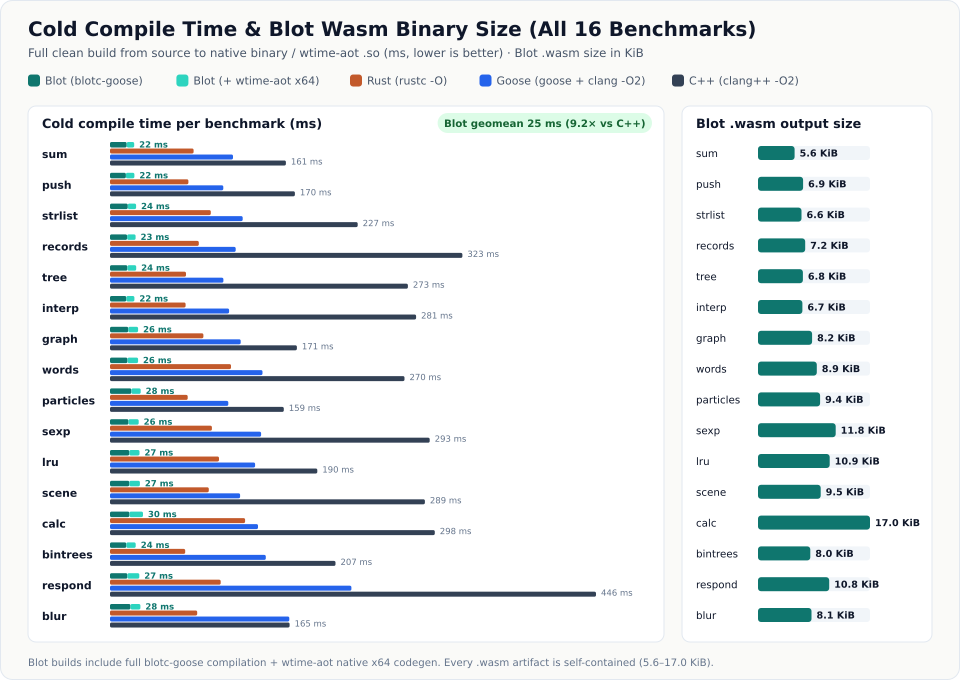

# 16-Benchmark Cross-Language Suite: Blot vs Goose, Rust & C++

This page reproduces all **16 benchmarks** from Goose's main benchmark suite (`sum`, `push`, `strlist`, `records`, `tree`, `interp`, `graph`, `words`, `particles`, `sexp`, `lru`, `scene`, `calc`, `bintrees`, `respond`, `blur`) on the same Linux machine, adding **Blot** (`blotc-goose` → WebAssembly ABI 8 → `wtime-aot` x64) alongside **Goose** (`clang -O2`), **C++20** (`clang++ -O2`, idiomatic and expert), and **Rust** (`rustc -O -C codegen-units=1`, idiomatic and arena/expert).

Every implementation across all 16 benchmarks (88 rows total) runs the exact same workload, generates the same inputs from `xorshift64`, and is verified for **100% byte-for-byte identical checksum output**.

---

## Executive Summary


Across all 16 benchmarks at **medium** size on **AMD Ryzen 7 7800X3D (Linux)**:

- **Cold compile time (geomean):** **Blot builds in 25.4 ms** (`16.5 ms` `blotc-goose` + `8.8 ms` `wtime-aot`, `22.2–30.3 ms` range) — **9.2× faster than C++** (`234.5 ms`), **5.1× faster than Goose** (`128.2 ms`), and **3.4× faster than Rust** (`85.4 ms`), producing self-contained **5.6–17.0 KiB** `.wasm` modules.
- **Peak memory (geomean exact per-process RSS vs C++ expert):** **Blot averages 0.86×** (down from `1.03×` on Nov 26) — **#2 lowest peak memory in the suite**, edging out **Rust expert (`0.87×`)**, **C++ expert (`1.00×`)**, **idiomatic Rust (`1.12×`)**, and **idiomatic C++ (`1.31×`)** (with Goose at `0.73×`). Blot uses less memory than idiomatic C++ on **14/16** benchmarks, less than C++ expert on **12/16**, less than idiomatic Rust on **8/16**, less than Goose on **6/16**, achieves the **lowest peak memory of every language in the suite** on `strlist` (**43.4 MiB**), `words` (**79.6 MiB**), and `sexp` (**109.2 MiB**), and halves `sum` (`129.3 → 64.9 MiB`) and `tree` (`61.1 → 27.8 MiB`) peak RSS via `Array.with_capacity`.
- **Runtime (geomean CPU time vs C++ expert):** Inside a deterministic, bounds-checked Wasm32 sandbox with no LLVM optimizer in the compiler, **Blot averages 1.09× C++ expert** (down from `1.15×` Wave A, `1.41×` pre-Wave-A on Nov 27, `2.07×` on Nov 26, and `2.90×` originally — **`0.54×` of idiomatic C++** at `1.99×` = **`1.84×` faster**, **`0.64×` of idiomatic Rust** at `1.70×` = **`1.57×` faster**, and **`1.17×` of Goose** at `0.93×`; Rust expert `1.05×`; excluding `particles`, **`1.15×` C++ expert / `1.25×` Goose**). Blot beats idiomatic C++ on **14/16** benchmarks (`push` **1.22×**, `strlist` **1.46×**, `records` **1.50×**, `tree` **2.74×**, `interp` **1.39×**, `graph` **2.37×**, `words` **1.48×**, `particles` **2.63×**, `sexp` **2.01×**, `lru` **2.76×**, `scene` **1.56×**, `calc` **2.25×**, `bintrees` **10.26×**, `respond` **1.31×**), beats **idiomatic Rust** on **13/16** (`strlist`, `records`, `tree`, `interp`, `graph`, `words`, `particles`, `sexp`, `lru`, `scene`, `calc`, `bintrees`, `respond`), beats **C++ expert** on **5/16** (`push`, `strlist`, `records`, `particles`, `bintrees`), beats **Rust expert** on **4/16** (`strlist`, `records`, `particles`, `bintrees`), beats **Goose** on **2/16** (`particles`, `blur`) while tying Goose on `strlist` (`73.5 vs 73.3 ms`) and `records` (`107.8 vs 107.3 ms`), and finishes **#1 fastest overall** on `particles` (**83.1 ms** vs C++ expert `185.6 ms`, Rust `186.3 ms`, Goose `192.5 ms`). Notable Wave B (`f9ce96db`) speedups on top of Wave A (`1.15× → 1.09×` geomean): `particles` **`141.8 → 83.1 ms` (`1.71×`)**, `scene` **`66.4 → 58.9 ms` (`1.13×`)**, `interp` **`10.8 → 9.7 ms` (`1.12×`)**, `blur` **`29.5 → 28.0 ms` (`1.05×`)**, `words` **`199.4 → 190.9 ms` (`1.04×`)**, `lru` **`190.6 → 183.0 ms` (`1.04×`)**.

---

## Runtime Comparison (All 16 Benchmarks)

Lower is better. Bars are sorted fastest → slowest per benchmark and report best single-process CPU time (`ru_utime + ru_stime`, ms) across 3 timed runs after 2 warmups.

### Benchmarks 1–8: Arrays, Strings, Records, Trees, Dispatch, Graph & Words


### Benchmarks 9–16: Particles, S-Expressions, LRU, Scene Graph, Parser, Binary Trees, JSON & Blur


---

## Peak Memory Comparison (All 16 Benchmarks)

Lower is better. Measured with a minimal native `posix_spawnp` + `wait4` harness (`ru_maxrss`) so parent-process memory never leaks into child RSS measurements.

### Benchmarks 1–8


### Benchmarks 9–16


---

## Cold Compile Speed & Blot `.wasm` Output Size

Blot's stacked bars show both `blotc-goose` compilation (dark teal) and `wtime-aot` native x64 compilation (light teal) against full cold builds of `rustc -O`, `goose + clang -O2`, and `clang++ -O2`.



---

## Honest Diagnosis: Where Blot Wins and Where the Remaining Gap Comes From

### Where Blot shines

- **Unboxed `v128` SIMD + whole-program unobservable-NaN elision (`particles`, `blur`, `scene`):** With unboxed `v128` lowering for `F32x4`/`U32x4` and `F64x2`/`U64x2`/`U8x16`/`I16x8`, whole-program float-bit observability analysis, and Mode-4 `v128` wide-float worker ABI packing, Blot's SoA `particles` kernel (`83.1 ms`) finishes **#1 fastest of every language in the suite** (**2.23× faster than C++ expert**, **2.32× faster than Goose**), 16-wide `U8x16`/`I16x8` SIMD pushes `blur` to **`28.0 ms`** (beating Goose `29.8 ms`, down `4.26×` from `119.3 ms`), and `scene` drops to **`58.9 ms`** (down `3.55×` from `208.9 ms`).
- **Validated recursive descriptor workers & arena workloads (`bintrees`, `tree`, `interp`, `scene`, `calc`, `sexp`, `lru`, `respond`, `words`, `records`, `strlist`):** SCC-wide recursive owner/effect analysis checks array owners once in the wrapper and passes validated `(base, len)` or `entry` descriptors across recursive calls (with `no_scope_alloc` elision, right-spine associative TCO, 1-level leaf peeling, and external direct worker dispatch), while `.rodata` constant tables, scalar-packed `DirectArray` buffers, wide-aggregate leaf inlining, masked loop-carry `mask == len - 1` proofs, same-array `ifNode` merge reuse, and non-resizing `own`-helper preservation remove redundant owner checks and scratch traffic. `bintrees` (`65.3 ms`) beats both C++ expert (`86.5 ms`) and Rust expert (`72.3 ms`), `strlist` (`73.5 ms`) and `records` (`107.8 ms`) tie Goose while beating C++ expert, `interp` (`9.7 ms`) sits within `1.7%` of Rust expert, `respond` (`184.6 ms`) beats Goose/C++/Rust DTO, and `sexp` runs **2.01× faster** with **5.78× less memory** than idiomatic C++.
- **Data density (`strlist`, `words`, `sexp`, `records`, `sum`, `tree`):** Native 1-byte `#[U8]` arrays, exact-size `Array.with_capacity` backing, and flat index arenas keep Blot's geomean peak RSS at **`0.86×` of C++ expert** (#2 overall, ahead of Rust expert), with the #1 lowest peak RSS overall on `strlist`, `words`, and `sexp`.
- **Iteration speed:** Without LLVM in the loop, Blot compiles + AOTs all 16 benchmarks in **~25.4 ms geomean** (**9.2× faster** than `clang++ -O2`).

### Why Blot still trails expert LLVM (`clang -O2` / `rustc -O`) by ~9% on geomean (15% excl. `particles`)

1. **Native codegen vs full LLVM backend (`wtime-aot` vs `clang -O2` / `rustc -O`):** `wtime-aot` compiles Wasm in ~9 ms using an SSA optimizer, helper inlining, and cross-block linear-scan register allocation, but lacks LLVM's widening map-reduce vectorization (`sum`), wide-call multi-value register allocation (`scene`), and loop-invariant constant hoisting / spill-reload elision on large parser bodies (`sexp`, `calc`, `words`, `lru`, `respond`).
2. **Explicit software bounds checks & sandbox guarantees:** Array loads/stores outside proven induction/masked/affine ranges execute explicit bounds checks (while Wasm linear-memory accesses use 4 GiB hardware `--guard-pages`), and observable floating-point outputs preserve deterministic canonical NaNs.
3. **Wasm32 linear-memory address translation & branch-heavy loops (`lru`, `words`, `respond`):** Even with validated descriptor workers and hoisted owner checks, Wasm32 indexed loads add `base + (idx << shift)` on top of the linear-memory base register, and LLVM's GVN/LICM/switch lowering still yields a ~1.2–1.5× edge on branchy hash-table and streaming loops.

---

## Methodology, Hardware & Reproduction

- **Machine:** AMD Ryzen 7 7800X3D (8C / 16T), Linux `x86_64`.
- **Toolchains:**
  - **Blot:** `blotc-goose` (`f9ce96db`, optimized build) + `wtime-aot 0.1.10` (`acb4fed`, `--backend x64 --target-cpu native --guard-pages --blot-cdylib`, executed via standalone native [`blot_runner.c`](blot_runner.c) reading ABI 8 `#[U32]` checksum packets).
  - **Goose:** `goose` (`d5ae5bb`, `build-precision`, `-O2 --standalone`) + `clang 23.1.5 -O2`.
  - **C++:** `clang++ 23.1.5 -O2 -std=c++20` (both idiomatic and expert variants from Goose's suite).
  - **Rust:** `rustc 1.96.0-nightly (1d419d203 2026-04-06) -O -C codegen-units=1` (idiomatic and arena/expert variants from Goose's suite).
- **Timing & memory:** Every child execution is spawned via [`measure_proc.c`](measure_proc.c) (`posix_spawnp` + `wait4`), recording best single-process CPU time (`ru_utime + ru_stime`), wall time (`CLOCK_MONOTONIC`), and exact per-child peak RSS (`ru_maxrss`). Each implementation runs 2 discarded warmups followed by 3 timed reps, and its stdout is checked byte-for-byte against all other implementations of the same benchmark.
- **Raw recorded data:** [`results.json`](../evidence/measurements/2026-11-27-goose-suite/results.json) (Nov 26 baseline preserved in [`../evidence/measurements/2026-11-26-goose-suite/`](../evidence/measurements/2026-11-26-goose-suite/results.json)).

### Running locally

```sh
# Run all 16 benchmarks at medium size across Blot, Goose, C++, and Rust:
python3 benchmarks/goose-suite/run_suite.py --sizes medium --reps 3 --warmups 2

# Regenerate all 6 SVG bar charts from results.json:
python3 benchmarks/goose-suite/plot_charts.py
```
