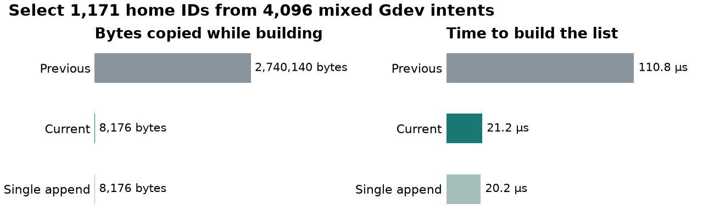

# Packed lists of Gdev intents

## Isolated Wasm layouts

Gdev's pile-handle benchmark produced 144 Idle and 144 Collect intents across
the six workers' incoming and outgoing plans. The sequence comes from executing
the Squid fixture for pile counts 2, 8 and 64. The main game does not use this
candidate planner. A separate balanced control exercises Deliver and Rest too.

| Wasm layout | Bytes per intent | Tags only | All fields | Concatenate |
| --- | ---: | ---: | ---: | ---: |
| Fixed 32-bit tag and maximum payload | 20 | 23.7 µs | 214.6 µs | 29.4 µs |
| Inline byte tag and variable payload | 9 | 202.4 µs | 250.6 µs | 14.3 µs |
| Separate byte tags and packed payloads | 9 | 20.0 µs | 200.4 µs | 13.6 µs |

Times cover 65,536 elements. An inline tag makes even a tag-only scan depend
on the previous element's payload width. The separate tag buffer lets Wasm
read those tags sequentially. For the balanced control the separate layout
uses 7 bytes per intent and scans all fields in 183.1 µs. Fixed-width storage
takes 214.5 µs. The byte counts cover list contents, excluding allocator and
owner headers.

Run `deno run -A benchmarks/intent/run.ts` from the Squid root with the Gdev and
Ink siblings present. The driver builds the actual Gdev fixture with a source
overlay to collect the input. Clang compiles three kernels to Wasm to isolate
layout cost. Each timing is the median of nine rotated rounds in V8. Each round
warms the kernel and checks 100 results. Concatenation copies two spans in
reverse order and checks the resulting sequence with an order-sensitive hash.

These measurements support a split representation for sequential lists of
varying-width cases. Squid still emits its existing fixed-stride list layout.
The following Squid benchmark exercises repeated append and shared tails. [Raw measurements](../evidence/measurements/2026-11-18-intent-layout.json)

## Building and sharing lists in Squid

The released compiler builds the actual Gdev `plan.Intent` type, including its
opaque four-word pile handle. The fixture supplies 288 captured intents and a
second control covers all four alternatives. Run
`deno run -A benchmarks/intent/persistent.ts` with the Ink and Gdev siblings.
A source overlay adds a constructor and a scalar projection in the module
that defines the handle. Timing starts after creating the input array.

| Joining 128 alternating 31- and 33-intent chunks | Bulk bytes copied during join | Build, join and scan |
| --- | ---: | ---: |
| Repeated flat `@list.concat` | 5,282,560 | 169.7 µs |
| Append each intent to one flat builder | 130,920 | 37.8 µs |
| Append fixed-width chunk references | 1,008 | 14.7 µs |
| Append packed chunk references, payloads grouped by width | 4,004 | 15.8 µs |

Repeated flat concatenation copied each successive prefix and kept 129
owners live at the join boundary. A list of two-word chunk references kept
one additional owner. Its 1,008 copied bytes came from growing the descriptor
list. The two immutable input chunks were read again after traversal.

| Build a 4,096-intent tail and two prefixes, join both branches, then scan | Reserved capacity after build | Bulk bytes copied by both joins | Build, join and scan |
| --- | ---: | ---: | ---: |
| Fixed-width lists, flat joins | 160 KiB | 184,340 | 103.1 µs |
| Fixed-width lists, shared tail | 160 KiB | 0 | 97.8 µs |
| Packed tag bytes and scalar payload words, shared tail | 45.5 KiB | 0 | 118.2 µs |
| Packed tag bytes and payloads grouped by width, shared tail | 45.5 KiB | 0 | 82.6 µs |

Grouping writes a four-word Collect target with one append. Deliver and Rest
share a separate one-word stream. Both branches keep the same tail and retain
the original operands. Their descriptor lists reserved 32 bytes for fixed
elements, 80 for packed words and 112 for grouped payloads. These capacity
measurements cover owner backing storage at callback boundaries and exclude
headers, allocator free lists and the runtime's fixed Wasm memory reservation.
On the all-variants control the grouped shared-tail case reserved 55.5 KiB
and took 99.6 µs, down from 116.9 µs for fixed-width shared chunks.

Fresh 19-module builds of the shared-tail probe emitted 30,529 bytes for
fixed rows, 33,508 for packed words and 34,051 for grouped payloads. Their
medians were 162, 158 and 158 ms across 18 fresh builds per layout. All
three still use Squid's regular List operations. The shipping list layout is
fixed stride. The main game uses a different planner.

Each checksum includes every active payload word in order. Small controls
cover empty inputs, all tag alignments, partial tag words and saved operands.
Three processes timed unmodified release Wasm with rotated variant order.
A separate instrumented guest verified the same checksum and counted
`memory.copy` bytes. Sub-microsecond join timings include the callback
boundary. [Measurements](../evidence/measurements/2026-11-18-squid-list-builders.json) · [Per-process samples](../evidence/measurements/2026-11-18-squid-list-builders.raw.json.gz)

### Growing one list across case arms

Two `case` arms select Deliver and Rest home IDs from 4,096 mixed Gdev intents.
Both spellings return the same 1,171 words in order.

| Compiler and source | Time to build | Bulk bytes copied | List owners at end of build |
| --- | ---: | ---: | ---: |
| Previous, append in each arm | 110.8 µs | 2,740,140 | 1,172 |
| Current, append in each arm | 21.2 µs | 8,176 | 1 |
| Previous, append after the match | 20.7 µs | 8,176 | 1 |
| Current, append after the match | 20.2 µs | 8,176 | 1 |

The previous compiler copied the accumulated prefix at every append. The
backend now follows the list each branch returns to the next loop iteration.
When every use of the incoming list is a terminal append on an exclusive
path, that append can grow the same owner. Other reads keep the existing
lowering. The 8,192-input regression covers nested branches, a guarded arm
and a path that skips the append.

Three pairs of processes timed the two optimized compiler outputs with the
same source. Each build time excludes input construction and the final scan.
The game uses a different planner. [Samples and qualification](../evidence/measurements/2026-11-18-exclusive-appends.json)
