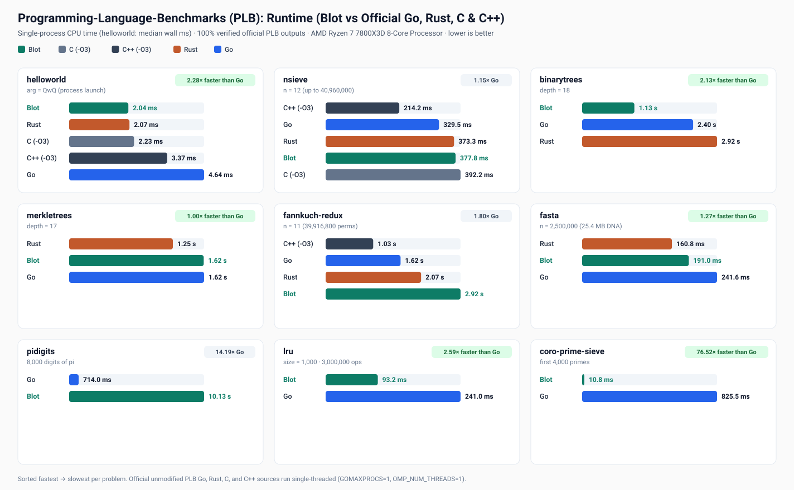
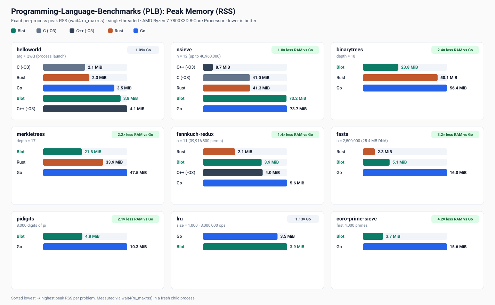

# Programming-Language-Benchmarks (PLB): Blot vs Official Go, Rust, C & C++

Nine problems from [Programming-Language-Benchmarks (`hanabi1224/Programming-Language-Benchmarks`)](https://github.com/hanabi1224/Programming-Language-Benchmarks), comparing **Blot** (`blotc-goose` + `wtime-aot 0.1.7`, x64 native) directly against **unmodified official PLB Go (`go 1.27.4`), Rust (`rustc 1.96.0-nightly -O -C lto=fat`), C (`clang -O3 -march=native`), and C++ (`clang++ -O3 -march=native`)** reference implementations on the same AMD Ryzen 7 7800X3D host.

Every program passes all official PLB `*_out` unittests and produces a **100% identical full-input stdout SHA-256** across every language on the full benchmark inputs.





## Methodology & Fairness Notes

- **Measurement**: Exact per-child single-process CPU time (`ru_utime + ru_stime`), wall time, and peak RSS (`ru_maxrss`) via [`../goose-suite/measure_proc.c`](../goose-suite/measure_proc.c) (`posix_spawnp` + `wait4`), best CPU time across 3 interleaved repetitions (`helloworld`: median wall time across 15 launches).
- **Single-threaded normalization**: All reference programs run with `GOMAXPROCS=1` and `OMP_NUM_THREADS=1`. Note that official PLB Go `fannkuch-redux/1.go` explicitly overrides `runtime.GOMAXPROCS(runtime.NumCPU())` inside `main`; reporting total CPU time (`cpu_ms`) keeps total compute work directly comparable.
- **Algorithmic transparency**:
  - `coro-prime-sieve`: Blot has no language-level coroutines/channels, so `coro_prime_sieve.blot` runs the iterative prime-filter chain (`primes[0..k-1]`), whereas official Go `1.go` spawns 4,000 goroutines and channels.
  - `pidigits`: `pidigits.blot` implements big integers in pure Blot using base-`2^30` `U64` limbs (`#[U64]`), whereas Go `8.go` uses Go's assembly-accelerated 64-bit `math/big`.
  - `nsieve`: `nsieve.blot` uses 1-byte `#[U8]` sieve flags, matching Go, Rust, and C.
  - `rust` / `c` / `cpp` coverage: Only unmodified official PLB reference files that compile without third-party Cargo crates or external libraries (`apr_pools`, GMP, etc.) are included alongside Go (which covers all 9 with pure stdlib).
- **Remaining 9 of 18 PLB problems not yet ported**:
  - `nbody`, `spectral-norm`, `mandelbrot`, `json-serde`: now unblocked by Wave 3 `F64` (not yet ported into this suite).
  - `regex-redux`, `http-server`: require regex engines / TCP HTTP networking.
  - `knucleotide`, `edigits`, `secp256k1`: require streaming >2 MiB raw stdin or 256-bit arithmetic.

## Reproduce

```bash
python3 benchmarks/plb/run_plb.py
```

- **Raw evidence**: [`results.json`](../evidence/measurements/2026-11-26-plb/results.json)
