# Fast compilation

The long-term goal is one million source lines per second. The Gdev milestone
measures a fresh process from project session open to receipt of complete Wasm.

## Gdev import edits, 19 November 2026

The retained checker compares the producer’s exported interface packet after
checking a changed implementation. With identical bytes and a stable symbol
view it can reuse its callers. A changed packet or renumbered symbols still
invalidate transitive consumers, including through re-exports. Gdev also moved
startup above storage and game. Main, the performance entries and an actor
fixture now share the same camera, orbit and stash initialization.

| Median time to full Wasm | Original Gdev, previous compiler | Original Gdev, new compiler | Shared session, previous compiler | Shared session, new compiler |
| --- | ---: | ---: | ---: | ---: |
| Increase scene history capacity | 182.4 ms | 137.1 ms | 189.4 ms | 92.2 ms |
| Rename the imported host parameter | 215.4 ms | 222.7 ms | 66.6 ms | 69.1 ms |
| Change lighting | 40.0 ms | 38.7 ms | 40.2 ms | 39.4 ms |
| Open and compile Main | 868.6 ms | 870.9 ms | 877.7 ms | 872.9 ms |

Eight counterbalanced rounds used eight frontend workers on a shared machine.
Every edit and revert returned the same bytes as a fresh compile of that source.
The capacity edit changes the Wasm, while the rename preserves it. With the original
Gdev source the new compiler checked one module after a rename and revert,
and four after a lighting edit and revert. Each order ran four times.
Directly after a fresh build the old source also needed four checks in four
trials, while the current source needed one in all four.
The original runner rename still checks 6 modules. On the new source
it checks only the session and Main with either compiler. A storage edit there
now checks 1 of 271 modules, down from 5. Its separately profiled checker phase
took 49.2 ms. Checking individual declarations inside storage is the next target.

The compiler suite passed. The named Gdev, Ink and native outcomes, the hardware
frame and all 242 files from the 120-frame replay matched the reference. All
three performance entry modules and the actor host compiled.
[Trials, profiles and qualification](../benchmarks/evidence/measurements/2026-11-19-gdev-import-boundary.json) ·
[Rerun the four configurations](../benchmarks/tools/bench_import_boundary.ts)

## Gdev Main, 18 November 2026

### Scene callbacks and compile-time inputs

Eight fresh, alternating process pairs measured **782.5 → 726.3 ms** for the
combined compiler and Gdev changes. In a separate source-only test on the same
compiler, the scene callback interface reduced a storage edit from six checked
modules to four. A one-worker fresh build was effectively flat. The strongest
reason to keep the interface is that scenes can be checked while the storage
implementation is broken.

`#run` can now build structured constants and read declared files. An edit to
an unselected file reused the previous Wasm. Changed source still goes through
the existing module checks. Run the two real-source probes from the Blot root.

```sh
deno run -A benchmarks/language/terrain_owner.ts
deno run -A benchmarks/language/staged_catalog.ts
```

[Paired measurements and integration checks](../benchmarks/evidence/measurements/2026-11-18-language-hills.json)

### Reusing emitted function bodies after a scalar edit

The earlier full-emission compiler compiled Gdev Main in **879 ms** and rebuilt the lighting
preset in **270 ms** median over six unprofiled sessions. Six separate profiles
put loading at 109 ms and the backend at 126 ms on the edit. The following
experiment starts with the previous emitter state and the two decoded Core
catalogs. Each run returns a complete Wasm image.

| Source edit | Stock backend | Prototype | Functions re-emitted on the reuse path |
| --- | ---: | ---: | ---: |
| Lighting preset | 111.2 ms | 2.1 ms | 1 |
| Imported `#run` constant | 110.3 ms | 2.7 ms | 1 |
| Integer literal crosses a signed LEB128 width boundary | 107.9 ms | 2.1 ms | 1 |
| Replacing a literal with an expression | 110.0 ms | 114.4 ms | Full fallback |

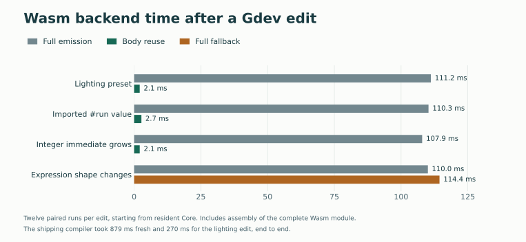

The compiler records the Core literals consumed by each emitted function,
including reads made while evaluating `#run` in another module. The prototype
compares the changed modules’ portable fields and accepts changes to scalar
values and source positions. It recompiles the affected instances in their
original type-inference mode and assembles the module with the existing Wasm
writer. Other structural changes use the whole backend. At the lighting
baseline, 41,436 recorded reads reserved 768 KiB. Initial backend construction
in that window took 116.3 ms with tracking and 109.9 ms in the stock control.

All 14 transitions matched independently compiled release Wasm. Eight used the
reuse path, including three edits to unreachable code that required zero bodies.
The six structural fallbacks also matched. Selecting bodies solely by their
source module missed a staged caller in another module. The edit comparisons,
raw records, exact inputs and runnable probe are in the evidence bundle.
[Measurements](../benchmarks/evidence/measurements/2026-11-18-gdev-body-reuse.json) · [Raw trials](../benchmarks/evidence/measurements/2026-11-18-gdev-body-reuse.raw.json.gz) · [Reproducer](../benchmarks/evidence/measurements/2026-11-18-gdev-body-reuse-probes.tar.gz)

Over 512 alternating lighting edits, mutating the same generator appended
30,208 bytes of body storage, 4,096 temporary values and 7,680 words. Forking
from an immutable baseline kept those three counts fixed. Fork, re-emission,
assembly, transfer of the 2,639,228-byte image and child exit took **12.9 ms**
median and **15.7 ms** p95. The parent’s RSS rose 2.5 MiB while receiving the
images. Both Core catalogs were already resident in this experiment. Both soak
tests checked every image against the matching release build.

The project server now reuses the last committed Wasm image for fixed-width
scalar edits. Changing Gdev’s lighting preset updated one operand. Time from
the edit request to receipt of the complete **2,639,648-byte** image fell
from **229.7 to 121.9 ms** median in eight alternating pairs.
Fresh session builds took **750.5 and 764.0 ms** respectively. All
14 transitions matched an independent fresh build or its rejection. Structural
edits, changed staged reads and changes in encoded width use full emission.

The writer records ordinary scalar operands as it emits them. It accounts for
insertions at loop entry and keeps only the final version of a body emitted
during type inference. The session compares newly checked Core against the last
committed revision and passes through previously checked units. A changed
literal that was read by `#run`, an unaccounted literal, or a different code
shape causes a full build and a replacement table. Projects with declared
compile-time file inputs continue to use their existing asset read-set logic.
A failed edit preserves the previous image, its table and its revision.

The candidate won all eight edit pairs and one of eight fresh pairs.
In two separately profiled sessions per compiler, backend time on the edit fell
from 108.36 to 0.76 ms. Loading the project took 92.89 ms on the candidate.

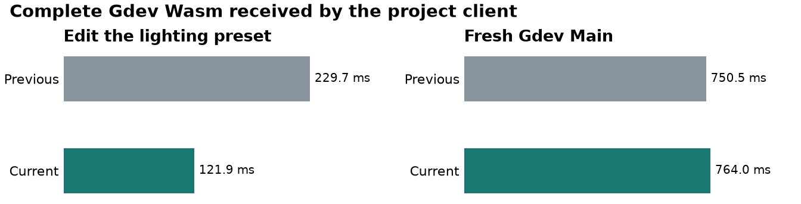

The named compiler, Gdev and Ink checks preserved their reference outcomes.
The Main image, 120-frame replay and inspected hardware frame also matched.
[Paired timings and qualification](../benchmarks/evidence/measurements/2026-11-18-gdev-session-relocations.json) · [Runnable edit comparison](../benchmarks/tools/bench_body_edits.ts)

### Reusing parsed modules across edits

The loader now checks every canonical import and current source as it walks
the project. When a module's source, parser symbols and inherited fixities
agree, the candidate copies its parsed tree. Each revision owns its copy, so
a rejected revision can be discarded without affecting the previous one.
An early symbol divergence makes later modules parse again. If the entry
introduces different symbols, the loader sends its remaining imports to parse
workers. In the first trial, reparsing those imports serially took
768.7 ms against 689.3 ms in its paired control. The table shows the final
release and its independently measured control.
Changing the prelude root disables reuse for modules that inherit its operators.

| Gdev Main, eight frontend workers | Previous | Current | Alternating pairs |
| --- | ---: | ---: | ---: |
| Edit the lighting preset | 119.6 ms | 36.5 ms | 8 |
| Start a fresh session | 762.9 ms | 737.3 ms | 8 |
| Rename the entry parameter | 714.6 ms | 712.1 ms | 4 |

The lighting edit acquired all 270 sources and reused 269 syntax trees.
An independent file-open trace counted 213 speculative opens of
`.blot` files on the previous compiler and 0 on the current one.
Both opened 214 disk sources during the authoritative walk. Other
sources came from in-memory inputs. In two separately profiled pairs,
load time fell from 92.9 to 14.5 ms.
The client timer includes delivery of the complete Wasm image. All eight
lighting pairs improved. A fresh build spent 426.6 ms in checking across two
profiles. At this checkpoint, renaming an entry parameter rechecked all 270
modules.

Tests cover on-disk edits with the same size and timestamp, retargeted symlinks,
changed identifier spellings, inherited operator associativity, overlay removal
and recovery after a rejection. The benchmark compared every revision with an
independent fresh build and compared the replay, hardware frame and named
Gdev and Ink outcomes with their references.
[Raw pairs, profiles and qualification](../benchmarks/evidence/measurements/2026-11-18-gdev-syntax-reuse.json) · [Runnable edit comparison](../benchmarks/tools/bench_body_edits.ts)

### Checking the entry after its dependencies

The entry parses into its own symbol table. Import paths enter the shared
table before traversal. Once dependencies have contributed their source and
checker-generated names, the loader maps the entry syntax into the shared
table. An unchanged entry can replay its parse packet. Parallel checker
workers restrict name lookup to the dependency prefix. For an entry-only edit,
the session checks the dependency bytes, import graph and prefix spellings,
then checks and lowers the edited entry using the retained interfaces.

| Gdev Main, eight alternating pairs | Previous | Current |
| --- | ---: | ---: |
| Rename the entry parameter | 710.8 ms | 45.2 ms |
| Edit the lighting preset | 36.8 ms | 37.3 ms |
| Start a fresh session | 768.0 ms | 763.8 ms |

The rename checked one module, down from 270. It reused 269 syntax trees and
returned the same Wasm SHA-256 as a fresh build on the previous release.
Across two separately profiled pairs, checking fell from **435.5 to 6.2 ms**
and backend work fell from **109.0 to 0.7 ms**.
The same private rename in the imported world-storage module rechecked
270 modules on this release.

A 16-module executed fixture covers moving between fresh and existing names,
shadowing an imported function, adding a local declaration, changing a
dependency, and recovery from syntax and name errors. All 21 Gdev session
transitions matched independent release builds or their diagnostics. The
hardware frame, 120-frame replay and named Gdev and Ink outcomes also matched.
[Paired trials and profiles](../benchmarks/evidence/measurements/2026-11-18-gdev-entry-symbols.json) · [Runnable comparison](../benchmarks/tools/bench_body_edits.ts)

### Rechecking a changed import

The parser records the order in which each file uses names. After an imported
file introduces a new name, unchanged files replay those spellings and relocate
their parsed trees. For parallel source projects with at least 16 modules, the
checker assigns names by maximum import depth. Each module gets the same view
of source and generated names on fresh and retained checks. A change to that
view rebuilds the module and its dependents. The parser and checker share
immutable trees across revisions when their symbol IDs still agree.

| Gdev Main, eight alternating pairs | Previous | Current | Faster pairs |
| --- | ---: | ---: | ---: |
| Rename an imported parameter | 949.7 ms | 257.6 ms | 8/8 |
| Rename the entry parameter | 53.0 ms | 54.4 ms | 4/8 |
| Edit the lighting preset | 47.1 ms | 47.0 ms | 4/8 |
| Start a fresh session | 1,031.9 ms | 971.5 ms | 5/8 |

For the private rename in `world_storage`, checking fell from
**951.0 to 230.7 ms** and loading, lexing and parsing together fell from
**314.6 to 52.9 ms** across two separately profiled pairs.
The compiler reused 269 parsed trees, up from two, and rechecked six modules,
down from 270. In a separate trace, checking `game.blot` took 101.7 ms and
checking `world_storage.blot` took 100.4 ms.

Relinking names raised the load phase alone from **23.4 to 47.4 ms**.
The next target is reuse of `game.blot` when an edit preserves the exports it consumes.

Across four separate pairs, median resident memory after the rename was
**282.9 MiB** previously and **269.8 MiB** on this release. The measurement sums
proportional set size for the live compiler processes after the reply. Fresh
builds used 180.8 and 191.0 MiB respectively. In one further session, memory
held steady from the fourth through the sixteenth alternating rename or revert.

All 21 edit, rejection and recovery transitions matched independent fresh
compilations. An 18-module executed test covers parameter renames,
shadowing, an unbound name, edits to two files, a retargeted import and
crossing the parallel checker’s project-size threshold. The release passed
the full compiler gate and reproduced Gdev Main, its inspected hardware frame
and every file of the 120-frame replay. All named Gdev and Ink outcomes matched.
[Trials, phase profiles, memory and qualification](../benchmarks/evidence/measurements/2026-11-18-gdev-import-rename.json) · [Runnable edit comparison](../benchmarks/tools/bench_body_edits.ts)

### Verified arrays in worker packets

Tracing the previous compiler on Gdev located slow field-by-field serialization
in Core merge ranges, field names, obligations and nominals, and in imported
binding arrays. Thirteen measured tables now use the existing verified Goose
array image. A shared generator emits the typed encoders and decoders. This
changes the private representation exchanged between workers running the same
executable. Guest Wasm, the project protocol and portable BLOTDEP1 records keep
their formats.

| Paired workload | Previous compiler | Bulk transfers | Median paired saving | Wins |
| --- | ---: | ---: | ---: | ---: |
| Fresh Gdev, first window | 943.5 ms | 888.5 ms | +28.4 ms | 15/20 |
| Fresh Gdev, reversed order | 904.1 ms | 882.9 ms | +24.3 ms | 17/20 |
| Fresh Gdev, confirmation | 1572.6 ms | 1539.5 ms | +58.8 ms | 12/16 |
| Lighting edit, first window | 271.9 ms | 286.4 ms | -13.1 ms | 3/8 |
| Lighting edit, confirmation | 446.4 ms | 414.9 ms | +8.1 ms | 5/8 |
| Child CPU, fresh confirmation | 4283.1 ms | 4184.1 ms | +183.8 ms | 13/16 |

The first two fresh windows had 4.5–6.9% one-minute CPU pressure at the start.
The confirmation window started at 61.1%. The new compiler won
44 of 56 fresh pairs, with a median paired saving of 32.8 ms.
Lighting edits were 13.1 ms slower per pair in the first window and
8.1 ms faster in the second.

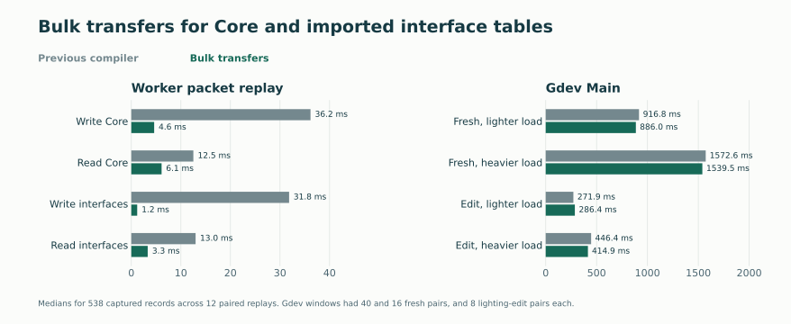

Twelve alternating replay pairs each processed one interface and one Core
module for all 269 Gdev modules. The timings exclude file I/O.

| Captured records | Previous compiler | Bulk transfers |
| --- | ---: | ---: |
| Write Core | 36.16 ms | 4.61 ms |
| Read Core | 12.52 ms | 6.11 ms |
| Write interfaces | 31.84 ms | 1.19 ms |
| Read interfaces | 12.97 ms | 3.31 ms |

Together the worker replies shrank by **1,001,880 bytes (1.38%)**. Every
decoded record matched its counterpart after independent BLOTDEP1 encoding.
The checker dispatched all 269 modules across eight slots. The packet codec occupied 5.7% of
sampled CPU on the prior release and 1.9% on the new one.
The sampler attributes the interrupted instruction to its compiled symbol.

Each confirmed fresh build returned the same 2,639,228-byte Main. A valid
lighting edit checked one module and reused 268. The full compiler gate
passed 190 Wasm fixtures, 212 lowering references, both direct references
and 1,088 guest and host tests. The 120-frame replay matched all 242 files,
and every named Gdev and Ink outcome matched.

In six separately profiled lighting edits under contention, project loading
took 164 ms and the backend took 216 ms. Checking took just 3.5 ms and never
dispatched a worker. The edit changed only the code section, and only the
59-byte body at defined-function ordinal 98. All other 6,858 bodies matched
byte for byte at the same ordinal. The [body reuse experiment](#reusing-emitted-function-bodies-after-a-scalar-edit) tests this observation against fresh compilation.
[Measurements](../benchmarks/evidence/measurements/2026-11-18-gdev-worker-tables.json)
· [Raw trials and record hashes](../benchmarks/evidence/measurements/2026-11-18-gdev-worker-tables.raw.json.gz)
· [Packet capture and replay tools](../benchmarks/evidence/measurements/2026-11-18-gdev-worker-tables-probes.tar.gz)

### Two-word list packets

The worker codec transfers the type-list descriptor’s start and length together. One fixed-width transfer encodes the same eight
little-endian bytes. Near a packet limit it uses the field-by-field path. A complete first word survives a missing second word. Both compilers passed the same depth, alignment and truncation tests.

| Paired workload | Previous release | Candidate | Median paired saving | Wins |
| --- | ---: | ---: | ---: | ---: |
| Fresh, contended host | 1857.9 ms | 1767.3 ms | +29.8 ms | 13/20 |
| Fresh, starting order reversed | 837.7 ms | 841.4 ms | -2.9 ms | 9/20 |
| Fresh, independent confirmation | 850.0 ms | 845.0 ms | +8.8 ms | 12/20 |
| Lighting edit | 256.8 ms | 259.9 ms | -3.7 ms | 2/8 |
| Lighting edit, confirmation | 247.8 ms | 246.1 ms | -0.5 ms | 5/10 |
| Total child CPU, fresh confirmation | 2820.0 ms | 2795.5 ms | +8.8 ms | 10/20 |

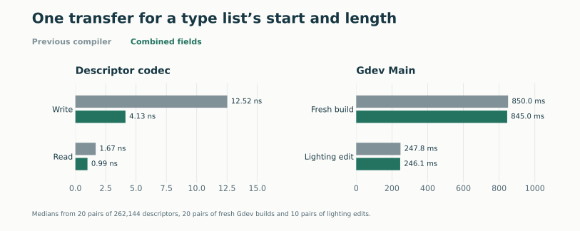

The isolated native benchmark alternated 20 pairs of fresh processes, each
writing and reading 262,144 descriptors. Encoding took **12.52 → 4.13 ns**
per descriptor and decoding took **1.67 → 0.99 ns**.
In eight separately sampled fresh compiles per binary, **386 of 21,806**
release CPU samples and **118 of 24,718** candidate samples landed in the list
codec. Inlining can move samples into a caller. Backend output and checker
reply sizes match across compilers, including all **72,858,303** reply bytes.

The first timing window started with host CPU pressure at 63%. The second
started at 2%. The final timing window ran separately after integration.
Each fresh run checked all 269 modules. A valid retained edit rechecked one.
The codec shipped in `78d616bd`. Fresh build times varied across windows,
and lighting edits showed no consistent speedup.
The full gate passed 190 Wasm fixtures, 212 lowering references, both direct
references and 1,088 guest and host tests. The Gdev and Ink named outcomes,
all 242 replay files and the inspected Pen frame matched the qualified release.
Core module packets and imported binding arrays account for the largest remaining codec samples. Profile their field and array costs before widening the fast path.
[Measurements](../benchmarks/evidence/measurements/2026-11-18-gdev-packet-list.json)
· [Raw trials](../benchmarks/evidence/measurements/2026-11-18-gdev-packet-list.raw.json.gz)
· [Codec patch, microbenchmark and probes](../benchmarks/evidence/measurements/2026-11-18-gdev-packet-list-probes.tar.gz)

### Function-pair unification

The qualified release compiled all 46,109 lines in **797.5 ms** median,
about 57,800 lines/s, and rebuilt a lighting edit in **229.9 ms**. Every
successful fresh run returned the same 2,639,228-byte Wasm. The comparison
rotated four compilers through all four starting positions.

| Compiler | Recursive visits | Fresh median | Median saving within round | Wins |
| --- | ---: | ---: | ---: | ---: |
| Release | 842,642 | 797.5 ms | — | — |
| Capture fields at pair entry | 702,176 | 803.5 ms | −4.2 ms | 6/16 |
| Reuse resolved child IDs | 732,106 | 791.8 ms | −6.5 ms | 6/16 |
| Combine both | 601,703 | 803.4 ms | +12.8 ms | 10/16 |

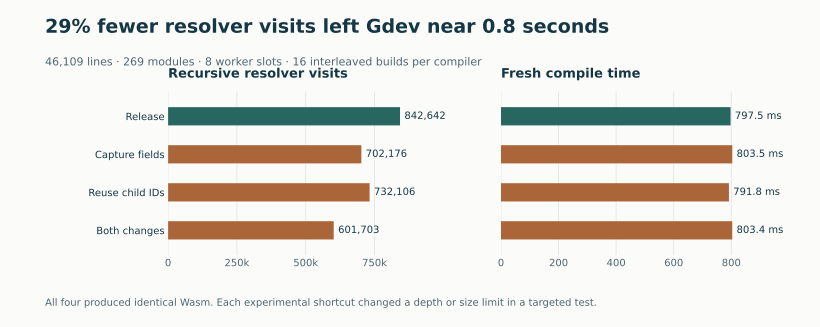

The combined path made 8,627 fewer type-node allocations during unification.
All 252,160 child IDs eligible for reuse on Gdev agreed with eager resolution.
All four prototypes matched the release on 190 fixtures and 4,096 generated
unification cases. Two targeted native tests found the boundary of that
agreement. Interning a selection can return an older descriptor with 1,025
nested arrays. Reusing its ID skips the depth check. Omitting a parent
allocation can also let a full store accept a type. Both cases now run
in the native regression suite.

A fourth prototype kept ordinary root resolution and specialized its
immediate returns. It passed both limit tests and reproduced every named Gdev
and Ink outcome, all 242 replay files, and the inspected Pen frame. Across
two windows of 20 fresh pairs, its median paired saving was **−5.0 ms**
then **+16.9 ms**. Release and candidate medians for the retained lighting
edit were **237.9 and 245.0 ms** over eight pairs. The full gate was
interrupted during native linking. These results use the independently
completed binary. The release and packaged compiler remain at `6b223a73`.

A separate 1 ms CPU sampling run covered 12 fresh release builds with phase
profiling disabled. Of 27,894 samples, 2,059 (7.4%) landed directly in the
project packet encoder and decoder, and 1,624 (5.8%) in four allocation
observer functions. The release sent **72,858,303 bytes** in checker worker
replies per build. All 35 sampled codec specializations mapped to release
source types. Core modules accounted for 562 samples, two-word type-list
descriptors for 431, and reads of principal-interface binding arrays for 330.
The type-list codec checks its two U32 fields separately. Try one bounds
check and one fixed-width transfer, preserving field order, depth limits and
failure behavior. Allocation accounting is a second candidate for reducing
call overhead while preserving counters and fault injection. The sampled
shares describe CPU time across processes. End-to-end savings require a
fresh timing comparison.
[Measurements](../benchmarks/evidence/measurements/2026-11-18-gdev-function-unification.json)
· [Raw trials and samples](../benchmarks/evidence/measurements/2026-11-18-gdev-function-unification.raw.json.gz)
· [Patches, sampler and reproducers](../benchmarks/evidence/measurements/2026-11-18-gdev-function-unification-probes.tar.gz)

### Earlier direct Core type reader

Direct projection of expression and dispatch signatures avoided 115,982 of
405,857 resolver allocations. In 18 alternating fresh pairs it won 15 and
saved **14.9 ms** at the median within-pair difference. Gdev exercised 310,236
admitted facts across 269 modules. The eager and experimental types agreed on
all of them and produced byte-identical Wasm.

| Gdev Main | Release median | Experiment median | Median paired saving | Wins |
| --- | ---: | ---: | ---: | ---: |
| Direct reader | 849 ms | 837 ms | +14.9 ms | 15/18 |
| Guarded reader | 829 ms | 835 ms | +5.4 ms | 10/18 |
| Guarded, starting order reversed | 840 ms | 825 ms | +17.5 ms | 14/18 |
| Stable leaves and rows | 782 ms | 778 ms | +0.2 ms | 9/18 |
| Stable, starting order reversed | 784 ms | 776 ms | +13.6 ms | 10/18 |

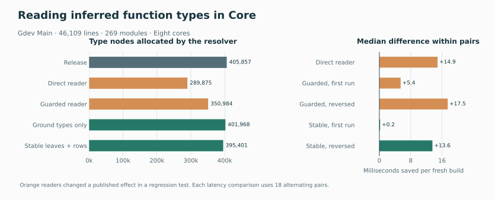

A native test reached the same function through two substitution cursors.
The direct reader preserved the distinct `u32` and `bool` results and their
different effect rows. A second test published a function with an open effect,
then bound that effect to the empty row. Ordinary Core observed the published
open tail. The experimental reader observed the later closed tail. This is a
store-level counterexample. No Gdev or Blot-source failure was observed.

The guarded reader excluded expression types needed by ownership, editor,
scope and coverage checks. It still reproduced the effect-row divergence.
Its complete gate passed 1,088 guest and host tests, 190 Wasm fixtures, 212
lowering references, both direct backend references and the package check.
Gdev and Ink retained every named outcome, including 108 Gdev failures and two existing
Ink native failures. The 120-frame replay matched all 242 files and the
inspected hardware frame and trace matched the release hashes.

Two further experiments kept ordinary Core projection. Requiring fully
settled leaves and physical closed rows avoided 3,889 allocations. Admitting
stable free variables and unmodified empty row tails avoided 10,456 (2.6%).
Both preserved all 190 fixture outputs and diagnostics. The latter won 19 of
36 fresh pairs and two of six retained lighting edits. The median edit rose
from **226 to 233 ms**, and all four profiled checks took longer. The
qualified compiler stays at `6b223a73`.

The release unifier fully resolves both operands before it examines their
outer constructors. Of 457,283 type pairs, **89,108 function pairs** accounted
for **599,250 of 842,642** recursive resolver visits (71.1%) and **29,225 of
39,083** new nodes (74.8%) during operand resolution. A prototype can capture
the resolved input types, outputs and effects of both functions at pair entry,
then feed those six facts to the existing worklist. Preserve the behavior
when solving an argument writes a variable also present in the result.
[Measurements](../benchmarks/evidence/measurements/2026-11-18-gdev-cursor-core.json)
· [Raw trials](../benchmarks/evidence/measurements/2026-11-18-gdev-cursor-core.raw.json.gz)
· [Patches and native witnesses](../benchmarks/evidence/measurements/2026-11-18-gdev-cursor-core-probes.tar.gz)

### Earlier signature-sharing experiment

The signature-sharing experiment reduced resolver allocations **19%**, from
405,857 to 329,686. Both executables compiled the same 46,109 lines into
2,639,228 Wasm bytes. The prototype remains in the measurement archive.

| Gdev Main | Baseline | Candidate | Candidate wins |
| --- | ---: | ---: | ---: |
| First 24 fresh pairs | 893 ms | 893 ms | 15/24 |
| Second 24, starting order reversed | 3121 ms | 2895 ms | 14/24 |
| Retained lighting edit | 281 ms | 283 ms | 5/8 |

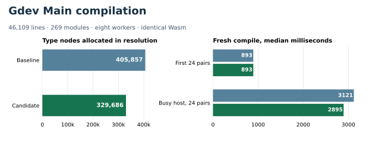

The second window ran under heavy contention. The host CPU pressure reached
82% over ten seconds during the comparison. The median savings within pairs were 18.798 ms in the first window
and 52.783 ms in the second. Positive values favor the candidate.
The single-worker control took 1118 and 1132 ms for checking. The full
compiler gate and 120-frame Pen replay passed. All named Gdev and Ink
outcomes matched the release, including its existing failures.

Expression type finalization allocated 112,112 nodes and dispatch signatures
another 37,855. Removing both loops cut the resolver count to 256,867 and
preserved Main's Wasm. All 190 fixtures retained the same output and diagnostics.
A store-level witness exposes the constraint on this shortcut. If a parent is
bound between two writes to a child's variable, the resolver selects the later
`bool` replacement. Restarting the child's lookup at cursor zero selects the
earlier `u32`. That witness motivated the cursor-aware projection experiments above.
[Measurements](../benchmarks/evidence/measurements/2026-11-18-gdev-finished-functions.json)
· [Raw trials](../benchmarks/evidence/measurements/2026-11-18-gdev-finished-functions.raw.json.gz)
· [Patches and cursor witness](../benchmarks/evidence/measurements/2026-11-18-gdev-finished-functions-prototypes.tar.gz)

### Direct variable views

Blot `6b223a73` compiled Main in **868 ms**, down from **890 ms** for
`0c4bc0eb` on the same 18 alternating fresh pairs. The median paired gain
was 22 ms, with 14 wins. In an earlier, busier three-way window the same
change won 12 of 18 rounds with an 8 ms median paired gain. Filesystem pages
were warm and compiler processes were fresh throughout.

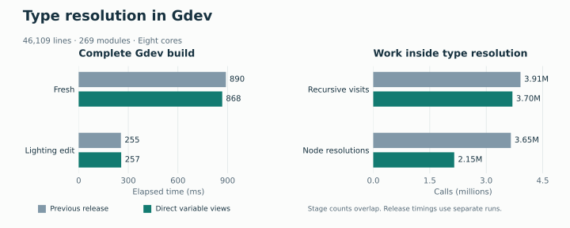

| Operation | Previous | Shipped |
| --- | ---: | ---: |
| Fresh Gdev compile, eight workers | 890 ms | 868 ms |
| Retained lighting edit | 255 ms | 257 ms |
| Profiled check phase with one worker | 1,301 ms | 1,264 ms |
| Full node-resolution calls on Main | 3,653,932 | 2,150,123 |

The baseline made 3,909,874 recursive visits. Of these, 1,182,937 repeated
the exact type, cursor, depth and inference state. A visit can already be
cheap. Of 926,995 exact repeats that reached full node resolution, 766,946
were primitives or proven-closed types. The shipped checker returns closed
subtrees directly, keeps a variable's principal view on its binder and
allocates scratch for compound fields only when a child changes. Historical
views retain their cursor. The invalid edit diagnostics, inference budget
boundary and valid Wasm bytes matched the previous release.

A 64-slot cache for unchanged roots avoided another 440,753 recursive visits.
It improved serial checking by 26 ms median within pairs across all six rounds.
With eight workers, the initial comparison split 9–9. In 18 further direct
pairs it won eight, took 864 ms versus 856 ms for the shipped resolver, and
lost 1.5 ms in the median pair. The prototype is archived.

Two observational builds attributed all **405,857** resolver allocations.
Functions account for 341,886 (84%). Finishing inferred types allocated
158,398 nodes, including 144,463 functions. Among those functions, 43,852
had the same parameter, result and effect row IDs as a previously seen
signature. Across all callers, a change to the effect row alone triggered
141,195 function rebuilds. Checking ordinary calls produced 37,460 functions,
but just 28 matched an earlier signature by its three IDs.
[Allocation profile and probe source](../benchmarks/evidence/measurements/2026-11-18-gdev-resolver-allocations.json)

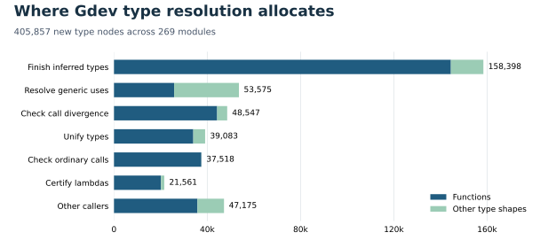

[Measurements](../benchmarks/evidence/measurements/2026-11-18-gdev-type-resolution.json)
· [Raw trials](../benchmarks/evidence/measurements/2026-11-18-gdev-type-resolution.raw.json.gz)
· [Counter and cache source](../benchmarks/evidence/measurements/2026-11-18-gdev-type-resolution-probes.tar.gz)

### Parallel parser release

Blot `0c4bc0eb` compiled 46,109 lines to complete Wasm in **823 ms**
median on eight cores, about **56,000 lines/s**. The previous release took
**919 ms** on the same alternating twelve pairs. Each fresh build checked
269 modules. All 24 emitted the same 2,639,228 bytes.

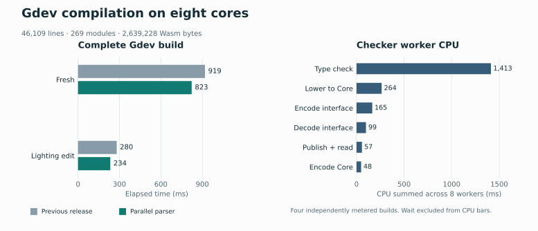

| Gdev workload | Previous release | Parallel parser |
| --- | ---: | ---: |
| Fresh process | 919 ms | 823 ms |
| Edit the lighting preset in an open session | 280 ms | 234 ms |
| Reject an unresolved name | 418 ms | 369 ms |
| Reject a syntax error | 160 ms | 111 ms |
| Reject a lexical error | 157 ms | 108 ms |
| Restore the original source after rejection | 280 ms | 238 ms |

The fresh improvement was 103 ms median within pairs. Valid edits and
recoveries rechecked one module and reused 268. Across three separate profiled
pairs, loading, lexing and parsing together fell from 158 to 69 ms. On Linux,
large projects discover leading literal imports and parse independent files
after the prelude. The loader reads the actual revision, adopts only exact
source matches and replays symbols in the original order. Unrecognized import
layouts and rejected speculative parses use the ordinary parser.
[Measurements](../benchmarks/evidence/measurements/2026-11-18-gdev-parallel-parse.json)
· [Raw trials](../benchmarks/evidence/measurements/2026-11-18-gdev-parallel-parse.raw.json.gz)
· [Benchmark runner](../scripts/integration/time_gdev_parse.ts)

Four separately metered builds spent **1,413 ms of aggregate worker CPU**
in type checking (68%), 264 ms lowering to Core, 165 ms freezing and encoding
interfaces, and 99 ms decoding imported interfaces. Workers spent 57 ms in
queue publication and reads combined. Coordinator reads and gathering added
39 ms of CPU. Waiting for available jobs occupied 42% of aggregate lane
wall time and consumed 5 ms of CPU. These worker durations overlap. A
million lines per second still gives this workload a **46 ms wall budget**.
[Reproducible profiling probe](../benchmarks/evidence/measurements/2026-11-18-gdev-parallel-parse-probe.tar.gz)

### Scalar compile-time execution

Blot `d92d35ac` compiled the 46,109-line project in **938 ms** median over
twelve fresh processes, about **49,100 lines/s**. A lighting edit took
**291 ms** median. On the same sources, an unused `#run` fell from **1,938 to
1,031 ms**. Using it for the actual lighting field took **1,015 ms** and
emitted byte-identical Wasm. All 269 modules used the worker queue.
[Measurements, compiler identities and probe inputs](../benchmarks/evidence/measurements/2026-11-18-gdev-staging-interfaces.json)

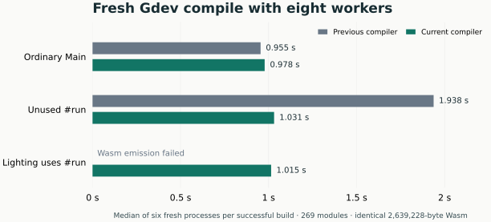

### Earlier worker release

Blot `20fed713` took **0.889 s** median on fresh Main and **268 ms**
on a lighting preset edit in an open session. Each of six fresh builds checked
all 269 modules, emitted the same 2,639,228 bytes and finished in 870–910 ms. Both defaults used Gdev `45748aba`, Ink `3f2e603`
and Pen `ad9766c` on the same shared eight-core Linux host.
[Measurements and raw trials](../benchmarks/evidence/measurements/2026-11-18-gdev-compiler-workers.json)

| Operation | Previous default | Current default |
| --- | ---: | ---: |
| Fresh Main | 1,691 ms | 889 ms |
| Lighting preset edit | 270 ms | 268 ms |
| Reject an invalid lighting edit | 303 ms | 403 ms |
| Recover the last valid edit | 263 ms | 273 ms |
| Revert the lighting preset | 266 ms | 269 ms |

Fresh trials opened a new native process, regenerated assets and checked every
module with warm filesystem pages. The edit trials alternated previous and current
compilers and compared successful bytes and rejection diagnostics with fresh sessions.

### Where fresh time goes

Seven forked workers and the parent check dependency-ready modules. Each
publishes its interface as soon as it is ready, then lowers the checked body to
Core. Importers decode each producer once per worker. The coordinator restores
the budget debits in source order and assembles the complete Wasm.

In a separate traced build, checking and worker-side lowering took
447 ms, gathering Core took 54 ms, loading and parsing took
156 ms, assets took 73 ms and the Wasm backend took 113 ms.
The serial trace spent 1,119 ms checking and 207 ms lowering.
Sending the largest Core tables as verified Goose arrays reduced worker replies
from 75.0 MB to 72.9 MB. With the same scheduler it reduced fresh time from
0.914 s to 0.889 s on these six pairs.

### Edits and remaining costs

A successful build retains the interfaces, inference-budget debits and Core it
needs for the next edit. A closed-record Boolean edit checks one module and
reuses 268. Restoring the last successful revision after rejection reuses all
269. Rejection falls back to the source checker for the ordered diagnostic.
In the measured cycle, the compiler process ended at
212 MiB RSS, compared with 354 MiB previously.

Changing the body of a public lighting function produced different Wasm and
rechecked 72 modules in **1.11 s** median across the edit, revert
and repeat. Comparing the changed module's exported interface before checking
its importers could reduce that work. The source splits already reduced the
inclusive dependent count for station from 12 to 3, robots from 31 to 20 and
salt from 53 to 35.
[Source split and serial edit measurements](../benchmarks/evidence/measurements/2026-11-18-gdev-incremental.json)
· [Worker prototype and rejected experiments](../benchmarks/evidence/measurements/2026-11-18-gdev-persistent-workers.json)

### What one million lines per second would take

Main has 46,109 physical source lines, including 314 generated lines. The
889 ms release median is **51,890 lines/s**. One million lines/s on this input
allows **46 ms** to receive complete Wasm. The release trace spent 434 ms
outside parallel checking and worker-side lowering. In a separate, slower
timing window the same binary took 2.48 s with one worker, 1.30 s with eight
and 1.50 s with sixteen on eight physical cores.
[Worker scaling graph](../benchmarks/evidence/measurements/2026-11-18-gdev-multicore.svg)
· [Source counts and raw trials](../benchmarks/evidence/measurements/2026-11-18-gdev-multicore.json)

1. **Early interfaces.** The estimate of 307 → 225 ms for the eight-worker
   checker assumed free headers for `world_storage`, `world/salt` and
   `actors/robots`. In the source pilot, scenes, hauling plans and minors each
   compiled with the corresponding producer remainder deliberately broken.
   Complete builds checked all 272 modules. They took 938 → 928 ms across
   twelve paired runs, winning seven with a 6 ms median within-pair gain.
   The application retains its current layout. A second pilot passed the
   hauling planner a declared U32 stash index and a lazy lookup. It compiled
   with the entire salt producer broken. A declared callbacks record over
   `FrameAccess` hit `TypeLimit` even after reducing it to one imported field.
   This reproducer is a smaller target than adding result annotations to all
   2,923 functions that currently omit them.
   [Pilot inputs and results](../benchmarks/evidence/measurements/2026-11-18-gdev-staging-interfaces.json)
2. **Compile-time execution.** The direct backend folds supported pure scalar
   `#run` and `#do` expressions from current Core. Imported scalar functions
   and constants can run during compilation. A retained Boolean edit to an
   imported constant rechecks one module and updates the staged result.
   Quoted code and numeric proof validation still use the live checker.
3. **Reduce work per line and parallelize the rest of the pipeline.** The
   checker alone used 1,101 ms of single-core CPU. At the throughput target,
   eight cores have 369 ms of CPU for the entire compile. Measure repeated
   type resolution and the 72.9 MB of worker replies. The parallel parser shipped in `0c4bc0eb`. Its release trace spent
   69 ms loading and parsing and 116 ms in the Wasm backend. After the type
   resolution experiment, test assigning stable Wasm indices before workers
   emit independent function bodies. [Go's per-function backend queue](https://go.dev/src/cmd/compile/internal/gc/compile.go)

## Goose release measurements, 17 November 2026

Gdev Main took **2.04 s** median on the ordinary one-worker path. All 264
modules were fresh and all runs produced the same 2,639,595 bytes. Two
frontend workers took 5.76 s and four took 4.99 s. The
[measurements](../benchmarks/evidence/measurements/2026-11-17-gdev-subsecond.json)
pin the compiler, sources, individual trials and output hashes.

Four fresh command-line builds used the same generated asset sources on
disk. They produced byte-identical Main and exposed these unprofiled medians.

| Stage | Time |
| --- | ---: |
| Load, lex and parse | 168 ms |
| Type check | 1,351 ms |
| Lower to Core | 220 ms |
| Emit Wasm | 112 ms |

### Architecture proposed on 17 November

Give each module an immutable interface for its callers and retain its
checked bodies in the existing Core IR. Keep mutable inference state local
to the checker that owns it. Use the same boundary for two milestones.

1. **A real edit under one second.** Keep the last successful module results
   in the open session. The lighting edit currently checks all 264 modules.
   Checking just its 70 transitive dependents, including the edited module,
   would still repeat 60–62% of checker CPU in two traces. Recompute the
   changed module, propagate changes to types, effects, ownership, dispatch
   choices and observed compile-time values, and stop when the facts a caller
   used are equal. Re-emit the full Wasm. Give declarations stable identities
   or fall back to a fresh check when their slots move. Test edit, rejection,
   recovery and revert against the same compiler's fresh bytes and diagnostics.
   The in-memory experiment can reuse Core owners. The portable dependency
   bundle hit `ArtifactLimit` on Main. [Incremental query precedent](https://rustc-dev-guide.rust-lang.org/queries/incremental-compilation-in-detail.html#improving-accuracy-the-red-green-algorithm)
2. **A fresh build under one second.** Build public interfaces from source
   before checking bodies. Pilot `ui/station`, `world/salt` and `actors/robots`,
   with explicit public constraints and inference inside each body. Let
   long-lived workers read the interfaces, check bodies and lower them into
   Core. Today's four-worker path forks 264 times in 29 batches and writes
   139,332,884 bytes of checked state through pipes. The pilot must charge
   header construction, worker coordination and result transfer to the measured
   build. Keep source-order diagnostics and check every declaration.

In two timing traces of the same import graph, publishing those three
interfaces early reduced the modeled longest serial chain from 36% to 22–23%
of checker work. In the second trace, the observed session took 1.930 s,
including 1.340 s checking. A four-worker schedule on the pilot graph took
350 ms in the model. Substituting that schedule gives **0.941 s** assuming
free interface construction and worker handoff. That leaves only 59 ms of
margin. Overlapping the roughly 220 ms of Core lowering can increase it.

Full type resolution accounted for 601 of 2,632 checker CPU samples across
four fresh builds. The composite cache's 326 hits in 1.09 million probes make
it a small A/B experiment. The architectural pilot addresses a larger share
of the build. [Samples, worker replies and scheduling inputs](../benchmarks/evidence/measurements/2026-11-17-gdev-architecture.raw.json.gz)

## Decisions (14 November 2026)

The owner approved all six changes below. The ownership model gets a later
review; until then keep it minimal and runtime-checked.

1. Ownership becomes per-function: no owner graph, aliasing partition or owner
   flags flow from a caller into a callee. Lifetimes are checked at run time by
   the existing owner epochs; scope release is decided from the function's own
   types and a boolean escape summary.
2. Module-level functions require complete signatures; locals stay inferred.
3. The checker records each call's type arguments; an instance is
   `(binding, type arguments)`.
4. Function values are runtime closures (table index + environment pointer).
   Saturated calls of named functions stay direct calls.
5. Every type has one fixed layout. Nothing is projected or chosen per call.
6. Blot does not inline. Wasm engines inline hot small functions; release builds
   may run `wasm-opt`.

## Why: measured costs

The following profile and implementation stages describe the earlier Zig
compiler. Its scoped backend took 6.6 s and produced 9.2 MB on that snapshot.

CPU profile of the Zig compiler (dynamically linked `-Dprofiling=true` build,
SIGPROF sampler) building Gdev Main, grouped by cause:

| Cause | Share |
| --- | ---: |
| Types re-derived per call: type-environment copy per plan, mapping, keys | 21% |
| Ownership tracked across calls: owner graph keys, borrow tracking | 17% |
| Frontend checking (parallel workers) | 19% |
| Inline-by-default emission, then outlining giant bodies | 11% |
| Per-call record layouts: reader-layout keys, projection, refinement | 6% |
| Plan construction, lookup and rollback | 5% |
| Post-assembly optimization passes | 4% |
| Callback identity in keys | 3% |
| Wasm emission itself | 12% |

The backend allocates 5.4 GB for 2.5 MB of source; memory copies are 13% of the
time. The largest 1% of functions hold 46% of the 8.9 MB code section. The
development tier currently emits identical bytes in the same time (6.9 s).

## Architecture

- **Instances.** `direct/` compiles each `(binding, type arguments)` once.
  Type arguments come from the instantiated type at the use node, matched
  against the callee's principal scheme, until the checker records them
  (decision 3). Concrete types are hash-consed `Ty` handles shared by all units.
- **Layout by type.** Unit has no words; Bool/U32 are i32; F32 is f32; tuples and
  records concatenate their fields in canonical field order; sum types are a tag
  word plus the widest payload; closures are two words; arrays, views, refs and
  links keep the data-stack descriptor words.
- **Calls.** Saturated calls of named functions are direct calls with flattened
  arguments and multi-value results. Partial applications and lambdas build a
  closure; applying a closure is `call_indirect` with the environment first.
- **Memory.** The data-stack runtime (owner table, epochs, regions) is kept and
  re-emitted by the direct backend. A scope whose result type holds no owner,
  view or closure rewinds what it created; a function that may store a fresh
  owner into older storage keeps its allocations for the enclosing scope.
  Exports reset temporaries on entry, as today.
- **Output.** A lean Wasm writer encodes bytes directly: multi-value results, a
  function table for closures, the ABI 8 exports, imports and `blot:abi`.
- **Parallelism.** Emission per instance has no shared mutable state besides
  the instance table, so it can run on all cores; final indices are assigned in
  a deterministic order at link time.

## Status (14 November 2026)

Phases 1–3 are done behind `--backend direct` (CLI, project protocol,
`serve-project`, `build_gdev.ts`). Gdev Main compiles to 2,741,651 bytes
(scoped: 9,203,490) and its first Pen frame is byte-identical to the scoped
backend's (frame.png 19a03f0a…, frames.trace 86d50101…). On one native
(`-Dllvm=false -Doptimize=fast`) compiler the backend takes 1.2 s against
43.5 s; checking now dominates. `tests/guest/direct_backend_execution.test.ts`
runs every fixture in `compiler/fixtures/direct/`.

What the direct backend does beyond the plan above:

- Generic bodies are typed from their values: each instance's environment is
  refined by matching every expression's Core type against the type it
  produced; a callee or lambda whose result only its body fixes is emitted
  first; function-valued arguments are typed by what the callee expects,
  including its field constraints on a still-unknown argument.
- Values wider than 16 words are boxed (a pointer to an immutable copy).
- A function stored in a literal record at a type no use fixes (a codec's
  `encode` at a restore site) becomes a closure that traps if called.
- Unsupported forms are listed together with counts and sample locations.

Gdev needed three annotations (the `version` parameters of three codec
`migrate` functions, committed in ../gdev).

On a release (LLVM) compiler, Gdev Main builds in 1.15 s against 6.61 s. The
backend's share is 95 ms against 5,533 ms, so the frontend is now 90% of the
time.

Ink's suite (`pen test-blot` through a `--backend direct` wrapper) matches
the scoped backend on all 64 modules both compile, with identical outcomes.
The direct backend also passes extractions, retained and simd-batches, which
the scoped backend rejects.

## Sequencing (owner, 14 November 2026)

1. Phase 6 first (done 14 November 2026, tasks/DELETE_SCOPED.md): the direct
   backend becomes the only backend, and the scoped backend, `eval/`, the
   scoped `runtime/` and the reuse machinery built around scoped artifacts
   are deleted.
   - Tests of scoped internals go with the code.
   - A test that only exercises a feature on the approved removal list in
     tasks/LANGUAGE_COHERENCE.md goes with that feature.
   - Kept features the direct backend lacks are implemented there.
   - The checker's eight shared `backend/` modules (`collection_ops`,
     `scalar_ops`, `simd_intrinsics`, `opaque_storage`, `loop_targets`,
     `function_facts`, `runtime_identity`, `wasm`) move to a neutral place
     or are cut.
2. Then tasks/LANGUAGE_COHERENCE.md, memory model (item A) first, together
   with phase 5's frontend work.
3. Phase 7 (Goose port) last.

Run-time cost, measured with `pen bench` and `pen packets`
([evidence](../benchmarks/evidence/measurements/2026-11-14-direct-gdev-runtime.json)):
- Gdev Main's guest time per frame is 0.079 ms median on the direct backend
  against 2.45 ms on the scoped one; state snapshots take 0.46 ms against
  16 ms, and loading takes 3.2 s against 5.8 s.
- The 120 frames' render packets and the final snapshot are byte-identical.

No run-time reason remains to keep the scoped backend for release builds;
`wasm-opt` stays optional.

## Phases

1. Scalars, records, tuples, nominal data and `case`, blocks, `if`, loops,
   direct and curried calls, generics and closures. Executed Deno tests on
   fixtures, selected by an explicit backend option.
2. Arrays and `@storage`, views and refs, indexed updates, array loops,
   persistent pools, constants, Foreign callbacks and packets. Ink's tests pass.
3. Gdev Main compiles; its first Pen frame matches the scoped backend's PNG.
   Measure lines/s and Wasm size.
4. Parallel emission and lean allocation toward the 45 ms budget.
5. Frontend: recorded instantiations, required signatures (migration tool and
   std/Ink/Gdev migration), parallel body checking.
6. The direct backend serves both tiers (release adds `wasm-opt`); remove the
   scoped backend, plan/evidence machinery and outlining.
7. Port to Goose.

Check each phase with `deno task check:dev`, `deno task lint:zig` and its own
executed tests; run `deno task test:compiler` on the final candidate.
